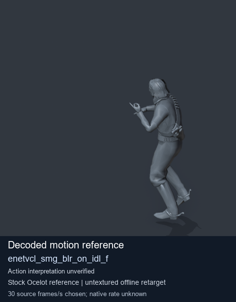
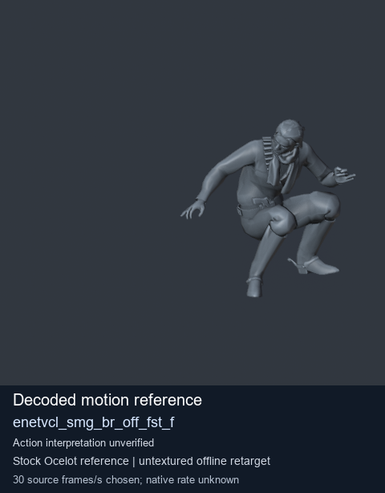
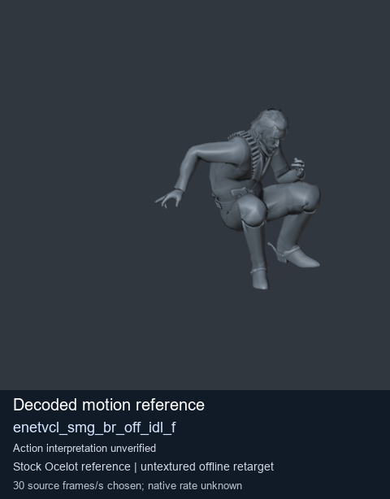

# Stock Soldier_common motion references / /Assets/tpp/motion/SI_game/fani/bodies/enet/enetvcl - page 18

[Library](../README.md) · [Grouped directory](../browse/README.md) · [This source family](../browse/stock-soldier-enetvcl-81e0562d.md) · [Switch mode](browse-stock-soldier-enetvcl-81e0562d-18.md)

**Still images: no GIFs loaded** · 3 clips · 0.20 MiB downloaded.

Images reuse existing files. A small display width does not reduce download size. Open one clip for its larger titled GIF and original technical data.

Source-family grouping uses only recorded virtual directories; it does not establish an action, weapon, actor, rig or native compatibility. Existing descriptions and tags below are unchanged. Per-clip visual review may be pending; chosen preview speed is separate from unmeasured native timing.

| Preview | Animation | Category | Tags | Virtual GANI directory / file | MTAR / container location | Description | Frames / data |
| --- | --- | --- | --- | --- | --- | --- | --- |
|  | [Stock reference: enetvcl_smg_blr_on_idl_f](../clips/mgsv-tpp-soldier_common-payloadsha256-bb3717fa925f911adf9ee2808a2b951b39e241f59be24dd98a3805ee9391bf45.md) <code>enetvcl_smg_blr_on_idl_f</code> | Stock Soldier_common motion references | <code>stock animation reference</code> <code>Soldier_common</code> <code>source-derived label</code> <code>Ocelot reference mesh</code> | <code>/Assets/tpp/motion/SI_game/fani/bodies/enet/enetvcl</code> <code>enetvcl_smg_blr_on_idl_f.gani</code> | Retained MTAR: <code>Soldier_common.mtar</code> DAT / FPK membership unverified | Decoded stock reference enetvcl_smg_blr_on_idl_f; action interpretation unverified. | 205 raw 6.83 s chosen; native rate unknown [Full data](../clips/mgsv-tpp-soldier_common-payloadsha256-bb3717fa925f911adf9ee2808a2b951b39e241f59be24dd98a3805ee9391bf45.md#technical-data) |
|  | [Stock motion reference: enetvcl_smg_br_off_fst_f](../clips/mgsv-tpp-soldier_common-payloadsha256-3d8d0eb1656c8148d2b14274cabb55f38c37fe81436d3606b75afacb732196e8.md) <code>enetvcl_smg_br_off_fst_f</code> | Stock Soldier_common motion references | <code>stock body motion</code> <code>Soldier_common</code> <code>source-derived label</code> <code>Ocelot reference mesh</code> | <code>/Assets/tpp/motion/SI_game/fani/bodies/enet/enetvcl</code> <code>enetvcl_smg_br_off_fst_f.gani</code> | Retained MTAR: <code>Soldier_common.mtar</code> DAT / FPK membership unverified | Decoded stock body-motion reference enetvcl_smg_br_off_fst_f; action interpretation unverified. | 168 raw 5.6 s chosen; native rate unknown [Full data](../clips/mgsv-tpp-soldier_common-payloadsha256-3d8d0eb1656c8148d2b14274cabb55f38c37fe81436d3606b75afacb732196e8.md#technical-data) |
|  | [Stock reference: enetvcl_smg_br_off_idl_f](../clips/mgsv-tpp-soldier_common-payloadsha256-0ee4f948a7adcade9eaf5dbadd5ccf878c01977cd9e8669362ceb029fff7e401.md) <code>enetvcl_smg_br_off_idl_f</code> | Stock Soldier_common motion references | <code>stock animation reference</code> <code>Soldier_common</code> <code>source-derived label</code> <code>Ocelot reference mesh</code> | <code>/Assets/tpp/motion/SI_game/fani/bodies/enet/enetvcl</code> <code>enetvcl_smg_br_off_idl_f.gani</code> | Retained MTAR: <code>Soldier_common.mtar</code> DAT / FPK membership unverified | Decoded stock reference enetvcl_smg_br_off_idl_f; action interpretation unverified. | 184 raw 6.13 s chosen; native rate unknown [Full data](../clips/mgsv-tpp-soldier_common-payloadsha256-0ee4f948a7adcade9eaf5dbadd5ccf878c01977cd9e8669362ceb029fff7e401.md#technical-data) |

[Source descriptions, confidence and credits](../description-sources.md) · [Complete JSON](../catalogue.json) · [CSV](../catalogue.csv)
