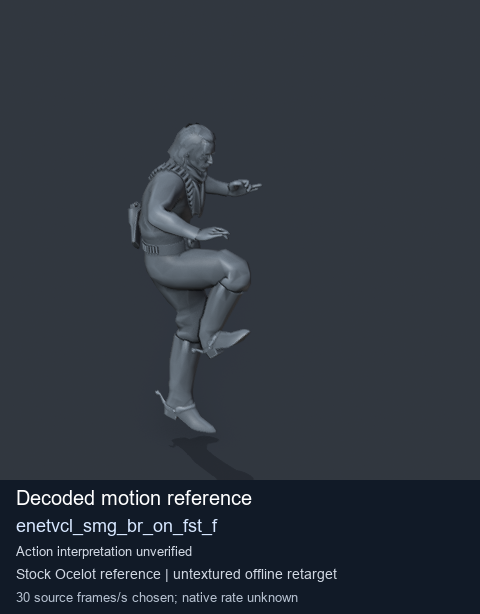
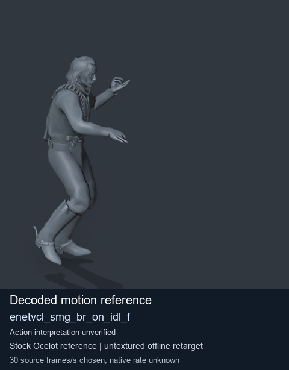
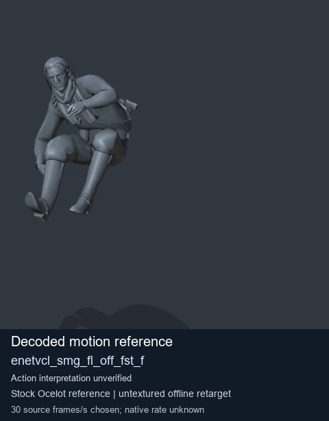

# Stock Soldier_common motion references / /Assets/tpp/motion/SI_game/fani/bodies/enet/enetvcl - page 19

[Library](../README.md) · [Grouped directory](../browse/README.md) · [This source family](../browse/stock-soldier-enetvcl-81e0562d.md) · [Switch mode](browse-stock-soldier-enetvcl-81e0562d-19.md)

**Still images: no GIFs loaded** · 3 clips · 0.23 MiB downloaded.

Images reuse existing files. A small display width does not reduce download size. Open one clip for its larger titled GIF and original technical data.

Source-family grouping uses only recorded virtual directories; it does not establish an action, weapon, actor, rig or native compatibility. Existing descriptions and tags below are unchanged. Per-clip visual review may be pending; chosen preview speed is separate from unmeasured native timing.

| Preview | Animation | Category | Tags | Virtual GANI directory / file | MTAR / container location | Description | Frames / data |
| --- | --- | --- | --- | --- | --- | --- | --- |
|  | [Stock motion reference: enetvcl_smg_br_on_fst_f](../clips/mgsv-tpp-soldier_common-payloadsha256-38789de33b64946e6a5933b4e00a38f3743ae2f68cab5c5232299547dc7de752.md) <code>enetvcl_smg_br_on_fst_f</code> | Stock Soldier_common motion references | <code>stock body motion</code> <code>Soldier_common</code> <code>source-derived label</code> <code>Ocelot reference mesh</code> | <code>/Assets/tpp/motion/SI_game/fani/bodies/enet/enetvcl</code> <code>enetvcl_smg_br_on_fst_f.gani</code> | Retained MTAR: <code>Soldier_common.mtar</code> DAT / FPK membership unverified | Decoded stock body-motion reference enetvcl_smg_br_on_fst_f; action interpretation unverified. | 156 raw 5.2 s chosen; native rate unknown [Full data](../clips/mgsv-tpp-soldier_common-payloadsha256-38789de33b64946e6a5933b4e00a38f3743ae2f68cab5c5232299547dc7de752.md#technical-data) |
|  | [Stock reference: enetvcl_smg_br_on_idl_f](../clips/mgsv-tpp-soldier_common-payloadsha256-0676c95bc85ef86233d0ede60f43d1dfeca623bd608258c585a8b715c5295fd7.md) <code>enetvcl_smg_br_on_idl_f</code> | Stock Soldier_common motion references | <code>stock animation reference</code> <code>Soldier_common</code> <code>source-derived label</code> <code>Ocelot reference mesh</code> | <code>/Assets/tpp/motion/SI_game/fani/bodies/enet/enetvcl</code> <code>enetvcl_smg_br_on_idl_f.gani</code> | Retained MTAR: <code>Soldier_common.mtar</code> DAT / FPK membership unverified | Decoded stock reference enetvcl_smg_br_on_idl_f; action interpretation unverified. | 205 raw 6.83 s chosen; native rate unknown [Full data](../clips/mgsv-tpp-soldier_common-payloadsha256-0676c95bc85ef86233d0ede60f43d1dfeca623bd608258c585a8b715c5295fd7.md#technical-data) |
|  | [Stock reference: enetvcl_smg_fl_off_fst_f](../clips/mgsv-tpp-soldier_common-payloadsha256-3bbc0731a55a823e6fc95c7e088989e68482d113bc8487795fedc258ad61c270.md) <code>enetvcl_smg_fl_off_fst_f</code> | Stock Soldier_common motion references | <code>stock animation reference</code> <code>Soldier_common</code> <code>source-derived label</code> <code>Ocelot reference mesh</code> | <code>/Assets/tpp/motion/SI_game/fani/bodies/enet/enetvcl</code> <code>enetvcl_smg_fl_off_fst_f.gani</code> | Retained MTAR: <code>Soldier_common.mtar</code> DAT / FPK membership unverified | Decoded stock reference enetvcl_smg_fl_off_fst_f; action interpretation unverified. | 128 raw 4.27 s chosen; native rate unknown [Full data](../clips/mgsv-tpp-soldier_common-payloadsha256-3bbc0731a55a823e6fc95c7e088989e68482d113bc8487795fedc258ad61c270.md#technical-data) |

[Source descriptions, confidence and credits](../description-sources.md) · [Complete JSON](../catalogue.json) · [CSV](../catalogue.csv)
