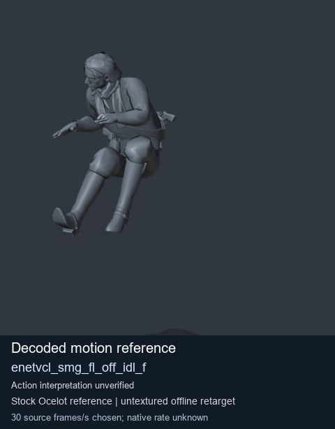
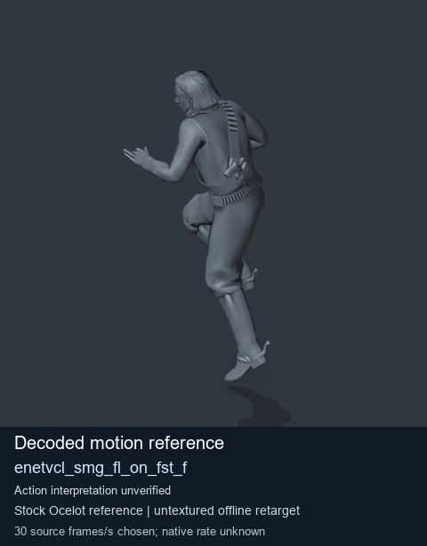
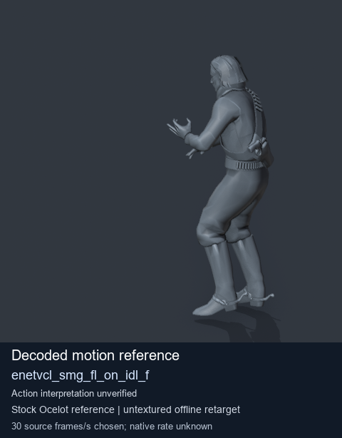

# Stock Soldier_common motion references / /Assets/tpp/motion/SI_game/fani/bodies/enet/enetvcl - page 20

[Library](../README.md) · [Grouped directory](../browse/README.md) · [This source family](../browse/stock-soldier-enetvcl-81e0562d.md) · [Switch mode](browse-stock-soldier-enetvcl-81e0562d-20.md)

**Still images: no GIFs loaded** · 3 clips · 0.23 MiB downloaded.

Images reuse existing files. A small display width does not reduce download size. Open one clip for its larger titled GIF and original technical data.

Source-family grouping uses only recorded virtual directories; it does not establish an action, weapon, actor, rig or native compatibility. Existing descriptions and tags below are unchanged. Per-clip visual review may be pending; chosen preview speed is separate from unmeasured native timing.

| Preview | Animation | Category | Tags | Virtual GANI directory / file | MTAR / container location | Description | Frames / data |
| --- | --- | --- | --- | --- | --- | --- | --- |
|  | [Stock motion reference: enetvcl_smg_fl_off_idl_f](../clips/mgsv-tpp-soldier_common-payloadsha256-e1785ce037288b4cb46cf8199a42a8444718559402c2008403fc85e46ff6ce68.md) <code>enetvcl_smg_fl_off_idl_f</code> | Stock Soldier_common motion references | <code>stock body motion</code> <code>Soldier_common</code> <code>source-derived label</code> <code>Ocelot reference mesh</code> | <code>/Assets/tpp/motion/SI_game/fani/bodies/enet/enetvcl</code> <code>enetvcl_smg_fl_off_idl_f.gani</code> | Retained MTAR: <code>Soldier_common.mtar</code> DAT / FPK membership unverified | Decoded stock body-motion reference enetvcl_smg_fl_off_idl_f; action interpretation unverified. | 175 raw 5.83 s chosen; native rate unknown [Full data](../clips/mgsv-tpp-soldier_common-payloadsha256-e1785ce037288b4cb46cf8199a42a8444718559402c2008403fc85e46ff6ce68.md#technical-data) |
|  | [Stock motion reference: enetvcl_smg_fl_on_fst_f](../clips/mgsv-tpp-soldier_common-payloadsha256-5844f5ea2db70e847d950a1101e32d0b3cc674614ccf08afd49fc9640745c631.md) <code>enetvcl_smg_fl_on_fst_f</code> | Stock Soldier_common motion references | <code>stock body motion</code> <code>Soldier_common</code> <code>source-derived label</code> <code>Ocelot reference mesh</code> | <code>/Assets/tpp/motion/SI_game/fani/bodies/enet/enetvcl</code> <code>enetvcl_smg_fl_on_fst_f.gani</code> | Retained MTAR: <code>Soldier_common.mtar</code> DAT / FPK membership unverified | Decoded stock body-motion reference enetvcl_smg_fl_on_fst_f; action interpretation unverified. | 143 raw 4.77 s chosen; native rate unknown [Full data](../clips/mgsv-tpp-soldier_common-payloadsha256-5844f5ea2db70e847d950a1101e32d0b3cc674614ccf08afd49fc9640745c631.md#technical-data) |
|  | [Stock reference: enetvcl_smg_fl_on_idl_f](../clips/mgsv-tpp-soldier_common-payloadsha256-a7e28a8247e84c4da2e7651b781394111fdb8b80d2c5d757a1a2fac07f9e23f2.md) <code>enetvcl_smg_fl_on_idl_f</code> | Stock Soldier_common motion references | <code>stock animation reference</code> <code>Soldier_common</code> <code>source-derived label</code> <code>Ocelot reference mesh</code> | <code>/Assets/tpp/motion/SI_game/fani/bodies/enet/enetvcl</code> <code>enetvcl_smg_fl_on_idl_f.gani</code> | Retained MTAR: <code>Soldier_common.mtar</code> DAT / FPK membership unverified | Decoded stock reference enetvcl_smg_fl_on_idl_f; action interpretation unverified. | 236 raw 7.87 s chosen; native rate unknown [Full data](../clips/mgsv-tpp-soldier_common-payloadsha256-a7e28a8247e84c4da2e7651b781394111fdb8b80d2c5d757a1a2fac07f9e23f2.md#technical-data) |

[Source descriptions, confidence and credits](../description-sources.md) · [Complete JSON](../catalogue.json) · [CSV](../catalogue.csv)
