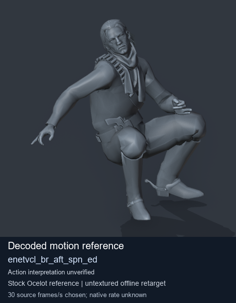
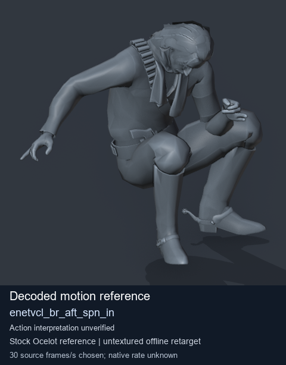

# Stock Soldier_common motion references / /Assets/tpp/motion/SI_game/fani/bodies/enet/enetvcl - page 6

[Library](../README.md) · [Grouped directory](../browse/README.md) · [This source family](../browse/stock-soldier-enetvcl-81e0562d.md) · [Switch mode](browse-stock-soldier-enetvcl-81e0562d-6.md)

**Still images: no GIFs loaded** · 2 clips · 0.26 MiB downloaded.

Images reuse existing files. A small display width does not reduce download size. Open one clip for its larger titled GIF and original technical data.

Source-family grouping uses only recorded virtual directories; it does not establish an action, weapon, actor, rig or native compatibility. Existing descriptions and tags below are unchanged. Per-clip visual review may be pending; chosen preview speed is separate from unmeasured native timing.

| Preview | Animation | Category | Tags | Virtual GANI directory / file | MTAR / container location | Description | Frames / data |
| --- | --- | --- | --- | --- | --- | --- | --- |
|  | [Stock reference: enetvcl_br_aft_spn_ed](../clips/mgsv-tpp-soldier_common-payloadsha256-3b5b58bbb52664a83da008ea6b9d70af732506344e989a5a65f564e238b59373.md) <code>enetvcl_br_aft_spn_ed</code> | Stock Soldier_common motion references | <code>stock animation reference</code> <code>Soldier_common</code> <code>source-derived label</code> <code>Ocelot reference mesh</code> | <code>/Assets/tpp/motion/SI_game/fani/bodies/enet/enetvcl</code> <code>enetvcl_br_aft_spn_ed.gani</code> | Retained MTAR: <code>Soldier_common.mtar</code> DAT / FPK membership unverified | Decoded stock reference enetvcl_br_aft_spn_ed; action interpretation unverified. | 219 raw 7.3 s chosen; native rate unknown [Full data](../clips/mgsv-tpp-soldier_common-payloadsha256-3b5b58bbb52664a83da008ea6b9d70af732506344e989a5a65f564e238b59373.md#technical-data) |
|  | [Stock reference: enetvcl_br_aft_spn_in](../clips/mgsv-tpp-soldier_common-payloadsha256-00e8561f6f2bbeaffe68b1f131bbfe2c8fd3c3fcc6f4b12025e7ade8a6549b82.md) <code>enetvcl_br_aft_spn_in</code> | Stock Soldier_common motion references | <code>stock animation reference</code> <code>Soldier_common</code> <code>source-derived label</code> <code>Ocelot reference mesh</code> | <code>/Assets/tpp/motion/SI_game/fani/bodies/enet/enetvcl</code> <code>enetvcl_br_aft_spn_in.gani</code> | Retained MTAR: <code>Soldier_common.mtar</code> DAT / FPK membership unverified | Decoded stock reference enetvcl_br_aft_spn_in; action interpretation unverified. | 60 raw 2.0 s chosen; native rate unknown [Full data](../clips/mgsv-tpp-soldier_common-payloadsha256-00e8561f6f2bbeaffe68b1f131bbfe2c8fd3c3fcc6f4b12025e7ade8a6549b82.md#technical-data) |

[Source descriptions, confidence and credits](../description-sources.md) · [Complete JSON](../catalogue.json) · [CSV](../catalogue.csv)
