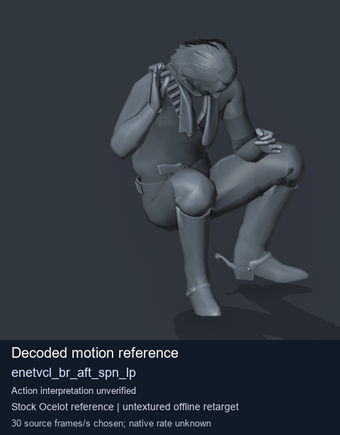
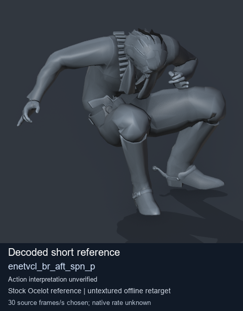
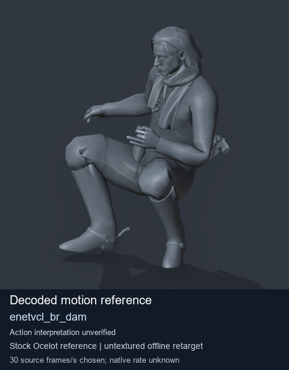
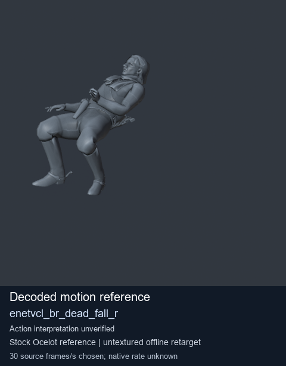

# Stock Soldier_common motion references / /Assets/tpp/motion/SI_game/fani/bodies/enet/enetvcl - page 7

[Library](../README.md) · [Grouped directory](../browse/README.md) · [This source family](../browse/stock-soldier-enetvcl-81e0562d.md) · [Switch mode](browse-stock-soldier-enetvcl-81e0562d-7.md)

**Still images: no GIFs loaded** · 4 clips · 0.44 MiB downloaded.

Images reuse existing files. A small display width does not reduce download size. Open one clip for its larger titled GIF and original technical data.

Source-family grouping uses only recorded virtual directories; it does not establish an action, weapon, actor, rig or native compatibility. Existing descriptions and tags below are unchanged. Per-clip visual review may be pending; chosen preview speed is separate from unmeasured native timing.

| Preview | Animation | Category | Tags | Virtual GANI directory / file | MTAR / container location | Description | Frames / data |
| --- | --- | --- | --- | --- | --- | --- | --- |
|  | [Stock reference: enetvcl_br_aft_spn_lp](../clips/mgsv-tpp-soldier_common-payloadsha256-08a2d32668caea6d697b4d41ebffeb04da877cbbe1a08fcde693f8b9bb2b9b06.md) <code>enetvcl_br_aft_spn_lp</code> | Stock Soldier_common motion references | <code>stock animation reference</code> <code>Soldier_common</code> <code>source-derived label</code> <code>Ocelot reference mesh</code> | <code>/Assets/tpp/motion/SI_game/fani/bodies/enet/enetvcl</code> <code>enetvcl_br_aft_spn_lp.gani</code> | Retained MTAR: <code>Soldier_common.mtar</code> DAT / FPK membership unverified | Decoded stock reference enetvcl_br_aft_spn_lp; action interpretation unverified. | 278 raw 9.27 s chosen; native rate unknown [Full data](../clips/mgsv-tpp-soldier_common-payloadsha256-08a2d32668caea6d697b4d41ebffeb04da877cbbe1a08fcde693f8b9bb2b9b06.md#technical-data) |
|  | [Stock reference: enetvcl_br_aft_spn_p](../clips/mgsv-tpp-soldier_common-payloadsha256-56d93c429bad11a24e7e8704a7ea40697af2eeffb08c930df309b8ca34a1d7ab.md) <code>enetvcl_br_aft_spn_p</code> | Stock Soldier_common motion references | <code>stock animation reference</code> <code>Soldier_common</code> <code>source-derived label</code> <code>Ocelot reference mesh</code> | <code>/Assets/tpp/motion/SI_game/fani/bodies/enet/enetvcl</code> <code>enetvcl_br_aft_spn_p.gani</code> | Retained MTAR: <code>Soldier_common.mtar</code> DAT / FPK membership unverified | Decoded stock reference enetvcl_br_aft_spn_p; action interpretation unverified. | 1 raw 0.03 s chosen; native rate unknown [Full data](../clips/mgsv-tpp-soldier_common-payloadsha256-56d93c429bad11a24e7e8704a7ea40697af2eeffb08c930df309b8ca34a1d7ab.md#technical-data) |
|  | [Stock reference: enetvcl_br_dam](../clips/mgsv-tpp-soldier_common-payloadsha256-dd06186b5fdbd403042c0b976024d9f774898021f513b9d555190d99b96dd487.md) <code>enetvcl_br_dam</code> | Stock Soldier_common motion references | <code>stock animation reference</code> <code>Soldier_common</code> <code>source-derived label</code> <code>Ocelot reference mesh</code> | <code>/Assets/tpp/motion/SI_game/fani/bodies/enet/enetvcl</code> <code>enetvcl_br_dam.gani</code> | Retained MTAR: <code>Soldier_common.mtar</code> DAT / FPK membership unverified | Decoded stock reference enetvcl_br_dam; action interpretation unverified. | 45 raw 1.5 s chosen; native rate unknown [Full data](../clips/mgsv-tpp-soldier_common-payloadsha256-dd06186b5fdbd403042c0b976024d9f774898021f513b9d555190d99b96dd487.md#technical-data) |
|  | [Stock reference: enetvcl_br_dead_fall_r](../clips/mgsv-tpp-soldier_common-payloadsha256-f1a4cc7aecde59b7a96fe657ead86147bc637d9a4a0228f005a42bdf47ada591.md) <code>enetvcl_br_dead_fall_r</code> | Stock Soldier_common motion references | <code>stock animation reference</code> <code>Soldier_common</code> <code>source-derived label</code> <code>Ocelot reference mesh</code> | <code>/Assets/tpp/motion/SI_game/fani/bodies/enet/enetvcl</code> <code>enetvcl_br_dead_fall_r.gani</code> | Retained MTAR: <code>Soldier_common.mtar</code> DAT / FPK membership unverified | Decoded stock reference enetvcl_br_dead_fall_r; action interpretation unverified. | 95 raw 3.17 s chosen; native rate unknown [Full data](../clips/mgsv-tpp-soldier_common-payloadsha256-f1a4cc7aecde59b7a96fe657ead86147bc637d9a4a0228f005a42bdf47ada591.md#technical-data) |

[Source descriptions, confidence and credits](../description-sources.md) · [Complete JSON](../catalogue.json) · [CSV](../catalogue.csv)
