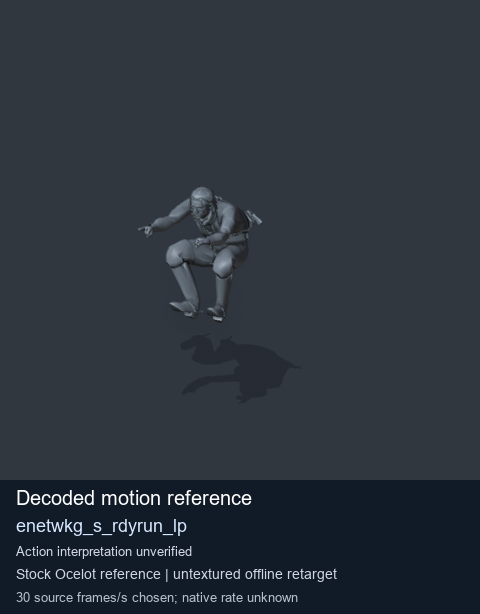
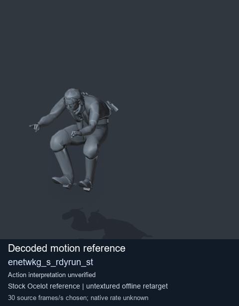
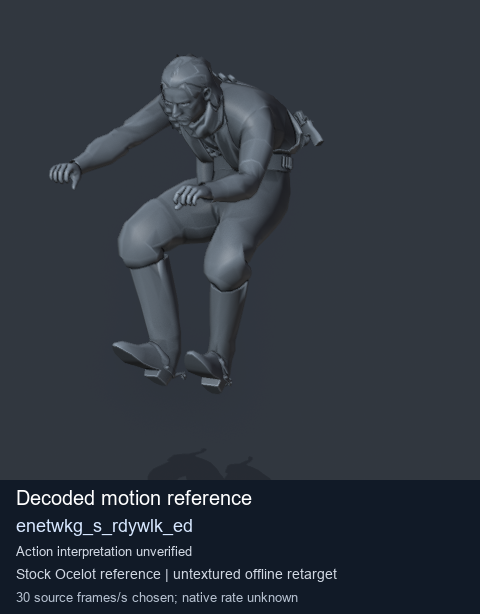
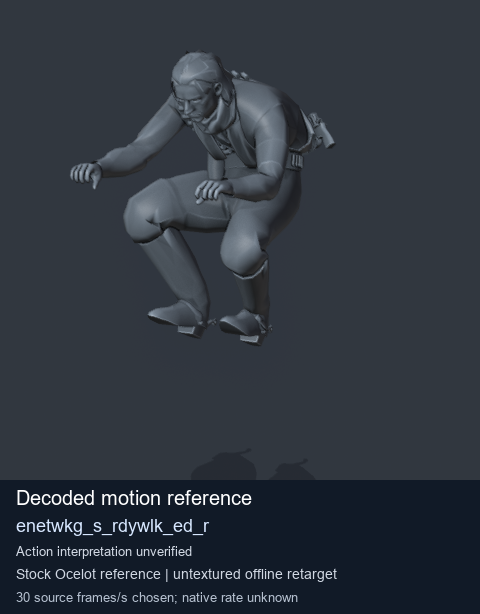

# Stock Soldier_common motion references / /Assets/tpp/motion/SI_game/fani/bodies/enet/enetwkg - page 11

[Library](../README.md) · [Grouped directory](../browse/README.md) · [This source family](../browse/stock-soldier-enetwkg-35bd0197.md) · [Switch mode](browse-stock-soldier-enetwkg-35bd0197-11.md)

**Still images: no GIFs loaded** · 4 clips · 0.32 MiB downloaded.

Images reuse existing files. A small display width does not reduce download size. Open one clip for its larger titled GIF and original technical data.

Source-family grouping uses only recorded virtual directories; it does not establish an action, weapon, actor, rig or native compatibility. Existing descriptions and tags below are unchanged. Per-clip visual review may be pending; chosen preview speed is separate from unmeasured native timing.

| Preview | Animation | Category | Tags | Virtual GANI directory / file | MTAR / container location | Description | Frames / data |
| --- | --- | --- | --- | --- | --- | --- | --- |
|  | [Stock reference: enetwkg_s_rdyrun_lp](../clips/mgsv-tpp-soldier_common-payloadsha256-9d0b20b26abe31d89e6e40c207356cfb059887b9b30838ed89d069c32d5be153.md) <code>enetwkg_s_rdyrun_lp</code> | Stock Soldier_common motion references | <code>stock animation reference</code> <code>Soldier_common</code> <code>source-derived label</code> <code>Ocelot reference mesh</code> | <code>/Assets/tpp/motion/SI_game/fani/bodies/enet/enetwkg</code> <code>enetwkg_s_rdyrun_lp.gani</code> | Retained MTAR: <code>Soldier_common.mtar</code> DAT / FPK membership unverified | Decoded stock reference enetwkg_s_rdyrun_lp; action interpretation unverified. | 50 raw 1.67 s chosen; native rate unknown [Full data](../clips/mgsv-tpp-soldier_common-payloadsha256-9d0b20b26abe31d89e6e40c207356cfb059887b9b30838ed89d069c32d5be153.md#technical-data) |
|  | [Stock reference: enetwkg_s_rdyrun_st](../clips/mgsv-tpp-soldier_common-payloadsha256-148f36b519207fa730123fb4c03d2f028cea227f78cea81358bef2897911a5a6.md) <code>enetwkg_s_rdyrun_st</code> | Stock Soldier_common motion references | <code>stock animation reference</code> <code>Soldier_common</code> <code>source-derived label</code> <code>Ocelot reference mesh</code> | <code>/Assets/tpp/motion/SI_game/fani/bodies/enet/enetwkg</code> <code>enetwkg_s_rdyrun_st.gani</code> | Retained MTAR: <code>Soldier_common.mtar</code> DAT / FPK membership unverified | Decoded stock reference enetwkg_s_rdyrun_st; action interpretation unverified. | 35 raw 1.17 s chosen; native rate unknown [Full data](../clips/mgsv-tpp-soldier_common-payloadsha256-148f36b519207fa730123fb4c03d2f028cea227f78cea81358bef2897911a5a6.md#technical-data) |
|  | [Stock reference: enetwkg_s_rdywlk_ed](../clips/mgsv-tpp-soldier_common-payloadsha256-4544c93e5567a6efc8700220cfee8779d9c8153e24c184a73fb6ad4391b319af.md) <code>enetwkg_s_rdywlk_ed</code> | Stock Soldier_common motion references | <code>stock animation reference</code> <code>Soldier_common</code> <code>source-derived label</code> <code>Ocelot reference mesh</code> | <code>/Assets/tpp/motion/SI_game/fani/bodies/enet/enetwkg</code> <code>enetwkg_s_rdywlk_ed.gani</code> | Retained MTAR: <code>Soldier_common.mtar</code> DAT / FPK membership unverified | Decoded stock reference enetwkg_s_rdywlk_ed; action interpretation unverified. | 70 raw 2.33 s chosen; native rate unknown [Full data](../clips/mgsv-tpp-soldier_common-payloadsha256-4544c93e5567a6efc8700220cfee8779d9c8153e24c184a73fb6ad4391b319af.md#technical-data) |
|  | [Stock reference: enetwkg_s_rdywlk_ed_r](../clips/mgsv-tpp-soldier_common-payloadsha256-1621d3de78b8e98674f202cdcbfd6052f8edb3ae1694ceaabecdceadc93c0ea0.md) <code>enetwkg_s_rdywlk_ed_r</code> | Stock Soldier_common motion references | <code>stock animation reference</code> <code>Soldier_common</code> <code>source-derived label</code> <code>Ocelot reference mesh</code> | <code>/Assets/tpp/motion/SI_game/fani/bodies/enet/enetwkg</code> <code>enetwkg_s_rdywlk_ed_r.gani</code> | Retained MTAR: <code>Soldier_common.mtar</code> DAT / FPK membership unverified | Decoded stock reference enetwkg_s_rdywlk_ed_r; action interpretation unverified. | 85 raw 2.83 s chosen; native rate unknown [Full data](../clips/mgsv-tpp-soldier_common-payloadsha256-1621d3de78b8e98674f202cdcbfd6052f8edb3ae1694ceaabecdceadc93c0ea0.md#technical-data) |

[Source descriptions, confidence and credits](../description-sources.md) · [Complete JSON](../catalogue.json) · [CSV](../catalogue.csv)
