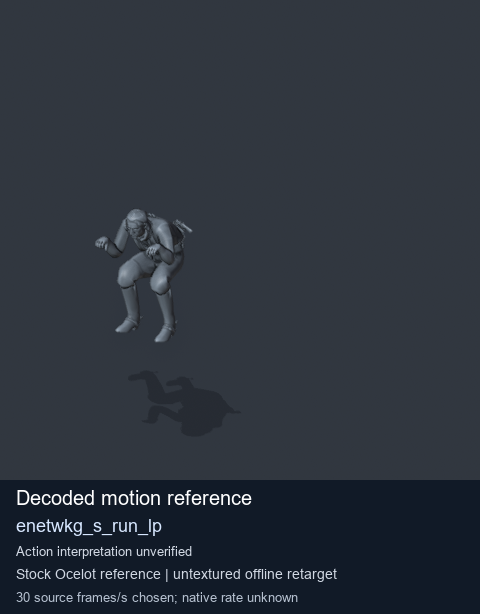
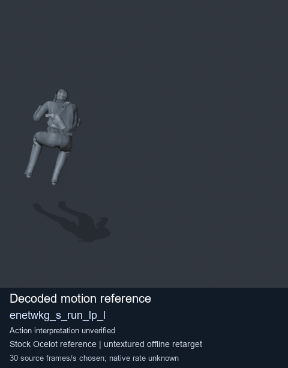
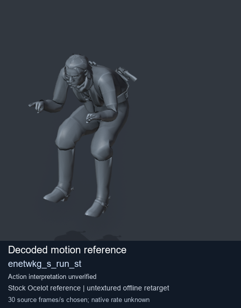
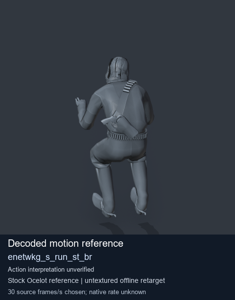

# Stock Soldier_common motion references / /Assets/tpp/motion/SI_game/fani/bodies/enet/enetwkg - page 13

[Library](../README.md) · [Grouped directory](../browse/README.md) · [This source family](../browse/stock-soldier-enetwkg-35bd0197.md) · [Switch mode](browse-stock-soldier-enetwkg-35bd0197-13.md)

**Still images: no GIFs loaded** · 4 clips · 0.29 MiB downloaded.

Images reuse existing files. A small display width does not reduce download size. Open one clip for its larger titled GIF and original technical data.

Source-family grouping uses only recorded virtual directories; it does not establish an action, weapon, actor, rig or native compatibility. Existing descriptions and tags below are unchanged. Per-clip visual review may be pending; chosen preview speed is separate from unmeasured native timing.

| Preview | Animation | Category | Tags | Virtual GANI directory / file | MTAR / container location | Description | Frames / data |
| --- | --- | --- | --- | --- | --- | --- | --- |
|  | [Stock reference: enetwkg_s_run_lp](../clips/mgsv-tpp-soldier_common-payloadsha256-d57b7885e1ec9ef9f063afaef26bf6c55b9d6495619646903df2840fec969452.md) <code>enetwkg_s_run_lp</code> | Stock Soldier_common motion references | <code>stock animation reference</code> <code>Soldier_common</code> <code>source-derived label</code> <code>Ocelot reference mesh</code> | <code>/Assets/tpp/motion/SI_game/fani/bodies/enet/enetwkg</code> <code>enetwkg_s_run_lp.gani</code> | Retained MTAR: <code>Soldier_common.mtar</code> DAT / FPK membership unverified | Decoded stock reference enetwkg_s_run_lp; action interpretation unverified. | 40 raw 1.33 s chosen; native rate unknown [Full data](../clips/mgsv-tpp-soldier_common-payloadsha256-d57b7885e1ec9ef9f063afaef26bf6c55b9d6495619646903df2840fec969452.md#technical-data) |
|  | [Stock reference: enetwkg_s_run_lp_l](../clips/mgsv-tpp-soldier_common-payloadsha256-4ce716012f05c1c84a1dd441c2b47fbb549d7a8e9a4bc8f12c7c13ff56bd78eb.md) <code>enetwkg_s_run_lp_l</code> | Stock Soldier_common motion references | <code>stock animation reference</code> <code>Soldier_common</code> <code>source-derived label</code> <code>Ocelot reference mesh</code> | <code>/Assets/tpp/motion/SI_game/fani/bodies/enet/enetwkg</code> <code>enetwkg_s_run_lp_l.gani</code> | Retained MTAR: <code>Soldier_common.mtar</code> DAT / FPK membership unverified | Decoded stock reference enetwkg_s_run_lp_l; action interpretation unverified. | 42 raw 1.4 s chosen; native rate unknown [Full data](../clips/mgsv-tpp-soldier_common-payloadsha256-4ce716012f05c1c84a1dd441c2b47fbb549d7a8e9a4bc8f12c7c13ff56bd78eb.md#technical-data) |
|  | [Stock motion reference: enetwkg_s_run_st](../clips/mgsv-tpp-soldier_common-payloadsha256-5ab8cf434fc58130e76c2cd8255096ab716f8be97f3af27936ca2372236901cf.md) <code>enetwkg_s_run_st</code> | Stock Soldier_common motion references | <code>stock body motion</code> <code>Soldier_common</code> <code>source-derived label</code> <code>Ocelot reference mesh</code> | <code>/Assets/tpp/motion/SI_game/fani/bodies/enet/enetwkg</code> <code>enetwkg_s_run_st.gani</code> | Retained MTAR: <code>Soldier_common.mtar</code> DAT / FPK membership unverified | Decoded stock body-motion reference enetwkg_s_run_st; action interpretation unverified. | 17 raw 0.57 s chosen; native rate unknown [Full data](../clips/mgsv-tpp-soldier_common-payloadsha256-5ab8cf434fc58130e76c2cd8255096ab716f8be97f3af27936ca2372236901cf.md#technical-data) |
|  | [Stock reference: enetwkg_s_run_st_br](../clips/mgsv-tpp-soldier_common-payloadsha256-8642b41e76fba36d8493dfca2921adf71fd33686282979f6872af24363dd87bf.md) <code>enetwkg_s_run_st_br</code> | Stock Soldier_common motion references | <code>stock animation reference</code> <code>Soldier_common</code> <code>source-derived label</code> <code>Ocelot reference mesh</code> | <code>/Assets/tpp/motion/SI_game/fani/bodies/enet/enetwkg</code> <code>enetwkg_s_run_st_br.gani</code> | Retained MTAR: <code>Soldier_common.mtar</code> DAT / FPK membership unverified | Decoded stock reference enetwkg_s_run_st_br; action interpretation unverified. | 43 raw 1.43 s chosen; native rate unknown [Full data](../clips/mgsv-tpp-soldier_common-payloadsha256-8642b41e76fba36d8493dfca2921adf71fd33686282979f6872af24363dd87bf.md#technical-data) |

[Source descriptions, confidence and credits](../description-sources.md) · [Complete JSON](../catalogue.json) · [CSV](../catalogue.csv)
