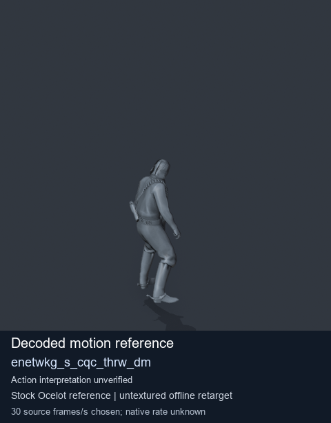
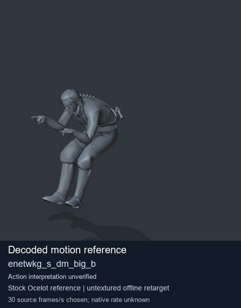
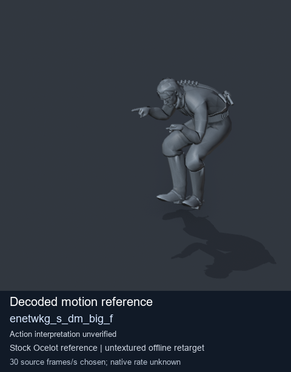
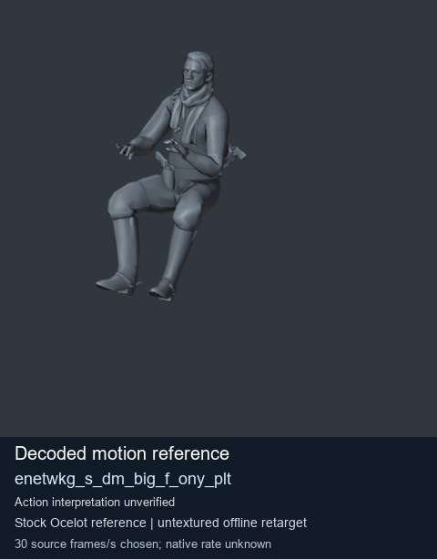

# Stock Soldier_common motion references / /Assets/tpp/motion/SI_game/fani/bodies/enet/enetwkg - page 2

[Library](../README.md) · [Grouped directory](../browse/README.md) · [This source family](../browse/stock-soldier-enetwkg-35bd0197.md) · [Switch mode](browse-stock-soldier-enetwkg-35bd0197-2.md)

**Still images: no GIFs loaded** · 4 clips · 0.28 MiB downloaded.

Images reuse existing files. A small display width does not reduce download size. Open one clip for its larger titled GIF and original technical data.

Source-family grouping uses only recorded virtual directories; it does not establish an action, weapon, actor, rig or native compatibility. Existing descriptions and tags below are unchanged. Per-clip visual review may be pending; chosen preview speed is separate from unmeasured native timing.

| Preview | Animation | Category | Tags | Virtual GANI directory / file | MTAR / container location | Description | Frames / data |
| --- | --- | --- | --- | --- | --- | --- | --- |
|  | [Stock reference: enetwkg_s_cqc_thrw_dm](../clips/mgsv-tpp-soldier_common-payloadsha256-f58545a55c5ddb9d4a5f264bfe431d713f0b5c8d532a25fa069a20e5c73fa426.md) <code>enetwkg_s_cqc_thrw_dm</code> | Stock Soldier_common motion references | <code>stock animation reference</code> <code>Soldier_common</code> <code>source-derived label</code> <code>Ocelot reference mesh</code> | <code>/Assets/tpp/motion/SI_game/fani/bodies/enet/enetwkg</code> <code>enetwkg_s_cqc_thrw_dm.gani</code> | Retained MTAR: <code>Soldier_common.mtar</code> DAT / FPK membership unverified | Decoded stock reference enetwkg_s_cqc_thrw_dm; action interpretation unverified. | 168 raw 5.6 s chosen; native rate unknown [Full data](../clips/mgsv-tpp-soldier_common-payloadsha256-f58545a55c5ddb9d4a5f264bfe431d713f0b5c8d532a25fa069a20e5c73fa426.md#technical-data) |
|  | [Stock reference: enetwkg_s_dm_big_b](../clips/mgsv-tpp-soldier_common-payloadsha256-fce092eb042bb642298adbd9a429ecb6d1ad793e853c67c7dd98f9b4971d9d16.md) <code>enetwkg_s_dm_big_b</code> | Stock Soldier_common motion references | <code>stock animation reference</code> <code>Soldier_common</code> <code>source-derived label</code> <code>Ocelot reference mesh</code> | <code>/Assets/tpp/motion/SI_game/fani/bodies/enet/enetwkg</code> <code>enetwkg_s_dm_big_b.gani</code> | Retained MTAR: <code>Soldier_common.mtar</code> DAT / FPK membership unverified | Decoded stock reference enetwkg_s_dm_big_b; action interpretation unverified. | 60 raw 2.0 s chosen; native rate unknown [Full data](../clips/mgsv-tpp-soldier_common-payloadsha256-fce092eb042bb642298adbd9a429ecb6d1ad793e853c67c7dd98f9b4971d9d16.md#technical-data) |
|  | [Stock reference: enetwkg_s_dm_big_f](../clips/mgsv-tpp-soldier_common-payloadsha256-17355023f17dd7d1e12bf69c153ef85680385997d15c3a4fe4189675f8df4823.md) <code>enetwkg_s_dm_big_f</code> | Stock Soldier_common motion references | <code>stock animation reference</code> <code>Soldier_common</code> <code>source-derived label</code> <code>Ocelot reference mesh</code> | <code>/Assets/tpp/motion/SI_game/fani/bodies/enet/enetwkg</code> <code>enetwkg_s_dm_big_f.gani</code> | Retained MTAR: <code>Soldier_common.mtar</code> DAT / FPK membership unverified | Decoded stock reference enetwkg_s_dm_big_f; action interpretation unverified. | 60 raw 2.0 s chosen; native rate unknown [Full data](../clips/mgsv-tpp-soldier_common-payloadsha256-17355023f17dd7d1e12bf69c153ef85680385997d15c3a4fe4189675f8df4823.md#technical-data) |
|  | [Stock reference: enetwkg_s_dm_big_f_ony_plt](../clips/mgsv-tpp-soldier_common-payloadsha256-23845811b9c31345557785dcb1b40bf12caba0f9c1f1089a2d4550af8e501715.md) <code>enetwkg_s_dm_big_f_ony_plt</code> | Stock Soldier_common motion references | <code>stock animation reference</code> <code>Soldier_common</code> <code>source-derived label</code> <code>Ocelot reference mesh</code> | <code>/Assets/tpp/motion/SI_game/fani/bodies/enet/enetwkg</code> <code>enetwkg_s_dm_big_f_ony_plt.gani</code> | Retained MTAR: <code>Soldier_common.mtar</code> DAT / FPK membership unverified | Decoded stock reference enetwkg_s_dm_big_f_ony_plt; action interpretation unverified. | 150 raw 5.0 s chosen; native rate unknown [Full data](../clips/mgsv-tpp-soldier_common-payloadsha256-23845811b9c31345557785dcb1b40bf12caba0f9c1f1089a2d4550af8e501715.md#technical-data) |

[Source descriptions, confidence and credits](../description-sources.md) · [Complete JSON](../catalogue.json) · [CSV](../catalogue.csv)
