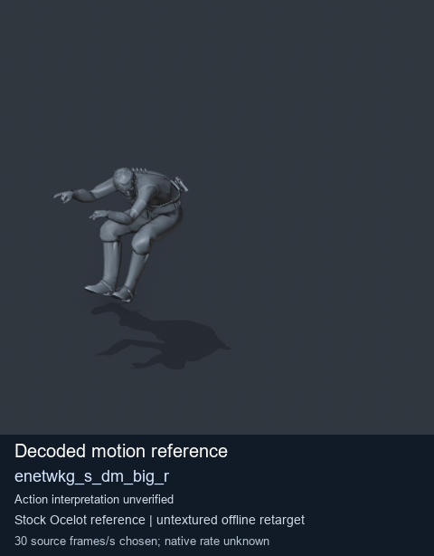
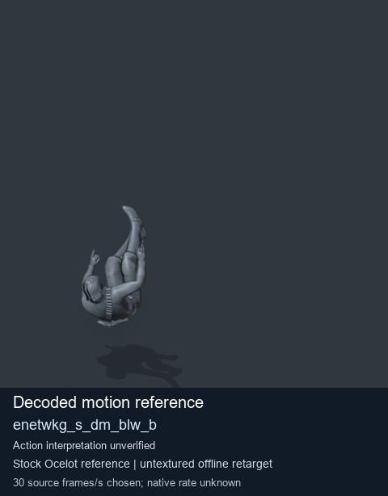
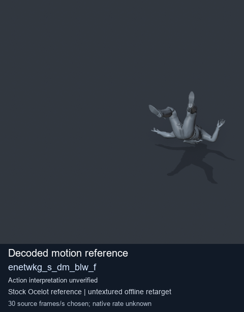
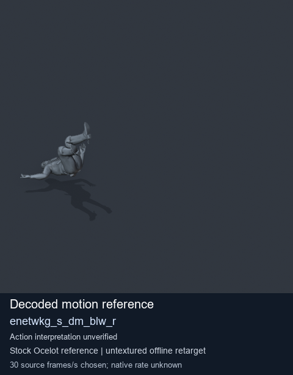

# Stock Soldier_common motion references / /Assets/tpp/motion/SI_game/fani/bodies/enet/enetwkg - page 3

[Library](../README.md) · [Grouped directory](../browse/README.md) · [This source family](../browse/stock-soldier-enetwkg-35bd0197.md) · [Switch mode](browse-stock-soldier-enetwkg-35bd0197-3.md)

**Still images: no GIFs loaded** · 4 clips · 0.24 MiB downloaded.

Images reuse existing files. A small display width does not reduce download size. Open one clip for its larger titled GIF and original technical data.

Source-family grouping uses only recorded virtual directories; it does not establish an action, weapon, actor, rig or native compatibility. Existing descriptions and tags below are unchanged. Per-clip visual review may be pending; chosen preview speed is separate from unmeasured native timing.

| Preview | Animation | Category | Tags | Virtual GANI directory / file | MTAR / container location | Description | Frames / data |
| --- | --- | --- | --- | --- | --- | --- | --- |
|  | [Stock reference: enetwkg_s_dm_big_r](../clips/mgsv-tpp-soldier_common-payloadsha256-2bb89d03608b52dba84774ea7f510976bbd74b18a4d32b699b8599f3dfe64112.md) <code>enetwkg_s_dm_big_r</code> | Stock Soldier_common motion references | <code>stock animation reference</code> <code>Soldier_common</code> <code>source-derived label</code> <code>Ocelot reference mesh</code> | <code>/Assets/tpp/motion/SI_game/fani/bodies/enet/enetwkg</code> <code>enetwkg_s_dm_big_r.gani</code> | Retained MTAR: <code>Soldier_common.mtar</code> DAT / FPK membership unverified | Decoded stock reference enetwkg_s_dm_big_r; action interpretation unverified. | 60 raw 2.0 s chosen; native rate unknown [Full data](../clips/mgsv-tpp-soldier_common-payloadsha256-2bb89d03608b52dba84774ea7f510976bbd74b18a4d32b699b8599f3dfe64112.md#technical-data) |
|  | [Stock reference: enetwkg_s_dm_blw_b](../clips/mgsv-tpp-soldier_common-payloadsha256-8814afff2d277a3583252afc722fbb5f209fc7427988fb6421ce1303959ddada.md) <code>enetwkg_s_dm_blw_b</code> | Stock Soldier_common motion references | <code>stock animation reference</code> <code>Soldier_common</code> <code>source-derived label</code> <code>Ocelot reference mesh</code> | <code>/Assets/tpp/motion/SI_game/fani/bodies/enet/enetwkg</code> <code>enetwkg_s_dm_blw_b.gani</code> | Retained MTAR: <code>Soldier_common.mtar</code> DAT / FPK membership unverified | Decoded stock reference enetwkg_s_dm_blw_b; action interpretation unverified. | 75 raw 2.5 s chosen; native rate unknown [Full data](../clips/mgsv-tpp-soldier_common-payloadsha256-8814afff2d277a3583252afc722fbb5f209fc7427988fb6421ce1303959ddada.md#technical-data) |
|  | [Stock motion reference: enetwkg_s_dm_blw_f](../clips/mgsv-tpp-soldier_common-payloadsha256-e06bc60dcbc203c44245db44773eb834b204882c3a836c4fb5539715592387d3.md) <code>enetwkg_s_dm_blw_f</code> | Stock Soldier_common motion references | <code>stock body motion</code> <code>Soldier_common</code> <code>source-derived label</code> <code>Ocelot reference mesh</code> | <code>/Assets/tpp/motion/SI_game/fani/bodies/enet/enetwkg</code> <code>enetwkg_s_dm_blw_f.gani</code> | Retained MTAR: <code>Soldier_common.mtar</code> DAT / FPK membership unverified | Decoded stock body-motion reference enetwkg_s_dm_blw_f; action interpretation unverified. | 75 raw 2.5 s chosen; native rate unknown [Full data](../clips/mgsv-tpp-soldier_common-payloadsha256-e06bc60dcbc203c44245db44773eb834b204882c3a836c4fb5539715592387d3.md#technical-data) |
|  | [Stock reference: enetwkg_s_dm_blw_r](../clips/mgsv-tpp-soldier_common-payloadsha256-60462c8fd48e6594879c3a6e3169d42412c472a95cffe36730b26767571637ab.md) <code>enetwkg_s_dm_blw_r</code> | Stock Soldier_common motion references | <code>stock animation reference</code> <code>Soldier_common</code> <code>source-derived label</code> <code>Ocelot reference mesh</code> | <code>/Assets/tpp/motion/SI_game/fani/bodies/enet/enetwkg</code> <code>enetwkg_s_dm_blw_r.gani</code> | Retained MTAR: <code>Soldier_common.mtar</code> DAT / FPK membership unverified | Decoded stock reference enetwkg_s_dm_blw_r; action interpretation unverified. | 75 raw 2.5 s chosen; native rate unknown [Full data](../clips/mgsv-tpp-soldier_common-payloadsha256-60462c8fd48e6594879c3a6e3169d42412c472a95cffe36730b26767571637ab.md#technical-data) |

[Source descriptions, confidence and credits](../description-sources.md) · [Complete JSON](../catalogue.json) · [CSV](../catalogue.csv)
