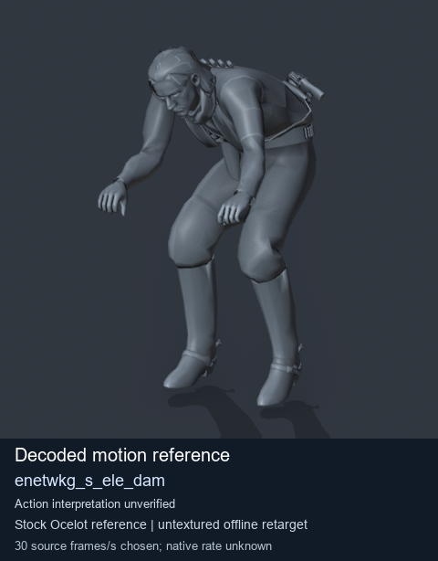
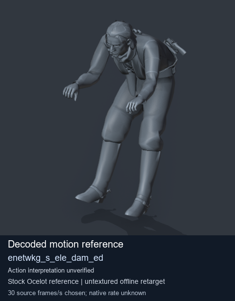
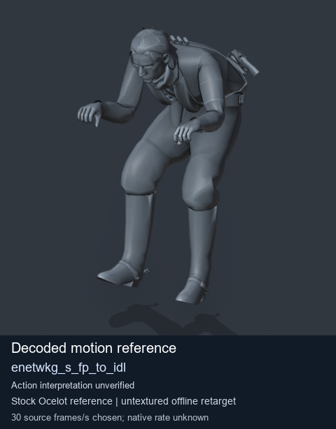
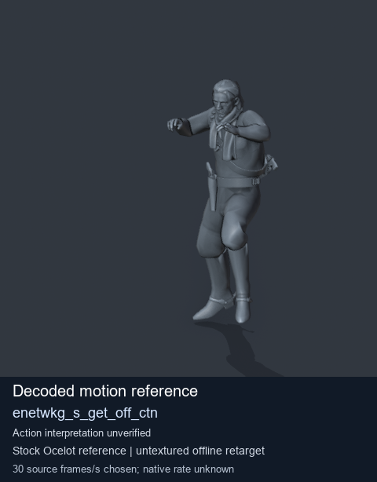

# Stock Soldier_common motion references / /Assets/tpp/motion/SI_game/fani/bodies/enet/enetwkg - page 5

[Library](../README.md) · [Grouped directory](../browse/README.md) · [This source family](../browse/stock-soldier-enetwkg-35bd0197.md) · [Switch mode](browse-stock-soldier-enetwkg-35bd0197-5.md)

**Still images: no GIFs loaded** · 4 clips · 0.40 MiB downloaded.

Images reuse existing files. A small display width does not reduce download size. Open one clip for its larger titled GIF and original technical data.

Source-family grouping uses only recorded virtual directories; it does not establish an action, weapon, actor, rig or native compatibility. Existing descriptions and tags below are unchanged. Per-clip visual review may be pending; chosen preview speed is separate from unmeasured native timing.

| Preview | Animation | Category | Tags | Virtual GANI directory / file | MTAR / container location | Description | Frames / data |
| --- | --- | --- | --- | --- | --- | --- | --- |
|  | [Stock reference: enetwkg_s_ele_dam](../clips/mgsv-tpp-soldier_common-payloadsha256-4aa6d5219964e36ff9c92c652f9a8cc7237394a4e3306c622e9a874d62d27989.md) <code>enetwkg_s_ele_dam</code> | Stock Soldier_common motion references | <code>stock animation reference</code> <code>Soldier_common</code> <code>source-derived label</code> <code>Ocelot reference mesh</code> | <code>/Assets/tpp/motion/SI_game/fani/bodies/enet/enetwkg</code> <code>enetwkg_s_ele_dam.gani</code> | Retained MTAR: <code>Soldier_common.mtar</code> DAT / FPK membership unverified | Decoded stock reference enetwkg_s_ele_dam; action interpretation unverified. | 250 raw 8.33 s chosen; native rate unknown [Full data](../clips/mgsv-tpp-soldier_common-payloadsha256-4aa6d5219964e36ff9c92c652f9a8cc7237394a4e3306c622e9a874d62d27989.md#technical-data) |
|  | [Stock reference: enetwkg_s_ele_dam_ed](../clips/mgsv-tpp-soldier_common-payloadsha256-a32025a2d34a2445c9bcea84c306daa1b56788615444932f7ddb3426de398c5d.md) <code>enetwkg_s_ele_dam_ed</code> | Stock Soldier_common motion references | <code>stock animation reference</code> <code>Soldier_common</code> <code>source-derived label</code> <code>Ocelot reference mesh</code> | <code>/Assets/tpp/motion/SI_game/fani/bodies/enet/enetwkg</code> <code>enetwkg_s_ele_dam_ed.gani</code> | Retained MTAR: <code>Soldier_common.mtar</code> DAT / FPK membership unverified | Decoded stock reference enetwkg_s_ele_dam_ed; action interpretation unverified. | 65 raw 2.17 s chosen; native rate unknown [Full data](../clips/mgsv-tpp-soldier_common-payloadsha256-a32025a2d34a2445c9bcea84c306daa1b56788615444932f7ddb3426de398c5d.md#technical-data) |
|  | [Stock reference: enetwkg_s_fp_to_idl](../clips/mgsv-tpp-soldier_common-payloadsha256-b2f92c43300ddbe6627e15bbc9aa52eb55ba5f53fd634eea408e6f92ac923c2e.md) <code>enetwkg_s_fp_to_idl</code> | Stock Soldier_common motion references | <code>stock animation reference</code> <code>Soldier_common</code> <code>source-derived label</code> <code>Ocelot reference mesh</code> | <code>/Assets/tpp/motion/SI_game/fani/bodies/enet/enetwkg</code> <code>enetwkg_s_fp_to_idl.gani</code> | Retained MTAR: <code>Soldier_common.mtar</code> DAT / FPK membership unverified | Decoded stock reference enetwkg_s_fp_to_idl; action interpretation unverified. | 45 raw 1.5 s chosen; native rate unknown [Full data](../clips/mgsv-tpp-soldier_common-payloadsha256-b2f92c43300ddbe6627e15bbc9aa52eb55ba5f53fd634eea408e6f92ac923c2e.md#technical-data) |
|  | [Stock motion reference: enetwkg_s_get_off_ctn](../clips/mgsv-tpp-soldier_common-payloadsha256-0ab2835b02061ff50dc77d4f546d74a26e39aa5e2e532c0ecd952017b4dc2557.md) <code>enetwkg_s_get_off_ctn</code> | Stock Soldier_common motion references | <code>stock body motion</code> <code>Soldier_common</code> <code>source-derived label</code> <code>Ocelot reference mesh</code> | <code>/Assets/tpp/motion/SI_game/fani/bodies/enet/enetwkg</code> <code>enetwkg_s_get_off_ctn.gani</code> | Retained MTAR: <code>Soldier_common.mtar</code> DAT / FPK membership unverified | Decoded stock body-motion reference enetwkg_s_get_off_ctn; action interpretation unverified. | 70 raw 2.33 s chosen; native rate unknown [Full data](../clips/mgsv-tpp-soldier_common-payloadsha256-0ab2835b02061ff50dc77d4f546d74a26e39aa5e2e532c0ecd952017b4dc2557.md#technical-data) |

[Source descriptions, confidence and credits](../description-sources.md) · [Complete JSON](../catalogue.json) · [CSV](../catalogue.csv)
