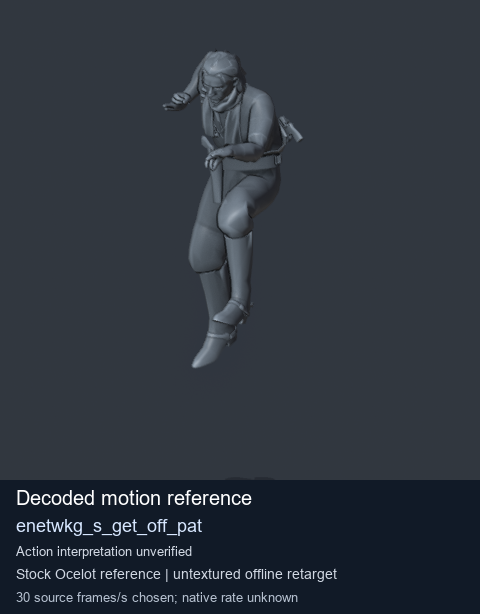
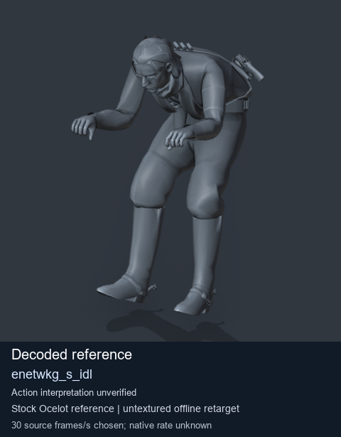
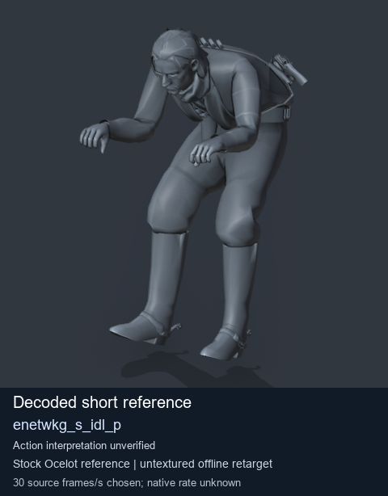

# Stock Soldier_common motion references / /Assets/tpp/motion/SI_game/fani/bodies/enet/enetwkg - page 6

[Library](../README.md) · [Grouped directory](../browse/README.md) · [This source family](../browse/stock-soldier-enetwkg-35bd0197.md) · [Switch mode](browse-stock-soldier-enetwkg-35bd0197-6.md)

**Still images: no GIFs loaded** · 3 clips · 0.29 MiB downloaded.

Images reuse existing files. A small display width does not reduce download size. Open one clip for its larger titled GIF and original technical data.

Source-family grouping uses only recorded virtual directories; it does not establish an action, weapon, actor, rig or native compatibility. Existing descriptions and tags below are unchanged. Per-clip visual review may be pending; chosen preview speed is separate from unmeasured native timing.

| Preview | Animation | Category | Tags | Virtual GANI directory / file | MTAR / container location | Description | Frames / data |
| --- | --- | --- | --- | --- | --- | --- | --- |
|  | [Stock reference: enetwkg_s_get_off_pat](../clips/mgsv-tpp-soldier_common-payloadsha256-f52a008f5e22bcb6b083ded68f59d9baa719c544d8dc609634e89f0d5114a0a4.md) <code>enetwkg_s_get_off_pat</code> | Stock Soldier_common motion references | <code>stock animation reference</code> <code>Soldier_common</code> <code>source-derived label</code> <code>Ocelot reference mesh</code> | <code>/Assets/tpp/motion/SI_game/fani/bodies/enet/enetwkg</code> <code>enetwkg_s_get_off_pat.gani</code> | Retained MTAR: <code>Soldier_common.mtar</code> DAT / FPK membership unverified | Decoded stock reference enetwkg_s_get_off_pat; action interpretation unverified. | 113 raw 3.77 s chosen; native rate unknown [Full data](../clips/mgsv-tpp-soldier_common-payloadsha256-f52a008f5e22bcb6b083ded68f59d9baa719c544d8dc609634e89f0d5114a0a4.md#technical-data) |
|  | [Stock reference: enetwkg_s_idl](../clips/mgsv-tpp-soldier_common-payloadsha256-81bb70d6165c8643f3da0e62e2b06081ccf54b034a719cd1c5f089d1eacc0847.md) <code>enetwkg_s_idl</code> | Stock Soldier_common motion references | <code>stock animation reference</code> <code>Soldier_common</code> <code>source-derived label</code> <code>Ocelot reference mesh</code> | <code>/Assets/tpp/motion/SI_game/fani/bodies/enet/enetwkg</code> <code>enetwkg_s_idl.gani</code> | Retained MTAR: <code>Soldier_common.mtar</code> DAT / FPK membership unverified | Decoded stock reference enetwkg_s_idl; action interpretation unverified. | 357 raw 11.9 s chosen; native rate unknown [Full data](../clips/mgsv-tpp-soldier_common-payloadsha256-81bb70d6165c8643f3da0e62e2b06081ccf54b034a719cd1c5f089d1eacc0847.md#technical-data) |
|  | [Stock reference: enetwkg_s_idl_p](../clips/mgsv-tpp-soldier_common-payloadsha256-8487238c396ab593b7c389f2762c5c70b39b8ee5adc012fd2948f4982544a49d.md) <code>enetwkg_s_idl_p</code> | Stock Soldier_common motion references | <code>stock animation reference</code> <code>Soldier_common</code> <code>source-derived label</code> <code>Ocelot reference mesh</code> | <code>/Assets/tpp/motion/SI_game/fani/bodies/enet/enetwkg</code> <code>enetwkg_s_idl_p.gani</code> | Retained MTAR: <code>Soldier_common.mtar</code> DAT / FPK membership unverified | Decoded stock reference enetwkg_s_idl_p; action interpretation unverified. | 1 raw 0.03 s chosen; native rate unknown [Full data](../clips/mgsv-tpp-soldier_common-payloadsha256-8487238c396ab593b7c389f2762c5c70b39b8ee5adc012fd2948f4982544a49d.md#technical-data) |

[Source descriptions, confidence and credits](../description-sources.md) · [Complete JSON](../catalogue.json) · [CSV](../catalogue.csv)
