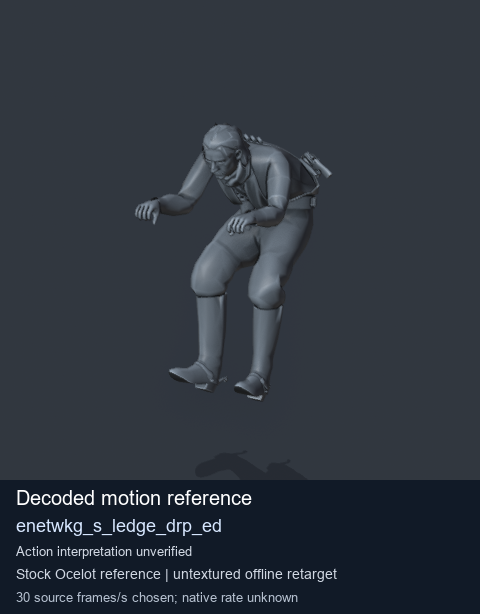
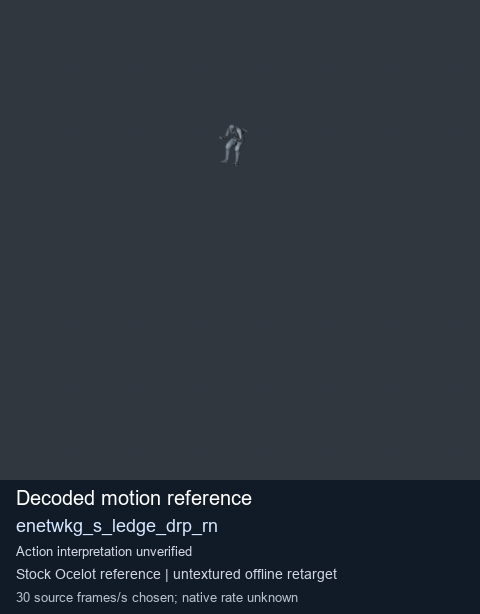
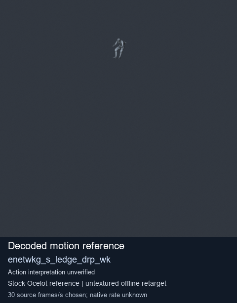
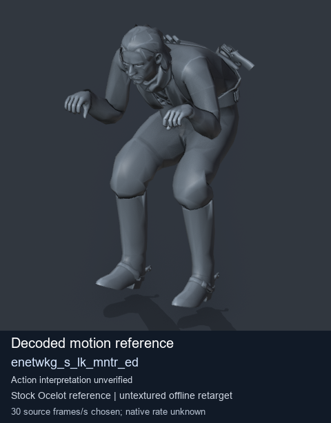

# Stock Soldier_common motion references / /Assets/tpp/motion/SI_game/fani/bodies/enet/enetwkg - page 7

[Library](../README.md) · [Grouped directory](../browse/README.md) · [This source family](../browse/stock-soldier-enetwkg-35bd0197.md) · [Switch mode](browse-stock-soldier-enetwkg-35bd0197-7.md)

**Still images: no GIFs loaded** · 4 clips · 0.29 MiB downloaded.

Images reuse existing files. A small display width does not reduce download size. Open one clip for its larger titled GIF and original technical data.

Source-family grouping uses only recorded virtual directories; it does not establish an action, weapon, actor, rig or native compatibility. Existing descriptions and tags below are unchanged. Per-clip visual review may be pending; chosen preview speed is separate from unmeasured native timing.

| Preview | Animation | Category | Tags | Virtual GANI directory / file | MTAR / container location | Description | Frames / data |
| --- | --- | --- | --- | --- | --- | --- | --- |
|  | [Stock reference: enetwkg_s_ledge_drp_ed](../clips/mgsv-tpp-soldier_common-payloadsha256-658d8ee1268a8c7b9defc0ec73053b40bbc19ff604a484c9894ece7fcf25ace0.md) <code>enetwkg_s_ledge_drp_ed</code> | Stock Soldier_common motion references | <code>stock animation reference</code> <code>Soldier_common</code> <code>source-derived label</code> <code>Ocelot reference mesh</code> | <code>/Assets/tpp/motion/SI_game/fani/bodies/enet/enetwkg</code> <code>enetwkg_s_ledge_drp_ed.gani</code> | Retained MTAR: <code>Soldier_common.mtar</code> DAT / FPK membership unverified | Decoded stock reference enetwkg_s_ledge_drp_ed; action interpretation unverified. | 39 raw 1.3 s chosen; native rate unknown [Full data](../clips/mgsv-tpp-soldier_common-payloadsha256-658d8ee1268a8c7b9defc0ec73053b40bbc19ff604a484c9894ece7fcf25ace0.md#technical-data) |
|  | [Stock reference: enetwkg_s_ledge_drp_rn](../clips/mgsv-tpp-soldier_common-payloadsha256-b91413d070c2b760fdd7c9ccc386fa77656874024d61ef7096475a938dde1fe9.md) <code>enetwkg_s_ledge_drp_rn</code> | Stock Soldier_common motion references | <code>stock animation reference</code> <code>Soldier_common</code> <code>source-derived label</code> <code>Ocelot reference mesh</code> | <code>/Assets/tpp/motion/SI_game/fani/bodies/enet/enetwkg</code> <code>enetwkg_s_ledge_drp_rn.gani</code> | Retained MTAR: <code>Soldier_common.mtar</code> DAT / FPK membership unverified | Decoded stock reference enetwkg_s_ledge_drp_rn; action interpretation unverified. | 65 raw 2.17 s chosen; native rate unknown [Full data](../clips/mgsv-tpp-soldier_common-payloadsha256-b91413d070c2b760fdd7c9ccc386fa77656874024d61ef7096475a938dde1fe9.md#technical-data) |
|  | [Stock motion reference: enetwkg_s_ledge_drp_wk](../clips/mgsv-tpp-soldier_common-payloadsha256-852211a1fb2e5d194eb19c67d48dd7e5bc9834c9c2058e2ce5bac3cc1782b5b4.md) <code>enetwkg_s_ledge_drp_wk</code> | Stock Soldier_common motion references | <code>stock body motion</code> <code>Soldier_common</code> <code>source-derived label</code> <code>Ocelot reference mesh</code> | <code>/Assets/tpp/motion/SI_game/fani/bodies/enet/enetwkg</code> <code>enetwkg_s_ledge_drp_wk.gani</code> | Retained MTAR: <code>Soldier_common.mtar</code> DAT / FPK membership unverified | Decoded stock body-motion reference enetwkg_s_ledge_drp_wk; action interpretation unverified. | 71 raw 2.37 s chosen; native rate unknown [Full data](../clips/mgsv-tpp-soldier_common-payloadsha256-852211a1fb2e5d194eb19c67d48dd7e5bc9834c9c2058e2ce5bac3cc1782b5b4.md#technical-data) |
|  | [Stock reference: enetwkg_s_lk_mntr_ed](../clips/mgsv-tpp-soldier_common-payloadsha256-92125f5c3fea3301655c824fe7f8c29229752812b87fb968438357e63c80f83d.md) <code>enetwkg_s_lk_mntr_ed</code> | Stock Soldier_common motion references | <code>stock animation reference</code> <code>Soldier_common</code> <code>source-derived label</code> <code>Ocelot reference mesh</code> | <code>/Assets/tpp/motion/SI_game/fani/bodies/enet/enetwkg</code> <code>enetwkg_s_lk_mntr_ed.gani</code> | Retained MTAR: <code>Soldier_common.mtar</code> DAT / FPK membership unverified | Decoded stock reference enetwkg_s_lk_mntr_ed; action interpretation unverified. | 46 raw 1.53 s chosen; native rate unknown [Full data](../clips/mgsv-tpp-soldier_common-payloadsha256-92125f5c3fea3301655c824fe7f8c29229752812b87fb968438357e63c80f83d.md#technical-data) |

[Source descriptions, confidence and credits](../description-sources.md) · [Complete JSON](../catalogue.json) · [CSV](../catalogue.csv)
