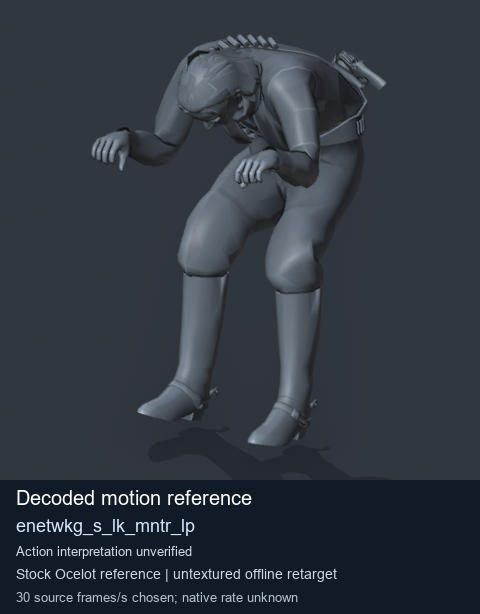
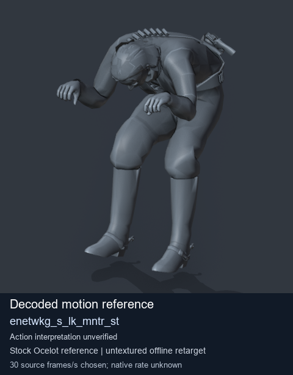
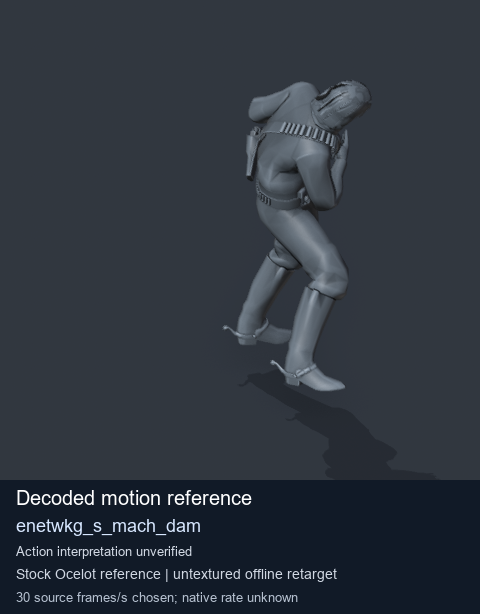

# Stock Soldier_common motion references / /Assets/tpp/motion/SI_game/fani/bodies/enet/enetwkg - page 8

[Library](../README.md) · [Grouped directory](../browse/README.md) · [This source family](../browse/stock-soldier-enetwkg-35bd0197.md) · [Switch mode](browse-stock-soldier-enetwkg-35bd0197-8.md)

**Still images: no GIFs loaded** · 3 clips · 0.32 MiB downloaded.

Images reuse existing files. A small display width does not reduce download size. Open one clip for its larger titled GIF and original technical data.

Source-family grouping uses only recorded virtual directories; it does not establish an action, weapon, actor, rig or native compatibility. Existing descriptions and tags below are unchanged. Per-clip visual review may be pending; chosen preview speed is separate from unmeasured native timing.

| Preview | Animation | Category | Tags | Virtual GANI directory / file | MTAR / container location | Description | Frames / data |
| --- | --- | --- | --- | --- | --- | --- | --- |
|  | [Stock reference: enetwkg_s_lk_mntr_lp](../clips/mgsv-tpp-soldier_common-payloadsha256-950e31302e18c0691461e420ea1fd212a0525beaa5598ec881f8d05778e7aa0a.md) <code>enetwkg_s_lk_mntr_lp</code> | Stock Soldier_common motion references | <code>stock animation reference</code> <code>Soldier_common</code> <code>source-derived label</code> <code>Ocelot reference mesh</code> | <code>/Assets/tpp/motion/SI_game/fani/bodies/enet/enetwkg</code> <code>enetwkg_s_lk_mntr_lp.gani</code> | Retained MTAR: <code>Soldier_common.mtar</code> DAT / FPK membership unverified | Decoded stock reference enetwkg_s_lk_mntr_lp; action interpretation unverified. | 236 raw 7.87 s chosen; native rate unknown [Full data](../clips/mgsv-tpp-soldier_common-payloadsha256-950e31302e18c0691461e420ea1fd212a0525beaa5598ec881f8d05778e7aa0a.md#technical-data) |
|  | [Stock reference: enetwkg_s_lk_mntr_st](../clips/mgsv-tpp-soldier_common-payloadsha256-805afb86ac050af598b1a71254651ce4f99aae19a28a1ca063b85f56f5c38492.md) <code>enetwkg_s_lk_mntr_st</code> | Stock Soldier_common motion references | <code>stock animation reference</code> <code>Soldier_common</code> <code>source-derived label</code> <code>Ocelot reference mesh</code> | <code>/Assets/tpp/motion/SI_game/fani/bodies/enet/enetwkg</code> <code>enetwkg_s_lk_mntr_st.gani</code> | Retained MTAR: <code>Soldier_common.mtar</code> DAT / FPK membership unverified | Decoded stock reference enetwkg_s_lk_mntr_st; action interpretation unverified. | 54 raw 1.8 s chosen; native rate unknown [Full data](../clips/mgsv-tpp-soldier_common-payloadsha256-805afb86ac050af598b1a71254651ce4f99aae19a28a1ca063b85f56f5c38492.md#technical-data) |
|  | [Stock motion reference: enetwkg_s_mach_dam](../clips/mgsv-tpp-soldier_common-payloadsha256-b370933296f4ed4a4adc693260ac6dfeebe004790a58ea60f46c3dc389cc29ff.md) <code>enetwkg_s_mach_dam</code> | Stock Soldier_common motion references | <code>stock body motion</code> <code>Soldier_common</code> <code>source-derived label</code> <code>Ocelot reference mesh</code> | <code>/Assets/tpp/motion/SI_game/fani/bodies/enet/enetwkg</code> <code>enetwkg_s_mach_dam.gani</code> | Retained MTAR: <code>Soldier_common.mtar</code> DAT / FPK membership unverified | Decoded stock body-motion reference enetwkg_s_mach_dam; action interpretation unverified. | 152 raw 5.07 s chosen; native rate unknown [Full data](../clips/mgsv-tpp-soldier_common-payloadsha256-b370933296f4ed4a4adc693260ac6dfeebe004790a58ea60f46c3dc389cc29ff.md#technical-data) |

[Source descriptions, confidence and credits](../description-sources.md) · [Complete JSON](../catalogue.json) · [CSV](../catalogue.csv)
