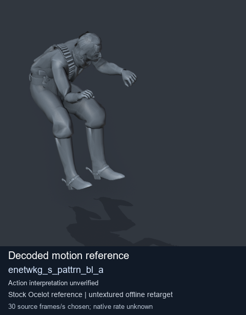
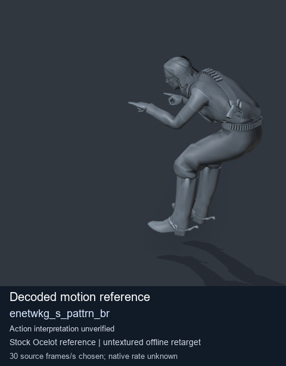
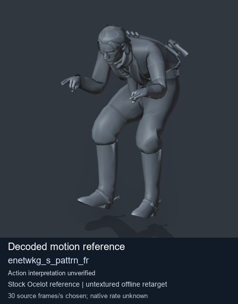
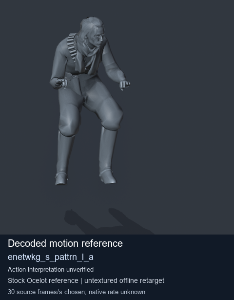

# Stock Soldier_common motion references / /Assets/tpp/motion/SI_game/fani/bodies/enet/enetwkg - page 9

[Library](../README.md) · [Grouped directory](../browse/README.md) · [This source family](../browse/stock-soldier-enetwkg-35bd0197.md) · [Switch mode](browse-stock-soldier-enetwkg-35bd0197-9.md)

**Still images: no GIFs loaded** · 4 clips · 0.38 MiB downloaded.

Images reuse existing files. A small display width does not reduce download size. Open one clip for its larger titled GIF and original technical data.

Source-family grouping uses only recorded virtual directories; it does not establish an action, weapon, actor, rig or native compatibility. Existing descriptions and tags below are unchanged. Per-clip visual review may be pending; chosen preview speed is separate from unmeasured native timing.

| Preview | Animation | Category | Tags | Virtual GANI directory / file | MTAR / container location | Description | Frames / data |
| --- | --- | --- | --- | --- | --- | --- | --- |
|  | [Stock reference: enetwkg_s_pattrn_bl_a](../clips/mgsv-tpp-soldier_common-payloadsha256-b1470d5317bada4e78b7896996885cf836bbfbfe7afee5c1bea25931c7c1e4a0.md) <code>enetwkg_s_pattrn_bl_a</code> | Stock Soldier_common motion references | <code>stock animation reference</code> <code>Soldier_common</code> <code>source-derived label</code> <code>Ocelot reference mesh</code> | <code>/Assets/tpp/motion/SI_game/fani/bodies/enet/enetwkg</code> <code>enetwkg_s_pattrn_bl_a.gani</code> | Retained MTAR: <code>Soldier_common.mtar</code> DAT / FPK membership unverified | Decoded stock reference enetwkg_s_pattrn_bl_a; action interpretation unverified. | 90 raw 3.0 s chosen; native rate unknown [Full data](../clips/mgsv-tpp-soldier_common-payloadsha256-b1470d5317bada4e78b7896996885cf836bbfbfe7afee5c1bea25931c7c1e4a0.md#technical-data) |
|  | [Stock reference: enetwkg_s_pattrn_br](../clips/mgsv-tpp-soldier_common-payloadsha256-e1cc4942cd46031e82cd4096feaa70b9d4f4d8c8cfe2ed5bfb3fd62ab8b2ac71.md) <code>enetwkg_s_pattrn_br</code> | Stock Soldier_common motion references | <code>stock animation reference</code> <code>Soldier_common</code> <code>source-derived label</code> <code>Ocelot reference mesh</code> | <code>/Assets/tpp/motion/SI_game/fani/bodies/enet/enetwkg</code> <code>enetwkg_s_pattrn_br.gani</code> | Retained MTAR: <code>Soldier_common.mtar</code> DAT / FPK membership unverified | Decoded stock reference enetwkg_s_pattrn_br; action interpretation unverified. | 90 raw 3.0 s chosen; native rate unknown [Full data](../clips/mgsv-tpp-soldier_common-payloadsha256-e1cc4942cd46031e82cd4096feaa70b9d4f4d8c8cfe2ed5bfb3fd62ab8b2ac71.md#technical-data) |
|  | [Stock motion reference: enetwkg_s_pattrn_fr](../clips/mgsv-tpp-soldier_common-payloadsha256-7b9f1e69f7d709ab20c90f32848b8700ecfa033f5668445c0e318db4a2c3b20b.md) <code>enetwkg_s_pattrn_fr</code> | Stock Soldier_common motion references | <code>stock body motion</code> <code>Soldier_common</code> <code>source-derived label</code> <code>Ocelot reference mesh</code> | <code>/Assets/tpp/motion/SI_game/fani/bodies/enet/enetwkg</code> <code>enetwkg_s_pattrn_fr.gani</code> | Retained MTAR: <code>Soldier_common.mtar</code> DAT / FPK membership unverified | Decoded stock body-motion reference enetwkg_s_pattrn_fr; action interpretation unverified. | 105 raw 3.5 s chosen; native rate unknown [Full data](../clips/mgsv-tpp-soldier_common-payloadsha256-7b9f1e69f7d709ab20c90f32848b8700ecfa033f5668445c0e318db4a2c3b20b.md#technical-data) |
|  | [Stock reference: enetwkg_s_pattrn_l_a](../clips/mgsv-tpp-soldier_common-payloadsha256-c661df335e72762b9744c122f34db960ccad24be753f5e6ae96ae0c8f5b5f2d6.md) <code>enetwkg_s_pattrn_l_a</code> | Stock Soldier_common motion references | <code>stock animation reference</code> <code>Soldier_common</code> <code>source-derived label</code> <code>Ocelot reference mesh</code> | <code>/Assets/tpp/motion/SI_game/fani/bodies/enet/enetwkg</code> <code>enetwkg_s_pattrn_l_a.gani</code> | Retained MTAR: <code>Soldier_common.mtar</code> DAT / FPK membership unverified | Decoded stock reference enetwkg_s_pattrn_l_a; action interpretation unverified. | 80 raw 2.67 s chosen; native rate unknown [Full data](../clips/mgsv-tpp-soldier_common-payloadsha256-c661df335e72762b9744c122f34db960ccad24be753f5e6ae96ae0c8f5b5f2d6.md#technical-data) |

[Source descriptions, confidence and credits](../description-sources.md) · [Complete JSON](../catalogue.json) · [CSV](../catalogue.csv)
