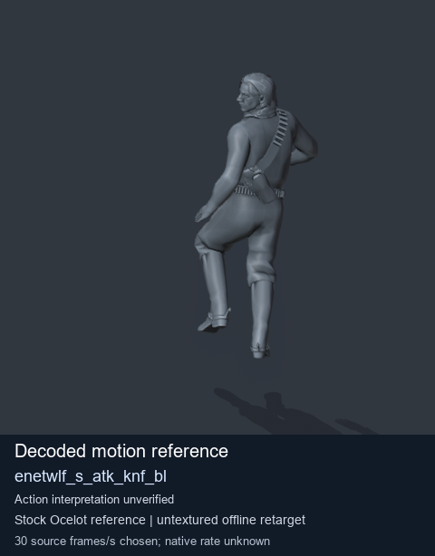
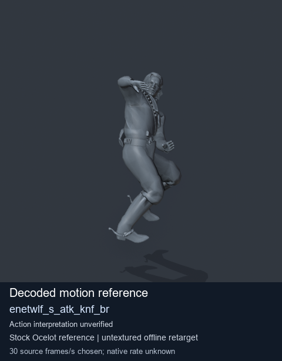

# Stock Soldier_common motion references / /Assets/tpp/motion/SI_game/fani/bodies/enet/enetwlf - page 1

[Library](../README.md) · [Grouped directory](../browse/README.md) · [This source family](../browse/stock-soldier-enetwlf-aa4d54af.md) · [Switch mode](browse-stock-soldier-enetwlf-aa4d54af-1.md)

**Still images: no GIFs loaded** · 2 clips · 0.15 MiB downloaded.

Images reuse existing files. A small display width does not reduce download size. Open one clip for its larger titled GIF and original technical data.

Source-family grouping uses only recorded virtual directories; it does not establish an action, weapon, actor, rig or native compatibility. Existing descriptions and tags below are unchanged. Per-clip visual review may be pending; chosen preview speed is separate from unmeasured native timing.

| Preview | Animation | Category | Tags | Virtual GANI directory / file | MTAR / container location | Description | Frames / data |
| --- | --- | --- | --- | --- | --- | --- | --- |
|  | [Stock reference: enetwlf_s_atk_knf_bl](../clips/mgsv-tpp-soldier_common-payloadsha256-c241fcd0826d2eec79c555c288a85e05170f236c5e1680e3a74fa93fac78e399.md) <code>enetwlf_s_atk_knf_bl</code> | Stock Soldier_common motion references | <code>stock animation reference</code> <code>Soldier_common</code> <code>source-derived label</code> <code>Ocelot reference mesh</code> | <code>/Assets/tpp/motion/SI_game/fani/bodies/enet/enetwlf</code> <code>enetwlf_s_atk_knf_bl.gani</code> | Retained MTAR: <code>Soldier_common.mtar</code> DAT / FPK membership unverified | Decoded stock reference enetwlf_s_atk_knf_bl; action interpretation unverified. | 260 raw 8.67 s chosen; native rate unknown [Full data](../clips/mgsv-tpp-soldier_common-payloadsha256-c241fcd0826d2eec79c555c288a85e05170f236c5e1680e3a74fa93fac78e399.md#technical-data) |
|  | [Stock reference: enetwlf_s_atk_knf_br](../clips/mgsv-tpp-soldier_common-payloadsha256-33253e20e9b4978a93882479252fcd2c73946df5ca8add672a6b4230fcbbadb2.md) <code>enetwlf_s_atk_knf_br</code> | Stock Soldier_common motion references | <code>stock animation reference</code> <code>Soldier_common</code> <code>source-derived label</code> <code>Ocelot reference mesh</code> | <code>/Assets/tpp/motion/SI_game/fani/bodies/enet/enetwlf</code> <code>enetwlf_s_atk_knf_br.gani</code> | Retained MTAR: <code>Soldier_common.mtar</code> DAT / FPK membership unverified | Decoded stock reference enetwlf_s_atk_knf_br; action interpretation unverified. | 260 raw 8.67 s chosen; native rate unknown [Full data](../clips/mgsv-tpp-soldier_common-payloadsha256-33253e20e9b4978a93882479252fcd2c73946df5ca8add672a6b4230fcbbadb2.md#technical-data) |

[Source descriptions, confidence and credits](../description-sources.md) · [Complete JSON](../catalogue.json) · [CSV](../catalogue.csv)
