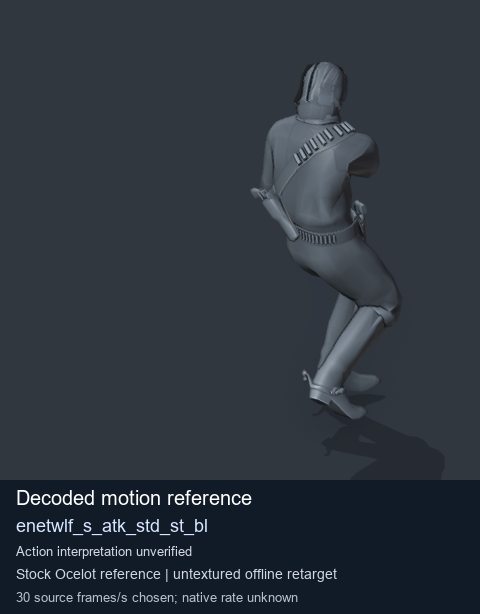
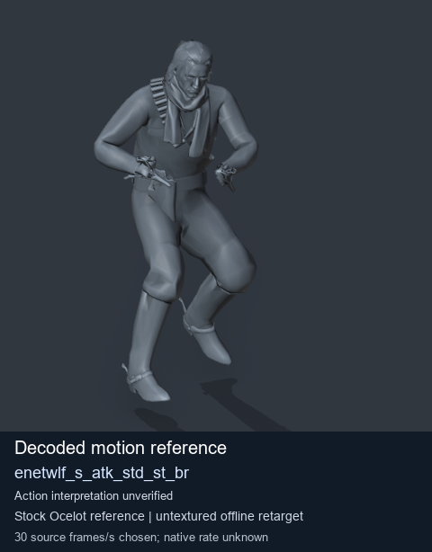
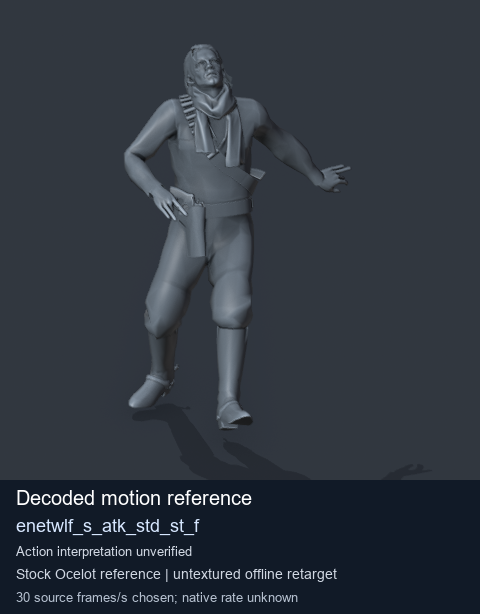

# Stock Soldier_common motion references / /Assets/tpp/motion/SI_game/fani/bodies/enet/enetwlf - page 4

[Library](../README.md) · [Grouped directory](../browse/README.md) · [This source family](../browse/stock-soldier-enetwlf-aa4d54af.md) · [Switch mode](browse-stock-soldier-enetwlf-aa4d54af-4.md)

**Still images: no GIFs loaded** · 3 clips · 0.28 MiB downloaded.

Images reuse existing files. A small display width does not reduce download size. Open one clip for its larger titled GIF and original technical data.

Source-family grouping uses only recorded virtual directories; it does not establish an action, weapon, actor, rig or native compatibility. Existing descriptions and tags below are unchanged. Per-clip visual review may be pending; chosen preview speed is separate from unmeasured native timing.

| Preview | Animation | Category | Tags | Virtual GANI directory / file | MTAR / container location | Description | Frames / data |
| --- | --- | --- | --- | --- | --- | --- | --- |
|  | [Stock motion reference: enetwlf_s_atk_std_st_bl](../clips/mgsv-tpp-soldier_common-payloadsha256-2cc0937428a975de11ba9bd5966ac805222c98beb28b7550ec3c7417446fadba.md) <code>enetwlf_s_atk_std_st_bl</code> | Stock Soldier_common motion references | <code>stock body motion</code> <code>Soldier_common</code> <code>source-derived label</code> <code>Ocelot reference mesh</code> | <code>/Assets/tpp/motion/SI_game/fani/bodies/enet/enetwlf</code> <code>enetwlf_s_atk_std_st_bl.gani</code> | Retained MTAR: <code>Soldier_common.mtar</code> DAT / FPK membership unverified | Decoded stock body-motion reference enetwlf_s_atk_std_st_bl; action interpretation unverified. | 128 raw 4.27 s chosen; native rate unknown [Full data](../clips/mgsv-tpp-soldier_common-payloadsha256-2cc0937428a975de11ba9bd5966ac805222c98beb28b7550ec3c7417446fadba.md#technical-data) |
|  | [Stock motion reference: enetwlf_s_atk_std_st_br](../clips/mgsv-tpp-soldier_common-payloadsha256-a21f40d5cd2668725bb0b405271b35c6f37338f1b9ffce2b03b0631e28748b18.md) <code>enetwlf_s_atk_std_st_br</code> | Stock Soldier_common motion references | <code>stock body motion</code> <code>Soldier_common</code> <code>source-derived label</code> <code>Ocelot reference mesh</code> | <code>/Assets/tpp/motion/SI_game/fani/bodies/enet/enetwlf</code> <code>enetwlf_s_atk_std_st_br.gani</code> | Retained MTAR: <code>Soldier_common.mtar</code> DAT / FPK membership unverified | Decoded stock body-motion reference enetwlf_s_atk_std_st_br; action interpretation unverified. | 128 raw 4.27 s chosen; native rate unknown [Full data](../clips/mgsv-tpp-soldier_common-payloadsha256-a21f40d5cd2668725bb0b405271b35c6f37338f1b9ffce2b03b0631e28748b18.md#technical-data) |
|  | [Stock motion reference: enetwlf_s_atk_std_st_f](../clips/mgsv-tpp-soldier_common-payloadsha256-ca89c3cb5cf47bbe71b3c6ecea0d1fcc257356e3b99093a350f05b69786a9b0d.md) <code>enetwlf_s_atk_std_st_f</code> | Stock Soldier_common motion references | <code>stock body motion</code> <code>Soldier_common</code> <code>source-derived label</code> <code>Ocelot reference mesh</code> | <code>/Assets/tpp/motion/SI_game/fani/bodies/enet/enetwlf</code> <code>enetwlf_s_atk_std_st_f.gani</code> | Retained MTAR: <code>Soldier_common.mtar</code> DAT / FPK membership unverified | Decoded stock body-motion reference enetwlf_s_atk_std_st_f; action interpretation unverified. | 128 raw 4.27 s chosen; native rate unknown [Full data](../clips/mgsv-tpp-soldier_common-payloadsha256-ca89c3cb5cf47bbe71b3c6ecea0d1fcc257356e3b99093a350f05b69786a9b0d.md#technical-data) |

[Source descriptions, confidence and credits](../description-sources.md) · [Complete JSON](../catalogue.json) · [CSV](../catalogue.csv)
