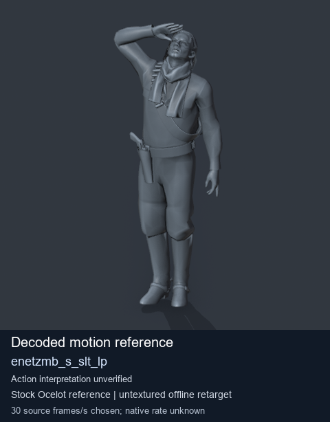
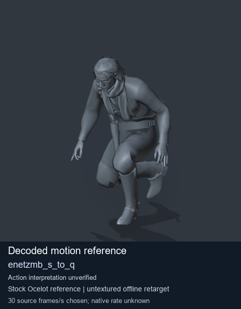
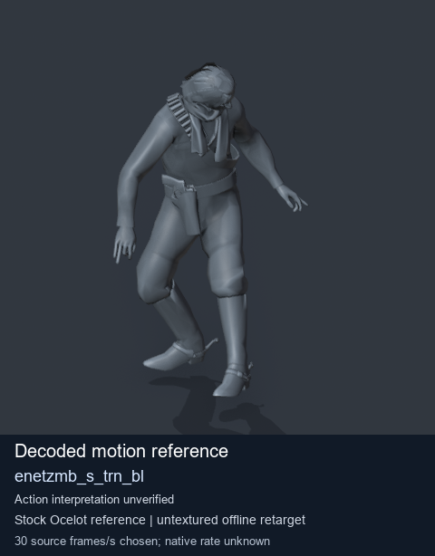

# Stock Soldier_common motion references / /Assets/tpp/motion/SI_game/fani/bodies/enet/enetzmb - page 10

[Library](../README.md) · [Grouped directory](../browse/README.md) · [This source family](../browse/stock-soldier-enetzmb-ca1e807b.md) · [Switch mode](browse-stock-soldier-enetzmb-ca1e807b-10.md)

**Still images: no GIFs loaded** · 3 clips · 0.28 MiB downloaded.

Images reuse existing files. A small display width does not reduce download size. Open one clip for its larger titled GIF and original technical data.

Source-family grouping uses only recorded virtual directories; it does not establish an action, weapon, actor, rig or native compatibility. Existing descriptions and tags below are unchanged. Per-clip visual review may be pending; chosen preview speed is separate from unmeasured native timing.

| Preview | Animation | Category | Tags | Virtual GANI directory / file | MTAR / container location | Description | Frames / data |
| --- | --- | --- | --- | --- | --- | --- | --- |
|  | [Stock reference: enetzmb_s_slt_lp](../clips/mgsv-tpp-soldier_common-payloadsha256-c0255f2d8a5f1eabf4ef491dd0d0dc1aabda9216d65e4189ecfa9c420f9772e8.md) <code>enetzmb_s_slt_lp</code> | Stock Soldier_common motion references | <code>stock animation reference</code> <code>Soldier_common</code> <code>source-derived label</code> <code>Ocelot reference mesh</code> | <code>/Assets/tpp/motion/SI_game/fani/bodies/enet/enetzmb</code> <code>enetzmb_s_slt_lp.gani</code> | Retained MTAR: <code>Soldier_common.mtar</code> DAT / FPK membership unverified | Decoded stock reference enetzmb_s_slt_lp; action interpretation unverified. | 211 raw 7.03 s chosen; native rate unknown [Full data](../clips/mgsv-tpp-soldier_common-payloadsha256-c0255f2d8a5f1eabf4ef491dd0d0dc1aabda9216d65e4189ecfa9c420f9772e8.md#technical-data) |
|  | [Stock reference: enetzmb_s_to_q](../clips/mgsv-tpp-soldier_common-payloadsha256-c52dad08767385508598ac2a391a5d803d64f843d2cd0c3a2cc5ba844e87cf9d.md) <code>enetzmb_s_to_q</code> | Stock Soldier_common motion references | <code>stock animation reference</code> <code>Soldier_common</code> <code>source-derived label</code> <code>Ocelot reference mesh</code> | <code>/Assets/tpp/motion/SI_game/fani/bodies/enet/enetzmb</code> <code>enetzmb_s_to_q.gani</code> | Retained MTAR: <code>Soldier_common.mtar</code> DAT / FPK membership unverified | Decoded stock reference enetzmb_s_to_q; action interpretation unverified. | 60 raw 2.0 s chosen; native rate unknown [Full data](../clips/mgsv-tpp-soldier_common-payloadsha256-c52dad08767385508598ac2a391a5d803d64f843d2cd0c3a2cc5ba844e87cf9d.md#technical-data) |
|  | [Stock reference: enetzmb_s_trn_bl](../clips/mgsv-tpp-soldier_common-payloadsha256-92ccc98225d22212090f70aacf17975d24bd62b72393f53ebfbe70ac73d98fb1.md) <code>enetzmb_s_trn_bl</code> | Stock Soldier_common motion references | <code>stock animation reference</code> <code>Soldier_common</code> <code>source-derived label</code> <code>Ocelot reference mesh</code> | <code>/Assets/tpp/motion/SI_game/fani/bodies/enet/enetzmb</code> <code>enetzmb_s_trn_bl.gani</code> | Retained MTAR: <code>Soldier_common.mtar</code> DAT / FPK membership unverified | Decoded stock reference enetzmb_s_trn_bl; action interpretation unverified. | 210 raw 7.0 s chosen; native rate unknown [Full data](../clips/mgsv-tpp-soldier_common-payloadsha256-92ccc98225d22212090f70aacf17975d24bd62b72393f53ebfbe70ac73d98fb1.md#technical-data) |

[Source descriptions, confidence and credits](../description-sources.md) · [Complete JSON](../catalogue.json) · [CSV](../catalogue.csv)
