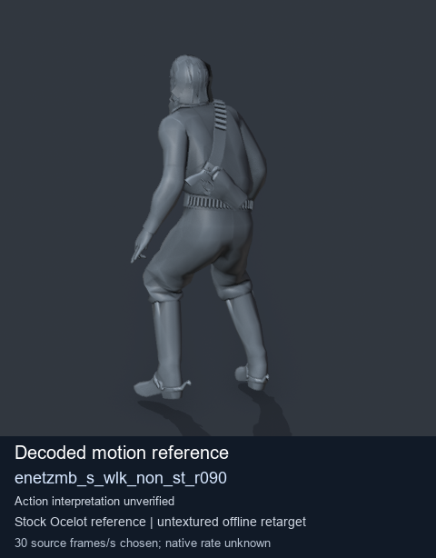
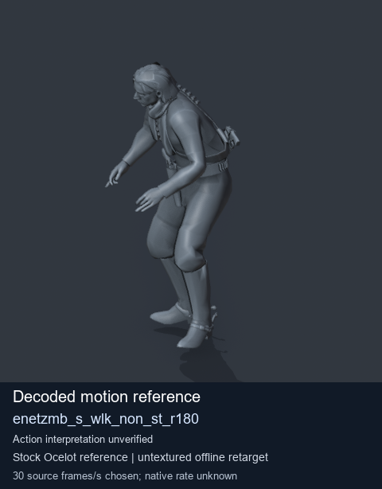

# Stock Soldier_common motion references / /Assets/tpp/motion/SI_game/fani/bodies/enet/enetzmb - page 13

[Library](../README.md) · [Grouped directory](../browse/README.md) · [This source family](../browse/stock-soldier-enetzmb-ca1e807b.md) · [Switch mode](browse-stock-soldier-enetzmb-ca1e807b-13.md)

**Still images: no GIFs loaded** · 2 clips · 0.18 MiB downloaded.

Images reuse existing files. A small display width does not reduce download size. Open one clip for its larger titled GIF and original technical data.

Source-family grouping uses only recorded virtual directories; it does not establish an action, weapon, actor, rig or native compatibility. Existing descriptions and tags below are unchanged. Per-clip visual review may be pending; chosen preview speed is separate from unmeasured native timing.

| Preview | Animation | Category | Tags | Virtual GANI directory / file | MTAR / container location | Description | Frames / data |
| --- | --- | --- | --- | --- | --- | --- | --- |
|  | [Stock motion reference: enetzmb_s_wlk_non_st_r090](../clips/mgsv-tpp-soldier_common-payloadsha256-0950a50ec28203130172b0d065e5f91bd0b56ffea202b039e8984b35a778ae91.md) <code>enetzmb_s_wlk_non_st_r090</code> | Stock Soldier_common motion references | <code>stock body motion</code> <code>Soldier_common</code> <code>source-derived label</code> <code>Ocelot reference mesh</code> | <code>/Assets/tpp/motion/SI_game/fani/bodies/enet/enetzmb</code> <code>enetzmb_s_wlk_non_st_r090.gani</code> | Retained MTAR: <code>Soldier_common.mtar</code> DAT / FPK membership unverified | Decoded stock body-motion reference enetzmb_s_wlk_non_st_r090; action interpretation unverified. | 144 raw 4.8 s chosen; native rate unknown [Full data](../clips/mgsv-tpp-soldier_common-payloadsha256-0950a50ec28203130172b0d065e5f91bd0b56ffea202b039e8984b35a778ae91.md#technical-data) |
|  | [Stock reference: enetzmb_s_wlk_non_st_r180](../clips/mgsv-tpp-soldier_common-payloadsha256-d7e0f6cfa792d69009f8d344d0bfe98b60f397ff5dbea3ec13f9446c2d408c59.md) <code>enetzmb_s_wlk_non_st_r180</code> | Stock Soldier_common motion references | <code>stock animation reference</code> <code>Soldier_common</code> <code>source-derived label</code> <code>Ocelot reference mesh</code> | <code>/Assets/tpp/motion/SI_game/fani/bodies/enet/enetzmb</code> <code>enetzmb_s_wlk_non_st_r180.gani</code> | Retained MTAR: <code>Soldier_common.mtar</code> DAT / FPK membership unverified | Decoded stock reference enetzmb_s_wlk_non_st_r180; action interpretation unverified. | 244 raw 8.13 s chosen; native rate unknown [Full data](../clips/mgsv-tpp-soldier_common-payloadsha256-d7e0f6cfa792d69009f8d344d0bfe98b60f397ff5dbea3ec13f9446c2d408c59.md#technical-data) |

[Source descriptions, confidence and credits](../description-sources.md) · [Complete JSON](../catalogue.json) · [CSV](../catalogue.csv)
