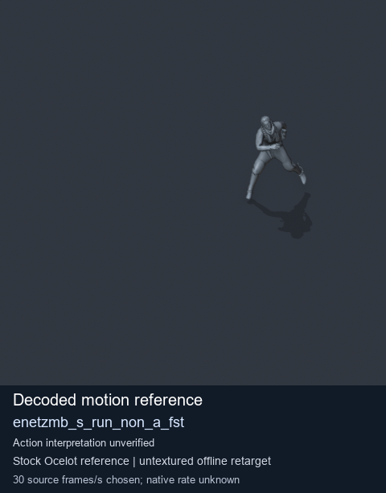
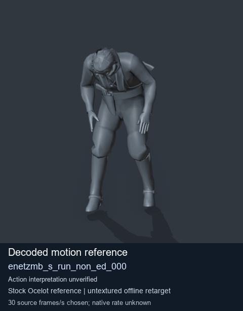
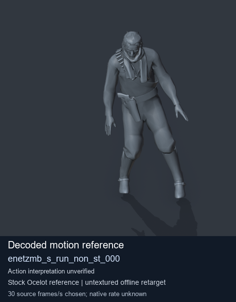
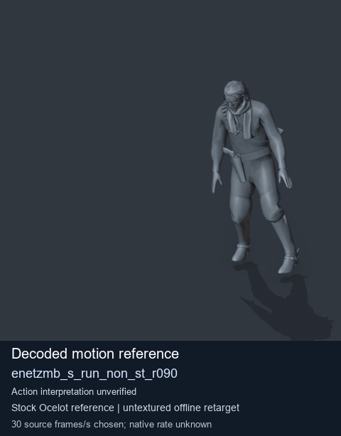

# Stock Soldier_common motion references / /Assets/tpp/motion/SI_game/fani/bodies/enet/enetzmb - page 8

[Library](../README.md) · [Grouped directory](../browse/README.md) · [This source family](../browse/stock-soldier-enetzmb-ca1e807b.md) · [Switch mode](browse-stock-soldier-enetzmb-ca1e807b-8.md)

**Still images: no GIFs loaded** · 4 clips · 0.31 MiB downloaded.

Images reuse existing files. A small display width does not reduce download size. Open one clip for its larger titled GIF and original technical data.

Source-family grouping uses only recorded virtual directories; it does not establish an action, weapon, actor, rig or native compatibility. Existing descriptions and tags below are unchanged. Per-clip visual review may be pending; chosen preview speed is separate from unmeasured native timing.

| Preview | Animation | Category | Tags | Virtual GANI directory / file | MTAR / container location | Description | Frames / data |
| --- | --- | --- | --- | --- | --- | --- | --- |
|  | [Stock motion reference: enetzmb_s_run_non_a_fst](../clips/mgsv-tpp-soldier_common-payloadsha256-34cf3360f9187353b341e865a15003b704cbc1b1e69c749a26dc7be02743df4b.md) <code>enetzmb_s_run_non_a_fst</code> | Stock Soldier_common motion references | <code>stock body motion</code> <code>Soldier_common</code> <code>source-derived label</code> <code>Ocelot reference mesh</code> | <code>/Assets/tpp/motion/SI_game/fani/bodies/enet/enetzmb</code> <code>enetzmb_s_run_non_a_fst.gani</code> | Retained MTAR: <code>Soldier_common.mtar</code> DAT / FPK membership unverified | Decoded stock body-motion reference enetzmb_s_run_non_a_fst; action interpretation unverified. | 122 raw 4.07 s chosen; native rate unknown [Full data](../clips/mgsv-tpp-soldier_common-payloadsha256-34cf3360f9187353b341e865a15003b704cbc1b1e69c749a26dc7be02743df4b.md#technical-data) |
|  | [Stock reference: enetzmb_s_run_non_ed_000](../clips/mgsv-tpp-soldier_common-payloadsha256-0a40f229deec1d07d1ea4bf9d84cd9b7a779748e42c810d74551c7eddd4115aa.md) <code>enetzmb_s_run_non_ed_000</code> | Stock Soldier_common motion references | <code>stock animation reference</code> <code>Soldier_common</code> <code>source-derived label</code> <code>Ocelot reference mesh</code> | <code>/Assets/tpp/motion/SI_game/fani/bodies/enet/enetzmb</code> <code>enetzmb_s_run_non_ed_000.gani</code> | Retained MTAR: <code>Soldier_common.mtar</code> DAT / FPK membership unverified | Decoded stock reference enetzmb_s_run_non_ed_000; action interpretation unverified. | 117 raw 3.9 s chosen; native rate unknown [Full data](../clips/mgsv-tpp-soldier_common-payloadsha256-0a40f229deec1d07d1ea4bf9d84cd9b7a779748e42c810d74551c7eddd4115aa.md#technical-data) |
|  | [Stock motion reference: enetzmb_s_run_non_st_000](../clips/mgsv-tpp-soldier_common-payloadsha256-108f8cb3f138698f63e191603bb213347ff6f1674b9be05ce234ed8270033df1.md) <code>enetzmb_s_run_non_st_000</code> | Stock Soldier_common motion references | <code>stock body motion</code> <code>Soldier_common</code> <code>source-derived label</code> <code>Ocelot reference mesh</code> | <code>/Assets/tpp/motion/SI_game/fani/bodies/enet/enetzmb</code> <code>enetzmb_s_run_non_st_000.gani</code> | Retained MTAR: <code>Soldier_common.mtar</code> DAT / FPK membership unverified | Decoded stock body-motion reference enetzmb_s_run_non_st_000; action interpretation unverified. | 102 raw 3.4 s chosen; native rate unknown [Full data](../clips/mgsv-tpp-soldier_common-payloadsha256-108f8cb3f138698f63e191603bb213347ff6f1674b9be05ce234ed8270033df1.md#technical-data) |
|  | [Stock reference: enetzmb_s_run_non_st_r090](../clips/mgsv-tpp-soldier_common-payloadsha256-0e089b92a808ae7ca7edc7609aeec0fa961ee2d6ec29ac38aa9eb55afc5eda8f.md) <code>enetzmb_s_run_non_st_r090</code> | Stock Soldier_common motion references | <code>stock animation reference</code> <code>Soldier_common</code> <code>source-derived label</code> <code>Ocelot reference mesh</code> | <code>/Assets/tpp/motion/SI_game/fani/bodies/enet/enetzmb</code> <code>enetzmb_s_run_non_st_r090.gani</code> | Retained MTAR: <code>Soldier_common.mtar</code> DAT / FPK membership unverified | Decoded stock reference enetzmb_s_run_non_st_r090; action interpretation unverified. | 102 raw 3.4 s chosen; native rate unknown [Full data](../clips/mgsv-tpp-soldier_common-payloadsha256-0e089b92a808ae7ca7edc7609aeec0fa961ee2d6ec29ac38aa9eb55afc5eda8f.md#technical-data) |

[Source descriptions, confidence and credits](../description-sources.md) · [Complete JSON](../catalogue.json) · [CSV](../catalogue.csv)
