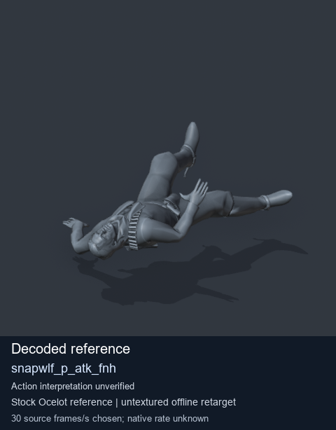
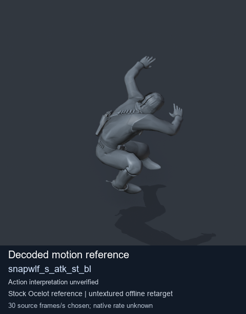
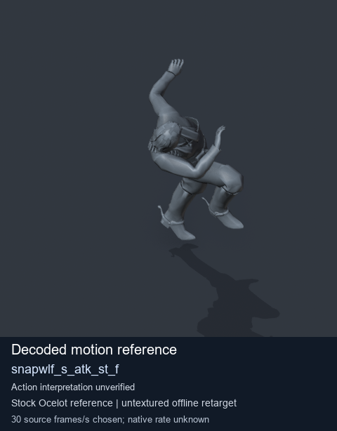

# Stock Soldier_common motion references / /Assets/tpp/motion/SI_game/fani/bodies/snap/snapwlf - page 1

[Library](../README.md) · [Grouped directory](../browse/README.md) · [This source family](../browse/stock-soldier-snapwlf-e270ca55.md) · [Switch mode](browse-stock-soldier-snapwlf-e270ca55-1.md)

**Still images: no GIFs loaded** · 3 clips · 0.23 MiB downloaded.

Images reuse existing files. A small display width does not reduce download size. Open one clip for its larger titled GIF and original technical data.

Source-family grouping uses only recorded virtual directories; it does not establish an action, weapon, actor, rig or native compatibility. Existing descriptions and tags below are unchanged. Per-clip visual review may be pending; chosen preview speed is separate from unmeasured native timing.

| Preview | Animation | Category | Tags | Virtual GANI directory / file | MTAR / container location | Description | Frames / data |
| --- | --- | --- | --- | --- | --- | --- | --- |
|  | [Stock reference: snapwlf_p_atk_fnh](../clips/mgsv-tpp-soldier_common-payloadsha256-462d1b2f9724914b591e52b649d00d7db972fc8ee7393fd23dddc85ea03f8040.md) <code>snapwlf_p_atk_fnh</code> | Stock Soldier_common motion references | <code>stock animation reference</code> <code>Soldier_common</code> <code>source-derived label</code> <code>Ocelot reference mesh</code> | <code>/Assets/tpp/motion/SI_game/fani/bodies/snap/snapwlf</code> <code>snapwlf_p_atk_fnh.gani</code> | Retained MTAR: <code>Soldier_common.mtar</code> DAT / FPK membership unverified | Decoded stock reference snapwlf_p_atk_fnh; action interpretation unverified. | 372 raw 12.4 s chosen; native rate unknown [Full data](../clips/mgsv-tpp-soldier_common-payloadsha256-462d1b2f9724914b591e52b649d00d7db972fc8ee7393fd23dddc85ea03f8040.md#technical-data) |
|  | [Stock motion reference: snapwlf_s_atk_st_bl](../clips/mgsv-tpp-soldier_common-payloadsha256-d96aa0b9272ce4eb2db98e42801fd06d4b2ab8281bc1a7a0d3ac08c7e7fde46a.md) <code>snapwlf_s_atk_st_bl</code> | Stock Soldier_common motion references | <code>stock body motion</code> <code>Soldier_common</code> <code>source-derived label</code> <code>Ocelot reference mesh</code> | <code>/Assets/tpp/motion/SI_game/fani/bodies/snap/snapwlf</code> <code>snapwlf_s_atk_st_bl.gani</code> | Retained MTAR: <code>Soldier_common.mtar</code> DAT / FPK membership unverified | Decoded stock body-motion reference snapwlf_s_atk_st_bl; action interpretation unverified. | 77 raw 2.57 s chosen; native rate unknown [Full data](../clips/mgsv-tpp-soldier_common-payloadsha256-d96aa0b9272ce4eb2db98e42801fd06d4b2ab8281bc1a7a0d3ac08c7e7fde46a.md#technical-data) |
|  | [Stock motion reference: snapwlf_s_atk_st_f](../clips/mgsv-tpp-soldier_common-payloadsha256-c07b498a0c22d8c4ef56c3552f26cd91aea44d10c3256c703ffba285ea3e8e3e.md) <code>snapwlf_s_atk_st_f</code> | Stock Soldier_common motion references | <code>stock body motion</code> <code>Soldier_common</code> <code>source-derived label</code> <code>Ocelot reference mesh</code> | <code>/Assets/tpp/motion/SI_game/fani/bodies/snap/snapwlf</code> <code>snapwlf_s_atk_st_f.gani</code> | Retained MTAR: <code>Soldier_common.mtar</code> DAT / FPK membership unverified | Decoded stock body-motion reference snapwlf_s_atk_st_f; action interpretation unverified. | 77 raw 2.57 s chosen; native rate unknown [Full data](../clips/mgsv-tpp-soldier_common-payloadsha256-c07b498a0c22d8c4ef56c3552f26cd91aea44d10c3256c703ffba285ea3e8e3e.md#technical-data) |

[Source descriptions, confidence and credits](../description-sources.md) · [Complete JSON](../catalogue.json) · [CSV](../catalogue.csv)
