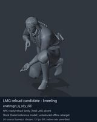
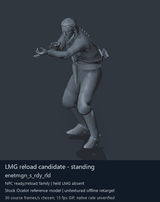

# LMG ready/reload candidates - page 1 of 1

[Library index](../README.md) · [Switch to still images](lmg-reloads-1-stills.md)

**Animated preview mode** · 2 previews · 3.00 MiB of image files. Click a preview or title for its larger GIF and complete data.

Pages: **1**

Categories/tags are authored retrieval labels; candidate source roles and observed reference posture remain distinct. GANI paths are virtual asset locations. Recorded container chains are historical source locations; current DAT contents are unverified. [Description matching and credits](../description-sources.md) explain why a community description may be unavailable.

All clips are offline Ocelot reference previews. Native timing, weapon/contact, pairing and actor compatibility remain unverified; duration uses a chosen preview rate.

| Preview | Animation | Category | Tags | Virtual GANI directory / file | MTAR / container location | Community source description | Credits | Frames / data |
| --- | --- | --- | --- | --- | --- | --- | --- | --- |
|  | [LMG reload candidate - kneeling](../clips/mgsv-tpp-soldier_common-313cdbcc7c1d9.md) <code>enetmgn_q_rdy_rld</code> Authored preview label | LMG ready/reload candidates | <code>offline-reference</code> <code>source-enemy</code> <code>lmg</code> <code>reload-candidate</code> <code>kneeling</code> | <code>/Assets/tpp/motion/SI_game/fani/bodies/enet/enetmgn/</code> <code>enetmgn_q_rdy_rld.gani</code> | DAT: <code>a_chunk7.dat</code> FPK: <code>/Assets/tpp/pack/soldier/common/Soldier2Common.fpk</code> MTAR: <code>/Assets/tpp/motion/mtar/soldier2/Soldier_common.mtar</code> Historical source receipt | Unavailable: no verified exact source match. | Game: Konami / Kojima Productions Labels: arsenal-pt / Codex Discovery: KnochenGott (human supplied) [Per-entry provenance](../clips/mgsv-tpp-soldier_common-313cdbcc7c1d9.md#credits-and-evidence) | 337 raw 11.23 s (chosen) [Full data](../clips/mgsv-tpp-soldier_common-313cdbcc7c1d9.md#technical-data) |
|  | [LMG reload candidate - standing](../clips/mgsv-tpp-soldier_common-380f6573688d2.md) <code>enetmgn_s_rdy_rld</code> Authored preview label | LMG ready/reload candidates | <code>offline-reference</code> <code>source-enemy</code> <code>lmg</code> <code>reload-candidate</code> <code>standing</code> | <code>/Assets/tpp/motion/SI_game/fani/bodies/enet/enetmgn/</code> <code>enetmgn_s_rdy_rld.gani</code> | DAT: <code>a_chunk7.dat</code> FPK: <code>/Assets/tpp/pack/soldier/common/Soldier2Common.fpk</code> MTAR: <code>/Assets/tpp/motion/mtar/soldier2/Soldier_common.mtar</code> Historical source receipt | Unavailable: no verified exact source match. | Game: Konami / Kojima Productions Labels: arsenal-pt / Codex Discovery: KnochenGott (human supplied) [Per-entry provenance](../clips/mgsv-tpp-soldier_common-380f6573688d2.md#credits-and-evidence) | 337 raw 11.23 s (chosen) [Full data](../clips/mgsv-tpp-soldier_common-380f6573688d2.md#technical-data) |

Pages: **1**

[All data (JSON)](../catalogue.json) · [Spreadsheet data (CSV)](../catalogue.csv) · [Source review](../description-sources.md)
