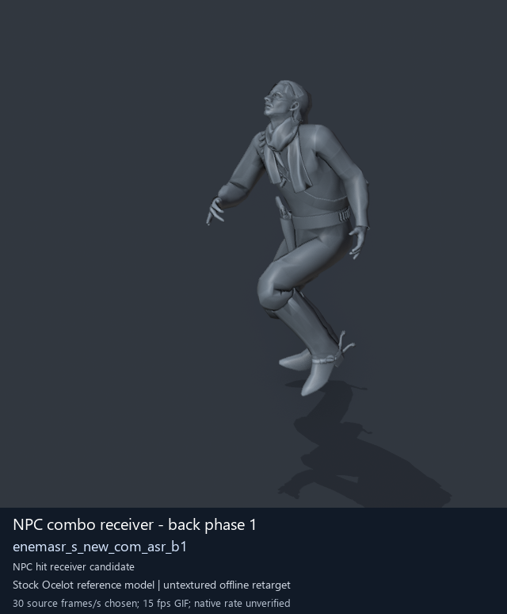
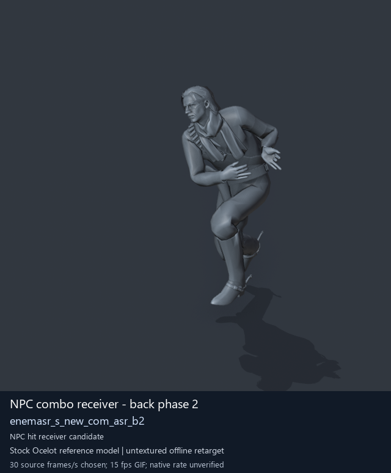
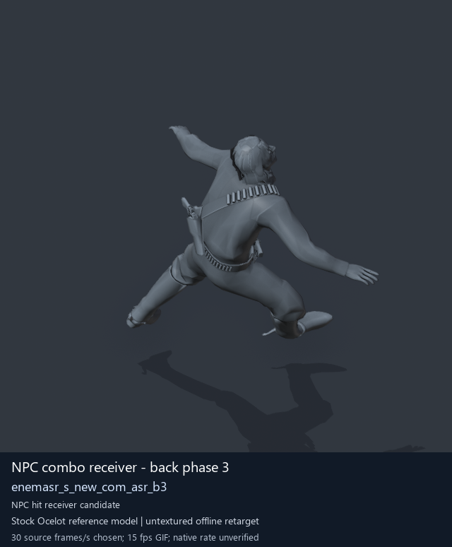
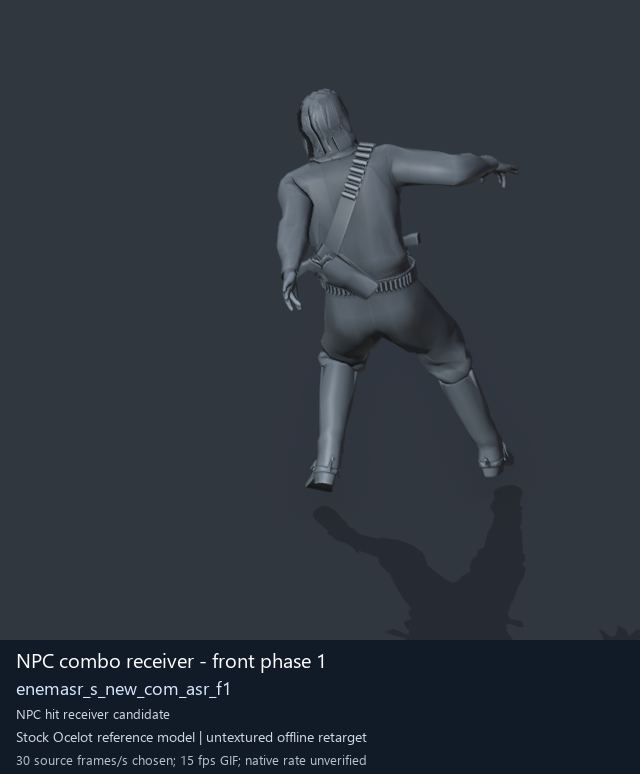

# NPC receiving and reaction candidates - page 1 of 2

[Library index](../README.md) · [Switch to animated previews](npc-receivers-1.md)

**Still-image mode (no GIFs loaded)** · 4 previews · 0.45 MiB of image files. Click a preview or title for its larger GIF and complete data.

Pages: **1** · [2](npc-receivers-2-stills.md)

Categories/tags are authored retrieval labels; candidate source roles and observed reference posture remain distinct. GANI paths are virtual asset locations. Recorded container chains are historical source locations; current DAT contents are unverified. [Description matching and credits](../description-sources.md) explain why a community description may be unavailable.

All clips are offline Ocelot reference previews. Native timing, weapon/contact, pairing and actor compatibility remain unverified; duration uses a chosen preview rate.

| Preview | Animation | Category | Tags | Virtual GANI directory / file | MTAR / container location | Community source description | Credits | Frames / data |
| --- | --- | --- | --- | --- | --- | --- | --- | --- |
|  | [NPC combo receiver - back phase 1](../clips/mgsv-tpp-soldier_common-eb18706e40a.md) <code>enemasr_s_new_com_asr_b1</code> Authored preview label | NPC receiving and reaction candidates | <code>offline-reference</code> <code>source-Soldier2Common archive (membership does not prove actor use)</code> <code>cqc</code> <code>receiver-candidate</code> <code>reaction-candidate</code> <code>back-family</code> <code>phase-1</code> | <code>/Assets/tpp/motion/SI_game/fani/bodies/enem/enemasr/</code> <code>enemasr_s_new_com_asr_b1.gani</code> | DAT: <code>a_chunk7.dat</code> FPK: <code>/Assets/tpp/pack/soldier/common/Soldier2Common.fpk</code> MTAR: <code>/Assets/tpp/motion/mtar/soldier2/Soldier_common.mtar</code> Historical source receipt | Unavailable: no verified exact source match. | Game: Konami / Kojima Productions Labels: arsenal-pt / Codex [Per-entry provenance](../clips/mgsv-tpp-soldier_common-eb18706e40a.md#credits-and-evidence) | 87 raw 2.9 s (chosen) [Full data](../clips/mgsv-tpp-soldier_common-eb18706e40a.md#technical-data) |
|  | [NPC combo receiver - back phase 2](../clips/mgsv-tpp-soldier_common-3996cc2687e1f.md) <code>enemasr_s_new_com_asr_b2</code> Authored preview label | NPC receiving and reaction candidates | <code>offline-reference</code> <code>source-Soldier2Common archive (membership does not prove actor use)</code> <code>cqc</code> <code>receiver-candidate</code> <code>reaction-candidate</code> <code>back-family</code> <code>phase-2</code> | <code>/Assets/tpp/motion/SI_game/fani/bodies/enem/enemasr/</code> <code>enemasr_s_new_com_asr_b2.gani</code> | DAT: <code>a_chunk7.dat</code> FPK: <code>/Assets/tpp/pack/soldier/common/Soldier2Common.fpk</code> MTAR: <code>/Assets/tpp/motion/mtar/soldier2/Soldier_common.mtar</code> Historical source receipt | Unavailable: no verified exact source match. | Game: Konami / Kojima Productions Labels: arsenal-pt / Codex [Per-entry provenance](../clips/mgsv-tpp-soldier_common-3996cc2687e1f.md#credits-and-evidence) | 98 raw 3.27 s (chosen) [Full data](../clips/mgsv-tpp-soldier_common-3996cc2687e1f.md#technical-data) |
|  | [NPC combo receiver - back phase 3](../clips/mgsv-tpp-soldier_common-369dec61164bd.md) <code>enemasr_s_new_com_asr_b3</code> Authored preview label | NPC receiving and reaction candidates | <code>offline-reference</code> <code>source-Soldier2Common archive (membership does not prove actor use)</code> <code>cqc</code> <code>receiver-candidate</code> <code>reaction-candidate</code> <code>back-family</code> <code>phase-3</code> | <code>/Assets/tpp/motion/SI_game/fani/bodies/enem/enemasr/</code> <code>enemasr_s_new_com_asr_b3.gani</code> | DAT: <code>a_chunk7.dat</code> FPK: <code>/Assets/tpp/pack/soldier/common/Soldier2Common.fpk</code> MTAR: <code>/Assets/tpp/motion/mtar/soldier2/Soldier_common.mtar</code> Historical source receipt | Unavailable: no verified exact source match. | Game: Konami / Kojima Productions Labels: arsenal-pt / Codex [Per-entry provenance](../clips/mgsv-tpp-soldier_common-369dec61164bd.md#credits-and-evidence) | 120 raw 4 s (chosen) [Full data](../clips/mgsv-tpp-soldier_common-369dec61164bd.md#technical-data) |
|  | [NPC combo receiver - front phase 1](../clips/mgsv-tpp-soldier_common-2cf6595afc1aa.md) <code>enemasr_s_new_com_asr_f1</code> Authored preview label | NPC receiving and reaction candidates | <code>offline-reference</code> <code>source-Soldier2Common archive (membership does not prove actor use)</code> <code>cqc</code> <code>receiver-candidate</code> <code>reaction-candidate</code> <code>front-family</code> <code>phase-1</code> | <code>/Assets/tpp/motion/SI_game/fani/bodies/enem/enemasr/</code> <code>enemasr_s_new_com_asr_f1.gani</code> | DAT: <code>a_chunk7.dat</code> FPK: <code>/Assets/tpp/pack/soldier/common/Soldier2Common.fpk</code> MTAR: <code>/Assets/tpp/motion/mtar/soldier2/Soldier_common.mtar</code> Historical source receipt | Unavailable: no verified exact source match. | Game: Konami / Kojima Productions Labels: arsenal-pt / Codex [Per-entry provenance](../clips/mgsv-tpp-soldier_common-2cf6595afc1aa.md#credits-and-evidence) | 65 raw 2.17 s (chosen) [Full data](../clips/mgsv-tpp-soldier_common-2cf6595afc1aa.md#technical-data) |

Pages: **1** · [2](npc-receivers-2-stills.md)

[All data (JSON)](../catalogue.json) · [Spreadsheet data (CSV)](../catalogue.csv) · [Source review](../description-sources.md)
