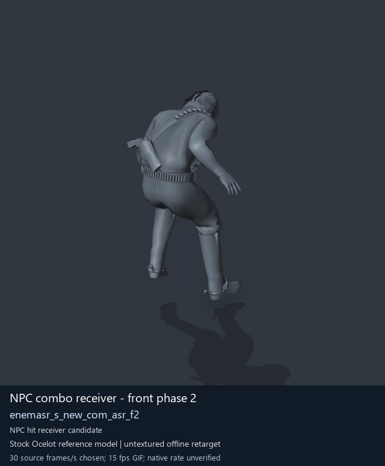
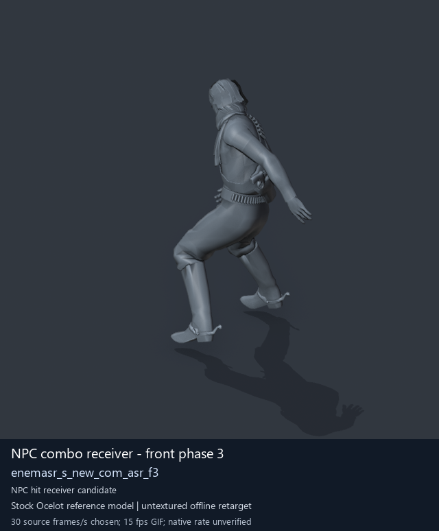
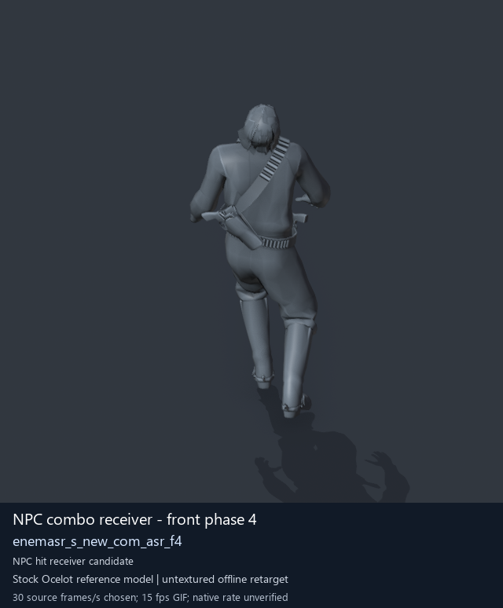
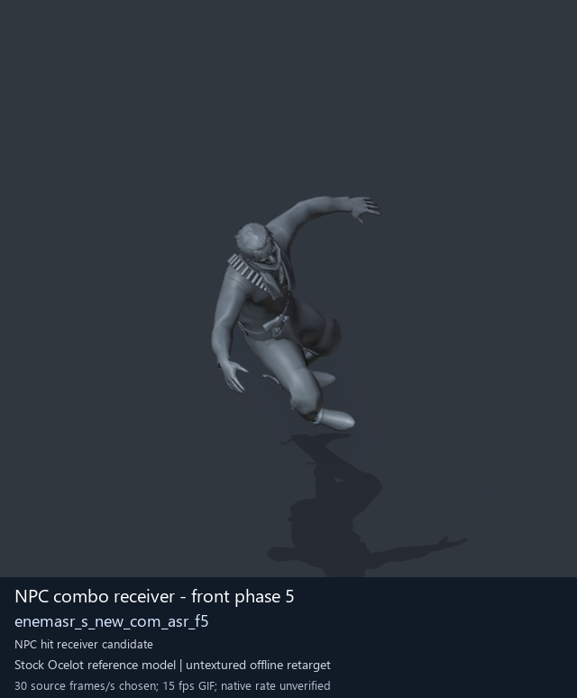

# NPC receiving and reaction candidates - page 2 of 2

[Library index](../README.md) · [Switch to animated previews](npc-receivers-2.md)

**Still-image mode (no GIFs loaded)** · 4 previews · 0.41 MiB of image files. Click a preview or title for its larger GIF and complete data.

Pages: [1](npc-receivers-1-stills.md) · **2**

Tags describe the source actor/family, action, weapon class and posture where supported. Descriptions are concise authored action summaries unless an exact source description is verified. Credits, confidence and source matching are retained on each detail page and in [source notes](../description-sources.md).

The visible Ocelot mesh is a reference model, separate from the motion origin. FPK member paths and selected clip bytes were checked directly against retained assets; outer FPK/DAT origins are historical and current DAT contents remain unverified. Native timing, held-weapon/contact, pairing and actor compatibility remain unverified.

| Preview | Animation | Category | Tags | Virtual GANI directory / file | MTAR / container location | Description | Frames / data |
| --- | --- | --- | --- | --- | --- | --- | --- |
|  | [NPC combo receiver - front phase 2](../clips/mgsv-tpp-soldier_common-2fa7f3ebdc793.md) <code>enemasr_s_new_com_asr_f2</code> Authored preview label | NPC receiving and reaction candidates | <code>CQC</code> <code>enemy soldier</code> <code>hit reaction</code> <code>combo</code> <code>front</code> <code>phase 2</code> | <code>/Assets/tpp/motion/SI_game/fani/bodies/enem/enemasr/</code> <code>enemasr_s_new_com_asr_f2.gani</code> | DAT: <code>a_chunk7.dat</code> FPK: <code>/Assets/tpp/pack/soldier/common/Soldier2Common.fpk</code> MTAR: <code>/Assets/tpp/motion/mtar/soldier2/Soldier_common.mtar</code> MTAR: verified FPK member; outer DAT/FPK origin: historical | Receiving/hit-reaction movement 2 in the front CQC combo. | 90 raw 3 s (chosen) [Full data](../clips/mgsv-tpp-soldier_common-2fa7f3ebdc793.md#technical-data) |
|  | [NPC combo receiver - front phase 3](../clips/mgsv-tpp-soldier_common-26966dd52b38f.md) <code>enemasr_s_new_com_asr_f3</code> Authored preview label | NPC receiving and reaction candidates | <code>CQC</code> <code>enemy soldier</code> <code>hit reaction</code> <code>combo</code> <code>front</code> <code>phase 3</code> | <code>/Assets/tpp/motion/SI_game/fani/bodies/enem/enemasr/</code> <code>enemasr_s_new_com_asr_f3.gani</code> | DAT: <code>a_chunk7.dat</code> FPK: <code>/Assets/tpp/pack/soldier/common/Soldier2Common.fpk</code> MTAR: <code>/Assets/tpp/motion/mtar/soldier2/Soldier_common.mtar</code> MTAR: verified FPK member; outer DAT/FPK origin: historical | Receiving/hit-reaction movement 3 in the front CQC combo. | 100 raw 3.33 s (chosen) [Full data](../clips/mgsv-tpp-soldier_common-26966dd52b38f.md#technical-data) |
|  | [NPC combo receiver - front phase 4](../clips/mgsv-tpp-soldier_common-2d551b46a321c.md) <code>enemasr_s_new_com_asr_f4</code> Authored preview label | NPC receiving and reaction candidates | <code>CQC</code> <code>enemy soldier</code> <code>hit reaction</code> <code>combo</code> <code>front</code> <code>phase 4</code> | <code>/Assets/tpp/motion/SI_game/fani/bodies/enem/enemasr/</code> <code>enemasr_s_new_com_asr_f4.gani</code> | DAT: <code>a_chunk7.dat</code> FPK: <code>/Assets/tpp/pack/soldier/common/Soldier2Common.fpk</code> MTAR: <code>/Assets/tpp/motion/mtar/soldier2/Soldier_common.mtar</code> MTAR: verified FPK member; outer DAT/FPK origin: historical | Receiving/hit-reaction movement 4 in the front CQC combo. | 93 raw 3.1 s (chosen) [Full data](../clips/mgsv-tpp-soldier_common-2d551b46a321c.md#technical-data) |
|  | [NPC combo receiver - front phase 5](../clips/mgsv-tpp-soldier_common-326a085b59184.md) <code>enemasr_s_new_com_asr_f5</code> Authored preview label | NPC receiving and reaction candidates | <code>CQC</code> <code>enemy soldier</code> <code>hit reaction</code> <code>combo</code> <code>front</code> <code>phase 5</code> | <code>/Assets/tpp/motion/SI_game/fani/bodies/enem/enemasr/</code> <code>enemasr_s_new_com_asr_f5.gani</code> | DAT: <code>a_chunk7.dat</code> FPK: <code>/Assets/tpp/pack/soldier/common/Soldier2Common.fpk</code> MTAR: <code>/Assets/tpp/motion/mtar/soldier2/Soldier_common.mtar</code> MTAR: verified FPK member; outer DAT/FPK origin: historical | Receiving/hit-reaction movement 5 in the front CQC combo. | 135 raw 4.5 s (chosen) [Full data](../clips/mgsv-tpp-soldier_common-326a085b59184.md#technical-data) |

Pages: [1](npc-receivers-1-stills.md) · **2**

[All data (JSON)](../catalogue.json) · [Spreadsheet data (CSV)](../catalogue.csv) · [Source review](../description-sources.md)
