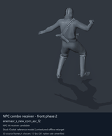
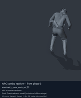
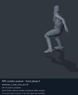
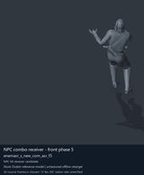

# NPC receiving and reaction candidates - page 2 of 2

[Library index](../README.md) · [Switch to still images](npc-receivers-2-stills.md)

**Animated preview mode** · 4 previews · 1.20 MiB of image files. Click a thumbnail or title for the larger GIF and full clip data.

Pages: [1](npc-receivers-1.md) · **2**

The visible model is untextured Ocelot, displaying actual decoded source motions. All entries are offline reference previews; native timing, pairing and ordinary-soldier attacker compatibility remain unverified. Durations below use a chosen preview rate.

| Preview - click to enlarge | Animation / source | Frames / preview length | Data |
| --- | --- | --- | --- |
|  | [NPC combo receiver - front phase 2](../clips/mgsv-tpp-soldier_common-2fa7f3ebdc793.md) <code>enemasr_s_new_com_asr_f2</code> <code>Soldier_common</code> | 90 raw 3 s (chosen) | [Metadata](../clips/mgsv-tpp-soldier_common-2fa7f3ebdc793.md#technical-data) Offline preview |
|  | [NPC combo receiver - front phase 3](../clips/mgsv-tpp-soldier_common-26966dd52b38f.md) <code>enemasr_s_new_com_asr_f3</code> <code>Soldier_common</code> | 100 raw 3.33 s (chosen) | [Metadata](../clips/mgsv-tpp-soldier_common-26966dd52b38f.md#technical-data) Offline preview |
|  | [NPC combo receiver - front phase 4](../clips/mgsv-tpp-soldier_common-2d551b46a321c.md) <code>enemasr_s_new_com_asr_f4</code> <code>Soldier_common</code> | 93 raw 3.1 s (chosen) | [Metadata](../clips/mgsv-tpp-soldier_common-2d551b46a321c.md#technical-data) Offline preview |
|  | [NPC combo receiver - front phase 5](../clips/mgsv-tpp-soldier_common-326a085b59184.md) <code>enemasr_s_new_com_asr_f5</code> <code>Soldier_common</code> | 135 raw 4.5 s (chosen) | [Metadata](../clips/mgsv-tpp-soldier_common-326a085b59184.md#technical-data) Offline preview |

Pages: [1](npc-receivers-1.md) · **2**

[All data (JSON)](../catalogue.json) · [Spreadsheet data (CSV)](../catalogue.csv) · [Research references](../references.md)
