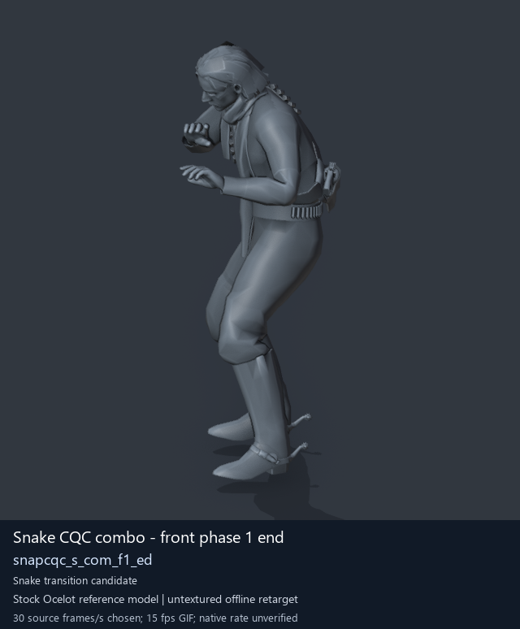
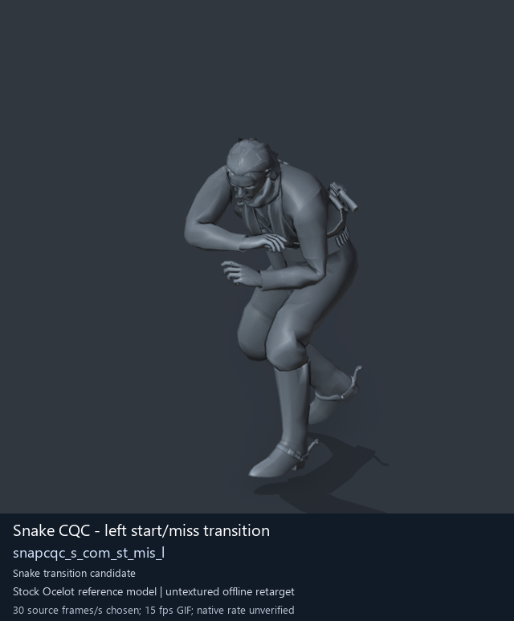
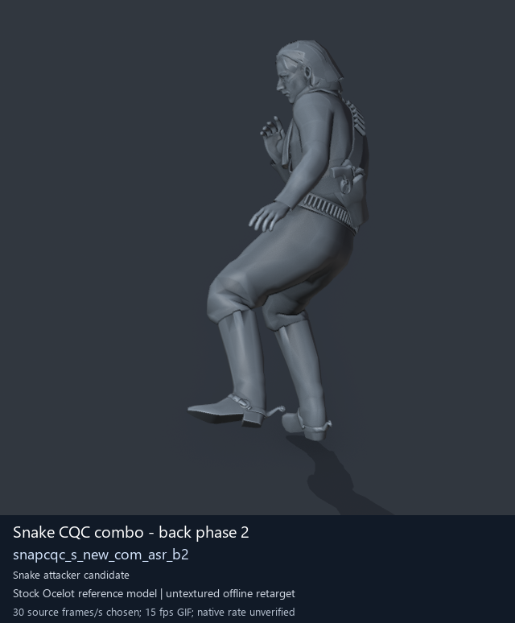
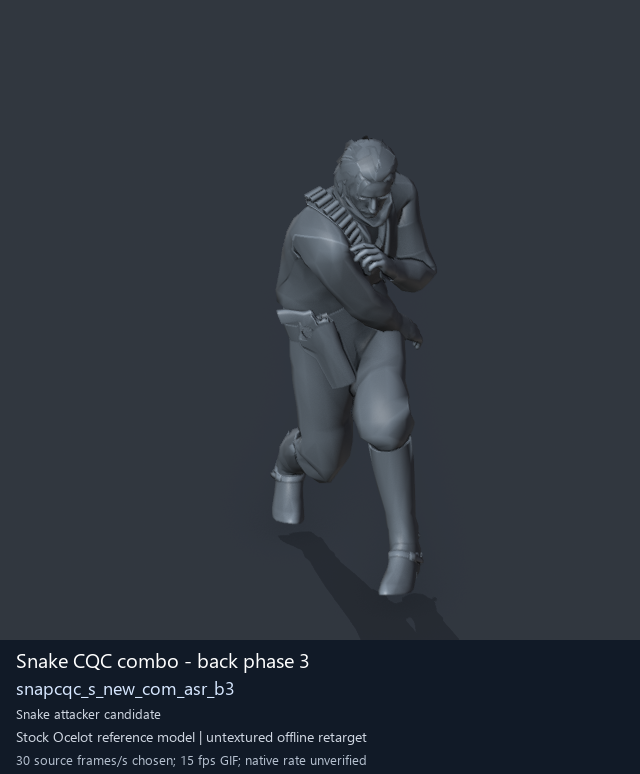

# Snake CQC combo and transition candidates - page 1 of 3

[Library index](../README.md) · [Switch to animated previews](snake-cqc-1.md)

**Still-image mode (no GIFs loaded)** · 4 previews · 0.48 MiB of image files. Click a preview or title for its larger GIF and complete data.

Pages: **1** · [2](snake-cqc-2-stills.md) · [3](snake-cqc-3-stills.md)

Tags describe the source actor/family, action, weapon class and posture where supported. Descriptions are concise authored action summaries unless an exact source description is verified. Credits, confidence and source matching are retained on each detail page and in [source notes](../description-sources.md).

The visible Ocelot mesh is a reference model, separate from the motion origin. FPK member paths and selected clip bytes were checked directly against retained assets; outer FPK/DAT origins are historical and current DAT contents remain unverified. Native timing, held-weapon/contact, pairing and actor compatibility remain unverified.

| Preview | Animation | Category | Tags | Virtual GANI directory / file | MTAR / container location | Description | Frames / data |
| --- | --- | --- | --- | --- | --- | --- | --- |
|  | [Snake CQC combo - front phase 1 end](../clips/mgsv-tpp-player2_cqc-16b0a2fb40a09.md) <code>snapcqc_s_com_f1_ed</code> Authored preview label | Snake CQC combo and transition candidates | <code>CQC</code> <code>Snake</code> <code>player</code> <code>combo</code> <code>transition</code> <code>ending</code> | <code>/Assets/tpp/motion/SI_game/fani/bodies/snap/snapcqc/</code> <code>snapcqc_s_com_f1_ed.gani</code> | DAT: <code>chunk0.dat</code> FPK: <code>/Assets/tpp/pack/player/motion/player2_mtbs_motion.fpk</code> MTAR: <code>/Assets/tpp/motion/mtar/player2/player2_cqc.mtar</code> MTAR: verified FPK member; outer DAT/FPK origin: historical | Short ending movement for the first front CQC combo segment. | 30 raw 1 s (chosen) [Full data](../clips/mgsv-tpp-player2_cqc-16b0a2fb40a09.md#technical-data) |
|  | [Snake CQC - left start/miss transition](../clips/mgsv-tpp-player2_cqc-e831dda3d332.md) <code>snapcqc_s_com_st_mis_l</code> Authored preview label | Snake CQC combo and transition candidates | <code>CQC</code> <code>Snake</code> <code>player</code> <code>combo</code> <code>transition</code> | <code>/Assets/tpp/motion/SI_game/fani/bodies/snap/snapcqc/</code> <code>snapcqc_s_com_st_mis_l.gani</code> | DAT: <code>chunk0.dat</code> FPK: <code>/Assets/tpp/pack/player/motion/player2_mtbs_motion.fpk</code> MTAR: <code>/Assets/tpp/motion/mtar/player2/player2_cqc.mtar</code> MTAR: verified FPK member; outer DAT/FPK origin: historical | Leftward start/miss transition for a CQC attack. | 75 raw 2.5 s (chosen) [Full data](../clips/mgsv-tpp-player2_cqc-e831dda3d332.md#technical-data) |
|  | [Snake CQC combo - back phase 2](../clips/mgsv-tpp-player2_cqc-2a144c68bf5f2.md) <code>snapcqc_s_new_com_asr_b2</code> Authored preview label | Snake CQC combo and transition candidates | <code>CQC</code> <code>Snake</code> <code>player</code> <code>combo</code> <code>back</code> <code>phase 2</code> | <code>/Assets/tpp/motion/SI_game/fani/bodies/snap/snapcqc/</code> <code>snapcqc_s_new_com_asr_b2.gani</code> | DAT: <code>chunk0.dat</code> FPK: <code>/Assets/tpp/pack/player/motion/player2_mtbs_motion.fpk</code> MTAR: <code>/Assets/tpp/motion/mtar/player2/player2_cqc.mtar</code> MTAR: verified FPK member; outer DAT/FPK origin: historical | Attack segment 2 of Snake&#x27;s back CQC combo. | 85 raw 2.83 s (chosen) [Full data](../clips/mgsv-tpp-player2_cqc-2a144c68bf5f2.md#technical-data) |
|  | [Snake CQC combo - back phase 3](../clips/mgsv-tpp-player2_cqc-102647d14d3f3.md) <code>snapcqc_s_new_com_asr_b3</code> Authored preview label | Snake CQC combo and transition candidates | <code>CQC</code> <code>Snake</code> <code>player</code> <code>combo</code> <code>back</code> <code>phase 3</code> | <code>/Assets/tpp/motion/SI_game/fani/bodies/snap/snapcqc/</code> <code>snapcqc_s_new_com_asr_b3.gani</code> | DAT: <code>chunk0.dat</code> FPK: <code>/Assets/tpp/pack/player/motion/player2_mtbs_motion.fpk</code> MTAR: <code>/Assets/tpp/motion/mtar/player2/player2_cqc.mtar</code> MTAR: verified FPK member; outer DAT/FPK origin: historical | Attack segment 3 of Snake&#x27;s back CQC combo. | 90 raw 3 s (chosen) [Full data](../clips/mgsv-tpp-player2_cqc-102647d14d3f3.md#technical-data) |

Pages: **1** · [2](snake-cqc-2-stills.md) · [3](snake-cqc-3-stills.md)

[All data (JSON)](../catalogue.json) · [Spreadsheet data (CSV)](../catalogue.csv) · [Source review](../description-sources.md)
