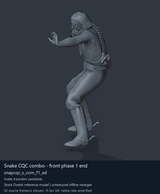
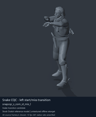
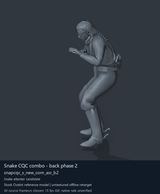
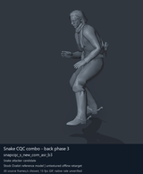

# Snake CQC combo and transition candidates - page 1 of 3

[Library index](../README.md) · [Switch to still images](snake-cqc-1-stills.md)

**Animated preview mode** · 4 previews · 0.93 MiB of image files. Click a preview or title for its larger GIF and complete data.

Pages: **1** · [2](snake-cqc-2.md) · [3](snake-cqc-3.md)

Categories/tags are authored retrieval labels; candidate source roles and observed reference posture remain distinct. GANI paths are virtual asset locations. Recorded container chains are historical source locations; current DAT contents are unverified. [Description matching and credits](../description-sources.md) explain why a community description may be unavailable.

All clips are offline Ocelot reference previews. Native timing, weapon/contact, pairing and actor compatibility remain unverified; duration uses a chosen preview rate.

| Preview | Animation | Category | Tags | Virtual GANI directory / file | MTAR / container location | Community source description | Credits | Frames / data |
| --- | --- | --- | --- | --- | --- | --- | --- | --- |
|  | [Snake CQC combo - front phase 1 end](../clips/mgsv-tpp-player2_cqc-16b0a2fb40a09.md) <code>snapcqc_s_com_f1_ed</code> Authored preview label | Snake CQC combo and transition candidates | <code>offline-reference</code> <code>source-player</code> <code>cqc</code> <code>combo-candidate</code> <code>transition-candidate</code> <code>ending-candidate</code> | <code>/Assets/tpp/motion/SI_game/fani/bodies/snap/snapcqc/</code> <code>snapcqc_s_com_f1_ed.gani</code> | DAT: <code>chunk0.dat</code> FPK: <code>/Assets/tpp/pack/player/motion/player2_mtbs_motion.fpk</code> MTAR: <code>/Assets/tpp/motion/mtar/player2/player2_cqc.mtar</code> Historical source receipt | Unavailable: no verified exact source match. | Game: Konami / Kojima Productions Labels: arsenal-pt / Codex [Per-entry provenance](../clips/mgsv-tpp-player2_cqc-16b0a2fb40a09.md#credits-and-evidence) | 30 raw 1 s (chosen) [Full data](../clips/mgsv-tpp-player2_cqc-16b0a2fb40a09.md#technical-data) |
|  | [Snake CQC - left start/miss transition](../clips/mgsv-tpp-player2_cqc-e831dda3d332.md) <code>snapcqc_s_com_st_mis_l</code> Authored preview label | Snake CQC combo and transition candidates | <code>offline-reference</code> <code>source-player</code> <code>cqc</code> <code>combo-candidate</code> <code>transition-candidate</code> | <code>/Assets/tpp/motion/SI_game/fani/bodies/snap/snapcqc/</code> <code>snapcqc_s_com_st_mis_l.gani</code> | DAT: <code>chunk0.dat</code> FPK: <code>/Assets/tpp/pack/player/motion/player2_mtbs_motion.fpk</code> MTAR: <code>/Assets/tpp/motion/mtar/player2/player2_cqc.mtar</code> Historical source receipt | Unavailable: no verified exact source match. | Game: Konami / Kojima Productions Labels: arsenal-pt / Codex [Per-entry provenance](../clips/mgsv-tpp-player2_cqc-e831dda3d332.md#credits-and-evidence) | 75 raw 2.5 s (chosen) [Full data](../clips/mgsv-tpp-player2_cqc-e831dda3d332.md#technical-data) |
|  | [Snake CQC combo - back phase 2](../clips/mgsv-tpp-player2_cqc-2a144c68bf5f2.md) <code>snapcqc_s_new_com_asr_b2</code> Authored preview label | Snake CQC combo and transition candidates | <code>offline-reference</code> <code>source-player</code> <code>cqc</code> <code>combo-candidate</code> <code>back-family</code> <code>phase-2</code> | <code>/Assets/tpp/motion/SI_game/fani/bodies/snap/snapcqc/</code> <code>snapcqc_s_new_com_asr_b2.gani</code> | DAT: <code>chunk0.dat</code> FPK: <code>/Assets/tpp/pack/player/motion/player2_mtbs_motion.fpk</code> MTAR: <code>/Assets/tpp/motion/mtar/player2/player2_cqc.mtar</code> Historical source receipt | Unavailable: no verified exact source match. | Game: Konami / Kojima Productions Labels: arsenal-pt / Codex [Per-entry provenance](../clips/mgsv-tpp-player2_cqc-2a144c68bf5f2.md#credits-and-evidence) | 85 raw 2.83 s (chosen) [Full data](../clips/mgsv-tpp-player2_cqc-2a144c68bf5f2.md#technical-data) |
|  | [Snake CQC combo - back phase 3](../clips/mgsv-tpp-player2_cqc-102647d14d3f3.md) <code>snapcqc_s_new_com_asr_b3</code> Authored preview label | Snake CQC combo and transition candidates | <code>offline-reference</code> <code>source-player</code> <code>cqc</code> <code>combo-candidate</code> <code>back-family</code> <code>phase-3</code> | <code>/Assets/tpp/motion/SI_game/fani/bodies/snap/snapcqc/</code> <code>snapcqc_s_new_com_asr_b3.gani</code> | DAT: <code>chunk0.dat</code> FPK: <code>/Assets/tpp/pack/player/motion/player2_mtbs_motion.fpk</code> MTAR: <code>/Assets/tpp/motion/mtar/player2/player2_cqc.mtar</code> Historical source receipt | Unavailable: no verified exact source match. | Game: Konami / Kojima Productions Labels: arsenal-pt / Codex [Per-entry provenance](../clips/mgsv-tpp-player2_cqc-102647d14d3f3.md#credits-and-evidence) | 90 raw 3 s (chosen) [Full data](../clips/mgsv-tpp-player2_cqc-102647d14d3f3.md#technical-data) |

Pages: **1** · [2](snake-cqc-2.md) · [3](snake-cqc-3.md)

[All data (JSON)](../catalogue.json) · [Spreadsheet data (CSV)](../catalogue.csv) · [Source review](../description-sources.md)
