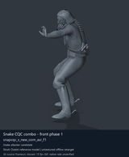
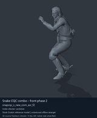
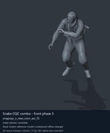
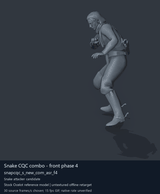

# Snake CQC combo and transition candidates - page 2 of 3

[Library index](../README.md) · [Switch to still images](snake-cqc-2-stills.md)

**Animated preview mode** · 4 previews · 0.98 MiB of image files. Click a thumbnail or title for the larger GIF and full clip data.

Pages: [1](snake-cqc-1.md) · **2** · [3](snake-cqc-3.md)

The visible model is untextured Ocelot, displaying actual decoded source motions. All entries are offline reference previews; native timing, pairing and ordinary-soldier attacker compatibility remain unverified. Durations below use a chosen preview rate.

| Preview - click to enlarge | Animation / source | Frames / preview length | Data |
| --- | --- | --- | --- |
|  | [Snake CQC combo - front phase 1](../clips/mgsv-tpp-player2_cqc-6b4ebb77250b.md) <code>snapcqc_s_new_com_asr_f1</code> <code>player2_cqc</code> | 60 raw 2 s (chosen) | [Metadata](../clips/mgsv-tpp-player2_cqc-6b4ebb77250b.md#technical-data) Offline preview |
|  | [Snake CQC combo - front phase 2](../clips/mgsv-tpp-player2_cqc-3a075aca6a734.md) <code>snapcqc_s_new_com_asr_f2</code> <code>player2_cqc</code> | 78 raw 2.6 s (chosen) | [Metadata](../clips/mgsv-tpp-player2_cqc-3a075aca6a734.md#technical-data) Offline preview |
|  | [Snake CQC combo - front phase 3](../clips/mgsv-tpp-player2_cqc-138b1932095af.md) <code>snapcqc_s_new_com_asr_f3</code> <code>player2_cqc</code> | 83 raw 2.77 s (chosen) | [Metadata](../clips/mgsv-tpp-player2_cqc-138b1932095af.md#technical-data) Offline preview |
|  | [Snake CQC combo - front phase 4](../clips/mgsv-tpp-player2_cqc-2471f88c4999c.md) <code>snapcqc_s_new_com_asr_f4</code> <code>player2_cqc</code> | 85 raw 2.83 s (chosen) | [Metadata](../clips/mgsv-tpp-player2_cqc-2471f88c4999c.md#technical-data) Offline preview |

Pages: [1](snake-cqc-1.md) · **2** · [3](snake-cqc-3.md)

[All data (JSON)](../catalogue.json) · [Spreadsheet data (CSV)](../catalogue.csv) · [Research references](../references.md)
