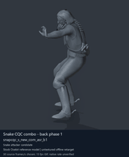
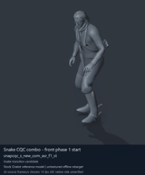
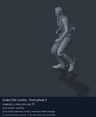

# Snake CQC combo and transition candidates - page 3 of 3

[Library index](../README.md) · [Switch to still images](snake-cqc-3-stills.md)

**Animated preview mode** · 3 previews · 0.60 MiB of image files. Click a thumbnail or title for the larger GIF and full clip data.

Pages: [1](snake-cqc-1.md) · [2](snake-cqc-2.md) · **3**

The visible model is untextured Ocelot, displaying actual decoded source motions. All entries are offline reference previews; native timing, pairing and ordinary-soldier attacker compatibility remain unverified. Durations below use a chosen preview rate.

| Preview - click to enlarge | Animation / source | Frames / preview length | Data |
| --- | --- | --- | --- |
|  | [Snake CQC combo - back phase 1](../clips/mgsv-tpp-player2_resident-36c8fbcb8b28a.md) <code>snapcqc_s_new_com_asr_b1</code> <code>player2_resident</code> | 60 raw 2 s (chosen) | [Metadata](../clips/mgsv-tpp-player2_resident-36c8fbcb8b28a.md#technical-data) Offline preview |
|  | [Snake CQC combo - front phase 1 start](../clips/mgsv-tpp-player2_resident-4857fd9e7ebc.md) <code>snapcqc_s_new_com_asr_f1_st</code> <code>player2_resident</code> | 25 raw 0.83 s (chosen) | [Metadata](../clips/mgsv-tpp-player2_resident-4857fd9e7ebc.md#technical-data) Offline preview |
|  | [Snake CQC combo - front phase 5](../clips/mgsv-tpp-player2_resident-1a1c4551b3706.md) <code>snapcqc_s_new_com_asr_f5</code> <code>player2_resident</code> | 105 raw 3.5 s (chosen) | [Metadata](../clips/mgsv-tpp-player2_resident-1a1c4551b3706.md#technical-data) Offline preview |

Pages: [1](snake-cqc-1.md) · [2](snake-cqc-2.md) · **3**

[All data (JSON)](../catalogue.json) · [Spreadsheet data (CSV)](../catalogue.csv) · [Research references](../references.md)
