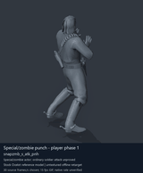
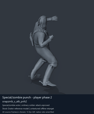
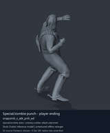
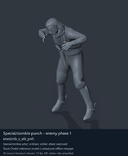

# Special / zombie actor candidates - page 1 of 2

[Library index](../README.md) · [Switch to still images](special-actors-1-stills.md)

**Animated preview mode** · 4 previews · 0.66 MiB of image files. Click a thumbnail or title for the larger GIF and full clip data.

Pages: **1** · [2](special-actors-2.md)

The visible model is untextured Ocelot, displaying actual decoded source motions. All entries are offline reference previews; native timing, pairing and ordinary-soldier attacker compatibility remain unverified. Durations below use a chosen preview rate.

| Preview - click to enlarge | Animation / source | Frames / preview length | Data |
| --- | --- | --- | --- |
|  | [Special/zombie punch - player phase 1](../clips/mgsv-tpp-player2_resident-18dfe32fab367.md) <code>snapzmb_s_atk_pnh</code> <code>player2_resident</code> | 60 raw 2 s (chosen) | [Metadata](../clips/mgsv-tpp-player2_resident-18dfe32fab367.md#technical-data) Offline preview |
|  | [Special/zombie punch - player phase 2](../clips/mgsv-tpp-player2_resident-29553c4699ca8.md) <code>snapzmb_s_atk_pnh2</code> <code>player2_resident</code> | 43 raw 1.43 s (chosen) | [Metadata](../clips/mgsv-tpp-player2_resident-29553c4699ca8.md#technical-data) Offline preview |
|  | [Special/zombie punch - player ending](../clips/mgsv-tpp-player2_resident-34ff0e1541984.md) <code>snapzmb_s_atk_pnh_ed</code> <code>player2_resident</code> | 15 raw 0.5 s (chosen) | [Metadata](../clips/mgsv-tpp-player2_resident-34ff0e1541984.md#technical-data) Offline preview |
|  | [Special/zombie punch - enemy phase 1](../clips/mgsv-tpp-soldier_common-17e48d5c5ad12.md) <code>enetzmb_s_atk_pnh</code> <code>Soldier_common</code> | 60 raw 2 s (chosen) | [Metadata](../clips/mgsv-tpp-soldier_common-17e48d5c5ad12.md#technical-data) Offline preview |

Pages: **1** · [2](special-actors-2.md)

[All data (JSON)](../catalogue.json) · [Spreadsheet data (CSV)](../catalogue.csv) · [Research references](../references.md)
