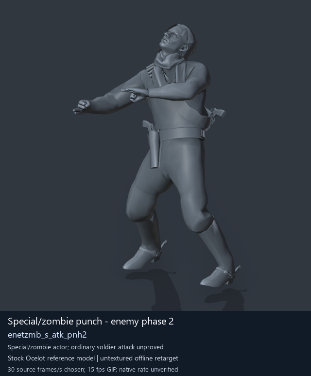
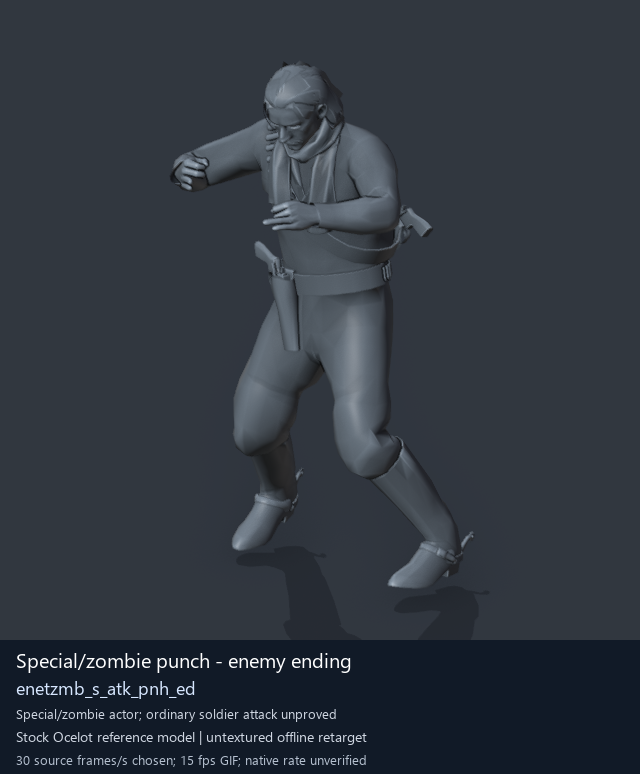

# Special / zombie actor candidates - page 2 of 2

[Library index](../README.md) · [Switch to animated previews](special-actors-2.md)

**Still-image mode (no GIFs loaded)** · 2 previews · 0.28 MiB of image files. Click a preview or title for its larger GIF and complete data.

Pages: [1](special-actors-1-stills.md) · **2**

Categories/tags are authored retrieval labels; candidate source roles and observed reference posture remain distinct. GANI paths are virtual asset locations. Recorded container chains are historical source locations; current DAT contents are unverified. [Description matching and credits](../description-sources.md) explain why a community description may be unavailable.

All clips are offline Ocelot reference previews. Native timing, weapon/contact, pairing and actor compatibility remain unverified; duration uses a chosen preview rate.

| Preview | Animation | Category | Tags | Virtual GANI directory / file | MTAR / container location | Community source description | Credits | Frames / data |
| --- | --- | --- | --- | --- | --- | --- | --- | --- |
|  | [Special/zombie punch - enemy phase 2](../clips/mgsv-tpp-soldier_common-244c2b65d1149.md) <code>enetzmb_s_atk_pnh2</code> Authored preview label | Special / zombie actor candidates | <code>offline-reference</code> <code>source-Soldier2Common archive (membership does not prove actor use)</code> <code>special-actor</code> <code>zombie-namespace</code> <code>punch-candidate</code> | <code>/Assets/tpp/motion/SI_game/fani/bodies/enet/enetzmb/</code> <code>enetzmb_s_atk_pnh2.gani</code> | DAT: <code>a_chunk7.dat</code> FPK: <code>/Assets/tpp/pack/soldier/common/Soldier2Common.fpk</code> MTAR: <code>/Assets/tpp/motion/mtar/soldier2/Soldier_common.mtar</code> Historical source receipt | Unavailable: no verified exact source match. | Game: Konami / Kojima Productions Labels: arsenal-pt / Codex [Per-entry provenance](../clips/mgsv-tpp-soldier_common-244c2b65d1149.md#credits-and-evidence) | 43 raw 1.43 s (chosen) [Full data](../clips/mgsv-tpp-soldier_common-244c2b65d1149.md#technical-data) |
|  | [Special/zombie punch - enemy ending](../clips/mgsv-tpp-soldier_common-3f61b4434967.md) <code>enetzmb_s_atk_pnh_ed</code> Authored preview label | Special / zombie actor candidates | <code>offline-reference</code> <code>source-Soldier2Common archive (membership does not prove actor use)</code> <code>special-actor</code> <code>zombie-namespace</code> <code>punch-candidate</code> <code>ending-candidate</code> | <code>/Assets/tpp/motion/SI_game/fani/bodies/enet/enetzmb/</code> <code>enetzmb_s_atk_pnh_ed.gani</code> | DAT: <code>a_chunk7.dat</code> FPK: <code>/Assets/tpp/pack/soldier/common/Soldier2Common.fpk</code> MTAR: <code>/Assets/tpp/motion/mtar/soldier2/Soldier_common.mtar</code> Historical source receipt | Unavailable: no verified exact source match. | Game: Konami / Kojima Productions Labels: arsenal-pt / Codex [Per-entry provenance](../clips/mgsv-tpp-soldier_common-3f61b4434967.md#credits-and-evidence) | 15 raw 0.5 s (chosen) [Full data](../clips/mgsv-tpp-soldier_common-3f61b4434967.md#technical-data) |

Pages: [1](special-actors-1-stills.md) · **2**

[All data (JSON)](../catalogue.json) · [Spreadsheet data (CSV)](../catalogue.csv) · [Source review](../description-sources.md)
