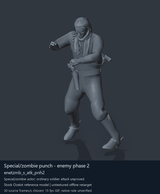
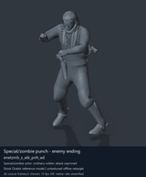

# Special / zombie actor candidates - page 2 of 2

[Library index](../README.md) · [Switch to still images](special-actors-2-stills.md)

**Animated preview mode** · 2 previews · 0.23 MiB of image files. Click a thumbnail or title for the larger GIF and full clip data.

Pages: [1](special-actors-1.md) · **2**

The visible model is untextured Ocelot, displaying actual decoded source motions. All entries are offline reference previews; native timing, pairing and ordinary-soldier attacker compatibility remain unverified. Durations below use a chosen preview rate.

| Preview - click to enlarge | Animation / source | Frames / preview length | Data |
| --- | --- | --- | --- |
|  | [Special/zombie punch - enemy phase 2](../clips/mgsv-tpp-soldier_common-244c2b65d1149.md) <code>enetzmb_s_atk_pnh2</code> <code>Soldier_common</code> | 43 raw 1.43 s (chosen) | [Metadata](../clips/mgsv-tpp-soldier_common-244c2b65d1149.md#technical-data) Offline preview |
|  | [Special/zombie punch - enemy ending](../clips/mgsv-tpp-soldier_common-3f61b4434967.md) <code>enetzmb_s_atk_pnh_ed</code> <code>Soldier_common</code> | 15 raw 0.5 s (chosen) | [Metadata](../clips/mgsv-tpp-soldier_common-3f61b4434967.md#technical-data) Offline preview |

Pages: [1](special-actors-1.md) · **2**

[All data (JSON)](../catalogue.json) · [Spreadsheet data (CSV)](../catalogue.csv) · [Research references](../references.md)
