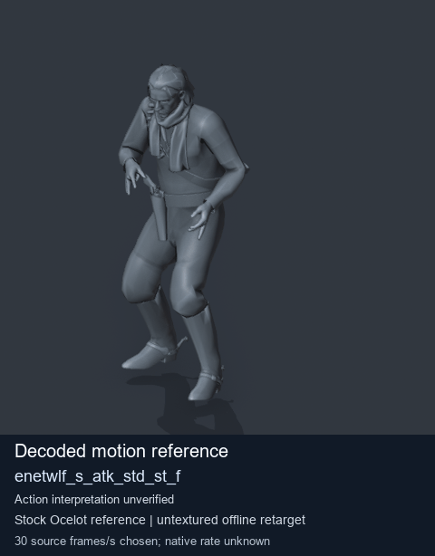

# Stock Soldier_common motion references - Stock motion reference: enetwlf_s_atk_std_st_f - page 1 of 1

[Library index](../README.md) · [Switch to still images](stock-ca89c3cb5cf47bbe71b3c6ecea0d1fcc257356e3b99093a350f05b69786a9b0d-stills.md)

**Animated preview mode** · 1 previews · 3.89 MiB of image files. Click a preview or title for its larger GIF and complete data.

Pages: **1**

Tags describe the source actor/family, action, weapon class and posture where supported. Descriptions are concise authored action summaries unless an exact source description is verified. Credits, confidence and source matching are retained on each detail page and in [source notes](../description-sources.md).

The visible Ocelot mesh is a reference model, separate from the motion origin. These stock entries bind exact retained MTAR/payload/header identities; FPK/DAT membership and arbitrary actor/weapon compatibility remain unverified. Per-clip visual review may be pending.

| Preview | Animation | Category | Tags | Virtual GANI directory / file | MTAR / container location | Description | Frames / data |
| --- | --- | --- | --- | --- | --- | --- | --- |
|  | [Stock motion reference: enetwlf_s_atk_std_st_f](../clips/mgsv-tpp-soldier_common-payloadsha256-ca89c3cb5cf47bbe71b3c6ecea0d1fcc257356e3b99093a350f05b69786a9b0d.md) <code>enetwlf_s_atk_std_st_f</code> Authored preview label | Stock Soldier_common motion references | <code>stock body motion</code> <code>Soldier_common</code> <code>source-derived label</code> <code>Ocelot reference mesh</code> | <code>/Assets/tpp/motion/SI_game/fani/bodies/enet/enetwlf/</code> <code>enetwlf_s_atk_std_st_f.gani</code> | DAT / FPK: unverified MTAR: <code>Soldier_common.mtar</code> Exact retained archive/payload identity | Decoded stock body-motion reference enetwlf_s_atk_std_st_f; action interpretation unverified. | 128 raw 4.27 s (chosen) [Full data](../clips/mgsv-tpp-soldier_common-payloadsha256-ca89c3cb5cf47bbe71b3c6ecea0d1fcc257356e3b99093a350f05b69786a9b0d.md#technical-data) |

Pages: **1**

[All data (JSON)](../catalogue.json) · [Spreadsheet data (CSV)](../catalogue.csv) · [Source review](../description-sources.md)
