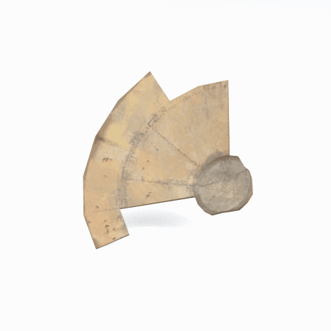

# Unidentified model (afgh_antn001_dbri003)

Native model reference; a readable object identification has not been reviewed.

[Library](../README.md) | [Category](../tables/unclassified-components-1.md) | [Source / advanced data](../catalogue.json) | [Credits](../sources-and-credits.md)

**Game filename:** afgh_antn001_dbri003.fmdl  
**Category:** Unclassified &gt; Unclassified components  
**Variant:** No explicit variant token; **LOD:** 0  
**Tags:** 

## Still reference


## 360-degree reference



The camera circles a static model. This is not a native animation. Source base textures and UVs use approximate studio shading; interaction, collision, complete assembly and FOX shader equivalence are not established.

## Identity and naming

| Field | Value |
|---|---|
| Library ID | mgsv-tpp-afgh_antn001_dbri003-3d9886745cd5e3c5 |
| Naming status | unidentified |
| Naming confidence | unknown |
| Naming evidence | {} |
| Native model | /Assets/tpp/environ/object/afghanistan/antenna/afgh_antn001/scenes/afgh_antn001_dbri003.fmdl |
| Model SHA256 | 1c424bd92ac8c747f8bf42ac4a321f0638e25c1ad8741193376e1cf245f3db9a |
| Container | /Assets/tpp/pack/location/afgh/pack_common/afgh_common.fpk |
| Container SHA256 | 810fe68a28c81299da7ef00849d2905b640d0a2da970f1b312e953a2c7b5df48 |
| Captured source / location scope | Selected native member/content and captured installed-source chain; full archive SHA/runtime priority unresolved |
| Raw record SHA256 | bc4110c6c64220f3202dab061ce051a9bd35bbfb11f5b235b78db9cb234ff817 |

Naming review is descriptive metadata only. It does not change model completion or identify a working game interaction.

## Native LOD inventory

| Native LOD | Triangles | Preview status | Decoded indices SHA256 |
|---|---:|---|---|
| 0 | 136 | rendered | 608549de1bb9a11da975623d09e5ce4ffcbbe106367a56cf954f1cc48aba4018 |
| 1 | 100 | not separately rendered | ec390b218405039c0aa60705062b6c3453606dd3b0fe2c86a914bbd3de868472 |
| 2 | 80 | not separately rendered | 9b2dbeb30667662545565c879b329f4e0b6a08b9c2a6021efc3f7d1fa3d6948d |
| 3 | 68 | not separately rendered | 8482df982618b61de294e4ae4e4b0155a4c1b8566689c0fb59210ac7bdc8e258 |

Mesh detail and texture pixels/mips are separate. Index hashes describe decoded triangle arrays, not packed index-buffer bytes. Only source-recorded native levels are listed.

<details>
<summary>Texture, source and naming technical metadata</summary>

```json
{
  "source": {
    "nativePath": "/Assets/tpp/environ/object/afghanistan/antenna/afgh_antn001/scenes/afgh_antn001_dbri003.fmdl",
    "nativeSha256": "1c424bd92ac8c747f8bf42ac4a321f0638e25c1ad8741193376e1cf245f3db9a",
    "stableIdentity": "/assets/tpp/environ/object/afghanistan/antenna/afgh_antn001/scenes/afgh_antn001_dbri003.fmdl#1c424bd92ac8c747f8bf42ac4a321f0638e25c1ad8741193376e1cf245f3db9a#bc301655a4c2f3ba19765d3497a48d5d7911288b6cd2ce4b1c172244870725d3",
    "container": {
      "nativePath": "/Assets/tpp/pack/location/afgh/pack_common/afgh_common.fpk",
      "sha256": "810fe68a28c81299da7ef00849d2905b640d0a2da970f1b312e953a2c7b5df48",
      "status": "Selected installed-source container/member chain captured by community reader"
    },
    "historicalDatOrigin": null,
    "sourceArchiveAtCapture": "master/0/00.dat",
    "locationStatus": "Selected native member/content and captured installed-source chain; full archive SHA/runtime priority unresolved",
    "currentInstalledDatVerified": false,
    "selectedInstalledMemberVerified": true,
    "evidence": {
      "archive_helper_executable_sha256": "6f8e39a436af3b024bbd0504966ab3d5d9d0cb05d86689bf3e83d15e68df613f",
      "archive_helper_source_sha256": "f662d3b63e066a0afc77ffe22ea0e564222d14469648300dba2c4f8e9b43446b",
      "archive_index_recipe": "54acff767f08d76ad6056c5387328759bc883df507788f398de6c2c04fac12db",
      "archive_reader": "Atvaark GzsTool.Core 0.5.3",
      "archive_reader_core_sha256": "9da447ae3c375cce2e46744eeff6af50f1591062afdf479d1a0b49edb47daaa3",
      "archive_tool_and_dictionary_sha256": {
        "CityHash.dll": "def6c4506d461b65e4059b2936b2cbd5f852ba5d1d8a1a527f1c0e6dc7008c8f",
        "GzsTool.Core.dll": "9da447ae3c375cce2e46744eeff6af50f1591062afdf479d1a0b49edb47daaa3",
        "GzsTool.exe": "1a9c5b11e2355383ff485aee7e86abc026f5c1fad729daf8c0fd15ee0aae1c10",
        "Zlib.Portable.dll": "fe84781ba35ca9cc5ff5f73fd08d2a66c59e5257b4573f5fe59743f30bf78e42",
        "fpk_dictionary.txt": "b82f9a8d6c10a68ba9471eca9d815c21355a53b5e68753d8ad7db7fd01bf401d",
        "qar_dictionary.txt": "1558c248ed0a4bb827888261563fbb91a2df4f03999682f85d637ff70d9d5fb2"
      },
      "bytes": 8768,
      "container_chain": [
        {
          "content_sha256": null,
          "depth": 0,
          "id": "3f19555d27c2ebecdfbad26aadd88b9f62e9fb6092c04c712963ef73c67ccb42",
          "index_sha256": "9acd3675d6e1500e0e18430cba0fdc70a5718ad7d6b62f13905891a35d59f18a",
          "kind": "qar",
          "name": "master/0/00.dat",
          "parent_occurrence": null
        },
        {
          "content_sha256": "810fe68a28c81299da7ef00849d2905b640d0a2da970f1b312e953a2c7b5df48",
          "depth": 1,
          "id": "19e9adf189f5f5e9c624197357336d49999dc3525b83bd8c71cf525fcd2100e2",
          "index_sha256": "924ec10c5736f8b618238e2523664271e558a6ad49aefdaf2473ccbad50f1231",
          "kind": "fpk",
          "name": "/Assets/tpp/pack/location/afgh/pack_common/afgh_common.fpk",
          "parent_occurrence": "e35acf6999427a88778266baae8c014a0c20a82388f8ff04caca6a88d977a6d1"
        }
      ],
      "contentSha256": "1c424bd92ac8c747f8bf42ac4a321f0638e25c1ad8741193376e1cf245f3db9a",
      "member": {
        "actual_size": 8768,
        "compressed_size": null,
        "content_sha256": "1c424bd92ac8c747f8bf42ac4a321f0638e25c1ad8741193376e1cf245f3db9a",
        "declared_size": 8768,
        "extension": "fmdl",
        "hash_hex": null,
        "name": "/Assets/tpp/environ/object/afghanistan/antenna/afgh_antn001/scenes/afgh_antn001_dbri003.fmdl",
        "name_origin": "embedded",
        "offset": 2079424,
        "ordinal": 14,
        "path_hash": null,
        "resolved": 1
      },
      "occurrenceId": "1c45f0c9894c392b6fee672f15fe884f25e7cdab12cd0c9acee665d42f8f4221",
      "occurrence_id": "1c45f0c9894c392b6fee672f15fe884f25e7cdab12cd0c9acee665d42f8f4221",
      "primary_source_revision": "fc4a8196555638c6cf8aa1b7c8dc34ccd5c69cb5",
      "source_adapter": "community_core_selective_export",
      "source_id": "7f6bb743fb4c487f0e9522f9c7fac280c46cf6b1051e0fc75a93602c8eb451f0",
      "source_path": "master/0/00.dat",
      "source_snapshot": "{\"bytes\":768788480,\"device\":621747392682911458,\"file_id\":844424931596481,\"header_sha256\":\"ead50f0a9a37e4285323b9c6fa0ec75fe75e518c63147e63158eeb2892c6589e\",\"mtime_ns\":1791852224238580700}",
      "virtualPath": "/Assets/tpp/environ/object/afghanistan/antenna/afgh_antn001/scenes/afgh_antn001_dbri003.fmdl"
    }
  },
  "materials": [
    {
      "sampler": "Base_Tex_SRGB",
      "materialIndex": 0,
      "nativePathHash": "1543207535705005893",
      "nativeVirtualPath": null,
      "nativeBinding": {
        "familyId": "44ad187945217a46d4a66583196a642fcb957ad269c32b505ca10f35dc2965b1",
        "height": 1024,
        "materialIndex": 0,
        "mipCount": 9,
        "nativeMipCountVerified": true,
        "nativePath": null,
        "nativePathHash": "1543207535705005893",
        "nativeTexture": {
          "additionalFtexsFileCount": 2,
          "depth": 1,
          "ftexsFileCount": 3,
          "height": 1024,
          "metadataBytes": 208,
          "mipCount": 9,
          "mips": [
            {
              "chunks": 32,
              "decodedBytes": 524288,
              "mip": 0,
              "offset": 0,
              "storedBytes": 402288,
              "streamNumber": 3
            },
            {
              "chunks": 8,
              "decodedBytes": 131072,
              "mip": 1,
              "offset": 0,
              "storedBytes": 105152,
              "streamNumber": 2
            },
            {
              "chunks": 2,
              "decodedBytes": 32768,
              "mip": 2,
              "offset": 9520,
              "storedBytes": 26768,
              "streamNumber": 1
            },
            {
              "chunks": 1,
              "decodedBytes": 8192,
              "mip": 3,
              "offset": 2632,
              "storedBytes": 6880,
              "streamNumber": 1
            },
            {
              "chunks": 1,
              "decodedBytes": 2048,
              "mip": 4,
              "offset": 768,
              "storedBytes": 1856,
              "streamNumber": 1
            },
            {
              "chunks": 1,
              "decodedBytes": 512,
              "mip": 5,
              "offset": 232,
              "storedBytes": 528,
              "streamNumber": 1
            },
            {
              "chunks": 1,
              "decodedBytes": 128,
              "mip": 6,
              "offset": 80,
              "storedBytes": 144,
              "streamNumber": 1
            },
            {
              "chunks": 1,
              "decodedBytes": 32,
              "mip": 7,
              "offset": 24,
              "storedBytes": 48,
              "streamNumber": 1
            },
            {
              "chunks": 1,
              "decodedBytes": 8,
              "mip": 8,
              "offset": 0,
              "storedBytes": 16,
              "streamNumber": 1
            }
          ],
          "nativeHeaderHash": "3dd0b866e07e2db9cd6d2e97008570b8",
          "nrtFlag": 2,
          "pixelFormat": 2,
          "requiredStreamNumbers": [
            1,
            2,
            3
          ],
          "textureType": 16777219,
          "unknownFlags": 273,
          "width": 1024
        },
        "samplerName": "Base_Tex_SRGB",
        "samplerNameHash": "72475356961633",
        "sha256": "6b4d41273e0c846203f798462c717e15157582b05d1cfe24f13418f15d2d4436",
        "sourceOccurrences": [
          {
            "archive_helper_executable_sha256": "6f8e39a436af3b024bbd0504966ab3d5d9d0cb05d86689bf3e83d15e68df613f",
            "archive_helper_source_sha256": "f662d3b63e066a0afc77ffe22ea0e564222d14469648300dba2c4f8e9b43446b",
            "archive_index_recipe": "54acff767f08d76ad6056c5387328759bc883df507788f398de6c2c04fac12db",
            "archive_reader": "Atvaark GzsTool.Core 0.5.3",
            "archive_reader_core_sha256": "9da447ae3c375cce2e46744eeff6af50f1591062afdf479d1a0b49edb47daaa3",
            "archive_tool_and_dictionary_sha256": {
              "CityHash.dll": "def6c4506d461b65e4059b2936b2cbd5f852ba5d1d8a1a527f1c0e6dc7008c8f",
              "GzsTool.Core.dll": "9da447ae3c375cce2e46744eeff6af50f1591062afdf479d1a0b49edb47daaa3",
              "GzsTool.exe": "1a9c5b11e2355383ff485aee7e86abc026f5c1fad729daf8c0fd15ee0aae1c10",
              "Zlib.Portable.dll": "fe84781ba35ca9cc5ff5f73fd08d2a66c59e5257b4573f5fe59743f30bf78e42",
              "fpk_dictionary.txt": "b82f9a8d6c10a68ba9471eca9d815c21355a53b5e68753d8ad7db7fd01bf401d",
              "qar_dictionary.txt": "1558c248ed0a4bb827888261563fbb91a2df4f03999682f85d637ff70d9d5fb2"
            },
            "bytes": 208,
            "container_chain": [
              {
                "content_sha256": null,
                "depth": 0,
                "id": "436c8cfb4f382de93365b167a61aa81383299b7bad18205d60f1d0beeb3919e3",
                "index_sha256": "2d7b45c6ca65418839618e978562cac336091c06eb56dfe99f762b07a4016960",
                "kind": "qar",
                "name": "master/texture4.dat",
                "parent_occurrence": null
              }
            ],
            "contentSha256": "20dee6710e7b48955f9201053325bc1af57d092e3db26449dda8139fac05e938",
            "member": {
              "actual_size": 208,
              "compressed_size": 208,
              "content_sha256": "20dee6710e7b48955f9201053325bc1af57d092e3db26449dda8139fac05e938",
              "declared_size": 208,
              "extension": "ftex",
              "hash_hex": "156a9313d4671f45",
              "name": "/Assets/tpp/environ/object/afghanistan/antenna/afgh_antn001/sourceimages/afgh_antn001_sl_bsm.ftex",
              "name_origin": "dictionary",
              "offset": 795056160,
              "ordinal": 4644,
              "path_hash": "29313d4671f45",
              "resolved": 1
            },
            "occurrenceId": "067767a1bffaecf73fe9c4e57d618ad67f84241c5223fb83a68b76bfcfcea74f",
            "occurrence_id": "067767a1bffaecf73fe9c4e57d618ad67f84241c5223fb83a68b76bfcfcea74f",
            "primary_source_revision": "fc4a8196555638c6cf8aa1b7c8dc34ccd5c69cb5",
            "source_adapter": "community_core_selective_export",
            "source_id": "6c31b98b4db9b88eb76cfcb538f5f34b4729531266a9459584126720a4fc14aa",
            "source_path": "master/texture4.dat",
            "source_snapshot": "{\"bytes\":2031604736,\"device\":621747392682911458,\"file_id\":562949953639628,\"header_sha256\":\"40ee2c6917b338f7f68c49847c97fe92b978506a1ba847fcc94d28c931c8711a\",\"mtime_ns\":1791224675561235200}",
            "virtualPath": "/Assets/tpp/environ/object/afghanistan/antenna/afgh_antn001/sourceimages/afgh_antn001_sl_bsm.ftex"
          },
          {
            "archive_helper_executable_sha256": "6f8e39a436af3b024bbd0504966ab3d5d9d0cb05d86689bf3e83d15e68df613f",
            "archive_helper_source_sha256": "f662d3b63e066a0afc77ffe22ea0e564222d14469648300dba2c4f8e9b43446b",
            "archive_index_recipe": "54acff767f08d76ad6056c5387328759bc883df507788f398de6c2c04fac12db",
            "archive_reader": "Atvaark GzsTool.Core 0.5.3",
            "archive_reader_core_sha256": "9da447ae3c375cce2e46744eeff6af50f1591062afdf479d1a0b49edb47daaa3",
            "archive_tool_and_dictionary_sha256": {
              "CityHash.dll": "def6c4506d461b65e4059b2936b2cbd5f852ba5d1d8a1a527f1c0e6dc7008c8f",
              "GzsTool.Core.dll": "9da447ae3c375cce2e46744eeff6af50f1591062afdf479d1a0b49edb47daaa3",
              "GzsTool.exe": "1a9c5b11e2355383ff485aee7e86abc026f5c1fad729daf8c0fd15ee0aae1c10",
              "Zlib.Portable.dll": "fe84781ba35ca9cc5ff5f73fd08d2a66c59e5257b4573f5fe59743f30bf78e42",
              "fpk_dictionary.txt": "b82f9a8d6c10a68ba9471eca9d815c21355a53b5e68753d8ad7db7fd01bf401d",
              "qar_dictionary.txt": "1558c248ed0a4bb827888261563fbb91a2df4f03999682f85d637ff70d9d5fb2"
            },
            "bytes": 36304,
            "container_chain": [
              {
                "content_sha256": null,
                "depth": 0,
                "id": "3f19555d27c2ebecdfbad26aadd88b9f62e9fb6092c04c712963ef73c67ccb42",
                "index_sha256": "9acd3675d6e1500e0e18430cba0fdc70a5718ad7d6b62f13905891a35d59f18a",
                "kind": "qar",
                "name": "master/0/00.dat",
                "parent_occurrence": null
              },
              {
                "content_sha256": "2d231e65dd0e258bee24869e50bdc46f93eeb650bb81d42404c08a5376b9a1c2",
                "depth": 1,
                "id": "781fdb390fcb62560fac23f19318bc6caca329344eeb7291ba0508686536e328",
                "index_sha256": "dc5f40a4ac0c7a4290c3cccdaa7abd0c87f4b773f96508f9646721d00343f589",
                "kind": "pftxs",
                "name": "/Assets/mgo/pack/location/afn0/pack_common/afn0_common.pftxs",
                "parent_occurrence": "2c020de573d8fb7e811508359bef43a77a42e08aaa94446a176f01bec1414905"
              }
            ],
            "contentSha256": "83d9477930ec31ce7f6a073d0de4287b8de1a98ab1242369677873b790b0531b",
            "member": {
              "actual_size": 36304,
              "compressed_size": null,
              "content_sha256": "83d9477930ec31ce7f6a073d0de4287b8de1a98ab1242369677873b790b0531b",
              "declared_size": 36304,
              "extension": "1.ftexs",
              "hash_hex": "b2c29313d4671f45",
              "name": "b2c29313d4671f45.1.ftexs",
              "name_origin": "hash_fallback",
              "offset": 12989568,
              "ordinal": 913,
              "path_hash": null,
              "resolved": 0
            },
            "occurrenceId": "1c9596a8c375a07a315320e4e3c9eb7fcddfcd9c7ec26caf4151051b7ce62b9d",
            "occurrence_id": "1c9596a8c375a07a315320e4e3c9eb7fcddfcd9c7ec26caf4151051b7ce62b9d",
            "primary_source_revision": "fc4a8196555638c6cf8aa1b7c8dc34ccd5c69cb5",
            "source_adapter": "community_core_selective_export",
            "source_id": "7f6bb743fb4c487f0e9522f9c7fac280c46cf6b1051e0fc75a93602c8eb451f0",
            "source_path": "master/0/00.dat",
            "source_snapshot": "{\"bytes\":768788480,\"device\":621747392682911458,\"file_id\":844424931596481,\"header_sha256\":\"ead50f0a9a37e4285323b9c6fa0ec75fe75e518c63147e63158eeb2892c6589e\",\"mtime_ns\":1791852224238580700}",
            "virtualPath": "b2c29313d4671f45.1.ftexs"
          },
          {
            "archive_helper_executable_sha256": "6f8e39a436af3b024bbd0504966ab3d5d9d0cb05d86689bf3e83d15e68df613f",
            "archive_helper_source_sha256": "f662d3b63e066a0afc77ffe22ea0e564222d14469648300dba2c4f8e9b43446b",
            "archive_index_recipe": "54acff767f08d76ad6056c5387328759bc883df507788f398de6c2c04fac12db",
            "archive_reader": "Atvaark GzsTool.Core 0.5.3",
            "archive_reader_core_sha256": "9da447ae3c375cce2e46744eeff6af50f1591062afdf479d1a0b49edb47daaa3",
            "archive_tool_and_dictionary_sha256": {
              "CityHash.dll": "def6c4506d461b65e4059b2936b2cbd5f852ba5d1d8a1a527f1c0e6dc7008c8f",
              "GzsTool.Core.dll": "9da447ae3c375cce2e46744eeff6af50f1591062afdf479d1a0b49edb47daaa3",
              "GzsTool.exe": "1a9c5b11e2355383ff485aee7e86abc026f5c1fad729daf8c0fd15ee0aae1c10",
              "Zlib.Portable.dll": "fe84781ba35ca9cc5ff5f73fd08d2a66c59e5257b4573f5fe59743f30bf78e42",
              "fpk_dictionary.txt": "b82f9a8d6c10a68ba9471eca9d815c21355a53b5e68753d8ad7db7fd01bf401d",
              "qar_dictionary.txt": "1558c248ed0a4bb827888261563fbb91a2df4f03999682f85d637ff70d9d5fb2"
            },
            "bytes": 105216,
            "container_chain": [
              {
                "content_sha256": null,
                "depth": 0,
                "id": "436c8cfb4f382de93365b167a61aa81383299b7bad18205d60f1d0beeb3919e3",
                "index_sha256": "2d7b45c6ca65418839618e978562cac336091c06eb56dfe99f762b07a4016960",
                "kind": "qar",
                "name": "master/texture4.dat",
                "parent_occurrence": null
              }
            ],
            "contentSha256": "7333dbcd0e4a99e19094989136bed4e396a6ac4fa410ca6bfc880aeb59aa778b",
            "member": {
              "actual_size": 105216,
              "compressed_size": 105216,
              "content_sha256": "7333dbcd0e4a99e19094989136bed4e396a6ac4fa410ca6bfc880aeb59aa778b",
              "declared_size": 105216,
              "extension": "2.ftexs",
              "hash_hex": "b5729313d4671f45",
              "name": "/Assets/tpp/environ/object/afghanistan/antenna/afgh_antn001/sourceimages/afgh_antn001_sl_bsm.2.ftexs",
              "name_origin": "dictionary",
              "offset": 794547232,
              "ordinal": 4642,
              "path_hash": "29313d4671f45",
              "resolved": 1
            },
            "occurrenceId": "08bca2b3aa5906bdaeca5dcbbb6e2ba84370da1a39cad4aa90472be19380157a",
            "occurrence_id": "08bca2b3aa5906bdaeca5dcbbb6e2ba84370da1a39cad4aa90472be19380157a",
            "primary_source_revision": "fc4a8196555638c6cf8aa1b7c8dc34ccd5c69cb5",
            "source_adapter": "community_core_selective_export",
            "source_id": "6c31b98b4db9b88eb76cfcb538f5f34b4729531266a9459584126720a4fc14aa",
            "source_path": "master/texture4.dat",
            "source_snapshot": "{\"bytes\":2031604736,\"device\":621747392682911458,\"file_id\":562949953639628,\"header_sha256\":\"40ee2c6917b338f7f68c49847c97fe92b978506a1ba847fcc94d28c931c8711a\",\"mtime_ns\":1791224675561235200}",
            "virtualPath": "/Assets/tpp/environ/object/afghanistan/antenna/afgh_antn001/sourceimages/afgh_antn001_sl_bsm.2.ftexs"
          },
          {
            "archive_helper_executable_sha256": "6f8e39a436af3b024bbd0504966ab3d5d9d0cb05d86689bf3e83d15e68df613f",
            "archive_helper_source_sha256": "f662d3b63e066a0afc77ffe22ea0e564222d14469648300dba2c4f8e9b43446b",
            "archive_index_recipe": "54acff767f08d76ad6056c5387328759bc883df507788f398de6c2c04fac12db",
            "archive_reader": "Atvaark GzsTool.Core 0.5.3",
            "archive_reader_core_sha256": "9da447ae3c375cce2e46744eeff6af50f1591062afdf479d1a0b49edb47daaa3",
            "archive_tool_and_dictionary_sha256": {
              "CityHash.dll": "def6c4506d461b65e4059b2936b2cbd5f852ba5d1d8a1a527f1c0e6dc7008c8f",
              "GzsTool.Core.dll": "9da447ae3c375cce2e46744eeff6af50f1591062afdf479d1a0b49edb47daaa3",
              "GzsTool.exe": "1a9c5b11e2355383ff485aee7e86abc026f5c1fad729daf8c0fd15ee0aae1c10",
              "Zlib.Portable.dll": "fe84781ba35ca9cc5ff5f73fd08d2a66c59e5257b4573f5fe59743f30bf78e42",
              "fpk_dictionary.txt": "b82f9a8d6c10a68ba9471eca9d815c21355a53b5e68753d8ad7db7fd01bf401d",
              "qar_dictionary.txt": "1558c248ed0a4bb827888261563fbb91a2df4f03999682f85d637ff70d9d5fb2"
            },
            "bytes": 402544,
            "container_chain": [
              {
                "content_sha256": null,
                "depth": 0,
                "id": "436c8cfb4f382de93365b167a61aa81383299b7bad18205d60f1d0beeb3919e3",
                "index_sha256": "2d7b45c6ca65418839618e978562cac336091c06eb56dfe99f762b07a4016960",
                "kind": "qar",
                "name": "master/texture4.dat",
                "parent_occurrence": null
              }
            ],
            "contentSha256": "4c007469f0fc7d0d448c9466fec9cb57340fedaf7d124a00f199ab44951c3eaf",
            "member": {
              "actual_size": 402544,
              "compressed_size": 402544,
              "content_sha256": "4c007469f0fc7d0d448c9466fec9cb57340fedaf7d124a00f199ab44951c3eaf",
              "declared_size": 402544,
              "extension": "3.ftexs",
              "hash_hex": "571a9313d4671f45",
              "name": "/Assets/tpp/environ/object/afghanistan/antenna/afgh_antn001/sourceimages/afgh_antn001_sl_bsm.3.ftexs",
              "name_origin": "dictionary",
              "offset": 794652704,
              "ordinal": 4643,
              "path_hash": "29313d4671f45",
              "resolved": 1
            },
            "occurrenceId": "0931bfc4c746b706ca360fa8ed2933a9187046fe28673088c1b2edb4ae338a07",
            "occurrence_id": "0931bfc4c746b706ca360fa8ed2933a9187046fe28673088c1b2edb4ae338a07",
            "primary_source_revision": "fc4a8196555638c6cf8aa1b7c8dc34ccd5c69cb5",
            "source_adapter": "community_core_selective_export",
            "source_id": "6c31b98b4db9b88eb76cfcb538f5f34b4729531266a9459584126720a4fc14aa",
            "source_path": "master/texture4.dat",
            "source_snapshot": "{\"bytes\":2031604736,\"device\":621747392682911458,\"file_id\":562949953639628,\"header_sha256\":\"40ee2c6917b338f7f68c49847c97fe92b978506a1ba847fcc94d28c931c8711a\",\"mtime_ns\":1791224675561235200}",
            "virtualPath": "/Assets/tpp/environ/object/afghanistan/antenna/afgh_antn001/sourceimages/afgh_antn001_sl_bsm.3.ftexs"
          }
        ],
        "width": 1024
      },
      "ddsSha256": "6b4d41273e0c846203f798462c717e15157582b05d1cfe24f13418f15d2d4436",
      "dimensions": [
        1024,
        1024
      ],
      "mipCount": 9,
      "nativeMipCountVerified": true,
      "connectedInPreview": true
    }
  ],
  "quality": {
    "decodedIndicesHashDerivation": "SHA256 of canonical UTF-8 JSON decoded triangle indices grouped by mesh; not packed buffer bytes",
    "highestRetainedGeometricLod": 0,
    "distinctNativeLods": 4,
    "baseTextureDimensions": [
      1024,
      1024
    ],
    "baseTextureNativeMipCount": 9,
    "largerRetainedBaseTextureFound": null,
    "nativeLods": [
      {
        "indicesSha256": "608549de1bb9a11da975623d09e5ce4ffcbbe106367a56cf954f1cc48aba4018",
        "nativeLod": 0,
        "triangles": 136
      },
      {
        "indicesSha256": "ec390b218405039c0aa60705062b6c3453606dd3b0fe2c86a914bbd3de868472",
        "nativeLod": 1,
        "triangles": 100
      },
      {
        "indicesSha256": "9b2dbeb30667662545565c879b329f4e0b6a08b9c2a6021efc3f7d1fa3d6948d",
        "nativeLod": 2,
        "triangles": 80
      },
      {
        "indicesSha256": "8482df982618b61de294e4ae4e4b0155a4c1b8566689c0fb59210ac7bdc8e258",
        "nativeLod": 3,
        "triangles": 68
      }
    ],
    "renderedNativeLods": [
      0
    ],
    "baseTextureSummary": "1024 x 1024; 9 native/DDS mips",
    "highestDetailScope": "Triangle-count comparison within captured FMDL only"
  }
}
```

</details>

[Original source / advanced record](../catalogue.json)
