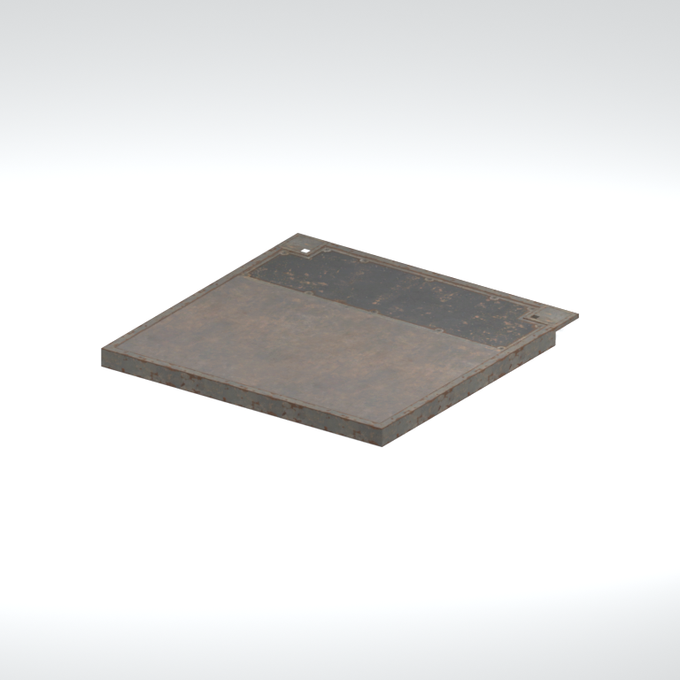
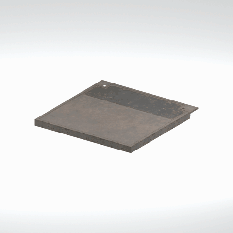

# Unidentified model (afgh_antn001_fndt001)

Native model reference; a readable object identification has not been reviewed.

[Library](../README.md) | [Category](../tables/unclassified-components-1.md) | [Source / advanced data](../catalogue.json) | [Credits](../sources-and-credits.md)

**Game filename:** afgh_antn001_fndt001.fmdl  
**Category:** Unclassified &gt; Unclassified components  
**Variant:** No explicit variant token; **LOD:** 0  
**Tags:** 

## Still reference



## 360-degree reference



The camera circles a static model. This is not a native animation. Source base textures and UVs use approximate studio shading; interaction, collision, complete assembly and FOX shader equivalence are not established.

## Identity and naming

| Field | Value |
|---|---|
| Library ID | mgsv-tpp-afgh_antn001_fndt001-0aae2c4629f42b41 |
| Naming status | unidentified |
| Naming confidence | unknown |
| Naming evidence | {} |
| Native model | /Assets/tpp/environ/object/afghanistan/antenna/afgh_antn001/scenes/afgh_antn001_fndt001.fmdl |
| Model SHA256 | 5306979d140a68900da97c6424518db2f2953ffdfa90929e2dd7a28ae671ee19 |
| Container | /Assets/mgo/pack/location/afc1/pack_common/afc1_common.fpk |
| Container SHA256 | cf9aff37b860d362b6723fe700775983cc61ae7d7f23b6de70df9ba489a966da |
| Captured source / location scope | Selected native member/content and captured installed-source chain; full archive SHA/runtime priority unresolved |
| Raw record SHA256 | 27f5c4b26d414f2030e049abe9106784ab4e187500d8cdb5ba0a8068981bfd07 |

Naming review is descriptive metadata only. It does not change model completion or identify a working game interaction.

## Native LOD inventory

| Native LOD | Triangles | Preview status | Decoded indices SHA256 |
|---|---:|---|---|
| 0 | 190 | rendered | 9230595f1077d3b6d6bde34eda1b7d777c03642a842f42da9dbc0c2cb0aa61d7 |
| 1 | 181 | not separately rendered | 4c145518f185760d605d44f0da6d80e3b0ab21f439f821ffb5ca7ba5459e219d |
| 2 | 176 | not separately rendered | b2bb806f0cd48a41a365c030e90f6f6bb13d0f00fb861c9dfadc51e15a928bc6 |
| 3 | 172 | not separately rendered | 38189c5c58638b92bd57c80d5451b50d8c4f9be15ad34507b1fd4f69d8e444a6 |

Mesh detail and texture pixels/mips are separate. Index hashes describe decoded triangle arrays, not packed index-buffer bytes. Only source-recorded native levels are listed.

<details>
<summary>Texture, source and naming technical metadata</summary>

```json
{
  "source": {
    "nativePath": "/Assets/tpp/environ/object/afghanistan/antenna/afgh_antn001/scenes/afgh_antn001_fndt001.fmdl",
    "nativeSha256": "5306979d140a68900da97c6424518db2f2953ffdfa90929e2dd7a28ae671ee19",
    "stableIdentity": "/assets/tpp/environ/object/afghanistan/antenna/afgh_antn001/scenes/afgh_antn001_fndt001.fmdl#5306979d140a68900da97c6424518db2f2953ffdfa90929e2dd7a28ae671ee19#105af5d2e67ab1f865a40e5bc2c116f346e258ac975cab5fab0de4081996f661",
    "container": {
      "nativePath": "/Assets/mgo/pack/location/afc1/pack_common/afc1_common.fpk",
      "sha256": "cf9aff37b860d362b6723fe700775983cc61ae7d7f23b6de70df9ba489a966da",
      "status": "Selected installed-source container/member chain captured by community reader"
    },
    "historicalDatOrigin": null,
    "sourceArchiveAtCapture": "master/0/00.dat",
    "locationStatus": "Selected native member/content and captured installed-source chain; full archive SHA/runtime priority unresolved",
    "currentInstalledDatVerified": false,
    "selectedInstalledMemberVerified": true,
    "evidence": {
      "archive_helper_executable_sha256": "6f8e39a436af3b024bbd0504966ab3d5d9d0cb05d86689bf3e83d15e68df613f",
      "archive_helper_source_sha256": "f662d3b63e066a0afc77ffe22ea0e564222d14469648300dba2c4f8e9b43446b",
      "archive_index_recipe": "54acff767f08d76ad6056c5387328759bc883df507788f398de6c2c04fac12db",
      "archive_reader": "Atvaark GzsTool.Core 0.5.3",
      "archive_reader_core_sha256": "9da447ae3c375cce2e46744eeff6af50f1591062afdf479d1a0b49edb47daaa3",
      "archive_tool_and_dictionary_sha256": {
        "CityHash.dll": "def6c4506d461b65e4059b2936b2cbd5f852ba5d1d8a1a527f1c0e6dc7008c8f",
        "GzsTool.Core.dll": "9da447ae3c375cce2e46744eeff6af50f1591062afdf479d1a0b49edb47daaa3",
        "GzsTool.exe": "1a9c5b11e2355383ff485aee7e86abc026f5c1fad729daf8c0fd15ee0aae1c10",
        "Zlib.Portable.dll": "fe84781ba35ca9cc5ff5f73fd08d2a66c59e5257b4573f5fe59743f30bf78e42",
        "fpk_dictionary.txt": "b82f9a8d6c10a68ba9471eca9d815c21355a53b5e68753d8ad7db7fd01bf401d",
        "qar_dictionary.txt": "1558c248ed0a4bb827888261563fbb91a2df4f03999682f85d637ff70d9d5fb2"
      },
      "bytes": 14976,
      "container_chain": [
        {
          "content_sha256": null,
          "depth": 0,
          "id": "3f19555d27c2ebecdfbad26aadd88b9f62e9fb6092c04c712963ef73c67ccb42",
          "index_sha256": "9acd3675d6e1500e0e18430cba0fdc70a5718ad7d6b62f13905891a35d59f18a",
          "kind": "qar",
          "name": "master/0/00.dat",
          "parent_occurrence": null
        },
        {
          "content_sha256": "cf9aff37b860d362b6723fe700775983cc61ae7d7f23b6de70df9ba489a966da",
          "depth": 1,
          "id": "6f51e2cefeb81d4be84fd97795833addfdc97724952faa48b68b04b91276c2d6",
          "index_sha256": "093dbba03abdf3c5222bb14076d11b2f349a959ae6521fed333d73e2731c6090",
          "kind": "fpk",
          "name": "/Assets/mgo/pack/location/afc1/pack_common/afc1_common.fpk",
          "parent_occurrence": "dc78337c139fb86a3d388f65ba968ecf0c752819c6074e53d3482c1ed223b489"
        }
      ],
      "contentSha256": "5306979d140a68900da97c6424518db2f2953ffdfa90929e2dd7a28ae671ee19",
      "member": {
        "actual_size": 14976,
        "compressed_size": null,
        "content_sha256": "5306979d140a68900da97c6424518db2f2953ffdfa90929e2dd7a28ae671ee19",
        "declared_size": 14976,
        "extension": "fmdl",
        "hash_hex": null,
        "name": "/Assets/tpp/environ/object/afghanistan/antenna/afgh_antn001/scenes/afgh_antn001_fndt001.fmdl",
        "name_origin": "embedded",
        "offset": 8149648,
        "ordinal": 195,
        "path_hash": null,
        "resolved": 1
      },
      "occurrenceId": "940debaf23b8597d67483cfe1a48610c519e7a13ea9adc87a4d633e16ffca1e8",
      "occurrence_id": "940debaf23b8597d67483cfe1a48610c519e7a13ea9adc87a4d633e16ffca1e8",
      "primary_source_revision": "fc4a8196555638c6cf8aa1b7c8dc34ccd5c69cb5",
      "source_adapter": "community_core_selective_export",
      "source_id": "7f6bb743fb4c487f0e9522f9c7fac280c46cf6b1051e0fc75a93602c8eb451f0",
      "source_path": "master/0/00.dat",
      "source_snapshot": "{\"bytes\":768788480,\"device\":621747392682911458,\"file_id\":844424931596481,\"header_sha256\":\"ead50f0a9a37e4285323b9c6fa0ec75fe75e518c63147e63158eeb2892c6589e\",\"mtime_ns\":1791852224238580700}",
      "virtualPath": "/Assets/tpp/environ/object/afghanistan/antenna/afgh_antn001/scenes/afgh_antn001_fndt001.fmdl"
    }
  },
  "materials": [
    {
      "sampler": "Base_Tex_SRGB",
      "materialIndex": 0,
      "nativePathHash": "1542802628519081045",
      "nativeVirtualPath": null,
      "nativeBinding": {
        "familyId": "242b055c2cefc4efdcfba1254372bf97b1ae80ab8be8c40bd3c183152dedafaa",
        "height": 1024,
        "materialIndex": 0,
        "mipCount": 9,
        "nativeMipCountVerified": true,
        "nativePath": null,
        "nativePathHash": "1542802628519081045",
        "nativeTexture": {
          "additionalFtexsFileCount": 2,
          "depth": 1,
          "ftexsFileCount": 3,
          "height": 1024,
          "metadataBytes": 208,
          "mipCount": 9,
          "mips": [
            {
              "chunks": 32,
              "decodedBytes": 524288,
              "mip": 0,
              "offset": 0,
              "storedBytes": 377824,
              "streamNumber": 3
            },
            {
              "chunks": 8,
              "decodedBytes": 131072,
              "mip": 1,
              "offset": 0,
              "storedBytes": 99520,
              "streamNumber": 2
            },
            {
              "chunks": 2,
              "decodedBytes": 32768,
              "mip": 2,
              "offset": 8720,
              "storedBytes": 24976,
              "streamNumber": 1
            },
            {
              "chunks": 1,
              "decodedBytes": 8192,
              "mip": 3,
              "offset": 2424,
              "storedBytes": 6288,
              "streamNumber": 1
            },
            {
              "chunks": 1,
              "decodedBytes": 2048,
              "mip": 4,
              "offset": 704,
              "storedBytes": 1712,
              "streamNumber": 1
            },
            {
              "chunks": 1,
              "decodedBytes": 512,
              "mip": 5,
              "offset": 232,
              "storedBytes": 464,
              "streamNumber": 1
            },
            {
              "chunks": 1,
              "decodedBytes": 128,
              "mip": 6,
              "offset": 80,
              "storedBytes": 144,
              "streamNumber": 1
            },
            {
              "chunks": 1,
              "decodedBytes": 32,
              "mip": 7,
              "offset": 24,
              "storedBytes": 48,
              "streamNumber": 1
            },
            {
              "chunks": 1,
              "decodedBytes": 8,
              "mip": 8,
              "offset": 0,
              "storedBytes": 16,
              "streamNumber": 1
            }
          ],
          "nativeHeaderHash": "2530d73fb11a9ea3cfc9288a72454c8f",
          "nrtFlag": 2,
          "pixelFormat": 2,
          "requiredStreamNumbers": [
            1,
            2,
            3
          ],
          "textureType": 16777219,
          "unknownFlags": 273,
          "width": 1024
        },
        "samplerName": "Base_Tex_SRGB",
        "samplerNameHash": "72475356961633",
        "sha256": "96e6ba8ee98c6383227487db084936496f47526f116d532ef0b4ea52124a4285",
        "sourceOccurrences": [
          {
            "archive_helper_executable_sha256": "6f8e39a436af3b024bbd0504966ab3d5d9d0cb05d86689bf3e83d15e68df613f",
            "archive_helper_source_sha256": "f662d3b63e066a0afc77ffe22ea0e564222d14469648300dba2c4f8e9b43446b",
            "archive_index_recipe": "54acff767f08d76ad6056c5387328759bc883df507788f398de6c2c04fac12db",
            "archive_reader": "Atvaark GzsTool.Core 0.5.3",
            "archive_reader_core_sha256": "9da447ae3c375cce2e46744eeff6af50f1591062afdf479d1a0b49edb47daaa3",
            "archive_tool_and_dictionary_sha256": {
              "CityHash.dll": "def6c4506d461b65e4059b2936b2cbd5f852ba5d1d8a1a527f1c0e6dc7008c8f",
              "GzsTool.Core.dll": "9da447ae3c375cce2e46744eeff6af50f1591062afdf479d1a0b49edb47daaa3",
              "GzsTool.exe": "1a9c5b11e2355383ff485aee7e86abc026f5c1fad729daf8c0fd15ee0aae1c10",
              "Zlib.Portable.dll": "fe84781ba35ca9cc5ff5f73fd08d2a66c59e5257b4573f5fe59743f30bf78e42",
              "fpk_dictionary.txt": "b82f9a8d6c10a68ba9471eca9d815c21355a53b5e68753d8ad7db7fd01bf401d",
              "qar_dictionary.txt": "1558c248ed0a4bb827888261563fbb91a2df4f03999682f85d637ff70d9d5fb2"
            },
            "bytes": 208,
            "container_chain": [
              {
                "content_sha256": null,
                "depth": 0,
                "id": "0b473016351235050c2f6af21454bd979a0ad4602a9860137c807c894c5eba4d",
                "index_sha256": "ac9b4dae0dd0166db3a6ec8da18524dffebcbaf9004569af631de82913bf49a3",
                "kind": "qar",
                "name": "master/texture2.dat",
                "parent_occurrence": null
              }
            ],
            "contentSha256": "aa497e6fc6a018eb69d83f91126f456413186d35b426967c30a2c72f7af7b47f",
            "member": {
              "actual_size": 208,
              "compressed_size": 208,
              "content_sha256": "aa497e6fc6a018eb69d83f91126f456413186d35b426967c30a2c72f7af7b47f",
              "declared_size": 208,
              "extension": "ftex",
              "hash_hex": "156922d1076b3455",
              "name": "/Assets/tpp/environ/object/afghanistan/antenna/afgh_antn001/sourceimages/afgh_antn001_st_bsm.ftex",
              "name_origin": "dictionary",
              "offset": 1235351584,
              "ordinal": 6605,
              "path_hash": "122d1076b3455",
              "resolved": 1
            },
            "occurrenceId": "14a038efffea7a4df052846c81448e296d722992eff9215d1083db25ef4dfb0f",
            "occurrence_id": "14a038efffea7a4df052846c81448e296d722992eff9215d1083db25ef4dfb0f",
            "primary_source_revision": "fc4a8196555638c6cf8aa1b7c8dc34ccd5c69cb5",
            "source_adapter": "community_core_selective_export",
            "source_id": "85e8296057664cbc6ebaf6bd43d1c6d18528bbd8a6fae920bdf4d5eb69f6a93d",
            "source_path": "master/texture2.dat",
            "source_snapshot": "{\"bytes\":2920239104,\"device\":621747392682911458,\"file_id\":562949953639626,\"header_sha256\":\"72bfee707623afb5f3abd8382035d3d4258b4941ac583a56f5a447f47123dcab\",\"mtime_ns\":1791224675561235200}",
            "virtualPath": "/Assets/tpp/environ/object/afghanistan/antenna/afgh_antn001/sourceimages/afgh_antn001_st_bsm.ftex"
          },
          {
            "archive_helper_executable_sha256": "6f8e39a436af3b024bbd0504966ab3d5d9d0cb05d86689bf3e83d15e68df613f",
            "archive_helper_source_sha256": "f662d3b63e066a0afc77ffe22ea0e564222d14469648300dba2c4f8e9b43446b",
            "archive_index_recipe": "54acff767f08d76ad6056c5387328759bc883df507788f398de6c2c04fac12db",
            "archive_reader": "Atvaark GzsTool.Core 0.5.3",
            "archive_reader_core_sha256": "9da447ae3c375cce2e46744eeff6af50f1591062afdf479d1a0b49edb47daaa3",
            "archive_tool_and_dictionary_sha256": {
              "CityHash.dll": "def6c4506d461b65e4059b2936b2cbd5f852ba5d1d8a1a527f1c0e6dc7008c8f",
              "GzsTool.Core.dll": "9da447ae3c375cce2e46744eeff6af50f1591062afdf479d1a0b49edb47daaa3",
              "GzsTool.exe": "1a9c5b11e2355383ff485aee7e86abc026f5c1fad729daf8c0fd15ee0aae1c10",
              "Zlib.Portable.dll": "fe84781ba35ca9cc5ff5f73fd08d2a66c59e5257b4573f5fe59743f30bf78e42",
              "fpk_dictionary.txt": "b82f9a8d6c10a68ba9471eca9d815c21355a53b5e68753d8ad7db7fd01bf401d",
              "qar_dictionary.txt": "1558c248ed0a4bb827888261563fbb91a2df4f03999682f85d637ff70d9d5fb2"
            },
            "bytes": 33712,
            "container_chain": [
              {
                "content_sha256": null,
                "depth": 0,
                "id": "436c8cfb4f382de93365b167a61aa81383299b7bad18205d60f1d0beeb3919e3",
                "index_sha256": "2d7b45c6ca65418839618e978562cac336091c06eb56dfe99f762b07a4016960",
                "kind": "qar",
                "name": "master/texture4.dat",
                "parent_occurrence": null
              }
            ],
            "contentSha256": "12dcae6b42e66aa4b3dbc64b57fbecf25805d2b0ae47ee90108de01f5df06757",
            "member": {
              "actual_size": 33712,
              "compressed_size": 33712,
              "content_sha256": "12dcae6b42e66aa4b3dbc64b57fbecf25805d2b0ae47ee90108de01f5df06757",
              "declared_size": 33712,
              "extension": "1.ftexs",
              "hash_hex": "b2c122d1076b3455",
              "name": "/Assets/tpp/environ/object/afghanistan/antenna/afgh_antn001/sourceimages/afgh_antn001_st_bsm.1.ftexs",
              "name_origin": "dictionary",
              "offset": 796601376,
              "ordinal": 4661,
              "path_hash": "122d1076b3455",
              "resolved": 1
            },
            "occurrenceId": "07ae12eeafac5a53b260072b6ac8e777ece805fc364ec1a56b5850b75bc84457",
            "occurrence_id": "07ae12eeafac5a53b260072b6ac8e777ece805fc364ec1a56b5850b75bc84457",
            "primary_source_revision": "fc4a8196555638c6cf8aa1b7c8dc34ccd5c69cb5",
            "source_adapter": "community_core_selective_export",
            "source_id": "6c31b98b4db9b88eb76cfcb538f5f34b4729531266a9459584126720a4fc14aa",
            "source_path": "master/texture4.dat",
            "source_snapshot": "{\"bytes\":2031604736,\"device\":621747392682911458,\"file_id\":562949953639628,\"header_sha256\":\"40ee2c6917b338f7f68c49847c97fe92b978506a1ba847fcc94d28c931c8711a\",\"mtime_ns\":1791224675561235200}",
            "virtualPath": "/Assets/tpp/environ/object/afghanistan/antenna/afgh_antn001/sourceimages/afgh_antn001_st_bsm.1.ftexs"
          },
          {
            "archive_helper_executable_sha256": "6f8e39a436af3b024bbd0504966ab3d5d9d0cb05d86689bf3e83d15e68df613f",
            "archive_helper_source_sha256": "f662d3b63e066a0afc77ffe22ea0e564222d14469648300dba2c4f8e9b43446b",
            "archive_index_recipe": "54acff767f08d76ad6056c5387328759bc883df507788f398de6c2c04fac12db",
            "archive_reader": "Atvaark GzsTool.Core 0.5.3",
            "archive_reader_core_sha256": "9da447ae3c375cce2e46744eeff6af50f1591062afdf479d1a0b49edb47daaa3",
            "archive_tool_and_dictionary_sha256": {
              "CityHash.dll": "def6c4506d461b65e4059b2936b2cbd5f852ba5d1d8a1a527f1c0e6dc7008c8f",
              "GzsTool.Core.dll": "9da447ae3c375cce2e46744eeff6af50f1591062afdf479d1a0b49edb47daaa3",
              "GzsTool.exe": "1a9c5b11e2355383ff485aee7e86abc026f5c1fad729daf8c0fd15ee0aae1c10",
              "Zlib.Portable.dll": "fe84781ba35ca9cc5ff5f73fd08d2a66c59e5257b4573f5fe59743f30bf78e42",
              "fpk_dictionary.txt": "b82f9a8d6c10a68ba9471eca9d815c21355a53b5e68753d8ad7db7fd01bf401d",
              "qar_dictionary.txt": "1558c248ed0a4bb827888261563fbb91a2df4f03999682f85d637ff70d9d5fb2"
            },
            "bytes": 99584,
            "container_chain": [
              {
                "content_sha256": null,
                "depth": 0,
                "id": "1cc220d9409d7163b6aca295ed89fd8c7befca6a8f849a8d5d09a2499724c863",
                "index_sha256": "5a818609a652a10d90fb90015661d0cb80898096bbb3aac36382172988d8736d",
                "kind": "qar",
                "name": "master/texture5_mgo0.dat",
                "parent_occurrence": null
              }
            ],
            "contentSha256": "0b911f1f55acd768c4676d3c658d77caccf86316cd3c3f98879afd4052bb5ae4",
            "member": {
              "actual_size": 99584,
              "compressed_size": 99584,
              "content_sha256": "0b911f1f55acd768c4676d3c658d77caccf86316cd3c3f98879afd4052bb5ae4",
              "declared_size": 99584,
              "extension": "2.ftexs",
              "hash_hex": "b57122d1076b3455",
              "name": "/Assets/tpp/environ/object/afghanistan/antenna/afgh_antn001/sourceimages/afgh_antn001_st_bsm.2.ftexs",
              "name_origin": "dictionary",
              "offset": 3065883680,
              "ordinal": 11721,
              "path_hash": "122d1076b3455",
              "resolved": 1
            },
            "occurrenceId": "0c8c57e771e991b130b014e0b0c45dd3b36f9789d7be17bcd504a7ff88a0a0eb",
            "occurrence_id": "0c8c57e771e991b130b014e0b0c45dd3b36f9789d7be17bcd504a7ff88a0a0eb",
            "primary_source_revision": "fc4a8196555638c6cf8aa1b7c8dc34ccd5c69cb5",
            "source_adapter": "community_core_selective_export",
            "source_id": "24f8989ccaae47940dc20e54ba67442ad562ac0032ab6e3d475e927c81444b56",
            "source_path": "master/texture5_mgo0.dat",
            "source_snapshot": "{\"bytes\":4492370944,\"device\":621747392682911458,\"file_id\":13510798883237422,\"header_sha256\":\"6108fbacb65c84d041742c39e5ca630745240453b336f1059a13b91943f0b011\",\"mtime_ns\":1791224675562234400}",
            "virtualPath": "/Assets/tpp/environ/object/afghanistan/antenna/afgh_antn001/sourceimages/afgh_antn001_st_bsm.2.ftexs"
          },
          {
            "archive_helper_executable_sha256": "6f8e39a436af3b024bbd0504966ab3d5d9d0cb05d86689bf3e83d15e68df613f",
            "archive_helper_source_sha256": "f662d3b63e066a0afc77ffe22ea0e564222d14469648300dba2c4f8e9b43446b",
            "archive_index_recipe": "54acff767f08d76ad6056c5387328759bc883df507788f398de6c2c04fac12db",
            "archive_reader": "Atvaark GzsTool.Core 0.5.3",
            "archive_reader_core_sha256": "9da447ae3c375cce2e46744eeff6af50f1591062afdf479d1a0b49edb47daaa3",
            "archive_tool_and_dictionary_sha256": {
              "CityHash.dll": "def6c4506d461b65e4059b2936b2cbd5f852ba5d1d8a1a527f1c0e6dc7008c8f",
              "GzsTool.Core.dll": "9da447ae3c375cce2e46744eeff6af50f1591062afdf479d1a0b49edb47daaa3",
              "GzsTool.exe": "1a9c5b11e2355383ff485aee7e86abc026f5c1fad729daf8c0fd15ee0aae1c10",
              "Zlib.Portable.dll": "fe84781ba35ca9cc5ff5f73fd08d2a66c59e5257b4573f5fe59743f30bf78e42",
              "fpk_dictionary.txt": "b82f9a8d6c10a68ba9471eca9d815c21355a53b5e68753d8ad7db7fd01bf401d",
              "qar_dictionary.txt": "1558c248ed0a4bb827888261563fbb91a2df4f03999682f85d637ff70d9d5fb2"
            },
            "bytes": 378080,
            "container_chain": [
              {
                "content_sha256": null,
                "depth": 0,
                "id": "1cc220d9409d7163b6aca295ed89fd8c7befca6a8f849a8d5d09a2499724c863",
                "index_sha256": "5a818609a652a10d90fb90015661d0cb80898096bbb3aac36382172988d8736d",
                "kind": "qar",
                "name": "master/texture5_mgo0.dat",
                "parent_occurrence": null
              }
            ],
            "contentSha256": "6029a86428e38624d3db1ce8fdb0f8e94f57c2816e049eaa58025cdb7d0b99ea",
            "member": {
              "actual_size": 378080,
              "compressed_size": 378080,
              "content_sha256": "6029a86428e38624d3db1ce8fdb0f8e94f57c2816e049eaa58025cdb7d0b99ea",
              "declared_size": 378080,
              "extension": "3.ftexs",
              "hash_hex": "571922d1076b3455",
              "name": "/Assets/tpp/environ/object/afghanistan/antenna/afgh_antn001/sourceimages/afgh_antn001_st_bsm.3.ftexs",
              "name_origin": "dictionary",
              "offset": 3065984032,
              "ordinal": 11722,
              "path_hash": "122d1076b3455",
              "resolved": 1
            },
            "occurrenceId": "27ba21b4cd9b290bcdbb46a01c66be01cc2a145358c75ba1e886686e1da86568",
            "occurrence_id": "27ba21b4cd9b290bcdbb46a01c66be01cc2a145358c75ba1e886686e1da86568",
            "primary_source_revision": "fc4a8196555638c6cf8aa1b7c8dc34ccd5c69cb5",
            "source_adapter": "community_core_selective_export",
            "source_id": "24f8989ccaae47940dc20e54ba67442ad562ac0032ab6e3d475e927c81444b56",
            "source_path": "master/texture5_mgo0.dat",
            "source_snapshot": "{\"bytes\":4492370944,\"device\":621747392682911458,\"file_id\":13510798883237422,\"header_sha256\":\"6108fbacb65c84d041742c39e5ca630745240453b336f1059a13b91943f0b011\",\"mtime_ns\":1791224675562234400}",
            "virtualPath": "/Assets/tpp/environ/object/afghanistan/antenna/afgh_antn001/sourceimages/afgh_antn001_st_bsm.3.ftexs"
          }
        ],
        "width": 1024
      },
      "ddsSha256": "96e6ba8ee98c6383227487db084936496f47526f116d532ef0b4ea52124a4285",
      "dimensions": [
        1024,
        1024
      ],
      "mipCount": 9,
      "nativeMipCountVerified": true,
      "connectedInPreview": true
    },
    {
      "sampler": "Base_Tex_SRGB",
      "materialIndex": 1,
      "nativePathHash": "1542523743242497898",
      "nativeVirtualPath": null,
      "nativeBinding": {
        "familyId": "9eb333e456eae8c8f35ec991eca33238123d160ceecb8c87dd8f970ee25e4f0f",
        "height": 512,
        "materialIndex": 1,
        "mipCount": 8,
        "nativeMipCountVerified": true,
        "nativePath": null,
        "nativePathHash": "1542523743242497898",
        "nativeTexture": {
          "additionalFtexsFileCount": 2,
          "depth": 1,
          "ftexsFileCount": 3,
          "height": 512,
          "metadataBytes": 192,
          "mipCount": 8,
          "mips": [
            {
              "chunks": 8,
              "decodedBytes": 131072,
              "mip": 0,
              "offset": 0,
              "storedBytes": 89616,
              "streamNumber": 3
            },
            {
              "chunks": 2,
              "decodedBytes": 32768,
              "mip": 1,
              "offset": 0,
              "storedBytes": 22752,
              "streamNumber": 2
            },
            {
              "chunks": 1,
              "decodedBytes": 8192,
              "mip": 2,
              "offset": 2152,
              "storedBytes": 5696,
              "streamNumber": 1
            },
            {
              "chunks": 1,
              "decodedBytes": 2048,
              "mip": 3,
              "offset": 656,
              "storedBytes": 1488,
              "streamNumber": 1
            },
            {
              "chunks": 1,
              "decodedBytes": 512,
              "mip": 4,
              "offset": 216,
              "storedBytes": 432,
              "streamNumber": 1
            },
            {
              "chunks": 1,
              "decodedBytes": 128,
              "mip": 5,
              "offset": 80,
              "storedBytes": 128,
              "streamNumber": 1
            },
            {
              "chunks": 1,
              "decodedBytes": 32,
              "mip": 6,
              "offset": 24,
              "storedBytes": 48,
              "streamNumber": 1
            },
            {
              "chunks": 1,
              "decodedBytes": 8,
              "mip": 7,
              "offset": 0,
              "storedBytes": 16,
              "streamNumber": 1
            }
          ],
          "nativeHeaderHash": "5d18183244e27f53265d491c03799d97",
          "nrtFlag": 2,
          "pixelFormat": 2,
          "requiredStreamNumbers": [
            1,
            2,
            3
          ],
          "textureType": 16777219,
          "unknownFlags": 273,
          "width": 512
        },
        "samplerName": "Base_Tex_SRGB",
        "samplerNameHash": "72475356961633",
        "sha256": "776f3979d5db383f2118c1c42b5d15f5448ee021965adbac6025d5681ec362e3",
        "sourceOccurrences": [
          {
            "archive_helper_executable_sha256": "6f8e39a436af3b024bbd0504966ab3d5d9d0cb05d86689bf3e83d15e68df613f",
            "archive_helper_source_sha256": "f662d3b63e066a0afc77ffe22ea0e564222d14469648300dba2c4f8e9b43446b",
            "archive_index_recipe": "54acff767f08d76ad6056c5387328759bc883df507788f398de6c2c04fac12db",
            "archive_reader": "Atvaark GzsTool.Core 0.5.3",
            "archive_reader_core_sha256": "9da447ae3c375cce2e46744eeff6af50f1591062afdf479d1a0b49edb47daaa3",
            "archive_tool_and_dictionary_sha256": {
              "CityHash.dll": "def6c4506d461b65e4059b2936b2cbd5f852ba5d1d8a1a527f1c0e6dc7008c8f",
              "GzsTool.Core.dll": "9da447ae3c375cce2e46744eeff6af50f1591062afdf479d1a0b49edb47daaa3",
              "GzsTool.exe": "1a9c5b11e2355383ff485aee7e86abc026f5c1fad729daf8c0fd15ee0aae1c10",
              "Zlib.Portable.dll": "fe84781ba35ca9cc5ff5f73fd08d2a66c59e5257b4573f5fe59743f30bf78e42",
              "fpk_dictionary.txt": "b82f9a8d6c10a68ba9471eca9d815c21355a53b5e68753d8ad7db7fd01bf401d",
              "qar_dictionary.txt": "1558c248ed0a4bb827888261563fbb91a2df4f03999682f85d637ff70d9d5fb2"
            },
            "bytes": 192,
            "container_chain": [
              {
                "content_sha256": null,
                "depth": 0,
                "id": "3f19555d27c2ebecdfbad26aadd88b9f62e9fb6092c04c712963ef73c67ccb42",
                "index_sha256": "9acd3675d6e1500e0e18430cba0fdc70a5718ad7d6b62f13905891a35d59f18a",
                "kind": "qar",
                "name": "master/0/00.dat",
                "parent_occurrence": null
              },
              {
                "content_sha256": "fd97657e1effdfa66faedfaa8aceab8699d5928812f2b7a948d492958f56217f",
                "depth": 1,
                "id": "041de25569b3afa35eafa037a79dbb221550af7c25638c26c5f796237b698a20",
                "index_sha256": "f3d8d59afb06b4309a625ba0dd5dc2f42dabc3d59150229746a05c61ee570d06",
                "kind": "pftxs",
                "name": "/Assets/mgo/pack/location/afc1/pack_common/afc1_common.pftxs",
                "parent_occurrence": "9bb9ddd185492a361b81e97ef73bd7f96ca26f3e99f82de31fecc98df2c24293"
              }
            ],
            "contentSha256": "89921f295a0d6375b48a7d81aee2e236d9646cefef92a01c7bb2df68d70dc781",
            "member": {
              "actual_size": 192,
              "compressed_size": null,
              "content_sha256": "89921f295a0d6375b48a7d81aee2e236d9646cefef92a01c7bb2df68d70dc781",
              "declared_size": 192,
              "extension": "ftex",
              "hash_hex": "1568252bfd932f6a",
              "name": "1568252bfd932f6a.ftex",
              "name_origin": "hash_fallback",
              "offset": 14763888,
              "ordinal": 1254,
              "path_hash": null,
              "resolved": 0
            },
            "occurrenceId": "033bab082431c2966473f23fe89f96d28ce368d205120b6964d37afd1e019d61",
            "occurrence_id": "033bab082431c2966473f23fe89f96d28ce368d205120b6964d37afd1e019d61",
            "primary_source_revision": "fc4a8196555638c6cf8aa1b7c8dc34ccd5c69cb5",
            "source_adapter": "community_core_selective_export",
            "source_id": "7f6bb743fb4c487f0e9522f9c7fac280c46cf6b1051e0fc75a93602c8eb451f0",
            "source_path": "master/0/00.dat",
            "source_snapshot": "{\"bytes\":768788480,\"device\":621747392682911458,\"file_id\":844424931596481,\"header_sha256\":\"ead50f0a9a37e4285323b9c6fa0ec75fe75e518c63147e63158eeb2892c6589e\",\"mtime_ns\":1791852224238580700}",
            "virtualPath": "1568252bfd932f6a.ftex"
          },
          {
            "archive_helper_executable_sha256": "6f8e39a436af3b024bbd0504966ab3d5d9d0cb05d86689bf3e83d15e68df613f",
            "archive_helper_source_sha256": "f662d3b63e066a0afc77ffe22ea0e564222d14469648300dba2c4f8e9b43446b",
            "archive_index_recipe": "54acff767f08d76ad6056c5387328759bc883df507788f398de6c2c04fac12db",
            "archive_reader": "Atvaark GzsTool.Core 0.5.3",
            "archive_reader_core_sha256": "9da447ae3c375cce2e46744eeff6af50f1591062afdf479d1a0b49edb47daaa3",
            "archive_tool_and_dictionary_sha256": {
              "CityHash.dll": "def6c4506d461b65e4059b2936b2cbd5f852ba5d1d8a1a527f1c0e6dc7008c8f",
              "GzsTool.Core.dll": "9da447ae3c375cce2e46744eeff6af50f1591062afdf479d1a0b49edb47daaa3",
              "GzsTool.exe": "1a9c5b11e2355383ff485aee7e86abc026f5c1fad729daf8c0fd15ee0aae1c10",
              "Zlib.Portable.dll": "fe84781ba35ca9cc5ff5f73fd08d2a66c59e5257b4573f5fe59743f30bf78e42",
              "fpk_dictionary.txt": "b82f9a8d6c10a68ba9471eca9d815c21355a53b5e68753d8ad7db7fd01bf401d",
              "qar_dictionary.txt": "1558c248ed0a4bb827888261563fbb91a2df4f03999682f85d637ff70d9d5fb2"
            },
            "bytes": 7856,
            "container_chain": [
              {
                "content_sha256": null,
                "depth": 0,
                "id": "0b473016351235050c2f6af21454bd979a0ad4602a9860137c807c894c5eba4d",
                "index_sha256": "ac9b4dae0dd0166db3a6ec8da18524dffebcbaf9004569af631de82913bf49a3",
                "kind": "qar",
                "name": "master/texture2.dat",
                "parent_occurrence": null
              }
            ],
            "contentSha256": "cde8aeef7587696db5df3032f6ee774e6a461cc1938802b6658ab55bcd7ee66f",
            "member": {
              "actual_size": 7856,
              "compressed_size": 7856,
              "content_sha256": "cde8aeef7587696db5df3032f6ee774e6a461cc1938802b6658ab55bcd7ee66f",
              "declared_size": 7856,
              "extension": "1.ftexs",
              "hash_hex": "b2c0252bfd932f6a",
              "name": "/Assets/tpp/environ/object/afghanistan/antenna/afgh_antn001/sourceimages/afgh_antn001_bsm.1.ftexs",
              "name_origin": "dictionary",
              "offset": 1232624672,
              "ordinal": 6578,
              "path_hash": "252bfd932f6a",
              "resolved": 1
            },
            "occurrenceId": "38c3a797271ffac67166f89a63a9d498513e2f3b93b4273fa494472822fa63b4",
            "occurrence_id": "38c3a797271ffac67166f89a63a9d498513e2f3b93b4273fa494472822fa63b4",
            "primary_source_revision": "fc4a8196555638c6cf8aa1b7c8dc34ccd5c69cb5",
            "source_adapter": "community_core_selective_export",
            "source_id": "85e8296057664cbc6ebaf6bd43d1c6d18528bbd8a6fae920bdf4d5eb69f6a93d",
            "source_path": "master/texture2.dat",
            "source_snapshot": "{\"bytes\":2920239104,\"device\":621747392682911458,\"file_id\":562949953639626,\"header_sha256\":\"72bfee707623afb5f3abd8382035d3d4258b4941ac583a56f5a447f47123dcab\",\"mtime_ns\":1791224675561235200}",
            "virtualPath": "/Assets/tpp/environ/object/afghanistan/antenna/afgh_antn001/sourceimages/afgh_antn001_bsm.1.ftexs"
          },
          {
            "archive_helper_executable_sha256": "6f8e39a436af3b024bbd0504966ab3d5d9d0cb05d86689bf3e83d15e68df613f",
            "archive_helper_source_sha256": "f662d3b63e066a0afc77ffe22ea0e564222d14469648300dba2c4f8e9b43446b",
            "archive_index_recipe": "54acff767f08d76ad6056c5387328759bc883df507788f398de6c2c04fac12db",
            "archive_reader": "Atvaark GzsTool.Core 0.5.3",
            "archive_reader_core_sha256": "9da447ae3c375cce2e46744eeff6af50f1591062afdf479d1a0b49edb47daaa3",
            "archive_tool_and_dictionary_sha256": {
              "CityHash.dll": "def6c4506d461b65e4059b2936b2cbd5f852ba5d1d8a1a527f1c0e6dc7008c8f",
              "GzsTool.Core.dll": "9da447ae3c375cce2e46744eeff6af50f1591062afdf479d1a0b49edb47daaa3",
              "GzsTool.exe": "1a9c5b11e2355383ff485aee7e86abc026f5c1fad729daf8c0fd15ee0aae1c10",
              "Zlib.Portable.dll": "fe84781ba35ca9cc5ff5f73fd08d2a66c59e5257b4573f5fe59743f30bf78e42",
              "fpk_dictionary.txt": "b82f9a8d6c10a68ba9471eca9d815c21355a53b5e68753d8ad7db7fd01bf401d",
              "qar_dictionary.txt": "1558c248ed0a4bb827888261563fbb91a2df4f03999682f85d637ff70d9d5fb2"
            },
            "bytes": 22768,
            "container_chain": [
              {
                "content_sha256": null,
                "depth": 0,
                "id": "1cc220d9409d7163b6aca295ed89fd8c7befca6a8f849a8d5d09a2499724c863",
                "index_sha256": "5a818609a652a10d90fb90015661d0cb80898096bbb3aac36382172988d8736d",
                "kind": "qar",
                "name": "master/texture5_mgo0.dat",
                "parent_occurrence": null
              }
            ],
            "contentSha256": "fb4822b83496004a253bad155ae74f50e50f778fbe838ff27fb710b9da846efc",
            "member": {
              "actual_size": 22768,
              "compressed_size": 22768,
              "content_sha256": "fb4822b83496004a253bad155ae74f50e50f778fbe838ff27fb710b9da846efc",
              "declared_size": 22768,
              "extension": "2.ftexs",
              "hash_hex": "b570252bfd932f6a",
              "name": "/Assets/tpp/environ/object/afghanistan/antenna/afgh_antn001/sourceimages/afgh_antn001_bsm.2.ftexs",
              "name_origin": "dictionary",
              "offset": 3064335392,
              "ordinal": 11711,
              "path_hash": "252bfd932f6a",
              "resolved": 1
            },
            "occurrenceId": "6e293c8c67ad94624486148f93bc000d1a4a1a80b4ad5c0a0de4a44df611ecce",
            "occurrence_id": "6e293c8c67ad94624486148f93bc000d1a4a1a80b4ad5c0a0de4a44df611ecce",
            "primary_source_revision": "fc4a8196555638c6cf8aa1b7c8dc34ccd5c69cb5",
            "source_adapter": "community_core_selective_export",
            "source_id": "24f8989ccaae47940dc20e54ba67442ad562ac0032ab6e3d475e927c81444b56",
            "source_path": "master/texture5_mgo0.dat",
            "source_snapshot": "{\"bytes\":4492370944,\"device\":621747392682911458,\"file_id\":13510798883237422,\"header_sha256\":\"6108fbacb65c84d041742c39e5ca630745240453b336f1059a13b91943f0b011\",\"mtime_ns\":1791224675562234400}",
            "virtualPath": "/Assets/tpp/environ/object/afghanistan/antenna/afgh_antn001/sourceimages/afgh_antn001_bsm.2.ftexs"
          },
          {
            "archive_helper_executable_sha256": "6f8e39a436af3b024bbd0504966ab3d5d9d0cb05d86689bf3e83d15e68df613f",
            "archive_helper_source_sha256": "f662d3b63e066a0afc77ffe22ea0e564222d14469648300dba2c4f8e9b43446b",
            "archive_index_recipe": "54acff767f08d76ad6056c5387328759bc883df507788f398de6c2c04fac12db",
            "archive_reader": "Atvaark GzsTool.Core 0.5.3",
            "archive_reader_core_sha256": "9da447ae3c375cce2e46744eeff6af50f1591062afdf479d1a0b49edb47daaa3",
            "archive_tool_and_dictionary_sha256": {
              "CityHash.dll": "def6c4506d461b65e4059b2936b2cbd5f852ba5d1d8a1a527f1c0e6dc7008c8f",
              "GzsTool.Core.dll": "9da447ae3c375cce2e46744eeff6af50f1591062afdf479d1a0b49edb47daaa3",
              "GzsTool.exe": "1a9c5b11e2355383ff485aee7e86abc026f5c1fad729daf8c0fd15ee0aae1c10",
              "Zlib.Portable.dll": "fe84781ba35ca9cc5ff5f73fd08d2a66c59e5257b4573f5fe59743f30bf78e42",
              "fpk_dictionary.txt": "b82f9a8d6c10a68ba9471eca9d815c21355a53b5e68753d8ad7db7fd01bf401d",
              "qar_dictionary.txt": "1558c248ed0a4bb827888261563fbb91a2df4f03999682f85d637ff70d9d5fb2"
            },
            "bytes": 89680,
            "container_chain": [
              {
                "content_sha256": null,
                "depth": 0,
                "id": "436c8cfb4f382de93365b167a61aa81383299b7bad18205d60f1d0beeb3919e3",
                "index_sha256": "2d7b45c6ca65418839618e978562cac336091c06eb56dfe99f762b07a4016960",
                "kind": "qar",
                "name": "master/texture4.dat",
                "parent_occurrence": null
              }
            ],
            "contentSha256": "e3012d59a06c3e82c0c573cf173fd90dddb1993f0c5c7fe62bdad8b7a309eb5b",
            "member": {
              "actual_size": 89680,
              "compressed_size": 89680,
              "content_sha256": "e3012d59a06c3e82c0c573cf173fd90dddb1993f0c5c7fe62bdad8b7a309eb5b",
              "declared_size": 89680,
              "extension": "3.ftexs",
              "hash_hex": "5718252bfd932f6a",
              "name": "/Assets/tpp/environ/object/afghanistan/antenna/afgh_antn001/sourceimages/afgh_antn001_bsm.3.ftexs",
              "name_origin": "dictionary",
              "offset": 794419232,
              "ordinal": 4639,
              "path_hash": "252bfd932f6a",
              "resolved": 1
            },
            "occurrenceId": "8ed033a6caeaf1a3736e88727eb11304367cfb9e94b8146265bd7dbd48daef5b",
            "occurrence_id": "8ed033a6caeaf1a3736e88727eb11304367cfb9e94b8146265bd7dbd48daef5b",
            "primary_source_revision": "fc4a8196555638c6cf8aa1b7c8dc34ccd5c69cb5",
            "source_adapter": "community_core_selective_export",
            "source_id": "6c31b98b4db9b88eb76cfcb538f5f34b4729531266a9459584126720a4fc14aa",
            "source_path": "master/texture4.dat",
            "source_snapshot": "{\"bytes\":2031604736,\"device\":621747392682911458,\"file_id\":562949953639628,\"header_sha256\":\"40ee2c6917b338f7f68c49847c97fe92b978506a1ba847fcc94d28c931c8711a\",\"mtime_ns\":1791224675561235200}",
            "virtualPath": "/Assets/tpp/environ/object/afghanistan/antenna/afgh_antn001/sourceimages/afgh_antn001_bsm.3.ftexs"
          }
        ],
        "width": 512
      },
      "ddsSha256": "776f3979d5db383f2118c1c42b5d15f5448ee021965adbac6025d5681ec362e3",
      "dimensions": [
        512,
        512
      ],
      "mipCount": 8,
      "nativeMipCountVerified": true,
      "connectedInPreview": true
    }
  ],
  "quality": {
    "decodedIndicesHashDerivation": "SHA256 of canonical UTF-8 JSON decoded triangle indices grouped by mesh; not packed buffer bytes",
    "highestRetainedGeometricLod": 0,
    "distinctNativeLods": 4,
    "baseTextureDimensions": [
      1024,
      1024
    ],
    "baseTextureNativeMipCount": 9,
    "largerRetainedBaseTextureFound": null,
    "nativeLods": [
      {
        "indicesSha256": "9230595f1077d3b6d6bde34eda1b7d777c03642a842f42da9dbc0c2cb0aa61d7",
        "nativeLod": 0,
        "triangles": 190
      },
      {
        "indicesSha256": "4c145518f185760d605d44f0da6d80e3b0ab21f439f821ffb5ca7ba5459e219d",
        "nativeLod": 1,
        "triangles": 181
      },
      {
        "indicesSha256": "b2bb806f0cd48a41a365c030e90f6f6bb13d0f00fb861c9dfadc51e15a928bc6",
        "nativeLod": 2,
        "triangles": 176
      },
      {
        "indicesSha256": "38189c5c58638b92bd57c80d5451b50d8c4f9be15ad34507b1fd4f69d8e444a6",
        "nativeLod": 3,
        "triangles": 172
      }
    ],
    "renderedNativeLods": [
      0
    ],
    "baseTextureSummary": "1024 x 1024; 9 native/DDS mips; 512 x 512; 8 native/DDS mips",
    "highestDetailScope": "Triangle-count comparison within captured FMDL only"
  }
}
```

</details>

[Original source / advanced record](../catalogue.json)
