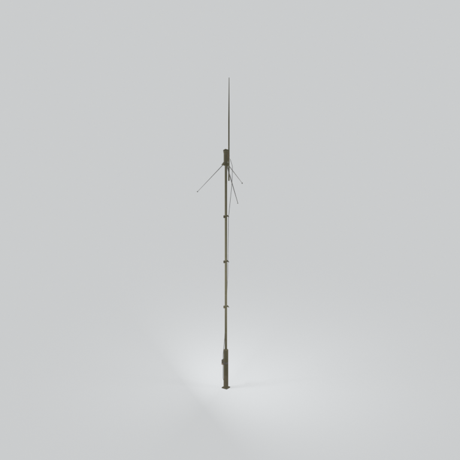
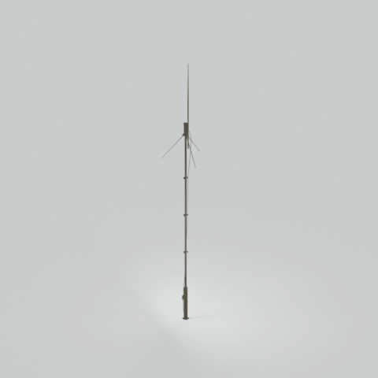

# Unidentified model (afgh_antn004)

Native model reference; a readable object identification has not been reviewed.

[Library](../README.md) | [Category](../tables/unclassified-components-1.md) | [Source / advanced data](../catalogue.json) | [Credits](../sources-and-credits.md)

**Game filename:** afgh_antn004.fmdl  
**Category:** Unclassified &gt; Unclassified components  
**Variant:** No explicit variant token; **LOD:** 0  
**Tags:** 

## Still reference



## 360-degree reference



The camera circles a static model. This is not a native animation. Source base textures and UVs use approximate studio shading; interaction, collision, complete assembly and FOX shader equivalence are not established.

## Identity and naming

| Field | Value |
|---|---|
| Library ID | mgsv-tpp-afgh_antn004-7e0b11ad6c10be80 |
| Naming status | unidentified |
| Naming confidence | unknown |
| Naming evidence | {} |
| Native model | /Assets/tpp/environ/object/afghanistan/antenna/afgh_antn004/scenes/afgh_antn004.fmdl |
| Model SHA256 | 43711a790c58f9e6361abc2941e19ad68a9f07965c1a38e9a8a8d3e3bb569903 |
| Container | /Assets/mgo/pack/location/afn0/pack_common/afn0_common.fpk |
| Container SHA256 | 793152d916d15d32b16935c3069b2171c7229092e9d1d3f1dd464e87ea95f415 |
| Captured source / location scope | Selected native member/content and captured installed-source chain; full archive SHA/runtime priority unresolved |
| Raw record SHA256 | faae49d6e3387cf2cc0633bbc046e67569dc4f2fa71093a3186230d880528e9a |

Naming review is descriptive metadata only. It does not change model completion or identify a working game interaction.

## Native LOD inventory

| Native LOD | Triangles | Preview status | Decoded indices SHA256 |
|---|---:|---|---|
| 0 | 300 | rendered | 2433c7842ac817ab4f2aa6898d8ff59550ea33f91557130b7949f91287d2aad6 |
| 1 | 251 | not separately rendered | f0383fe7921c39234440cddafd86e85dab2b57431b2c452f4237d753ea1b1f7b |
| 2 | 220 | not separately rendered | 281d222c99ffe8fca48147f154b4bccf88246b78f4da0d8d3666cc470bd13d1e |
| 3 | 202 | not separately rendered | 06b2c267e68f5ff2389838948fcc9ab44d3825467ff93de700965d1a8f924fa8 |

Mesh detail and texture pixels/mips are separate. Index hashes describe decoded triangle arrays, not packed index-buffer bytes. Only source-recorded native levels are listed.

<details>
<summary>Texture, source and naming technical metadata</summary>

```json
{
  "source": {
    "nativePath": "/Assets/tpp/environ/object/afghanistan/antenna/afgh_antn004/scenes/afgh_antn004.fmdl",
    "nativeSha256": "43711a790c58f9e6361abc2941e19ad68a9f07965c1a38e9a8a8d3e3bb569903",
    "stableIdentity": "/assets/tpp/environ/object/afghanistan/antenna/afgh_antn004/scenes/afgh_antn004.fmdl#43711a790c58f9e6361abc2941e19ad68a9f07965c1a38e9a8a8d3e3bb569903#9bfbf9e18cfa4bfd5130d687581d6cc3a3fbbfbe197c208e502c1187337e9c7f",
    "container": {
      "nativePath": "/Assets/mgo/pack/location/afn0/pack_common/afn0_common.fpk",
      "sha256": "793152d916d15d32b16935c3069b2171c7229092e9d1d3f1dd464e87ea95f415",
      "status": "Selected installed-source container/member chain captured by community reader"
    },
    "historicalDatOrigin": null,
    "sourceArchiveAtCapture": "master/0/00.dat",
    "locationStatus": "Selected native member/content and captured installed-source chain; full archive SHA/runtime priority unresolved",
    "currentInstalledDatVerified": false,
    "selectedInstalledMemberVerified": true,
    "evidence": {
      "archive_helper_executable_sha256": "6f8e39a436af3b024bbd0504966ab3d5d9d0cb05d86689bf3e83d15e68df613f",
      "archive_helper_source_sha256": "f662d3b63e066a0afc77ffe22ea0e564222d14469648300dba2c4f8e9b43446b",
      "archive_index_recipe": "54acff767f08d76ad6056c5387328759bc883df507788f398de6c2c04fac12db",
      "archive_reader": "Atvaark GzsTool.Core 0.5.3",
      "archive_reader_core_sha256": "9da447ae3c375cce2e46744eeff6af50f1591062afdf479d1a0b49edb47daaa3",
      "archive_tool_and_dictionary_sha256": {
        "CityHash.dll": "def6c4506d461b65e4059b2936b2cbd5f852ba5d1d8a1a527f1c0e6dc7008c8f",
        "GzsTool.Core.dll": "9da447ae3c375cce2e46744eeff6af50f1591062afdf479d1a0b49edb47daaa3",
        "GzsTool.exe": "1a9c5b11e2355383ff485aee7e86abc026f5c1fad729daf8c0fd15ee0aae1c10",
        "Zlib.Portable.dll": "fe84781ba35ca9cc5ff5f73fd08d2a66c59e5257b4573f5fe59743f30bf78e42",
        "fpk_dictionary.txt": "b82f9a8d6c10a68ba9471eca9d815c21355a53b5e68753d8ad7db7fd01bf401d",
        "qar_dictionary.txt": "1558c248ed0a4bb827888261563fbb91a2df4f03999682f85d637ff70d9d5fb2"
      },
      "bytes": 17456,
      "container_chain": [
        {
          "content_sha256": null,
          "depth": 0,
          "id": "3f19555d27c2ebecdfbad26aadd88b9f62e9fb6092c04c712963ef73c67ccb42",
          "index_sha256": "9acd3675d6e1500e0e18430cba0fdc70a5718ad7d6b62f13905891a35d59f18a",
          "kind": "qar",
          "name": "master/0/00.dat",
          "parent_occurrence": null
        },
        {
          "content_sha256": "793152d916d15d32b16935c3069b2171c7229092e9d1d3f1dd464e87ea95f415",
          "depth": 1,
          "id": "cdd16b801ab3d8abcb0eff58c5ffda33e686dfce824b125f6dae66b5b2538516",
          "index_sha256": "b576db71a757f0e278c2d308819efc35b981eb97da938ab92207c1f37446927a",
          "kind": "fpk",
          "name": "/Assets/mgo/pack/location/afn0/pack_common/afn0_common.fpk",
          "parent_occurrence": "629fd67dc6977d93ec9e65215d23dc6a6ff93ef5e14be9b3ffb02ad030ecfdde"
        }
      ],
      "contentSha256": "43711a790c58f9e6361abc2941e19ad68a9f07965c1a38e9a8a8d3e3bb569903",
      "member": {
        "actual_size": 17456,
        "compressed_size": null,
        "content_sha256": "43711a790c58f9e6361abc2941e19ad68a9f07965c1a38e9a8a8d3e3bb569903",
        "declared_size": 17456,
        "extension": "fmdl",
        "hash_hex": null,
        "name": "/Assets/tpp/environ/object/afghanistan/antenna/afgh_antn004/scenes/afgh_antn004.fmdl",
        "name_origin": "embedded",
        "offset": 5971680,
        "ordinal": 165,
        "path_hash": null,
        "resolved": 1
      },
      "occurrenceId": "857de4a1aa4764cf67d80ab1710ca625c5415f2286f786ecf6e3e9d9343c016a",
      "occurrence_id": "857de4a1aa4764cf67d80ab1710ca625c5415f2286f786ecf6e3e9d9343c016a",
      "primary_source_revision": "fc4a8196555638c6cf8aa1b7c8dc34ccd5c69cb5",
      "source_adapter": "community_core_selective_export",
      "source_id": "7f6bb743fb4c487f0e9522f9c7fac280c46cf6b1051e0fc75a93602c8eb451f0",
      "source_path": "master/0/00.dat",
      "source_snapshot": "{\"bytes\":768788480,\"device\":621747392682911458,\"file_id\":844424931596481,\"header_sha256\":\"ead50f0a9a37e4285323b9c6fa0ec75fe75e518c63147e63158eeb2892c6589e\",\"mtime_ns\":1791852224238580700}",
      "virtualPath": "/Assets/tpp/environ/object/afghanistan/antenna/afgh_antn004/scenes/afgh_antn004.fmdl"
    }
  },
  "materials": [
    {
      "sampler": "Base_Tex_SRGB",
      "materialIndex": 0,
      "nativePathHash": "1543585386974816202",
      "nativeVirtualPath": null,
      "nativeBinding": {
        "familyId": "1a5cc9b03a140ab4d88fbea3a7f0f6a3ebbaaa0bece731aec169d32409a9e8b0",
        "height": 512,
        "materialIndex": 0,
        "mipCount": 8,
        "nativeMipCountVerified": true,
        "nativePath": null,
        "nativePathHash": "1543585386974816202",
        "nativeTexture": {
          "additionalFtexsFileCount": 2,
          "depth": 1,
          "ftexsFileCount": 3,
          "height": 512,
          "metadataBytes": 192,
          "mipCount": 8,
          "mips": [
            {
              "chunks": 8,
              "decodedBytes": 131072,
              "mip": 0,
              "offset": 0,
              "storedBytes": 83456,
              "streamNumber": 3
            },
            {
              "chunks": 2,
              "decodedBytes": 32768,
              "mip": 1,
              "offset": 0,
              "storedBytes": 22896,
              "streamNumber": 2
            },
            {
              "chunks": 1,
              "decodedBytes": 8192,
              "mip": 2,
              "offset": 2392,
              "storedBytes": 6064,
              "streamNumber": 1
            },
            {
              "chunks": 1,
              "decodedBytes": 2048,
              "mip": 3,
              "offset": 736,
              "storedBytes": 1648,
              "streamNumber": 1
            },
            {
              "chunks": 1,
              "decodedBytes": 512,
              "mip": 4,
              "offset": 232,
              "storedBytes": 496,
              "streamNumber": 1
            },
            {
              "chunks": 1,
              "decodedBytes": 128,
              "mip": 5,
              "offset": 80,
              "storedBytes": 144,
              "streamNumber": 1
            },
            {
              "chunks": 1,
              "decodedBytes": 32,
              "mip": 6,
              "offset": 24,
              "storedBytes": 48,
              "streamNumber": 1
            },
            {
              "chunks": 1,
              "decodedBytes": 8,
              "mip": 7,
              "offset": 0,
              "storedBytes": 16,
              "streamNumber": 1
            }
          ],
          "nativeHeaderHash": "5cfdcab482a48fbc735ca87f8034e800",
          "nrtFlag": 2,
          "pixelFormat": 2,
          "requiredStreamNumbers": [
            1,
            2,
            3
          ],
          "textureType": 16777219,
          "unknownFlags": 273,
          "width": 512
        },
        "samplerName": "Base_Tex_SRGB",
        "samplerNameHash": "72475356961633",
        "sha256": "da5a6efd3d2bb8dceead358038c578b7d0b9843bb844301b0d2eab6931a5a6b5",
        "sourceOccurrences": [
          {
            "archive_helper_executable_sha256": "6f8e39a436af3b024bbd0504966ab3d5d9d0cb05d86689bf3e83d15e68df613f",
            "archive_helper_source_sha256": "f662d3b63e066a0afc77ffe22ea0e564222d14469648300dba2c4f8e9b43446b",
            "archive_index_recipe": "54acff767f08d76ad6056c5387328759bc883df507788f398de6c2c04fac12db",
            "archive_reader": "Atvaark GzsTool.Core 0.5.3",
            "archive_reader_core_sha256": "9da447ae3c375cce2e46744eeff6af50f1591062afdf479d1a0b49edb47daaa3",
            "archive_tool_and_dictionary_sha256": {
              "CityHash.dll": "def6c4506d461b65e4059b2936b2cbd5f852ba5d1d8a1a527f1c0e6dc7008c8f",
              "GzsTool.Core.dll": "9da447ae3c375cce2e46744eeff6af50f1591062afdf479d1a0b49edb47daaa3",
              "GzsTool.exe": "1a9c5b11e2355383ff485aee7e86abc026f5c1fad729daf8c0fd15ee0aae1c10",
              "Zlib.Portable.dll": "fe84781ba35ca9cc5ff5f73fd08d2a66c59e5257b4573f5fe59743f30bf78e42",
              "fpk_dictionary.txt": "b82f9a8d6c10a68ba9471eca9d815c21355a53b5e68753d8ad7db7fd01bf401d",
              "qar_dictionary.txt": "1558c248ed0a4bb827888261563fbb91a2df4f03999682f85d637ff70d9d5fb2"
            },
            "bytes": 192,
            "container_chain": [
              {
                "content_sha256": null,
                "depth": 0,
                "id": "3f19555d27c2ebecdfbad26aadd88b9f62e9fb6092c04c712963ef73c67ccb42",
                "index_sha256": "9acd3675d6e1500e0e18430cba0fdc70a5718ad7d6b62f13905891a35d59f18a",
                "kind": "qar",
                "name": "master/0/00.dat",
                "parent_occurrence": null
              },
              {
                "content_sha256": "2d231e65dd0e258bee24869e50bdc46f93eeb650bb81d42404c08a5376b9a1c2",
                "depth": 1,
                "id": "781fdb390fcb62560fac23f19318bc6caca329344eeb7291ba0508686536e328",
                "index_sha256": "dc5f40a4ac0c7a4290c3cccdaa7abd0c87f4b773f96508f9646721d00343f589",
                "kind": "pftxs",
                "name": "/Assets/mgo/pack/location/afn0/pack_common/afn0_common.pftxs",
                "parent_occurrence": "2c020de573d8fb7e811508359bef43a77a42e08aaa94446a176f01bec1414905"
              }
            ],
            "contentSha256": "06e2059add3f440e896c53e13e61c6b5c3caf72806219424d169c2e6dd4a80b6",
            "member": {
              "actual_size": 192,
              "compressed_size": null,
              "content_sha256": "06e2059add3f440e896c53e13e61c6b5c3caf72806219424d169c2e6dd4a80b6",
              "declared_size": 192,
              "extension": "ftex",
              "hash_hex": "156beabb2f1e27ca",
              "name": "156beabb2f1e27ca.ftex",
              "name_origin": "hash_fallback",
              "offset": 13105360,
              "ordinal": 920,
              "path_hash": null,
              "resolved": 0
            },
            "occurrenceId": "2993d32f4be9cbe4fb9e16f1060917910072d678e141b9a98e07f0c87f73e734",
            "occurrence_id": "2993d32f4be9cbe4fb9e16f1060917910072d678e141b9a98e07f0c87f73e734",
            "primary_source_revision": "fc4a8196555638c6cf8aa1b7c8dc34ccd5c69cb5",
            "source_adapter": "community_core_selective_export",
            "source_id": "7f6bb743fb4c487f0e9522f9c7fac280c46cf6b1051e0fc75a93602c8eb451f0",
            "source_path": "master/0/00.dat",
            "source_snapshot": "{\"bytes\":768788480,\"device\":621747392682911458,\"file_id\":844424931596481,\"header_sha256\":\"ead50f0a9a37e4285323b9c6fa0ec75fe75e518c63147e63158eeb2892c6589e\",\"mtime_ns\":1791852224238580700}",
            "virtualPath": "156beabb2f1e27ca.ftex"
          },
          {
            "archive_helper_executable_sha256": "6f8e39a436af3b024bbd0504966ab3d5d9d0cb05d86689bf3e83d15e68df613f",
            "archive_helper_source_sha256": "f662d3b63e066a0afc77ffe22ea0e564222d14469648300dba2c4f8e9b43446b",
            "archive_index_recipe": "54acff767f08d76ad6056c5387328759bc883df507788f398de6c2c04fac12db",
            "archive_reader": "Atvaark GzsTool.Core 0.5.3",
            "archive_reader_core_sha256": "9da447ae3c375cce2e46744eeff6af50f1591062afdf479d1a0b49edb47daaa3",
            "archive_tool_and_dictionary_sha256": {
              "CityHash.dll": "def6c4506d461b65e4059b2936b2cbd5f852ba5d1d8a1a527f1c0e6dc7008c8f",
              "GzsTool.Core.dll": "9da447ae3c375cce2e46744eeff6af50f1591062afdf479d1a0b49edb47daaa3",
              "GzsTool.exe": "1a9c5b11e2355383ff485aee7e86abc026f5c1fad729daf8c0fd15ee0aae1c10",
              "Zlib.Portable.dll": "fe84781ba35ca9cc5ff5f73fd08d2a66c59e5257b4573f5fe59743f30bf78e42",
              "fpk_dictionary.txt": "b82f9a8d6c10a68ba9471eca9d815c21355a53b5e68753d8ad7db7fd01bf401d",
              "qar_dictionary.txt": "1558c248ed0a4bb827888261563fbb91a2df4f03999682f85d637ff70d9d5fb2"
            },
            "bytes": 8464,
            "container_chain": [
              {
                "content_sha256": null,
                "depth": 0,
                "id": "0b473016351235050c2f6af21454bd979a0ad4602a9860137c807c894c5eba4d",
                "index_sha256": "ac9b4dae0dd0166db3a6ec8da18524dffebcbaf9004569af631de82913bf49a3",
                "kind": "qar",
                "name": "master/texture2.dat",
                "parent_occurrence": null
              }
            ],
            "contentSha256": "54dadc3e7a9d276d5beb0cbae9334800d3d56ed17c70ee112bf49c790c09e90c",
            "member": {
              "actual_size": 8464,
              "compressed_size": 8464,
              "content_sha256": "54dadc3e7a9d276d5beb0cbae9334800d3d56ed17c70ee112bf49c790c09e90c",
              "declared_size": 8464,
              "extension": "1.ftexs",
              "hash_hex": "b2c3eabb2f1e27ca",
              "name": "/Assets/tpp/environ/object/afghanistan/antenna/afgh_antn004/sourceimages/afgh_antn004_bsm.1.ftexs",
              "name_origin": "dictionary",
              "offset": 1236636704,
              "ordinal": 6618,
              "path_hash": "3eabb2f1e27ca",
              "resolved": 1
            },
            "occurrenceId": "6b1396af4d1ef7bcdc5c17bc97f05d293633571fd32b21d8e5554e6b7d27f5d1",
            "occurrence_id": "6b1396af4d1ef7bcdc5c17bc97f05d293633571fd32b21d8e5554e6b7d27f5d1",
            "primary_source_revision": "fc4a8196555638c6cf8aa1b7c8dc34ccd5c69cb5",
            "source_adapter": "community_core_selective_export",
            "source_id": "85e8296057664cbc6ebaf6bd43d1c6d18528bbd8a6fae920bdf4d5eb69f6a93d",
            "source_path": "master/texture2.dat",
            "source_snapshot": "{\"bytes\":2920239104,\"device\":621747392682911458,\"file_id\":562949953639626,\"header_sha256\":\"72bfee707623afb5f3abd8382035d3d4258b4941ac583a56f5a447f47123dcab\",\"mtime_ns\":1791224675561235200}",
            "virtualPath": "/Assets/tpp/environ/object/afghanistan/antenna/afgh_antn004/sourceimages/afgh_antn004_bsm.1.ftexs"
          },
          {
            "archive_helper_executable_sha256": "6f8e39a436af3b024bbd0504966ab3d5d9d0cb05d86689bf3e83d15e68df613f",
            "archive_helper_source_sha256": "f662d3b63e066a0afc77ffe22ea0e564222d14469648300dba2c4f8e9b43446b",
            "archive_index_recipe": "54acff767f08d76ad6056c5387328759bc883df507788f398de6c2c04fac12db",
            "archive_reader": "Atvaark GzsTool.Core 0.5.3",
            "archive_reader_core_sha256": "9da447ae3c375cce2e46744eeff6af50f1591062afdf479d1a0b49edb47daaa3",
            "archive_tool_and_dictionary_sha256": {
              "CityHash.dll": "def6c4506d461b65e4059b2936b2cbd5f852ba5d1d8a1a527f1c0e6dc7008c8f",
              "GzsTool.Core.dll": "9da447ae3c375cce2e46744eeff6af50f1591062afdf479d1a0b49edb47daaa3",
              "GzsTool.exe": "1a9c5b11e2355383ff485aee7e86abc026f5c1fad729daf8c0fd15ee0aae1c10",
              "Zlib.Portable.dll": "fe84781ba35ca9cc5ff5f73fd08d2a66c59e5257b4573f5fe59743f30bf78e42",
              "fpk_dictionary.txt": "b82f9a8d6c10a68ba9471eca9d815c21355a53b5e68753d8ad7db7fd01bf401d",
              "qar_dictionary.txt": "1558c248ed0a4bb827888261563fbb91a2df4f03999682f85d637ff70d9d5fb2"
            },
            "bytes": 22912,
            "container_chain": [
              {
                "content_sha256": null,
                "depth": 0,
                "id": "1cc220d9409d7163b6aca295ed89fd8c7befca6a8f849a8d5d09a2499724c863",
                "index_sha256": "5a818609a652a10d90fb90015661d0cb80898096bbb3aac36382172988d8736d",
                "kind": "qar",
                "name": "master/texture5_mgo0.dat",
                "parent_occurrence": null
              }
            ],
            "contentSha256": "9ff2efed46eb58185f07292f87acd75e7c2826094368faf5a31413fddafe53e8",
            "member": {
              "actual_size": 22912,
              "compressed_size": 22912,
              "content_sha256": "9ff2efed46eb58185f07292f87acd75e7c2826094368faf5a31413fddafe53e8",
              "declared_size": 22912,
              "extension": "2.ftexs",
              "hash_hex": "b573eabb2f1e27ca",
              "name": "/Assets/tpp/environ/object/afghanistan/antenna/afgh_antn004/sourceimages/afgh_antn004_bsm.2.ftexs",
              "name_origin": "dictionary",
              "offset": 3067566112,
              "ordinal": 11729,
              "path_hash": "3eabb2f1e27ca",
              "resolved": 1
            },
            "occurrenceId": "0238e8132229899f9c8f3c93f1ad18a9de6073df2e218648f684e82494b00ab6",
            "occurrence_id": "0238e8132229899f9c8f3c93f1ad18a9de6073df2e218648f684e82494b00ab6",
            "primary_source_revision": "fc4a8196555638c6cf8aa1b7c8dc34ccd5c69cb5",
            "source_adapter": "community_core_selective_export",
            "source_id": "24f8989ccaae47940dc20e54ba67442ad562ac0032ab6e3d475e927c81444b56",
            "source_path": "master/texture5_mgo0.dat",
            "source_snapshot": "{\"bytes\":4492370944,\"device\":621747392682911458,\"file_id\":13510798883237422,\"header_sha256\":\"6108fbacb65c84d041742c39e5ca630745240453b336f1059a13b91943f0b011\",\"mtime_ns\":1791224675562234400}",
            "virtualPath": "/Assets/tpp/environ/object/afghanistan/antenna/afgh_antn004/sourceimages/afgh_antn004_bsm.2.ftexs"
          },
          {
            "archive_helper_executable_sha256": "6f8e39a436af3b024bbd0504966ab3d5d9d0cb05d86689bf3e83d15e68df613f",
            "archive_helper_source_sha256": "f662d3b63e066a0afc77ffe22ea0e564222d14469648300dba2c4f8e9b43446b",
            "archive_index_recipe": "54acff767f08d76ad6056c5387328759bc883df507788f398de6c2c04fac12db",
            "archive_reader": "Atvaark GzsTool.Core 0.5.3",
            "archive_reader_core_sha256": "9da447ae3c375cce2e46744eeff6af50f1591062afdf479d1a0b49edb47daaa3",
            "archive_tool_and_dictionary_sha256": {
              "CityHash.dll": "def6c4506d461b65e4059b2936b2cbd5f852ba5d1d8a1a527f1c0e6dc7008c8f",
              "GzsTool.Core.dll": "9da447ae3c375cce2e46744eeff6af50f1591062afdf479d1a0b49edb47daaa3",
              "GzsTool.exe": "1a9c5b11e2355383ff485aee7e86abc026f5c1fad729daf8c0fd15ee0aae1c10",
              "Zlib.Portable.dll": "fe84781ba35ca9cc5ff5f73fd08d2a66c59e5257b4573f5fe59743f30bf78e42",
              "fpk_dictionary.txt": "b82f9a8d6c10a68ba9471eca9d815c21355a53b5e68753d8ad7db7fd01bf401d",
              "qar_dictionary.txt": "1558c248ed0a4bb827888261563fbb91a2df4f03999682f85d637ff70d9d5fb2"
            },
            "bytes": 83520,
            "container_chain": [
              {
                "content_sha256": null,
                "depth": 0,
                "id": "1cc220d9409d7163b6aca295ed89fd8c7befca6a8f849a8d5d09a2499724c863",
                "index_sha256": "5a818609a652a10d90fb90015661d0cb80898096bbb3aac36382172988d8736d",
                "kind": "qar",
                "name": "master/texture5_mgo0.dat",
                "parent_occurrence": null
              }
            ],
            "contentSha256": "58e209dc13ef2966c30487a367e00805c951b97cbda1186bc28eb0214ed6a7ae",
            "member": {
              "actual_size": 83520,
              "compressed_size": 83520,
              "content_sha256": "58e209dc13ef2966c30487a367e00805c951b97cbda1186bc28eb0214ed6a7ae",
              "declared_size": 83520,
              "extension": "3.ftexs",
              "hash_hex": "571beabb2f1e27ca",
              "name": "/Assets/tpp/environ/object/afghanistan/antenna/afgh_antn004/sourceimages/afgh_antn004_bsm.3.ftexs",
              "name_origin": "dictionary",
              "offset": 3067589664,
              "ordinal": 11730,
              "path_hash": "3eabb2f1e27ca",
              "resolved": 1
            },
            "occurrenceId": "be507fc0df54ff20853cd01167bdf2accce9b141601d8df7d8167816c2a4a53f",
            "occurrence_id": "be507fc0df54ff20853cd01167bdf2accce9b141601d8df7d8167816c2a4a53f",
            "primary_source_revision": "fc4a8196555638c6cf8aa1b7c8dc34ccd5c69cb5",
            "source_adapter": "community_core_selective_export",
            "source_id": "24f8989ccaae47940dc20e54ba67442ad562ac0032ab6e3d475e927c81444b56",
            "source_path": "master/texture5_mgo0.dat",
            "source_snapshot": "{\"bytes\":4492370944,\"device\":621747392682911458,\"file_id\":13510798883237422,\"header_sha256\":\"6108fbacb65c84d041742c39e5ca630745240453b336f1059a13b91943f0b011\",\"mtime_ns\":1791224675562234400}",
            "virtualPath": "/Assets/tpp/environ/object/afghanistan/antenna/afgh_antn004/sourceimages/afgh_antn004_bsm.3.ftexs"
          }
        ],
        "width": 512
      },
      "ddsSha256": "da5a6efd3d2bb8dceead358038c578b7d0b9843bb844301b0d2eab6931a5a6b5",
      "dimensions": [
        512,
        512
      ],
      "mipCount": 8,
      "nativeMipCountVerified": true,
      "connectedInPreview": true
    }
  ],
  "quality": {
    "decodedIndicesHashDerivation": "SHA256 of canonical UTF-8 JSON decoded triangle indices grouped by mesh; not packed buffer bytes",
    "highestRetainedGeometricLod": 0,
    "distinctNativeLods": 4,
    "baseTextureDimensions": [
      512,
      512
    ],
    "baseTextureNativeMipCount": 8,
    "largerRetainedBaseTextureFound": null,
    "nativeLods": [
      {
        "indicesSha256": "2433c7842ac817ab4f2aa6898d8ff59550ea33f91557130b7949f91287d2aad6",
        "nativeLod": 0,
        "triangles": 300
      },
      {
        "indicesSha256": "f0383fe7921c39234440cddafd86e85dab2b57431b2c452f4237d753ea1b1f7b",
        "nativeLod": 1,
        "triangles": 251
      },
      {
        "indicesSha256": "281d222c99ffe8fca48147f154b4bccf88246b78f4da0d8d3666cc470bd13d1e",
        "nativeLod": 2,
        "triangles": 220
      },
      {
        "indicesSha256": "06b2c267e68f5ff2389838948fcc9ab44d3825467ff93de700965d1a8f924fa8",
        "nativeLod": 3,
        "triangles": 202
      }
    ],
    "renderedNativeLods": [
      0
    ],
    "baseTextureSummary": "512 x 512; 8 native/DDS mips",
    "highestDetailScope": "Triangle-count comparison within captured FMDL only"
  }
}
```

</details>

[Original source / advanced record](../catalogue.json)
