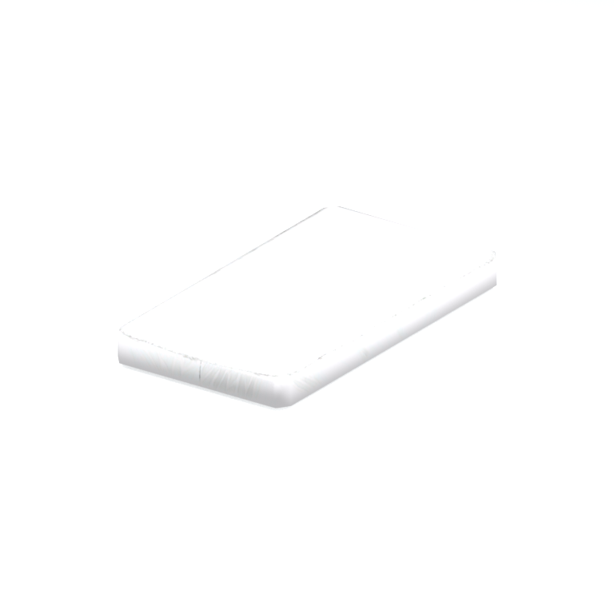
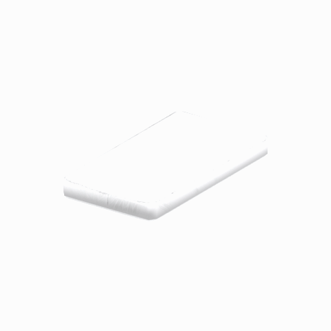

# Unidentified model (afgh_bedd006_mttr005)

Native model reference; a readable object identification has not been reviewed.

[Library](../README.md) | [Category](../tables/unclassified-components-1.md) | [Source / advanced data](../catalogue.json) | [Credits](../sources-and-credits.md)

**Game filename:** afgh_bedd006_mttr005.fmdl  
**Category:** Unclassified &gt; Unclassified components  
**Variant:** No explicit variant token; **LOD:** 0  
**Tags:** 

## Still reference



## 360-degree reference



The camera circles a static model. This is not a native animation. Source base textures and UVs use approximate studio shading; interaction, collision, complete assembly and FOX shader equivalence are not established.

## Identity and naming

| Field | Value |
|---|---|
| Library ID | mgsv-tpp-afgh_bedd006_mttr005-3fa1ff1facecd9e9 |
| Naming status | unidentified |
| Naming confidence | unknown |
| Naming evidence | {} |
| Native model | /Assets/tpp/environ/object/afghanistan/bed/afgh_bedd006/scenes/afgh_bedd006_mttr005.fmdl |
| Model SHA256 | fa0dbc0a939c1dffba48faea5532a822586480049df4b728165866266e2fd86b |
| Container | /Assets/tpp/pack/location/mtbs/pack_unique/mtbs_unique_0000.fpk |
| Container SHA256 | 05e9eb2302282ce7adea2eba11e56c0491ec126d7ec1b048b5bb0e53b15ea973 |
| Captured source / location scope | Selected native member/content and captured installed-source chain; full archive SHA/runtime priority unresolved |
| Raw record SHA256 | 8627275953e6e7dc85ea67ace8650224c9bcd7cb6746b2b0f01181a6b82d9b93 |

Naming review is descriptive metadata only. It does not change model completion or identify a working game interaction.

## Native LOD inventory

| Native LOD | Triangles | Preview status | Decoded indices SHA256 |
|---|---:|---|---|
| 0 | 44 | rendered | fa4d23a4c37c94d547db8fb0ed24127967fdd21c1b29842a97520af0d89245d1 |
| 1 | 26 | not separately rendered | c22ad220faec6a528b2cf4bc95da882085fdc3e218fde5617a5a069c906c3ff1 |
| 2 | 16 | not separately rendered | e7f30ecc9de5b1e37d6e650dc7e8c841e386cbebf19744d689a08f688a0ce127 |
| 3 | 8 | not separately rendered | e5aa00a03cb63f5eb7cebf1572abb95b924ecf6be35cb04a47cd6175829e9498 |

Mesh detail and texture pixels/mips are separate. Index hashes describe decoded triangle arrays, not packed index-buffer bytes. Only source-recorded native levels are listed.

<details>
<summary>Texture, source and naming technical metadata</summary>

```json
{
  "source": {
    "nativePath": "/Assets/tpp/environ/object/afghanistan/bed/afgh_bedd006/scenes/afgh_bedd006_mttr005.fmdl",
    "nativeSha256": "fa0dbc0a939c1dffba48faea5532a822586480049df4b728165866266e2fd86b",
    "stableIdentity": "/assets/tpp/environ/object/afghanistan/bed/afgh_bedd006/scenes/afgh_bedd006_mttr005.fmdl#fa0dbc0a939c1dffba48faea5532a822586480049df4b728165866266e2fd86b#5af3c19f4b123feb274ab20f9101f59ce676fcdb877841f13c0a253c5c821ae3",
    "container": {
      "nativePath": "/Assets/tpp/pack/location/mtbs/pack_unique/mtbs_unique_0000.fpk",
      "sha256": "05e9eb2302282ce7adea2eba11e56c0491ec126d7ec1b048b5bb0e53b15ea973",
      "status": "Selected installed-source container/member chain captured by community reader"
    },
    "historicalDatOrigin": null,
    "sourceArchiveAtCapture": "master/0/00.dat",
    "locationStatus": "Selected native member/content and captured installed-source chain; full archive SHA/runtime priority unresolved",
    "currentInstalledDatVerified": false,
    "selectedInstalledMemberVerified": true,
    "evidence": {
      "archive_helper_executable_sha256": "6f8e39a436af3b024bbd0504966ab3d5d9d0cb05d86689bf3e83d15e68df613f",
      "archive_helper_source_sha256": "f662d3b63e066a0afc77ffe22ea0e564222d14469648300dba2c4f8e9b43446b",
      "archive_index_recipe": "54acff767f08d76ad6056c5387328759bc883df507788f398de6c2c04fac12db",
      "archive_reader": "Atvaark GzsTool.Core 0.5.3",
      "archive_reader_core_sha256": "9da447ae3c375cce2e46744eeff6af50f1591062afdf479d1a0b49edb47daaa3",
      "archive_tool_and_dictionary_sha256": {
        "CityHash.dll": "def6c4506d461b65e4059b2936b2cbd5f852ba5d1d8a1a527f1c0e6dc7008c8f",
        "GzsTool.Core.dll": "9da447ae3c375cce2e46744eeff6af50f1591062afdf479d1a0b49edb47daaa3",
        "GzsTool.exe": "1a9c5b11e2355383ff485aee7e86abc026f5c1fad729daf8c0fd15ee0aae1c10",
        "Zlib.Portable.dll": "fe84781ba35ca9cc5ff5f73fd08d2a66c59e5257b4573f5fe59743f30bf78e42",
        "fpk_dictionary.txt": "b82f9a8d6c10a68ba9471eca9d815c21355a53b5e68753d8ad7db7fd01bf401d",
        "qar_dictionary.txt": "1558c248ed0a4bb827888261563fbb91a2df4f03999682f85d637ff70d9d5fb2"
      },
      "bytes": 2592,
      "container_chain": [
        {
          "content_sha256": null,
          "depth": 0,
          "id": "3f19555d27c2ebecdfbad26aadd88b9f62e9fb6092c04c712963ef73c67ccb42",
          "index_sha256": "9acd3675d6e1500e0e18430cba0fdc70a5718ad7d6b62f13905891a35d59f18a",
          "kind": "qar",
          "name": "master/0/00.dat",
          "parent_occurrence": null
        },
        {
          "content_sha256": "05e9eb2302282ce7adea2eba11e56c0491ec126d7ec1b048b5bb0e53b15ea973",
          "depth": 1,
          "id": "c3ab5fa547baaffedfde55b3ee16e80d27d1292dbcd112cdacf9f6df9636fa05",
          "index_sha256": "928b49f622f602c9f072128a474d48284d69db58dcefe051f7208d409d281da8",
          "kind": "fpk",
          "name": "/Assets/tpp/pack/location/mtbs/pack_unique/mtbs_unique_0000.fpk",
          "parent_occurrence": "b1758feccee5d490a240d2195c2364fd70bf1375302a76cb3fd5e1d2a4af2c77"
        }
      ],
      "contentSha256": "fa0dbc0a939c1dffba48faea5532a822586480049df4b728165866266e2fd86b",
      "member": {
        "actual_size": 2592,
        "compressed_size": null,
        "content_sha256": "fa0dbc0a939c1dffba48faea5532a822586480049df4b728165866266e2fd86b",
        "declared_size": 2592,
        "extension": "fmdl",
        "hash_hex": null,
        "name": "/Assets/tpp/environ/object/afghanistan/bed/afgh_bedd006/scenes/afgh_bedd006_mttr005.fmdl",
        "name_origin": "embedded",
        "offset": 4263200,
        "ordinal": 140,
        "path_hash": null,
        "resolved": 1
      },
      "occurrenceId": "32959b29a47621b26a55232be5afc0dfdacca50f9b09cb80e3e4028d61758174",
      "occurrence_id": "32959b29a47621b26a55232be5afc0dfdacca50f9b09cb80e3e4028d61758174",
      "primary_source_revision": "fc4a8196555638c6cf8aa1b7c8dc34ccd5c69cb5",
      "source_adapter": "community_core_selective_export",
      "source_id": "7f6bb743fb4c487f0e9522f9c7fac280c46cf6b1051e0fc75a93602c8eb451f0",
      "source_path": "master/0/00.dat",
      "source_snapshot": "{\"bytes\":768788480,\"device\":621747392682911458,\"file_id\":844424931596481,\"header_sha256\":\"ead50f0a9a37e4285323b9c6fa0ec75fe75e518c63147e63158eeb2892c6589e\",\"mtime_ns\":1791852224238580700}",
      "virtualPath": "/Assets/tpp/environ/object/afghanistan/bed/afgh_bedd006/scenes/afgh_bedd006_mttr005.fmdl"
    }
  },
  "materials": [
    {
      "sampler": "Base_Tex_SRGB",
      "materialIndex": 0,
      "nativePathHash": "1543496262803838831",
      "nativeVirtualPath": null,
      "nativeBinding": {
        "familyId": "f609bd52864178be3fc43a525d713907dcc66dba1fea5a1e81adf0bf03d17ff7",
        "height": 1024,
        "materialIndex": 0,
        "mipCount": 9,
        "nativeMipCountVerified": true,
        "nativePath": null,
        "nativePathHash": "1543496262803838831",
        "nativeTexture": {
          "additionalFtexsFileCount": 2,
          "depth": 1,
          "ftexsFileCount": 3,
          "height": 1024,
          "metadataBytes": 208,
          "mipCount": 9,
          "mips": [
            {
              "chunks": 16,
              "decodedBytes": 262144,
              "mip": 0,
              "offset": 0,
              "storedBytes": 86048,
              "streamNumber": 3
            },
            {
              "chunks": 4,
              "decodedBytes": 65536,
              "mip": 1,
              "offset": 0,
              "storedBytes": 26704,
              "streamNumber": 2
            },
            {
              "chunks": 1,
              "decodedBytes": 16384,
              "mip": 2,
              "offset": 3280,
              "storedBytes": 7616,
              "streamNumber": 1
            },
            {
              "chunks": 1,
              "decodedBytes": 4096,
              "mip": 3,
              "offset": 1096,
              "storedBytes": 2176,
              "streamNumber": 1
            },
            {
              "chunks": 1,
              "decodedBytes": 1024,
              "mip": 4,
              "offset": 400,
              "storedBytes": 688,
              "streamNumber": 1
            },
            {
              "chunks": 1,
              "decodedBytes": 256,
              "mip": 5,
              "offset": 152,
              "storedBytes": 240,
              "streamNumber": 1
            },
            {
              "chunks": 1,
              "decodedBytes": 64,
              "mip": 6,
              "offset": 64,
              "storedBytes": 80,
              "streamNumber": 1
            },
            {
              "chunks": 1,
              "decodedBytes": 16,
              "mip": 7,
              "offset": 24,
              "storedBytes": 32,
              "streamNumber": 1
            },
            {
              "chunks": 1,
              "decodedBytes": 8,
              "mip": 8,
              "offset": 0,
              "storedBytes": 16,
              "streamNumber": 1
            }
          ],
          "nativeHeaderHash": "28ac76697be585059043c97e078c5a87",
          "nrtFlag": 2,
          "pixelFormat": 2,
          "requiredStreamNumbers": [
            1,
            2,
            3
          ],
          "textureType": 16777219,
          "unknownFlags": 273,
          "width": 512
        },
        "samplerName": "Base_Tex_SRGB",
        "samplerNameHash": "72475356961633",
        "sha256": "5ba2eabd63bfe983d57c0495f5b84f4c09f71158b069bb3d035d7c3ce9ff9012",
        "sourceOccurrences": [
          {
            "archive_helper_executable_sha256": "6f8e39a436af3b024bbd0504966ab3d5d9d0cb05d86689bf3e83d15e68df613f",
            "archive_helper_source_sha256": "f662d3b63e066a0afc77ffe22ea0e564222d14469648300dba2c4f8e9b43446b",
            "archive_index_recipe": "54acff767f08d76ad6056c5387328759bc883df507788f398de6c2c04fac12db",
            "archive_reader": "Atvaark GzsTool.Core 0.5.3",
            "archive_reader_core_sha256": "9da447ae3c375cce2e46744eeff6af50f1591062afdf479d1a0b49edb47daaa3",
            "archive_tool_and_dictionary_sha256": {
              "CityHash.dll": "def6c4506d461b65e4059b2936b2cbd5f852ba5d1d8a1a527f1c0e6dc7008c8f",
              "GzsTool.Core.dll": "9da447ae3c375cce2e46744eeff6af50f1591062afdf479d1a0b49edb47daaa3",
              "GzsTool.exe": "1a9c5b11e2355383ff485aee7e86abc026f5c1fad729daf8c0fd15ee0aae1c10",
              "Zlib.Portable.dll": "fe84781ba35ca9cc5ff5f73fd08d2a66c59e5257b4573f5fe59743f30bf78e42",
              "fpk_dictionary.txt": "b82f9a8d6c10a68ba9471eca9d815c21355a53b5e68753d8ad7db7fd01bf401d",
              "qar_dictionary.txt": "1558c248ed0a4bb827888261563fbb91a2df4f03999682f85d637ff70d9d5fb2"
            },
            "bytes": 208,
            "container_chain": [
              {
                "content_sha256": null,
                "depth": 0,
                "id": "06035c7f54d1fe3fde25c93eb85d5278f37457e9730b7b0dc0553ea567520e6d",
                "index_sha256": "be525e8d33187ab76b3f97935035faac60a4c7ca7fcff3401a0ce712f03c285e",
                "kind": "qar",
                "name": "master/texture3.dat",
                "parent_occurrence": null
              }
            ],
            "contentSha256": "9770b73309d62204351d7a5d6c6d48d69e608fbeef6c293a6eec3e63b64b7333",
            "member": {
              "actual_size": 208,
              "compressed_size": 208,
              "content_sha256": "9770b73309d62204351d7a5d6c6d48d69e608fbeef6c293a6eec3e63b64b7333",
              "declared_size": 208,
              "extension": "ftex",
              "hash_hex": "156b99ac5890d76f",
              "name": "399ac5890d76f.ftex",
              "name_origin": "hash_fallback",
              "offset": 840941600,
              "ordinal": 7226,
              "path_hash": "399ac5890d76f",
              "resolved": 0
            },
            "occurrenceId": "0739300cda3ea0bf2b88391dd57ec3a5edf3ced4b801d1829215f7d422ea5f4e",
            "occurrence_id": "0739300cda3ea0bf2b88391dd57ec3a5edf3ced4b801d1829215f7d422ea5f4e",
            "primary_source_revision": "fc4a8196555638c6cf8aa1b7c8dc34ccd5c69cb5",
            "source_adapter": "community_core_selective_export",
            "source_id": "8d93a1c4a39e41ca988ccdecf8dbaa5fa7e6f9f82b75bea9a691d2b01de50ef8",
            "source_path": "master/texture3.dat",
            "source_snapshot": "{\"bytes\":1297381376,\"device\":621747392682911458,\"file_id\":562949953639627,\"header_sha256\":\"55c07d7fb3cb3498d10fa3bed93a81ce330553a903fff3222b5bf307bcc7ef0c\",\"mtime_ns\":1791224675561235200}",
            "virtualPath": "399ac5890d76f.ftex"
          },
          {
            "archive_helper_executable_sha256": "6f8e39a436af3b024bbd0504966ab3d5d9d0cb05d86689bf3e83d15e68df613f",
            "archive_helper_source_sha256": "f662d3b63e066a0afc77ffe22ea0e564222d14469648300dba2c4f8e9b43446b",
            "archive_index_recipe": "54acff767f08d76ad6056c5387328759bc883df507788f398de6c2c04fac12db",
            "archive_reader": "Atvaark GzsTool.Core 0.5.3",
            "archive_reader_core_sha256": "9da447ae3c375cce2e46744eeff6af50f1591062afdf479d1a0b49edb47daaa3",
            "archive_tool_and_dictionary_sha256": {
              "CityHash.dll": "def6c4506d461b65e4059b2936b2cbd5f852ba5d1d8a1a527f1c0e6dc7008c8f",
              "GzsTool.Core.dll": "9da447ae3c375cce2e46744eeff6af50f1591062afdf479d1a0b49edb47daaa3",
              "GzsTool.exe": "1a9c5b11e2355383ff485aee7e86abc026f5c1fad729daf8c0fd15ee0aae1c10",
              "Zlib.Portable.dll": "fe84781ba35ca9cc5ff5f73fd08d2a66c59e5257b4573f5fe59743f30bf78e42",
              "fpk_dictionary.txt": "b82f9a8d6c10a68ba9471eca9d815c21355a53b5e68753d8ad7db7fd01bf401d",
              "qar_dictionary.txt": "1558c248ed0a4bb827888261563fbb91a2df4f03999682f85d637ff70d9d5fb2"
            },
            "bytes": 10904,
            "container_chain": [
              {
                "content_sha256": null,
                "depth": 0,
                "id": "06035c7f54d1fe3fde25c93eb85d5278f37457e9730b7b0dc0553ea567520e6d",
                "index_sha256": "be525e8d33187ab76b3f97935035faac60a4c7ca7fcff3401a0ce712f03c285e",
                "kind": "qar",
                "name": "master/texture3.dat",
                "parent_occurrence": null
              }
            ],
            "contentSha256": "b5c4cb873919b3b4b7f5b2f737b3ca74a9826c5a8fbb84ff7c24b76c2c26629a",
            "member": {
              "actual_size": 10904,
              "compressed_size": 10904,
              "content_sha256": "b5c4cb873919b3b4b7f5b2f737b3ca74a9826c5a8fbb84ff7c24b76c2c26629a",
              "declared_size": 10904,
              "extension": "1.ftexs",
              "hash_hex": "b2c399ac5890d76f",
              "name": "399ac5890d76f.1.ftexs",
              "name_origin": "hash_fallback",
              "offset": 840815648,
              "ordinal": 7223,
              "path_hash": "399ac5890d76f",
              "resolved": 0
            },
            "occurrenceId": "e207438856102153906d49a4df590cf90eab320898cee3058e03c14a7acd27ec",
            "occurrence_id": "e207438856102153906d49a4df590cf90eab320898cee3058e03c14a7acd27ec",
            "primary_source_revision": "fc4a8196555638c6cf8aa1b7c8dc34ccd5c69cb5",
            "source_adapter": "community_core_selective_export",
            "source_id": "8d93a1c4a39e41ca988ccdecf8dbaa5fa7e6f9f82b75bea9a691d2b01de50ef8",
            "source_path": "master/texture3.dat",
            "source_snapshot": "{\"bytes\":1297381376,\"device\":621747392682911458,\"file_id\":562949953639627,\"header_sha256\":\"55c07d7fb3cb3498d10fa3bed93a81ce330553a903fff3222b5bf307bcc7ef0c\",\"mtime_ns\":1791224675561235200}",
            "virtualPath": "399ac5890d76f.1.ftexs"
          },
          {
            "archive_helper_executable_sha256": "6f8e39a436af3b024bbd0504966ab3d5d9d0cb05d86689bf3e83d15e68df613f",
            "archive_helper_source_sha256": "f662d3b63e066a0afc77ffe22ea0e564222d14469648300dba2c4f8e9b43446b",
            "archive_index_recipe": "54acff767f08d76ad6056c5387328759bc883df507788f398de6c2c04fac12db",
            "archive_reader": "Atvaark GzsTool.Core 0.5.3",
            "archive_reader_core_sha256": "9da447ae3c375cce2e46744eeff6af50f1591062afdf479d1a0b49edb47daaa3",
            "archive_tool_and_dictionary_sha256": {
              "CityHash.dll": "def6c4506d461b65e4059b2936b2cbd5f852ba5d1d8a1a527f1c0e6dc7008c8f",
              "GzsTool.Core.dll": "9da447ae3c375cce2e46744eeff6af50f1591062afdf479d1a0b49edb47daaa3",
              "GzsTool.exe": "1a9c5b11e2355383ff485aee7e86abc026f5c1fad729daf8c0fd15ee0aae1c10",
              "Zlib.Portable.dll": "fe84781ba35ca9cc5ff5f73fd08d2a66c59e5257b4573f5fe59743f30bf78e42",
              "fpk_dictionary.txt": "b82f9a8d6c10a68ba9471eca9d815c21355a53b5e68753d8ad7db7fd01bf401d",
              "qar_dictionary.txt": "1558c248ed0a4bb827888261563fbb91a2df4f03999682f85d637ff70d9d5fb2"
            },
            "bytes": 26736,
            "container_chain": [
              {
                "content_sha256": null,
                "depth": 0,
                "id": "06035c7f54d1fe3fde25c93eb85d5278f37457e9730b7b0dc0553ea567520e6d",
                "index_sha256": "be525e8d33187ab76b3f97935035faac60a4c7ca7fcff3401a0ce712f03c285e",
                "kind": "qar",
                "name": "master/texture3.dat",
                "parent_occurrence": null
              }
            ],
            "contentSha256": "75c22b1ef65d1f1b8b86c89bc7ab46593a925a01f0f49bba4793b1002f87e7ac",
            "member": {
              "actual_size": 26736,
              "compressed_size": 26736,
              "content_sha256": "75c22b1ef65d1f1b8b86c89bc7ab46593a925a01f0f49bba4793b1002f87e7ac",
              "declared_size": 26736,
              "extension": "2.ftexs",
              "hash_hex": "b57399ac5890d76f",
              "name": "399ac5890d76f.2.ftexs",
              "name_origin": "hash_fallback",
              "offset": 840826912,
              "ordinal": 7224,
              "path_hash": "399ac5890d76f",
              "resolved": 0
            },
            "occurrenceId": "240d9d7a922f30ed75b670cc82259158a543328add0fba40a8570c0a1cedcbb8",
            "occurrence_id": "240d9d7a922f30ed75b670cc82259158a543328add0fba40a8570c0a1cedcbb8",
            "primary_source_revision": "fc4a8196555638c6cf8aa1b7c8dc34ccd5c69cb5",
            "source_adapter": "community_core_selective_export",
            "source_id": "8d93a1c4a39e41ca988ccdecf8dbaa5fa7e6f9f82b75bea9a691d2b01de50ef8",
            "source_path": "master/texture3.dat",
            "source_snapshot": "{\"bytes\":1297381376,\"device\":621747392682911458,\"file_id\":562949953639627,\"header_sha256\":\"55c07d7fb3cb3498d10fa3bed93a81ce330553a903fff3222b5bf307bcc7ef0c\",\"mtime_ns\":1791224675561235200}",
            "virtualPath": "399ac5890d76f.2.ftexs"
          },
          {
            "archive_helper_executable_sha256": "6f8e39a436af3b024bbd0504966ab3d5d9d0cb05d86689bf3e83d15e68df613f",
            "archive_helper_source_sha256": "f662d3b63e066a0afc77ffe22ea0e564222d14469648300dba2c4f8e9b43446b",
            "archive_index_recipe": "54acff767f08d76ad6056c5387328759bc883df507788f398de6c2c04fac12db",
            "archive_reader": "Atvaark GzsTool.Core 0.5.3",
            "archive_reader_core_sha256": "9da447ae3c375cce2e46744eeff6af50f1591062afdf479d1a0b49edb47daaa3",
            "archive_tool_and_dictionary_sha256": {
              "CityHash.dll": "def6c4506d461b65e4059b2936b2cbd5f852ba5d1d8a1a527f1c0e6dc7008c8f",
              "GzsTool.Core.dll": "9da447ae3c375cce2e46744eeff6af50f1591062afdf479d1a0b49edb47daaa3",
              "GzsTool.exe": "1a9c5b11e2355383ff485aee7e86abc026f5c1fad729daf8c0fd15ee0aae1c10",
              "Zlib.Portable.dll": "fe84781ba35ca9cc5ff5f73fd08d2a66c59e5257b4573f5fe59743f30bf78e42",
              "fpk_dictionary.txt": "b82f9a8d6c10a68ba9471eca9d815c21355a53b5e68753d8ad7db7fd01bf401d",
              "qar_dictionary.txt": "1558c248ed0a4bb827888261563fbb91a2df4f03999682f85d637ff70d9d5fb2"
            },
            "bytes": 86176,
            "container_chain": [
              {
                "content_sha256": null,
                "depth": 0,
                "id": "06035c7f54d1fe3fde25c93eb85d5278f37457e9730b7b0dc0553ea567520e6d",
                "index_sha256": "be525e8d33187ab76b3f97935035faac60a4c7ca7fcff3401a0ce712f03c285e",
                "kind": "qar",
                "name": "master/texture3.dat",
                "parent_occurrence": null
              }
            ],
            "contentSha256": "0e45cb08ceb5f697b0cfafd887a6f5819ac50109337053b1b93fcf2e42f2b67a",
            "member": {
              "actual_size": 86176,
              "compressed_size": 86176,
              "content_sha256": "0e45cb08ceb5f697b0cfafd887a6f5819ac50109337053b1b93fcf2e42f2b67a",
              "declared_size": 86176,
              "extension": "3.ftexs",
              "hash_hex": "571b99ac5890d76f",
              "name": "399ac5890d76f.3.ftexs",
              "name_origin": "hash_fallback",
              "offset": 840854560,
              "ordinal": 7225,
              "path_hash": "399ac5890d76f",
              "resolved": 0
            },
            "occurrenceId": "ea7368bc015228dd6e19087b3dd6fc1c472f5827cbfca1033fac3d1ac5b54e59",
            "occurrence_id": "ea7368bc015228dd6e19087b3dd6fc1c472f5827cbfca1033fac3d1ac5b54e59",
            "primary_source_revision": "fc4a8196555638c6cf8aa1b7c8dc34ccd5c69cb5",
            "source_adapter": "community_core_selective_export",
            "source_id": "8d93a1c4a39e41ca988ccdecf8dbaa5fa7e6f9f82b75bea9a691d2b01de50ef8",
            "source_path": "master/texture3.dat",
            "source_snapshot": "{\"bytes\":1297381376,\"device\":621747392682911458,\"file_id\":562949953639627,\"header_sha256\":\"55c07d7fb3cb3498d10fa3bed93a81ce330553a903fff3222b5bf307bcc7ef0c\",\"mtime_ns\":1791224675561235200}",
            "virtualPath": "399ac5890d76f.3.ftexs"
          }
        ],
        "width": 512
      },
      "ddsSha256": "5ba2eabd63bfe983d57c0495f5b84f4c09f71158b069bb3d035d7c3ce9ff9012",
      "dimensions": [
        512,
        1024
      ],
      "mipCount": 9,
      "nativeMipCountVerified": true,
      "connectedInPreview": true
    }
  ],
  "quality": {
    "decodedIndicesHashDerivation": "SHA256 of canonical UTF-8 JSON decoded triangle indices grouped by mesh; not packed buffer bytes",
    "highestRetainedGeometricLod": 0,
    "distinctNativeLods": 4,
    "baseTextureDimensions": [
      512,
      1024
    ],
    "baseTextureNativeMipCount": 9,
    "largerRetainedBaseTextureFound": null,
    "nativeLods": [
      {
        "indicesSha256": "fa4d23a4c37c94d547db8fb0ed24127967fdd21c1b29842a97520af0d89245d1",
        "nativeLod": 0,
        "triangles": 44
      },
      {
        "indicesSha256": "c22ad220faec6a528b2cf4bc95da882085fdc3e218fde5617a5a069c906c3ff1",
        "nativeLod": 1,
        "triangles": 26
      },
      {
        "indicesSha256": "e7f30ecc9de5b1e37d6e650dc7e8c841e386cbebf19744d689a08f688a0ce127",
        "nativeLod": 2,
        "triangles": 16
      },
      {
        "indicesSha256": "e5aa00a03cb63f5eb7cebf1572abb95b924ecf6be35cb04a47cd6175829e9498",
        "nativeLod": 3,
        "triangles": 8
      }
    ],
    "renderedNativeLods": [
      0
    ],
    "baseTextureSummary": "512 x 1024; 9 native/DDS mips",
    "highestDetailScope": "Triangle-count comparison within captured FMDL only"
  }
}
```

</details>

[Original source / advanced record](../catalogue.json)
