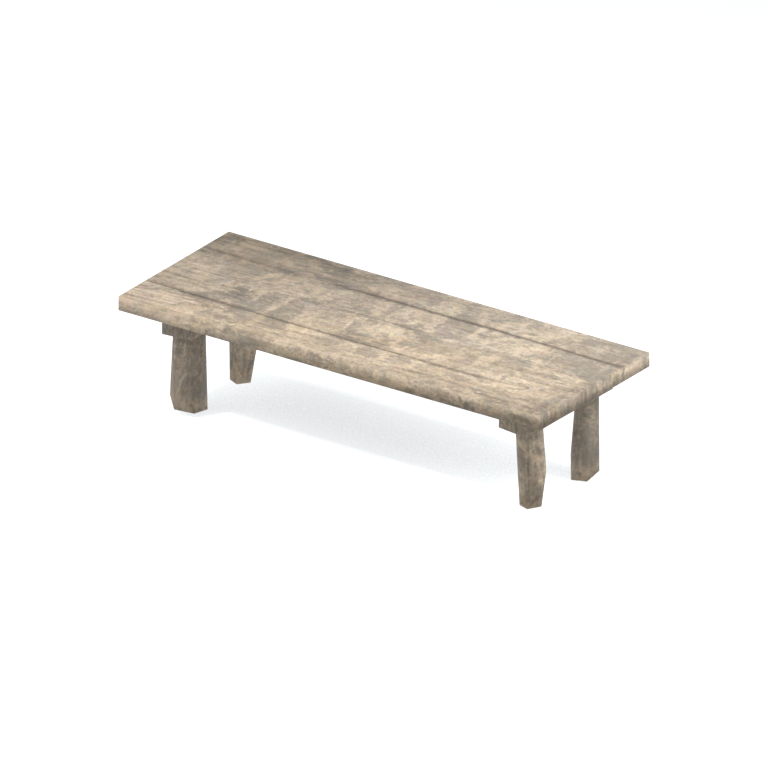
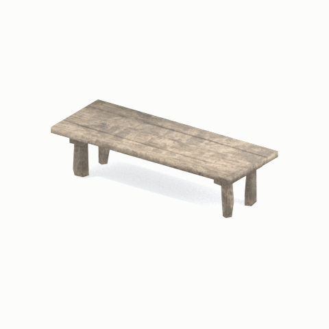

# Unidentified model (afgh_bnch001)

Native model reference; a readable object identification has not been reviewed.

[Library](../README.md) | [Category](../tables/unclassified-components-1.md) | [Source / advanced data](../catalogue.json) | [Credits](../sources-and-credits.md)

**Game filename:** afgh_bnch001.fmdl  
**Category:** Unclassified &gt; Unclassified components  
**Variant:** No explicit variant token; **LOD:** 0  
**Tags:** 

## Still reference



## 360-degree reference



The camera circles a static model. This is not a native animation. Source base textures and UVs use approximate studio shading; interaction, collision, complete assembly and FOX shader equivalence are not established.

## Identity and naming

| Field | Value |
|---|---|
| Library ID | mgsv-tpp-afgh_bnch001-16993bf297417661 |
| Naming status | unidentified |
| Naming confidence | unknown |
| Naming evidence | {} |
| Native model | /Assets/tpp/environ/object/afghanistan/bench/afgh_bnch001/scenes/afgh_bnch001.fmdl |
| Model SHA256 | f4e667d42fae0ca40864b45c97372438fb82e41dae678e1921bdc544ecefd1e7 |
| Container | /Assets/mgo/pack/location/afn0/pack_common/afn0_common.fpk |
| Container SHA256 | 793152d916d15d32b16935c3069b2171c7229092e9d1d3f1dd464e87ea95f415 |
| Captured source / location scope | Selected native member/content and captured installed-source chain; full archive SHA/runtime priority unresolved |
| Raw record SHA256 | 7c1710ded3554eb4786558490ba84fde23ff5f853bab1008a2fb12ab14968601 |

Naming review is descriptive metadata only. It does not change model completion or identify a working game interaction.

## Native LOD inventory

| Native LOD | Triangles | Preview status | Decoded indices SHA256 |
|---|---:|---|---|
| 0 | 92 | rendered | 8810ce008ecac8686d5b7505637f28dbe95c96b18b154154c0c999bdb1bf9d3f |
| 1 | 82 | not separately rendered | 48fa3b44c7c4dd8dc692d0c81c84d9d22b00bb4a09c52f8c8a943389985e835d |
| 2 | 76 | not separately rendered | 7d558743822f46f4f761a602d79aa71ed79d55ebcfcb4f4bcdb6c5cefa228691 |
| 3 | 72 | not separately rendered | 1b51c52c2904c6a2553674e1c2403da77e3e77520383df0dbcf6e5e9d07a37bf |

Mesh detail and texture pixels/mips are separate. Index hashes describe decoded triangle arrays, not packed index-buffer bytes. Only source-recorded native levels are listed.

<details>
<summary>Texture, source and naming technical metadata</summary>

```json
{
  "source": {
    "nativePath": "/Assets/tpp/environ/object/afghanistan/bench/afgh_bnch001/scenes/afgh_bnch001.fmdl",
    "nativeSha256": "f4e667d42fae0ca40864b45c97372438fb82e41dae678e1921bdc544ecefd1e7",
    "stableIdentity": "/assets/tpp/environ/object/afghanistan/bench/afgh_bnch001/scenes/afgh_bnch001.fmdl#f4e667d42fae0ca40864b45c97372438fb82e41dae678e1921bdc544ecefd1e7#a8bfa473b6ac8cfe668986ee562cee5dbea925be611f58833576c4fe8afa8392",
    "container": {
      "nativePath": "/Assets/mgo/pack/location/afn0/pack_common/afn0_common.fpk",
      "sha256": "793152d916d15d32b16935c3069b2171c7229092e9d1d3f1dd464e87ea95f415",
      "status": "Selected installed-source container/member chain captured by community reader"
    },
    "historicalDatOrigin": null,
    "sourceArchiveAtCapture": "master/0/00.dat",
    "locationStatus": "Selected native member/content and captured installed-source chain; full archive SHA/runtime priority unresolved",
    "currentInstalledDatVerified": false,
    "selectedInstalledMemberVerified": true,
    "evidence": {
      "archive_helper_executable_sha256": "6f8e39a436af3b024bbd0504966ab3d5d9d0cb05d86689bf3e83d15e68df613f",
      "archive_helper_source_sha256": "f662d3b63e066a0afc77ffe22ea0e564222d14469648300dba2c4f8e9b43446b",
      "archive_index_recipe": "54acff767f08d76ad6056c5387328759bc883df507788f398de6c2c04fac12db",
      "archive_reader": "Atvaark GzsTool.Core 0.5.3",
      "archive_reader_core_sha256": "9da447ae3c375cce2e46744eeff6af50f1591062afdf479d1a0b49edb47daaa3",
      "archive_tool_and_dictionary_sha256": {
        "CityHash.dll": "def6c4506d461b65e4059b2936b2cbd5f852ba5d1d8a1a527f1c0e6dc7008c8f",
        "GzsTool.Core.dll": "9da447ae3c375cce2e46744eeff6af50f1591062afdf479d1a0b49edb47daaa3",
        "GzsTool.exe": "1a9c5b11e2355383ff485aee7e86abc026f5c1fad729daf8c0fd15ee0aae1c10",
        "Zlib.Portable.dll": "fe84781ba35ca9cc5ff5f73fd08d2a66c59e5257b4573f5fe59743f30bf78e42",
        "fpk_dictionary.txt": "b82f9a8d6c10a68ba9471eca9d815c21355a53b5e68753d8ad7db7fd01bf401d",
        "qar_dictionary.txt": "1558c248ed0a4bb827888261563fbb91a2df4f03999682f85d637ff70d9d5fb2"
      },
      "bytes": 5280,
      "container_chain": [
        {
          "content_sha256": null,
          "depth": 0,
          "id": "3f19555d27c2ebecdfbad26aadd88b9f62e9fb6092c04c712963ef73c67ccb42",
          "index_sha256": "9acd3675d6e1500e0e18430cba0fdc70a5718ad7d6b62f13905891a35d59f18a",
          "kind": "qar",
          "name": "master/0/00.dat",
          "parent_occurrence": null
        },
        {
          "content_sha256": "793152d916d15d32b16935c3069b2171c7229092e9d1d3f1dd464e87ea95f415",
          "depth": 1,
          "id": "cdd16b801ab3d8abcb0eff58c5ffda33e686dfce824b125f6dae66b5b2538516",
          "index_sha256": "b576db71a757f0e278c2d308819efc35b981eb97da938ab92207c1f37446927a",
          "kind": "fpk",
          "name": "/Assets/mgo/pack/location/afn0/pack_common/afn0_common.fpk",
          "parent_occurrence": "629fd67dc6977d93ec9e65215d23dc6a6ff93ef5e14be9b3ffb02ad030ecfdde"
        }
      ],
      "contentSha256": "f4e667d42fae0ca40864b45c97372438fb82e41dae678e1921bdc544ecefd1e7",
      "member": {
        "actual_size": 5280,
        "compressed_size": null,
        "content_sha256": "f4e667d42fae0ca40864b45c97372438fb82e41dae678e1921bdc544ecefd1e7",
        "declared_size": 5280,
        "extension": "fmdl",
        "hash_hex": null,
        "name": "/Assets/tpp/environ/object/afghanistan/bench/afgh_bnch001/scenes/afgh_bnch001.fmdl",
        "name_origin": "embedded",
        "offset": 5989136,
        "ordinal": 166,
        "path_hash": null,
        "resolved": 1
      },
      "occurrenceId": "a2c9b5677fd455c98b5200e5947e30a57e9e02a6fa58944b75751d87f98b4415",
      "occurrence_id": "a2c9b5677fd455c98b5200e5947e30a57e9e02a6fa58944b75751d87f98b4415",
      "primary_source_revision": "fc4a8196555638c6cf8aa1b7c8dc34ccd5c69cb5",
      "source_adapter": "community_core_selective_export",
      "source_id": "7f6bb743fb4c487f0e9522f9c7fac280c46cf6b1051e0fc75a93602c8eb451f0",
      "source_path": "master/0/00.dat",
      "source_snapshot": "{\"bytes\":768788480,\"device\":621747392682911458,\"file_id\":844424931596481,\"header_sha256\":\"ead50f0a9a37e4285323b9c6fa0ec75fe75e518c63147e63158eeb2892c6589e\",\"mtime_ns\":1791852224238580700}",
      "virtualPath": "/Assets/tpp/environ/object/afghanistan/bench/afgh_bnch001/scenes/afgh_bnch001.fmdl"
    }
  },
  "materials": [
    {
      "sampler": "Base_Tex_SRGB",
      "materialIndex": 0,
      "nativePathHash": "1542823166128350124",
      "nativeVirtualPath": null,
      "nativeBinding": {
        "familyId": "f15fcbaf56206c93275a417d26494129d8b2a035e9745c08f1968fa48c053ef0",
        "height": 512,
        "materialIndex": 0,
        "mipCount": 8,
        "nativeMipCountVerified": true,
        "nativePath": null,
        "nativePathHash": "1542823166128350124",
        "nativeTexture": {
          "additionalFtexsFileCount": 2,
          "depth": 1,
          "ftexsFileCount": 3,
          "height": 512,
          "metadataBytes": 192,
          "mipCount": 8,
          "mips": [
            {
              "chunks": 4,
              "decodedBytes": 65536,
              "mip": 0,
              "offset": 0,
              "storedBytes": 52112,
              "streamNumber": 3
            },
            {
              "chunks": 1,
              "decodedBytes": 16384,
              "mip": 1,
              "offset": 0,
              "storedBytes": 13104,
              "streamNumber": 2
            },
            {
              "chunks": 1,
              "decodedBytes": 4096,
              "mip": 2,
              "offset": 1384,
              "storedBytes": 3456,
              "streamNumber": 1
            },
            {
              "chunks": 1,
              "decodedBytes": 1024,
              "mip": 3,
              "offset": 432,
              "storedBytes": 944,
              "streamNumber": 1
            },
            {
              "chunks": 1,
              "decodedBytes": 256,
              "mip": 4,
              "offset": 152,
              "storedBytes": 272,
              "streamNumber": 1
            },
            {
              "chunks": 1,
              "decodedBytes": 64,
              "mip": 5,
              "offset": 64,
              "storedBytes": 80,
              "streamNumber": 1
            },
            {
              "chunks": 1,
              "decodedBytes": 16,
              "mip": 6,
              "offset": 24,
              "storedBytes": 32,
              "streamNumber": 1
            },
            {
              "chunks": 1,
              "decodedBytes": 8,
              "mip": 7,
              "offset": 0,
              "storedBytes": 16,
              "streamNumber": 1
            }
          ],
          "nativeHeaderHash": "7599cd6a615813959e0e1617a51db8c6",
          "nrtFlag": 2,
          "pixelFormat": 2,
          "requiredStreamNumbers": [
            1,
            2,
            3
          ],
          "textureType": 16777219,
          "unknownFlags": 273,
          "width": 256
        },
        "samplerName": "Base_Tex_SRGB",
        "samplerNameHash": "72475356961633",
        "sha256": "81575a1d687c9dfe452d6794cac060fa0893b01d1bf355fb1a137d9152dee213",
        "sourceOccurrences": [
          {
            "archive_helper_executable_sha256": "6f8e39a436af3b024bbd0504966ab3d5d9d0cb05d86689bf3e83d15e68df613f",
            "archive_helper_source_sha256": "f662d3b63e066a0afc77ffe22ea0e564222d14469648300dba2c4f8e9b43446b",
            "archive_index_recipe": "54acff767f08d76ad6056c5387328759bc883df507788f398de6c2c04fac12db",
            "archive_reader": "Atvaark GzsTool.Core 0.5.3",
            "archive_reader_core_sha256": "9da447ae3c375cce2e46744eeff6af50f1591062afdf479d1a0b49edb47daaa3",
            "archive_tool_and_dictionary_sha256": {
              "CityHash.dll": "def6c4506d461b65e4059b2936b2cbd5f852ba5d1d8a1a527f1c0e6dc7008c8f",
              "GzsTool.Core.dll": "9da447ae3c375cce2e46744eeff6af50f1591062afdf479d1a0b49edb47daaa3",
              "GzsTool.exe": "1a9c5b11e2355383ff485aee7e86abc026f5c1fad729daf8c0fd15ee0aae1c10",
              "Zlib.Portable.dll": "fe84781ba35ca9cc5ff5f73fd08d2a66c59e5257b4573f5fe59743f30bf78e42",
              "fpk_dictionary.txt": "b82f9a8d6c10a68ba9471eca9d815c21355a53b5e68753d8ad7db7fd01bf401d",
              "qar_dictionary.txt": "1558c248ed0a4bb827888261563fbb91a2df4f03999682f85d637ff70d9d5fb2"
            },
            "bytes": 192,
            "container_chain": [
              {
                "content_sha256": null,
                "depth": 0,
                "id": "0b473016351235050c2f6af21454bd979a0ad4602a9860137c807c894c5eba4d",
                "index_sha256": "ac9b4dae0dd0166db3a6ec8da18524dffebcbaf9004569af631de82913bf49a3",
                "kind": "qar",
                "name": "master/texture2.dat",
                "parent_occurrence": null
              }
            ],
            "contentSha256": "b709f10c3b694f73bd78cc9cdba2571aa8a0424aa3cc992f287c5568972147a2",
            "member": {
              "actual_size": 192,
              "compressed_size": 192,
              "content_sha256": "b709f10c3b694f73bd78cc9cdba2571aa8a0424aa3cc992f287c5568972147a2",
              "declared_size": 192,
              "extension": "ftex",
              "hash_hex": "1569357ed052e3ac",
              "name": "/Assets/tpp/environ/object/afghanistan/bench/afgh_bnch001/sourceimages/afgh_bnch001_bsm.ftex",
              "name_origin": "dictionary",
              "offset": 1270404128,
              "ordinal": 7062,
              "path_hash": "1357ed052e3ac",
              "resolved": 1
            },
            "occurrenceId": "95c177c2878bf9367dcb62e3e366758e1426e5d703a6a7df0f6fc886fddf770f",
            "occurrence_id": "95c177c2878bf9367dcb62e3e366758e1426e5d703a6a7df0f6fc886fddf770f",
            "primary_source_revision": "fc4a8196555638c6cf8aa1b7c8dc34ccd5c69cb5",
            "source_adapter": "community_core_selective_export",
            "source_id": "85e8296057664cbc6ebaf6bd43d1c6d18528bbd8a6fae920bdf4d5eb69f6a93d",
            "source_path": "master/texture2.dat",
            "source_snapshot": "{\"bytes\":2920239104,\"device\":621747392682911458,\"file_id\":562949953639626,\"header_sha256\":\"72bfee707623afb5f3abd8382035d3d4258b4941ac583a56f5a447f47123dcab\",\"mtime_ns\":1791224675561235200}",
            "virtualPath": "/Assets/tpp/environ/object/afghanistan/bench/afgh_bnch001/sourceimages/afgh_bnch001_bsm.ftex"
          },
          {
            "archive_helper_executable_sha256": "6f8e39a436af3b024bbd0504966ab3d5d9d0cb05d86689bf3e83d15e68df613f",
            "archive_helper_source_sha256": "f662d3b63e066a0afc77ffe22ea0e564222d14469648300dba2c4f8e9b43446b",
            "archive_index_recipe": "54acff767f08d76ad6056c5387328759bc883df507788f398de6c2c04fac12db",
            "archive_reader": "Atvaark GzsTool.Core 0.5.3",
            "archive_reader_core_sha256": "9da447ae3c375cce2e46744eeff6af50f1591062afdf479d1a0b49edb47daaa3",
            "archive_tool_and_dictionary_sha256": {
              "CityHash.dll": "def6c4506d461b65e4059b2936b2cbd5f852ba5d1d8a1a527f1c0e6dc7008c8f",
              "GzsTool.Core.dll": "9da447ae3c375cce2e46744eeff6af50f1591062afdf479d1a0b49edb47daaa3",
              "GzsTool.exe": "1a9c5b11e2355383ff485aee7e86abc026f5c1fad729daf8c0fd15ee0aae1c10",
              "Zlib.Portable.dll": "fe84781ba35ca9cc5ff5f73fd08d2a66c59e5257b4573f5fe59743f30bf78e42",
              "fpk_dictionary.txt": "b82f9a8d6c10a68ba9471eca9d815c21355a53b5e68753d8ad7db7fd01bf401d",
              "qar_dictionary.txt": "1558c248ed0a4bb827888261563fbb91a2df4f03999682f85d637ff70d9d5fb2"
            },
            "bytes": 4848,
            "container_chain": [
              {
                "content_sha256": null,
                "depth": 0,
                "id": "3f19555d27c2ebecdfbad26aadd88b9f62e9fb6092c04c712963ef73c67ccb42",
                "index_sha256": "9acd3675d6e1500e0e18430cba0fdc70a5718ad7d6b62f13905891a35d59f18a",
                "kind": "qar",
                "name": "master/0/00.dat",
                "parent_occurrence": null
              },
              {
                "content_sha256": "2d231e65dd0e258bee24869e50bdc46f93eeb650bb81d42404c08a5376b9a1c2",
                "depth": 1,
                "id": "781fdb390fcb62560fac23f19318bc6caca329344eeb7291ba0508686536e328",
                "index_sha256": "dc5f40a4ac0c7a4290c3cccdaa7abd0c87f4b773f96508f9646721d00343f589",
                "kind": "pftxs",
                "name": "/Assets/mgo/pack/location/afn0/pack_common/afn0_common.pftxs",
                "parent_occurrence": "2c020de573d8fb7e811508359bef43a77a42e08aaa94446a176f01bec1414905"
              }
            ],
            "contentSha256": "0b71f2a777cab11c146d5bce8f952c239791a31f7589c71afce5029168cc885f",
            "member": {
              "actual_size": 4848,
              "compressed_size": null,
              "content_sha256": "0b71f2a777cab11c146d5bce8f952c239791a31f7589c71afce5029168cc885f",
              "declared_size": 4848,
              "extension": "1.ftexs",
              "hash_hex": "b2c1357ed052e3ac",
              "name": "b2c1357ed052e3ac.1.ftexs",
              "name_origin": "hash_fallback",
              "offset": 13130496,
              "ordinal": 927,
              "path_hash": null,
              "resolved": 0
            },
            "occurrenceId": "7940b39da1dd327dbd0d8bc6d869bd66a4aa74128529c3a46eb124c91b6c78d0",
            "occurrence_id": "7940b39da1dd327dbd0d8bc6d869bd66a4aa74128529c3a46eb124c91b6c78d0",
            "primary_source_revision": "fc4a8196555638c6cf8aa1b7c8dc34ccd5c69cb5",
            "source_adapter": "community_core_selective_export",
            "source_id": "7f6bb743fb4c487f0e9522f9c7fac280c46cf6b1051e0fc75a93602c8eb451f0",
            "source_path": "master/0/00.dat",
            "source_snapshot": "{\"bytes\":768788480,\"device\":621747392682911458,\"file_id\":844424931596481,\"header_sha256\":\"ead50f0a9a37e4285323b9c6fa0ec75fe75e518c63147e63158eeb2892c6589e\",\"mtime_ns\":1791852224238580700}",
            "virtualPath": "b2c1357ed052e3ac.1.ftexs"
          },
          {
            "archive_helper_executable_sha256": "6f8e39a436af3b024bbd0504966ab3d5d9d0cb05d86689bf3e83d15e68df613f",
            "archive_helper_source_sha256": "f662d3b63e066a0afc77ffe22ea0e564222d14469648300dba2c4f8e9b43446b",
            "archive_index_recipe": "54acff767f08d76ad6056c5387328759bc883df507788f398de6c2c04fac12db",
            "archive_reader": "Atvaark GzsTool.Core 0.5.3",
            "archive_reader_core_sha256": "9da447ae3c375cce2e46744eeff6af50f1591062afdf479d1a0b49edb47daaa3",
            "archive_tool_and_dictionary_sha256": {
              "CityHash.dll": "def6c4506d461b65e4059b2936b2cbd5f852ba5d1d8a1a527f1c0e6dc7008c8f",
              "GzsTool.Core.dll": "9da447ae3c375cce2e46744eeff6af50f1591062afdf479d1a0b49edb47daaa3",
              "GzsTool.exe": "1a9c5b11e2355383ff485aee7e86abc026f5c1fad729daf8c0fd15ee0aae1c10",
              "Zlib.Portable.dll": "fe84781ba35ca9cc5ff5f73fd08d2a66c59e5257b4573f5fe59743f30bf78e42",
              "fpk_dictionary.txt": "b82f9a8d6c10a68ba9471eca9d815c21355a53b5e68753d8ad7db7fd01bf401d",
              "qar_dictionary.txt": "1558c248ed0a4bb827888261563fbb91a2df4f03999682f85d637ff70d9d5fb2"
            },
            "bytes": 13112,
            "container_chain": [
              {
                "content_sha256": null,
                "depth": 0,
                "id": "0b473016351235050c2f6af21454bd979a0ad4602a9860137c807c894c5eba4d",
                "index_sha256": "ac9b4dae0dd0166db3a6ec8da18524dffebcbaf9004569af631de82913bf49a3",
                "kind": "qar",
                "name": "master/texture2.dat",
                "parent_occurrence": null
              }
            ],
            "contentSha256": "8653861d586c253371cb4a0a76d3bfcd050757ef003bf300e53e73ca0a297112",
            "member": {
              "actual_size": 13112,
              "compressed_size": 13112,
              "content_sha256": "8653861d586c253371cb4a0a76d3bfcd050757ef003bf300e53e73ca0a297112",
              "declared_size": 13112,
              "extension": "2.ftexs",
              "hash_hex": "b571357ed052e3ac",
              "name": "/Assets/tpp/environ/object/afghanistan/bench/afgh_bnch001/sourceimages/afgh_bnch001_bsm.2.ftexs",
              "name_origin": "dictionary",
              "offset": 1270338592,
              "ordinal": 7060,
              "path_hash": "1357ed052e3ac",
              "resolved": 1
            },
            "occurrenceId": "06c41233d70914fa03475b2e5941bd062d51d4334b3f82b3d5bd4ca3221ed2d9",
            "occurrence_id": "06c41233d70914fa03475b2e5941bd062d51d4334b3f82b3d5bd4ca3221ed2d9",
            "primary_source_revision": "fc4a8196555638c6cf8aa1b7c8dc34ccd5c69cb5",
            "source_adapter": "community_core_selective_export",
            "source_id": "85e8296057664cbc6ebaf6bd43d1c6d18528bbd8a6fae920bdf4d5eb69f6a93d",
            "source_path": "master/texture2.dat",
            "source_snapshot": "{\"bytes\":2920239104,\"device\":621747392682911458,\"file_id\":562949953639626,\"header_sha256\":\"72bfee707623afb5f3abd8382035d3d4258b4941ac583a56f5a447f47123dcab\",\"mtime_ns\":1791224675561235200}",
            "virtualPath": "/Assets/tpp/environ/object/afghanistan/bench/afgh_bnch001/sourceimages/afgh_bnch001_bsm.2.ftexs"
          },
          {
            "archive_helper_executable_sha256": "6f8e39a436af3b024bbd0504966ab3d5d9d0cb05d86689bf3e83d15e68df613f",
            "archive_helper_source_sha256": "f662d3b63e066a0afc77ffe22ea0e564222d14469648300dba2c4f8e9b43446b",
            "archive_index_recipe": "54acff767f08d76ad6056c5387328759bc883df507788f398de6c2c04fac12db",
            "archive_reader": "Atvaark GzsTool.Core 0.5.3",
            "archive_reader_core_sha256": "9da447ae3c375cce2e46744eeff6af50f1591062afdf479d1a0b49edb47daaa3",
            "archive_tool_and_dictionary_sha256": {
              "CityHash.dll": "def6c4506d461b65e4059b2936b2cbd5f852ba5d1d8a1a527f1c0e6dc7008c8f",
              "GzsTool.Core.dll": "9da447ae3c375cce2e46744eeff6af50f1591062afdf479d1a0b49edb47daaa3",
              "GzsTool.exe": "1a9c5b11e2355383ff485aee7e86abc026f5c1fad729daf8c0fd15ee0aae1c10",
              "Zlib.Portable.dll": "fe84781ba35ca9cc5ff5f73fd08d2a66c59e5257b4573f5fe59743f30bf78e42",
              "fpk_dictionary.txt": "b82f9a8d6c10a68ba9471eca9d815c21355a53b5e68753d8ad7db7fd01bf401d",
              "qar_dictionary.txt": "1558c248ed0a4bb827888261563fbb91a2df4f03999682f85d637ff70d9d5fb2"
            },
            "bytes": 52144,
            "container_chain": [
              {
                "content_sha256": null,
                "depth": 0,
                "id": "1cc220d9409d7163b6aca295ed89fd8c7befca6a8f849a8d5d09a2499724c863",
                "index_sha256": "5a818609a652a10d90fb90015661d0cb80898096bbb3aac36382172988d8736d",
                "kind": "qar",
                "name": "master/texture5_mgo0.dat",
                "parent_occurrence": null
              }
            ],
            "contentSha256": "f4e37373ba3c449bb0891399ff01286e4d48c71eb8042f57e4ffadf40519de57",
            "member": {
              "actual_size": 52144,
              "compressed_size": 52144,
              "content_sha256": "f4e37373ba3c449bb0891399ff01286e4d48c71eb8042f57e4ffadf40519de57",
              "declared_size": 52144,
              "extension": "3.ftexs",
              "hash_hex": "5719357ed052e3ac",
              "name": "/Assets/tpp/environ/object/afghanistan/bench/afgh_bnch001/sourceimages/afgh_bnch001_bsm.3.ftexs",
              "name_origin": "dictionary",
              "offset": 3070069792,
              "ordinal": 11763,
              "path_hash": "1357ed052e3ac",
              "resolved": 1
            },
            "occurrenceId": "63f69a84fce7d6a940873ac21b0f20d925840edfb02fbe44e9a0111c1b361e94",
            "occurrence_id": "63f69a84fce7d6a940873ac21b0f20d925840edfb02fbe44e9a0111c1b361e94",
            "primary_source_revision": "fc4a8196555638c6cf8aa1b7c8dc34ccd5c69cb5",
            "source_adapter": "community_core_selective_export",
            "source_id": "24f8989ccaae47940dc20e54ba67442ad562ac0032ab6e3d475e927c81444b56",
            "source_path": "master/texture5_mgo0.dat",
            "source_snapshot": "{\"bytes\":4492370944,\"device\":621747392682911458,\"file_id\":13510798883237422,\"header_sha256\":\"6108fbacb65c84d041742c39e5ca630745240453b336f1059a13b91943f0b011\",\"mtime_ns\":1791224675562234400}",
            "virtualPath": "/Assets/tpp/environ/object/afghanistan/bench/afgh_bnch001/sourceimages/afgh_bnch001_bsm.3.ftexs"
          }
        ],
        "width": 256
      },
      "ddsSha256": "81575a1d687c9dfe452d6794cac060fa0893b01d1bf355fb1a137d9152dee213",
      "dimensions": [
        256,
        512
      ],
      "mipCount": 8,
      "nativeMipCountVerified": true,
      "connectedInPreview": true
    }
  ],
  "quality": {
    "decodedIndicesHashDerivation": "SHA256 of canonical UTF-8 JSON decoded triangle indices grouped by mesh; not packed buffer bytes",
    "highestRetainedGeometricLod": 0,
    "distinctNativeLods": 4,
    "baseTextureDimensions": [
      256,
      512
    ],
    "baseTextureNativeMipCount": 8,
    "largerRetainedBaseTextureFound": null,
    "nativeLods": [
      {
        "indicesSha256": "8810ce008ecac8686d5b7505637f28dbe95c96b18b154154c0c999bdb1bf9d3f",
        "nativeLod": 0,
        "triangles": 92
      },
      {
        "indicesSha256": "48fa3b44c7c4dd8dc692d0c81c84d9d22b00bb4a09c52f8c8a943389985e835d",
        "nativeLod": 1,
        "triangles": 82
      },
      {
        "indicesSha256": "7d558743822f46f4f761a602d79aa71ed79d55ebcfcb4f4bcdb6c5cefa228691",
        "nativeLod": 2,
        "triangles": 76
      },
      {
        "indicesSha256": "1b51c52c2904c6a2553674e1c2403da77e3e77520383df0dbcf6e5e9d07a37bf",
        "nativeLod": 3,
        "triangles": 72
      }
    ],
    "renderedNativeLods": [
      0
    ],
    "baseTextureSummary": "256 x 512; 8 native/DDS mips",
    "highestDetailScope": "Triangle-count comparison within captured FMDL only"
  }
}
```

</details>

[Original source / advanced record](../catalogue.json)
