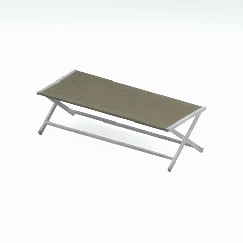

# Unidentified model (afgh_bnch002)

Native model reference; a readable object identification has not been reviewed.

[Library](../README.md) | [Category](../tables/unclassified-components-1.md) | [Source / advanced data](../catalogue.json) | [Credits](../sources-and-credits.md)

**Game filename:** afgh_bnch002.fmdl  
**Category:** Unclassified &gt; Unclassified components  
**Variant:** No explicit variant token; **LOD:** 0  
**Tags:** 

## Still reference


## 360-degree reference



The camera circles a static model. This is not a native animation. Source base textures and UVs use approximate studio shading; interaction, collision, complete assembly and FOX shader equivalence are not established.

## Identity and naming

| Field | Value |
|---|---|
| Library ID | mgsv-tpp-afgh_bnch002-998954f98ab4ae1c |
| Naming status | unidentified |
| Naming confidence | unknown |
| Naming evidence | {} |
| Native model | /Assets/tpp/environ/object/afghanistan/bench/afgh_bnch002/scenes/afgh_bnch002.fmdl |
| Model SHA256 | f3dd71f3dc5a7dcb04ccd296a330173c0d61f5ccb292522e7cf938188c729f2d |
| Container | /Assets/mgo/pack/location/afn0/pack_common/afn0_common.fpk |
| Container SHA256 | 793152d916d15d32b16935c3069b2171c7229092e9d1d3f1dd464e87ea95f415 |
| Captured source / location scope | Selected native member/content and captured installed-source chain; full archive SHA/runtime priority unresolved |
| Raw record SHA256 | 40cfbc6d32ca7e5fa564aa0e8bb93f88898d9477148c8ce16e33329a6b07417b |

Naming review is descriptive metadata only. It does not change model completion or identify a working game interaction.

## Native LOD inventory

| Native LOD | Triangles | Preview status | Decoded indices SHA256 |
|---|---:|---|---|
| 0 | 102 | rendered | 3efb7b680915ada74cadc1302a379c30a0b5ed7b3588dc6cd56f7082f464eee5 |
| 1 | 97 | not separately rendered | 267455b940c01a6f30671c5d5ebbf3bd6b1c8324ca3e773e0e4e3297c09a3e17 |
| 2 | 94 | not separately rendered | f925d2861cf09f3893f3721b689a43465433e6dd3a4e787e68c1bac9b9d83f1c |
| 3 | 92 | not separately rendered | b48ddba8f93d1acbc3b07bce552ad7856df4435c91d4e90e7951980b17d823a3 |

Mesh detail and texture pixels/mips are separate. Index hashes describe decoded triangle arrays, not packed index-buffer bytes. Only source-recorded native levels are listed.

<details>
<summary>Texture, source and naming technical metadata</summary>

```json
{
  "source": {
    "nativePath": "/Assets/tpp/environ/object/afghanistan/bench/afgh_bnch002/scenes/afgh_bnch002.fmdl",
    "nativeSha256": "f3dd71f3dc5a7dcb04ccd296a330173c0d61f5ccb292522e7cf938188c729f2d",
    "stableIdentity": "/assets/tpp/environ/object/afghanistan/bench/afgh_bnch002/scenes/afgh_bnch002.fmdl#f3dd71f3dc5a7dcb04ccd296a330173c0d61f5ccb292522e7cf938188c729f2d#64fdc2c9a2225772604f0b947c0dd6c5951186b855ed2b660beb638a6a61a1f8",
    "container": {
      "nativePath": "/Assets/mgo/pack/location/afn0/pack_common/afn0_common.fpk",
      "sha256": "793152d916d15d32b16935c3069b2171c7229092e9d1d3f1dd464e87ea95f415",
      "status": "Selected installed-source container/member chain captured by community reader"
    },
    "historicalDatOrigin": null,
    "sourceArchiveAtCapture": "master/0/00.dat",
    "locationStatus": "Selected native member/content and captured installed-source chain; full archive SHA/runtime priority unresolved",
    "currentInstalledDatVerified": false,
    "selectedInstalledMemberVerified": true,
    "evidence": {
      "archive_helper_executable_sha256": "6f8e39a436af3b024bbd0504966ab3d5d9d0cb05d86689bf3e83d15e68df613f",
      "archive_helper_source_sha256": "f662d3b63e066a0afc77ffe22ea0e564222d14469648300dba2c4f8e9b43446b",
      "archive_index_recipe": "54acff767f08d76ad6056c5387328759bc883df507788f398de6c2c04fac12db",
      "archive_reader": "Atvaark GzsTool.Core 0.5.3",
      "archive_reader_core_sha256": "9da447ae3c375cce2e46744eeff6af50f1591062afdf479d1a0b49edb47daaa3",
      "archive_tool_and_dictionary_sha256": {
        "CityHash.dll": "def6c4506d461b65e4059b2936b2cbd5f852ba5d1d8a1a527f1c0e6dc7008c8f",
        "GzsTool.Core.dll": "9da447ae3c375cce2e46744eeff6af50f1591062afdf479d1a0b49edb47daaa3",
        "GzsTool.exe": "1a9c5b11e2355383ff485aee7e86abc026f5c1fad729daf8c0fd15ee0aae1c10",
        "Zlib.Portable.dll": "fe84781ba35ca9cc5ff5f73fd08d2a66c59e5257b4573f5fe59743f30bf78e42",
        "fpk_dictionary.txt": "b82f9a8d6c10a68ba9471eca9d815c21355a53b5e68753d8ad7db7fd01bf401d",
        "qar_dictionary.txt": "1558c248ed0a4bb827888261563fbb91a2df4f03999682f85d637ff70d9d5fb2"
      },
      "bytes": 8128,
      "container_chain": [
        {
          "content_sha256": null,
          "depth": 0,
          "id": "3f19555d27c2ebecdfbad26aadd88b9f62e9fb6092c04c712963ef73c67ccb42",
          "index_sha256": "9acd3675d6e1500e0e18430cba0fdc70a5718ad7d6b62f13905891a35d59f18a",
          "kind": "qar",
          "name": "master/0/00.dat",
          "parent_occurrence": null
        },
        {
          "content_sha256": "793152d916d15d32b16935c3069b2171c7229092e9d1d3f1dd464e87ea95f415",
          "depth": 1,
          "id": "cdd16b801ab3d8abcb0eff58c5ffda33e686dfce824b125f6dae66b5b2538516",
          "index_sha256": "b576db71a757f0e278c2d308819efc35b981eb97da938ab92207c1f37446927a",
          "kind": "fpk",
          "name": "/Assets/mgo/pack/location/afn0/pack_common/afn0_common.fpk",
          "parent_occurrence": "629fd67dc6977d93ec9e65215d23dc6a6ff93ef5e14be9b3ffb02ad030ecfdde"
        }
      ],
      "contentSha256": "f3dd71f3dc5a7dcb04ccd296a330173c0d61f5ccb292522e7cf938188c729f2d",
      "member": {
        "actual_size": 8128,
        "compressed_size": null,
        "content_sha256": "f3dd71f3dc5a7dcb04ccd296a330173c0d61f5ccb292522e7cf938188c729f2d",
        "declared_size": 8128,
        "extension": "fmdl",
        "hash_hex": null,
        "name": "/Assets/tpp/environ/object/afghanistan/bench/afgh_bnch002/scenes/afgh_bnch002.fmdl",
        "name_origin": "embedded",
        "offset": 5994416,
        "ordinal": 167,
        "path_hash": null,
        "resolved": 1
      },
      "occurrenceId": "099e89275b0128c3974d266c78630bdfcb92d0b15a1b49ebb2e198625c362d54",
      "occurrence_id": "099e89275b0128c3974d266c78630bdfcb92d0b15a1b49ebb2e198625c362d54",
      "primary_source_revision": "fc4a8196555638c6cf8aa1b7c8dc34ccd5c69cb5",
      "source_adapter": "community_core_selective_export",
      "source_id": "7f6bb743fb4c487f0e9522f9c7fac280c46cf6b1051e0fc75a93602c8eb451f0",
      "source_path": "master/0/00.dat",
      "source_snapshot": "{\"bytes\":768788480,\"device\":621747392682911458,\"file_id\":844424931596481,\"header_sha256\":\"ead50f0a9a37e4285323b9c6fa0ec75fe75e518c63147e63158eeb2892c6589e\",\"mtime_ns\":1791852224238580700}",
      "virtualPath": "/Assets/tpp/environ/object/afghanistan/bench/afgh_bnch002/scenes/afgh_bnch002.fmdl"
    }
  },
  "materials": [
    {
      "sampler": "Base_Tex_SRGB",
      "materialIndex": 0,
      "nativePathHash": "1542959087162758249",
      "nativeVirtualPath": null,
      "nativeBinding": {
        "familyId": "353ce05f3380007954641f8c3830a757f564d9e89de52379eb112817f52e8523",
        "height": 256,
        "materialIndex": 0,
        "mipCount": 8,
        "nativeMipCountVerified": true,
        "nativePath": null,
        "nativePathHash": "1542959087162758249",
        "nativeTexture": {
          "additionalFtexsFileCount": 2,
          "depth": 1,
          "ftexsFileCount": 3,
          "height": 256,
          "metadataBytes": 192,
          "mipCount": 8,
          "mips": [
            {
              "chunks": 4,
              "decodedBytes": 65536,
              "mip": 0,
              "offset": 0,
              "storedBytes": 36768,
              "streamNumber": 3
            },
            {
              "chunks": 1,
              "decodedBytes": 16384,
              "mip": 1,
              "offset": 0,
              "storedBytes": 10272,
              "streamNumber": 2
            },
            {
              "chunks": 1,
              "decodedBytes": 4096,
              "mip": 2,
              "offset": 1128,
              "storedBytes": 2720,
              "streamNumber": 1
            },
            {
              "chunks": 1,
              "decodedBytes": 1024,
              "mip": 3,
              "offset": 384,
              "storedBytes": 736,
              "streamNumber": 1
            },
            {
              "chunks": 1,
              "decodedBytes": 256,
              "mip": 4,
              "offset": 152,
              "storedBytes": 224,
              "streamNumber": 1
            },
            {
              "chunks": 1,
              "decodedBytes": 64,
              "mip": 5,
              "offset": 64,
              "storedBytes": 80,
              "streamNumber": 1
            },
            {
              "chunks": 1,
              "decodedBytes": 16,
              "mip": 6,
              "offset": 24,
              "storedBytes": 32,
              "streamNumber": 1
            },
            {
              "chunks": 1,
              "decodedBytes": 8,
              "mip": 7,
              "offset": 0,
              "storedBytes": 16,
              "streamNumber": 1
            }
          ],
          "nativeHeaderHash": "21c0b665a48c976c65e9ee80c34f77a9",
          "nrtFlag": 2,
          "pixelFormat": 2,
          "requiredStreamNumbers": [
            1,
            2,
            3
          ],
          "textureType": 16777219,
          "unknownFlags": 273,
          "width": 512
        },
        "samplerName": "Base_Tex_SRGB",
        "samplerNameHash": "72475356961633",
        "sha256": "91642962198836b15bc24be9164b6abb28ee831ea59b5c7f7a243c18ed86b7cb",
        "sourceOccurrences": [
          {
            "archive_helper_executable_sha256": "6f8e39a436af3b024bbd0504966ab3d5d9d0cb05d86689bf3e83d15e68df613f",
            "archive_helper_source_sha256": "f662d3b63e066a0afc77ffe22ea0e564222d14469648300dba2c4f8e9b43446b",
            "archive_index_recipe": "54acff767f08d76ad6056c5387328759bc883df507788f398de6c2c04fac12db",
            "archive_reader": "Atvaark GzsTool.Core 0.5.3",
            "archive_reader_core_sha256": "9da447ae3c375cce2e46744eeff6af50f1591062afdf479d1a0b49edb47daaa3",
            "archive_tool_and_dictionary_sha256": {
              "CityHash.dll": "def6c4506d461b65e4059b2936b2cbd5f852ba5d1d8a1a527f1c0e6dc7008c8f",
              "GzsTool.Core.dll": "9da447ae3c375cce2e46744eeff6af50f1591062afdf479d1a0b49edb47daaa3",
              "GzsTool.exe": "1a9c5b11e2355383ff485aee7e86abc026f5c1fad729daf8c0fd15ee0aae1c10",
              "Zlib.Portable.dll": "fe84781ba35ca9cc5ff5f73fd08d2a66c59e5257b4573f5fe59743f30bf78e42",
              "fpk_dictionary.txt": "b82f9a8d6c10a68ba9471eca9d815c21355a53b5e68753d8ad7db7fd01bf401d",
              "qar_dictionary.txt": "1558c248ed0a4bb827888261563fbb91a2df4f03999682f85d637ff70d9d5fb2"
            },
            "bytes": 192,
            "container_chain": [
              {
                "content_sha256": null,
                "depth": 0,
                "id": "436c8cfb4f382de93365b167a61aa81383299b7bad18205d60f1d0beeb3919e3",
                "index_sha256": "2d7b45c6ca65418839618e978562cac336091c06eb56dfe99f762b07a4016960",
                "kind": "qar",
                "name": "master/texture4.dat",
                "parent_occurrence": null
              }
            ],
            "contentSha256": "ee02c4a8090bcd46e4ccb3e19c426f3cd63de38b6faf87ccfdd4c7c452323d9e",
            "member": {
              "actual_size": 192,
              "compressed_size": 192,
              "content_sha256": "ee02c4a8090bcd46e4ccb3e19c426f3cd63de38b6faf87ccfdd4c7c452323d9e",
              "declared_size": 192,
              "extension": "ftex",
              "hash_hex": "1569b11d654c1469",
              "name": "/Assets/tpp/environ/object/afghanistan/bench/afgh_bnch002/sourceimages/afgh_bnch002_bsm.ftex",
              "name_origin": "dictionary",
              "offset": 804963360,
              "ordinal": 4783,
              "path_hash": "1b11d654c1469",
              "resolved": 1
            },
            "occurrenceId": "5d74ad4f68555becb89fe9f3d470cf1405972a140be35800f374e040b4678cc2",
            "occurrence_id": "5d74ad4f68555becb89fe9f3d470cf1405972a140be35800f374e040b4678cc2",
            "primary_source_revision": "fc4a8196555638c6cf8aa1b7c8dc34ccd5c69cb5",
            "source_adapter": "community_core_selective_export",
            "source_id": "6c31b98b4db9b88eb76cfcb538f5f34b4729531266a9459584126720a4fc14aa",
            "source_path": "master/texture4.dat",
            "source_snapshot": "{\"bytes\":2031604736,\"device\":621747392682911458,\"file_id\":562949953639628,\"header_sha256\":\"40ee2c6917b338f7f68c49847c97fe92b978506a1ba847fcc94d28c931c8711a\",\"mtime_ns\":1791224675561235200}",
            "virtualPath": "/Assets/tpp/environ/object/afghanistan/bench/afgh_bnch002/sourceimages/afgh_bnch002_bsm.ftex"
          },
          {
            "archive_helper_executable_sha256": "6f8e39a436af3b024bbd0504966ab3d5d9d0cb05d86689bf3e83d15e68df613f",
            "archive_helper_source_sha256": "f662d3b63e066a0afc77ffe22ea0e564222d14469648300dba2c4f8e9b43446b",
            "archive_index_recipe": "54acff767f08d76ad6056c5387328759bc883df507788f398de6c2c04fac12db",
            "archive_reader": "Atvaark GzsTool.Core 0.5.3",
            "archive_reader_core_sha256": "9da447ae3c375cce2e46744eeff6af50f1591062afdf479d1a0b49edb47daaa3",
            "archive_tool_and_dictionary_sha256": {
              "CityHash.dll": "def6c4506d461b65e4059b2936b2cbd5f852ba5d1d8a1a527f1c0e6dc7008c8f",
              "GzsTool.Core.dll": "9da447ae3c375cce2e46744eeff6af50f1591062afdf479d1a0b49edb47daaa3",
              "GzsTool.exe": "1a9c5b11e2355383ff485aee7e86abc026f5c1fad729daf8c0fd15ee0aae1c10",
              "Zlib.Portable.dll": "fe84781ba35ca9cc5ff5f73fd08d2a66c59e5257b4573f5fe59743f30bf78e42",
              "fpk_dictionary.txt": "b82f9a8d6c10a68ba9471eca9d815c21355a53b5e68753d8ad7db7fd01bf401d",
              "qar_dictionary.txt": "1558c248ed0a4bb827888261563fbb91a2df4f03999682f85d637ff70d9d5fb2"
            },
            "bytes": 3856,
            "container_chain": [
              {
                "content_sha256": null,
                "depth": 0,
                "id": "436c8cfb4f382de93365b167a61aa81383299b7bad18205d60f1d0beeb3919e3",
                "index_sha256": "2d7b45c6ca65418839618e978562cac336091c06eb56dfe99f762b07a4016960",
                "kind": "qar",
                "name": "master/texture4.dat",
                "parent_occurrence": null
              }
            ],
            "contentSha256": "93fc467903af36ab16e3c862b8f0b41813b6cba5816a4c17ddd352e1053e5c92",
            "member": {
              "actual_size": 3856,
              "compressed_size": 3856,
              "content_sha256": "93fc467903af36ab16e3c862b8f0b41813b6cba5816a4c17ddd352e1053e5c92",
              "declared_size": 3856,
              "extension": "1.ftexs",
              "hash_hex": "b2c1b11d654c1469",
              "name": "/Assets/tpp/environ/object/afghanistan/bench/afgh_bnch002/sourceimages/afgh_bnch002_bsm.1.ftexs",
              "name_origin": "dictionary",
              "offset": 804911136,
              "ordinal": 4780,
              "path_hash": "1b11d654c1469",
              "resolved": 1
            },
            "occurrenceId": "013d9d7342f86faaf785947200d81a889548082b1d316f32e3502ce78f22895a",
            "occurrence_id": "013d9d7342f86faaf785947200d81a889548082b1d316f32e3502ce78f22895a",
            "primary_source_revision": "fc4a8196555638c6cf8aa1b7c8dc34ccd5c69cb5",
            "source_adapter": "community_core_selective_export",
            "source_id": "6c31b98b4db9b88eb76cfcb538f5f34b4729531266a9459584126720a4fc14aa",
            "source_path": "master/texture4.dat",
            "source_snapshot": "{\"bytes\":2031604736,\"device\":621747392682911458,\"file_id\":562949953639628,\"header_sha256\":\"40ee2c6917b338f7f68c49847c97fe92b978506a1ba847fcc94d28c931c8711a\",\"mtime_ns\":1791224675561235200}",
            "virtualPath": "/Assets/tpp/environ/object/afghanistan/bench/afgh_bnch002/sourceimages/afgh_bnch002_bsm.1.ftexs"
          },
          {
            "archive_helper_executable_sha256": "6f8e39a436af3b024bbd0504966ab3d5d9d0cb05d86689bf3e83d15e68df613f",
            "archive_helper_source_sha256": "f662d3b63e066a0afc77ffe22ea0e564222d14469648300dba2c4f8e9b43446b",
            "archive_index_recipe": "54acff767f08d76ad6056c5387328759bc883df507788f398de6c2c04fac12db",
            "archive_reader": "Atvaark GzsTool.Core 0.5.3",
            "archive_reader_core_sha256": "9da447ae3c375cce2e46744eeff6af50f1591062afdf479d1a0b49edb47daaa3",
            "archive_tool_and_dictionary_sha256": {
              "CityHash.dll": "def6c4506d461b65e4059b2936b2cbd5f852ba5d1d8a1a527f1c0e6dc7008c8f",
              "GzsTool.Core.dll": "9da447ae3c375cce2e46744eeff6af50f1591062afdf479d1a0b49edb47daaa3",
              "GzsTool.exe": "1a9c5b11e2355383ff485aee7e86abc026f5c1fad729daf8c0fd15ee0aae1c10",
              "Zlib.Portable.dll": "fe84781ba35ca9cc5ff5f73fd08d2a66c59e5257b4573f5fe59743f30bf78e42",
              "fpk_dictionary.txt": "b82f9a8d6c10a68ba9471eca9d815c21355a53b5e68753d8ad7db7fd01bf401d",
              "qar_dictionary.txt": "1558c248ed0a4bb827888261563fbb91a2df4f03999682f85d637ff70d9d5fb2"
            },
            "bytes": 10280,
            "container_chain": [
              {
                "content_sha256": null,
                "depth": 0,
                "id": "0b473016351235050c2f6af21454bd979a0ad4602a9860137c807c894c5eba4d",
                "index_sha256": "ac9b4dae0dd0166db3a6ec8da18524dffebcbaf9004569af631de82913bf49a3",
                "kind": "qar",
                "name": "master/texture2.dat",
                "parent_occurrence": null
              }
            ],
            "contentSha256": "1db1bff5b147924f64db33fb280dc6ed48d024205f589d685521ef5c6e2c71bd",
            "member": {
              "actual_size": 10280,
              "compressed_size": 10280,
              "content_sha256": "1db1bff5b147924f64db33fb280dc6ed48d024205f589d685521ef5c6e2c71bd",
              "declared_size": 10280,
              "extension": "2.ftexs",
              "hash_hex": "b571b11d654c1469",
              "name": "/Assets/tpp/environ/object/afghanistan/bench/afgh_bnch002/sourceimages/afgh_bnch002_bsm.2.ftexs",
              "name_origin": "dictionary",
              "offset": 1270594592,
              "ordinal": 7072,
              "path_hash": "1b11d654c1469",
              "resolved": 1
            },
            "occurrenceId": "1ff758d7c918a803760b7dc80956a3dd7ea83fd2a99d60e2ec68d85fc883314d",
            "occurrence_id": "1ff758d7c918a803760b7dc80956a3dd7ea83fd2a99d60e2ec68d85fc883314d",
            "primary_source_revision": "fc4a8196555638c6cf8aa1b7c8dc34ccd5c69cb5",
            "source_adapter": "community_core_selective_export",
            "source_id": "85e8296057664cbc6ebaf6bd43d1c6d18528bbd8a6fae920bdf4d5eb69f6a93d",
            "source_path": "master/texture2.dat",
            "source_snapshot": "{\"bytes\":2920239104,\"device\":621747392682911458,\"file_id\":562949953639626,\"header_sha256\":\"72bfee707623afb5f3abd8382035d3d4258b4941ac583a56f5a447f47123dcab\",\"mtime_ns\":1791224675561235200}",
            "virtualPath": "/Assets/tpp/environ/object/afghanistan/bench/afgh_bnch002/sourceimages/afgh_bnch002_bsm.2.ftexs"
          },
          {
            "archive_helper_executable_sha256": "6f8e39a436af3b024bbd0504966ab3d5d9d0cb05d86689bf3e83d15e68df613f",
            "archive_helper_source_sha256": "f662d3b63e066a0afc77ffe22ea0e564222d14469648300dba2c4f8e9b43446b",
            "archive_index_recipe": "54acff767f08d76ad6056c5387328759bc883df507788f398de6c2c04fac12db",
            "archive_reader": "Atvaark GzsTool.Core 0.5.3",
            "archive_reader_core_sha256": "9da447ae3c375cce2e46744eeff6af50f1591062afdf479d1a0b49edb47daaa3",
            "archive_tool_and_dictionary_sha256": {
              "CityHash.dll": "def6c4506d461b65e4059b2936b2cbd5f852ba5d1d8a1a527f1c0e6dc7008c8f",
              "GzsTool.Core.dll": "9da447ae3c375cce2e46744eeff6af50f1591062afdf479d1a0b49edb47daaa3",
              "GzsTool.exe": "1a9c5b11e2355383ff485aee7e86abc026f5c1fad729daf8c0fd15ee0aae1c10",
              "Zlib.Portable.dll": "fe84781ba35ca9cc5ff5f73fd08d2a66c59e5257b4573f5fe59743f30bf78e42",
              "fpk_dictionary.txt": "b82f9a8d6c10a68ba9471eca9d815c21355a53b5e68753d8ad7db7fd01bf401d",
              "qar_dictionary.txt": "1558c248ed0a4bb827888261563fbb91a2df4f03999682f85d637ff70d9d5fb2"
            },
            "bytes": 36800,
            "container_chain": [
              {
                "content_sha256": null,
                "depth": 0,
                "id": "436c8cfb4f382de93365b167a61aa81383299b7bad18205d60f1d0beeb3919e3",
                "index_sha256": "2d7b45c6ca65418839618e978562cac336091c06eb56dfe99f762b07a4016960",
                "kind": "qar",
                "name": "master/texture4.dat",
                "parent_occurrence": null
              }
            ],
            "contentSha256": "aa4ddf9fd44bb9e68db827c4e8344250d08c121b61d55f6b70b21a35ef40919f",
            "member": {
              "actual_size": 36800,
              "compressed_size": 36800,
              "content_sha256": "aa4ddf9fd44bb9e68db827c4e8344250d08c121b61d55f6b70b21a35ef40919f",
              "declared_size": 36800,
              "extension": "3.ftexs",
              "hash_hex": "5719b11d654c1469",
              "name": "/Assets/tpp/environ/object/afghanistan/bench/afgh_bnch002/sourceimages/afgh_bnch002_bsm.3.ftexs",
              "name_origin": "dictionary",
              "offset": 804926496,
              "ordinal": 4782,
              "path_hash": "1b11d654c1469",
              "resolved": 1
            },
            "occurrenceId": "0b628819ba982e183ea207b94b3b1518d2e10e4ced01fd16c020099b22ef834e",
            "occurrence_id": "0b628819ba982e183ea207b94b3b1518d2e10e4ced01fd16c020099b22ef834e",
            "primary_source_revision": "fc4a8196555638c6cf8aa1b7c8dc34ccd5c69cb5",
            "source_adapter": "community_core_selective_export",
            "source_id": "6c31b98b4db9b88eb76cfcb538f5f34b4729531266a9459584126720a4fc14aa",
            "source_path": "master/texture4.dat",
            "source_snapshot": "{\"bytes\":2031604736,\"device\":621747392682911458,\"file_id\":562949953639628,\"header_sha256\":\"40ee2c6917b338f7f68c49847c97fe92b978506a1ba847fcc94d28c931c8711a\",\"mtime_ns\":1791224675561235200}",
            "virtualPath": "/Assets/tpp/environ/object/afghanistan/bench/afgh_bnch002/sourceimages/afgh_bnch002_bsm.3.ftexs"
          }
        ],
        "width": 512
      },
      "ddsSha256": "91642962198836b15bc24be9164b6abb28ee831ea59b5c7f7a243c18ed86b7cb",
      "dimensions": [
        512,
        256
      ],
      "mipCount": 8,
      "nativeMipCountVerified": true,
      "connectedInPreview": true
    }
  ],
  "quality": {
    "decodedIndicesHashDerivation": "SHA256 of canonical UTF-8 JSON decoded triangle indices grouped by mesh; not packed buffer bytes",
    "highestRetainedGeometricLod": 0,
    "distinctNativeLods": 4,
    "baseTextureDimensions": [
      512,
      256
    ],
    "baseTextureNativeMipCount": 8,
    "largerRetainedBaseTextureFound": null,
    "nativeLods": [
      {
        "indicesSha256": "3efb7b680915ada74cadc1302a379c30a0b5ed7b3588dc6cd56f7082f464eee5",
        "nativeLod": 0,
        "triangles": 102
      },
      {
        "indicesSha256": "267455b940c01a6f30671c5d5ebbf3bd6b1c8324ca3e773e0e4e3297c09a3e17",
        "nativeLod": 1,
        "triangles": 97
      },
      {
        "indicesSha256": "f925d2861cf09f3893f3721b689a43465433e6dd3a4e787e68c1bac9b9d83f1c",
        "nativeLod": 2,
        "triangles": 94
      },
      {
        "indicesSha256": "b48ddba8f93d1acbc3b07bce552ad7856df4435c91d4e90e7951980b17d823a3",
        "nativeLod": 3,
        "triangles": 92
      }
    ],
    "renderedNativeLods": [
      0
    ],
    "baseTextureSummary": "512 x 256; 8 native/DDS mips",
    "highestDetailScope": "Triangle-count comparison within captured FMDL only"
  }
}
```

</details>

[Original source / advanced record](../catalogue.json)
