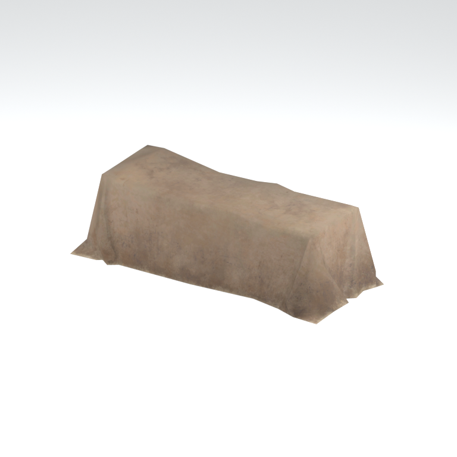
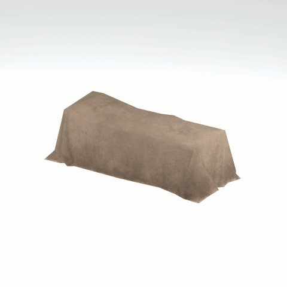

# Unidentified model (afgh_boxx003)

Native model reference; a readable object identification has not been reviewed.

[Library](../README.md) | [Category](../tables/unclassified-components-1.md) | [Source / advanced data](../catalogue.json) | [Credits](../sources-and-credits.md)

**Game filename:** afgh_boxx003.fmdl  
**Category:** Unclassified &gt; Unclassified components  
**Variant:** No explicit variant token; **LOD:** 0  
**Tags:** 

## Still reference



## 360-degree reference



The camera circles a static model. This is not a native animation. Source base textures and UVs use approximate studio shading; interaction, collision, complete assembly and FOX shader equivalence are not established.

## Identity and naming

| Field | Value |
|---|---|
| Library ID | mgsv-tpp-afgh_boxx003-f54d72a33d30e220 |
| Naming status | unidentified |
| Naming confidence | unknown |
| Naming evidence | {} |
| Native model | /Assets/tpp/environ/object/afghanistan/box/afgh_boxx003/scenes/afgh_boxx003.fmdl |
| Model SHA256 | 4e7855eab3d5a660f80be23c0c6e35cde7dc3b4cbe9a36537f6e2c97197338bb |
| Container | /Assets/mgo/pack/location/afda/pack_common/afda_common.fpk |
| Container SHA256 | 19048457fb21b8b2d25f52c752a427fd9400056cf6565142a9dcc9ad8e637b14 |
| Captured source / location scope | Selected native member/content and captured installed-source chain; full archive SHA/runtime priority unresolved |
| Raw record SHA256 | 4a0653358e469df06bcb70b4db035b4bb0844e614cdca9d940b0a4d25e1b694f |

Naming review is descriptive metadata only. It does not change model completion or identify a working game interaction.

## Native LOD inventory

| Native LOD | Triangles | Preview status | Decoded indices SHA256 |
|---|---:|---|---|
| 0 | 105 | rendered | 3924f3e26adc5338e16c09c33ed0b7f9ae93099c320eae17be431d9f2e6f5b6c |
| 1 | 62 | not separately rendered | f6a88859055261faf82a68212636c1c58f987e62f51f1aab99716b01d878be33 |
| 2 | 36 | not separately rendered | fab260e7e23978d5f728e04c8392bec2dc76066be77c74c8f05a4dbcd27243e2 |
| 3 | 20 | not separately rendered | 096c30a54a9e0bbb08739bfac51212b4c81f53e7d70fa389bc40204f44c3c765 |

Mesh detail and texture pixels/mips are separate. Index hashes describe decoded triangle arrays, not packed index-buffer bytes. Only source-recorded native levels are listed.

<details>
<summary>Texture, source and naming technical metadata</summary>

```json
{
  "source": {
    "nativePath": "/Assets/tpp/environ/object/afghanistan/box/afgh_boxx003/scenes/afgh_boxx003.fmdl",
    "nativeSha256": "4e7855eab3d5a660f80be23c0c6e35cde7dc3b4cbe9a36537f6e2c97197338bb",
    "stableIdentity": "/assets/tpp/environ/object/afghanistan/box/afgh_boxx003/scenes/afgh_boxx003.fmdl#4e7855eab3d5a660f80be23c0c6e35cde7dc3b4cbe9a36537f6e2c97197338bb#96f81fa4935c001fb3168850695c9824b886136c9920c577ddd0c65e6ff50d79",
    "container": {
      "nativePath": "/Assets/mgo/pack/location/afda/pack_common/afda_common.fpk",
      "sha256": "19048457fb21b8b2d25f52c752a427fd9400056cf6565142a9dcc9ad8e637b14",
      "status": "Selected installed-source container/member chain captured by community reader"
    },
    "historicalDatOrigin": null,
    "sourceArchiveAtCapture": "master/0/00.dat",
    "locationStatus": "Selected native member/content and captured installed-source chain; full archive SHA/runtime priority unresolved",
    "currentInstalledDatVerified": false,
    "selectedInstalledMemberVerified": true,
    "evidence": {
      "archive_helper_executable_sha256": "6f8e39a436af3b024bbd0504966ab3d5d9d0cb05d86689bf3e83d15e68df613f",
      "archive_helper_source_sha256": "f662d3b63e066a0afc77ffe22ea0e564222d14469648300dba2c4f8e9b43446b",
      "archive_index_recipe": "54acff767f08d76ad6056c5387328759bc883df507788f398de6c2c04fac12db",
      "archive_reader": "Atvaark GzsTool.Core 0.5.3",
      "archive_reader_core_sha256": "9da447ae3c375cce2e46744eeff6af50f1591062afdf479d1a0b49edb47daaa3",
      "archive_tool_and_dictionary_sha256": {
        "CityHash.dll": "def6c4506d461b65e4059b2936b2cbd5f852ba5d1d8a1a527f1c0e6dc7008c8f",
        "GzsTool.Core.dll": "9da447ae3c375cce2e46744eeff6af50f1591062afdf479d1a0b49edb47daaa3",
        "GzsTool.exe": "1a9c5b11e2355383ff485aee7e86abc026f5c1fad729daf8c0fd15ee0aae1c10",
        "Zlib.Portable.dll": "fe84781ba35ca9cc5ff5f73fd08d2a66c59e5257b4573f5fe59743f30bf78e42",
        "fpk_dictionary.txt": "b82f9a8d6c10a68ba9471eca9d815c21355a53b5e68753d8ad7db7fd01bf401d",
        "qar_dictionary.txt": "1558c248ed0a4bb827888261563fbb91a2df4f03999682f85d637ff70d9d5fb2"
      },
      "bytes": 4704,
      "container_chain": [
        {
          "content_sha256": null,
          "depth": 0,
          "id": "3f19555d27c2ebecdfbad26aadd88b9f62e9fb6092c04c712963ef73c67ccb42",
          "index_sha256": "9acd3675d6e1500e0e18430cba0fdc70a5718ad7d6b62f13905891a35d59f18a",
          "kind": "qar",
          "name": "master/0/00.dat",
          "parent_occurrence": null
        },
        {
          "content_sha256": "19048457fb21b8b2d25f52c752a427fd9400056cf6565142a9dcc9ad8e637b14",
          "depth": 1,
          "id": "cff1104ad9341561c9113491a97f31e7dddfa63604f4b3a1dd4e8fafa96f0d61",
          "index_sha256": "7bc2d3ca93cb2ad04aa26e68299971918cd410ce9c990329e0d9f3b834923fab",
          "kind": "fpk",
          "name": "/Assets/mgo/pack/location/afda/pack_common/afda_common.fpk",
          "parent_occurrence": "e354af6a735cde8714338920a5ddd0fe4b043fa04de93ea8fff8b6b954cb965b"
        }
      ],
      "contentSha256": "4e7855eab3d5a660f80be23c0c6e35cde7dc3b4cbe9a36537f6e2c97197338bb",
      "member": {
        "actual_size": 4704,
        "compressed_size": null,
        "content_sha256": "4e7855eab3d5a660f80be23c0c6e35cde7dc3b4cbe9a36537f6e2c97197338bb",
        "declared_size": 4704,
        "extension": "fmdl",
        "hash_hex": null,
        "name": "/Assets/tpp/environ/object/afghanistan/box/afgh_boxx003/scenes/afgh_boxx003.fmdl",
        "name_origin": "embedded",
        "offset": 8355008,
        "ordinal": 208,
        "path_hash": null,
        "resolved": 1
      },
      "occurrenceId": "7928b1b2a46b2d3431a8b0184f6b72778d2eb5999ec00386019509e5894d5cf4",
      "occurrence_id": "7928b1b2a46b2d3431a8b0184f6b72778d2eb5999ec00386019509e5894d5cf4",
      "primary_source_revision": "fc4a8196555638c6cf8aa1b7c8dc34ccd5c69cb5",
      "source_adapter": "community_core_selective_export",
      "source_id": "7f6bb743fb4c487f0e9522f9c7fac280c46cf6b1051e0fc75a93602c8eb451f0",
      "source_path": "master/0/00.dat",
      "source_snapshot": "{\"bytes\":768788480,\"device\":621747392682911458,\"file_id\":844424931596481,\"header_sha256\":\"ead50f0a9a37e4285323b9c6fa0ec75fe75e518c63147e63158eeb2892c6589e\",\"mtime_ns\":1791852224238580700}",
      "virtualPath": "/Assets/tpp/environ/object/afghanistan/box/afgh_boxx003/scenes/afgh_boxx003.fmdl"
    }
  },
  "materials": [
    {
      "sampler": "Base_Tex_SRGB",
      "materialIndex": 0,
      "nativePathHash": "1542955499642655620",
      "nativeVirtualPath": null,
      "nativeBinding": {
        "familyId": "99629588d782710322851089a37ee811ecb983697d244f711c8f42c4fab5ef03",
        "height": 1024,
        "materialIndex": 0,
        "mipCount": 9,
        "nativeMipCountVerified": true,
        "nativePath": null,
        "nativePathHash": "1542955499642655620",
        "nativeTexture": {
          "additionalFtexsFileCount": 2,
          "depth": 1,
          "ftexsFileCount": 3,
          "height": 1024,
          "metadataBytes": 208,
          "mipCount": 9,
          "mips": [
            {
              "chunks": 32,
              "decodedBytes": 524288,
              "mip": 0,
              "offset": 0,
              "storedBytes": 362320,
              "streamNumber": 3
            },
            {
              "chunks": 8,
              "decodedBytes": 131072,
              "mip": 1,
              "offset": 0,
              "storedBytes": 93888,
              "streamNumber": 2
            },
            {
              "chunks": 2,
              "decodedBytes": 32768,
              "mip": 2,
              "offset": 8432,
              "storedBytes": 23712,
              "streamNumber": 1
            },
            {
              "chunks": 1,
              "decodedBytes": 8192,
              "mip": 3,
              "offset": 2360,
              "storedBytes": 6064,
              "streamNumber": 1
            },
            {
              "chunks": 1,
              "decodedBytes": 2048,
              "mip": 4,
              "offset": 720,
              "storedBytes": 1632,
              "streamNumber": 1
            },
            {
              "chunks": 1,
              "decodedBytes": 512,
              "mip": 5,
              "offset": 232,
              "storedBytes": 480,
              "streamNumber": 1
            },
            {
              "chunks": 1,
              "decodedBytes": 128,
              "mip": 6,
              "offset": 80,
              "storedBytes": 144,
              "streamNumber": 1
            },
            {
              "chunks": 1,
              "decodedBytes": 32,
              "mip": 7,
              "offset": 24,
              "storedBytes": 48,
              "streamNumber": 1
            },
            {
              "chunks": 1,
              "decodedBytes": 8,
              "mip": 8,
              "offset": 0,
              "storedBytes": 16,
              "streamNumber": 1
            }
          ],
          "nativeHeaderHash": "da7c3f97ca57e43d19c841d8ed8e5a4c",
          "nrtFlag": 2,
          "pixelFormat": 2,
          "requiredStreamNumbers": [
            1,
            2,
            3
          ],
          "textureType": 16777219,
          "unknownFlags": 273,
          "width": 1024
        },
        "samplerName": "Base_Tex_SRGB",
        "samplerNameHash": "72475356961633",
        "sha256": "9a091778e41c64222072335bb1eea16520ba7fe8a4bd7a29db8d151b882a1d49",
        "sourceOccurrences": [
          {
            "archive_helper_executable_sha256": "6f8e39a436af3b024bbd0504966ab3d5d9d0cb05d86689bf3e83d15e68df613f",
            "archive_helper_source_sha256": "f662d3b63e066a0afc77ffe22ea0e564222d14469648300dba2c4f8e9b43446b",
            "archive_index_recipe": "54acff767f08d76ad6056c5387328759bc883df507788f398de6c2c04fac12db",
            "archive_reader": "Atvaark GzsTool.Core 0.5.3",
            "archive_reader_core_sha256": "9da447ae3c375cce2e46744eeff6af50f1591062afdf479d1a0b49edb47daaa3",
            "archive_tool_and_dictionary_sha256": {
              "CityHash.dll": "def6c4506d461b65e4059b2936b2cbd5f852ba5d1d8a1a527f1c0e6dc7008c8f",
              "GzsTool.Core.dll": "9da447ae3c375cce2e46744eeff6af50f1591062afdf479d1a0b49edb47daaa3",
              "GzsTool.exe": "1a9c5b11e2355383ff485aee7e86abc026f5c1fad729daf8c0fd15ee0aae1c10",
              "Zlib.Portable.dll": "fe84781ba35ca9cc5ff5f73fd08d2a66c59e5257b4573f5fe59743f30bf78e42",
              "fpk_dictionary.txt": "b82f9a8d6c10a68ba9471eca9d815c21355a53b5e68753d8ad7db7fd01bf401d",
              "qar_dictionary.txt": "1558c248ed0a4bb827888261563fbb91a2df4f03999682f85d637ff70d9d5fb2"
            },
            "bytes": 208,
            "container_chain": [
              {
                "content_sha256": null,
                "depth": 0,
                "id": "3f19555d27c2ebecdfbad26aadd88b9f62e9fb6092c04c712963ef73c67ccb42",
                "index_sha256": "9acd3675d6e1500e0e18430cba0fdc70a5718ad7d6b62f13905891a35d59f18a",
                "kind": "qar",
                "name": "master/0/00.dat",
                "parent_occurrence": null
              },
              {
                "content_sha256": "7784c61d48c2a829a8a3be8bea91819ed320466e84615e1196c12dc4390190ea",
                "depth": 1,
                "id": "a7374ee4090f72cbecb7df25f172141b83da2b51b8b38b375af7a4f0f577fc67",
                "index_sha256": "7f78072384a5e4f07d09223009a06931047d1b3d6ae36512b9bb7ef91d1fe958",
                "kind": "pftxs",
                "name": "/Assets/mgo/pack/location/afda/pack_common/afda_common.pftxs",
                "parent_occurrence": "e3bb44002c453c106548f7190291b4a4c22da16a7eebd82d6a8dac6ab3844ca7"
              }
            ],
            "contentSha256": "a06fe39819a2e331328348db2fb04b717086d2e65b4aaa64b19a8aa168b586c3",
            "member": {
              "actual_size": 208,
              "compressed_size": null,
              "content_sha256": "a06fe39819a2e331328348db2fb04b717086d2e65b4aaa64b19a8aa168b586c3",
              "declared_size": 208,
              "extension": "ftex",
              "hash_hex": "1569adda1c6f9384",
              "name": "1569adda1c6f9384.ftex",
              "name_origin": "hash_fallback",
              "offset": 17807760,
              "ordinal": 1394,
              "path_hash": null,
              "resolved": 0
            },
            "occurrenceId": "359c899c86421a95045d254a28ee370ee08307caa0ed33f568c92dde5a0be3b8",
            "occurrence_id": "359c899c86421a95045d254a28ee370ee08307caa0ed33f568c92dde5a0be3b8",
            "primary_source_revision": "fc4a8196555638c6cf8aa1b7c8dc34ccd5c69cb5",
            "source_adapter": "community_core_selective_export",
            "source_id": "7f6bb743fb4c487f0e9522f9c7fac280c46cf6b1051e0fc75a93602c8eb451f0",
            "source_path": "master/0/00.dat",
            "source_snapshot": "{\"bytes\":768788480,\"device\":621747392682911458,\"file_id\":844424931596481,\"header_sha256\":\"ead50f0a9a37e4285323b9c6fa0ec75fe75e518c63147e63158eeb2892c6589e\",\"mtime_ns\":1791852224238580700}",
            "virtualPath": "1569adda1c6f9384.ftex"
          },
          {
            "archive_helper_executable_sha256": "6f8e39a436af3b024bbd0504966ab3d5d9d0cb05d86689bf3e83d15e68df613f",
            "archive_helper_source_sha256": "f662d3b63e066a0afc77ffe22ea0e564222d14469648300dba2c4f8e9b43446b",
            "archive_index_recipe": "54acff767f08d76ad6056c5387328759bc883df507788f398de6c2c04fac12db",
            "archive_reader": "Atvaark GzsTool.Core 0.5.3",
            "archive_reader_core_sha256": "9da447ae3c375cce2e46744eeff6af50f1591062afdf479d1a0b49edb47daaa3",
            "archive_tool_and_dictionary_sha256": {
              "CityHash.dll": "def6c4506d461b65e4059b2936b2cbd5f852ba5d1d8a1a527f1c0e6dc7008c8f",
              "GzsTool.Core.dll": "9da447ae3c375cce2e46744eeff6af50f1591062afdf479d1a0b49edb47daaa3",
              "GzsTool.exe": "1a9c5b11e2355383ff485aee7e86abc026f5c1fad729daf8c0fd15ee0aae1c10",
              "Zlib.Portable.dll": "fe84781ba35ca9cc5ff5f73fd08d2a66c59e5257b4573f5fe59743f30bf78e42",
              "fpk_dictionary.txt": "b82f9a8d6c10a68ba9471eca9d815c21355a53b5e68753d8ad7db7fd01bf401d",
              "qar_dictionary.txt": "1558c248ed0a4bb827888261563fbb91a2df4f03999682f85d637ff70d9d5fb2"
            },
            "bytes": 32160,
            "container_chain": [
              {
                "content_sha256": null,
                "depth": 0,
                "id": "3f19555d27c2ebecdfbad26aadd88b9f62e9fb6092c04c712963ef73c67ccb42",
                "index_sha256": "9acd3675d6e1500e0e18430cba0fdc70a5718ad7d6b62f13905891a35d59f18a",
                "kind": "qar",
                "name": "master/0/00.dat",
                "parent_occurrence": null
              },
              {
                "content_sha256": "7784c61d48c2a829a8a3be8bea91819ed320466e84615e1196c12dc4390190ea",
                "depth": 1,
                "id": "a7374ee4090f72cbecb7df25f172141b83da2b51b8b38b375af7a4f0f577fc67",
                "index_sha256": "7f78072384a5e4f07d09223009a06931047d1b3d6ae36512b9bb7ef91d1fe958",
                "kind": "pftxs",
                "name": "/Assets/mgo/pack/location/afda/pack_common/afda_common.pftxs",
                "parent_occurrence": "e3bb44002c453c106548f7190291b4a4c22da16a7eebd82d6a8dac6ab3844ca7"
              }
            ],
            "contentSha256": "494e1f1a71fc95a80271261d38ed3b68c67381bb371faf35ea97159d60637a25",
            "member": {
              "actual_size": 32160,
              "compressed_size": null,
              "content_sha256": "494e1f1a71fc95a80271261d38ed3b68c67381bb371faf35ea97159d60637a25",
              "declared_size": 32160,
              "extension": "1.ftexs",
              "hash_hex": "b2c1adda1c6f9384",
              "name": "b2c1adda1c6f9384.1.ftexs",
              "name_origin": "hash_fallback",
              "offset": 17807968,
              "ordinal": 1395,
              "path_hash": null,
              "resolved": 0
            },
            "occurrenceId": "799ea96b085e8bf83d87acd719ea94aaad007c0d764b96d75f5bb57c314c1f73",
            "occurrence_id": "799ea96b085e8bf83d87acd719ea94aaad007c0d764b96d75f5bb57c314c1f73",
            "primary_source_revision": "fc4a8196555638c6cf8aa1b7c8dc34ccd5c69cb5",
            "source_adapter": "community_core_selective_export",
            "source_id": "7f6bb743fb4c487f0e9522f9c7fac280c46cf6b1051e0fc75a93602c8eb451f0",
            "source_path": "master/0/00.dat",
            "source_snapshot": "{\"bytes\":768788480,\"device\":621747392682911458,\"file_id\":844424931596481,\"header_sha256\":\"ead50f0a9a37e4285323b9c6fa0ec75fe75e518c63147e63158eeb2892c6589e\",\"mtime_ns\":1791852224238580700}",
            "virtualPath": "b2c1adda1c6f9384.1.ftexs"
          },
          {
            "archive_helper_executable_sha256": "6f8e39a436af3b024bbd0504966ab3d5d9d0cb05d86689bf3e83d15e68df613f",
            "archive_helper_source_sha256": "f662d3b63e066a0afc77ffe22ea0e564222d14469648300dba2c4f8e9b43446b",
            "archive_index_recipe": "54acff767f08d76ad6056c5387328759bc883df507788f398de6c2c04fac12db",
            "archive_reader": "Atvaark GzsTool.Core 0.5.3",
            "archive_reader_core_sha256": "9da447ae3c375cce2e46744eeff6af50f1591062afdf479d1a0b49edb47daaa3",
            "archive_tool_and_dictionary_sha256": {
              "CityHash.dll": "def6c4506d461b65e4059b2936b2cbd5f852ba5d1d8a1a527f1c0e6dc7008c8f",
              "GzsTool.Core.dll": "9da447ae3c375cce2e46744eeff6af50f1591062afdf479d1a0b49edb47daaa3",
              "GzsTool.exe": "1a9c5b11e2355383ff485aee7e86abc026f5c1fad729daf8c0fd15ee0aae1c10",
              "Zlib.Portable.dll": "fe84781ba35ca9cc5ff5f73fd08d2a66c59e5257b4573f5fe59743f30bf78e42",
              "fpk_dictionary.txt": "b82f9a8d6c10a68ba9471eca9d815c21355a53b5e68753d8ad7db7fd01bf401d",
              "qar_dictionary.txt": "1558c248ed0a4bb827888261563fbb91a2df4f03999682f85d637ff70d9d5fb2"
            },
            "bytes": 93952,
            "container_chain": [
              {
                "content_sha256": null,
                "depth": 0,
                "id": "0b473016351235050c2f6af21454bd979a0ad4602a9860137c807c894c5eba4d",
                "index_sha256": "ac9b4dae0dd0166db3a6ec8da18524dffebcbaf9004569af631de82913bf49a3",
                "kind": "qar",
                "name": "master/texture2.dat",
                "parent_occurrence": null
              }
            ],
            "contentSha256": "b42662958708ce9f23c131437d9063c6ddedb5aa6b0dba5cb0f63ba3a3ba6211",
            "member": {
              "actual_size": 93952,
              "compressed_size": 93952,
              "content_sha256": "b42662958708ce9f23c131437d9063c6ddedb5aa6b0dba5cb0f63ba3a3ba6211",
              "declared_size": 93952,
              "extension": "2.ftexs",
              "hash_hex": "b571adda1c6f9384",
              "name": "/Assets/tpp/environ/object/afghanistan/box/afgh_boxx003/sourceimages/afgh_boxx003_bsm.2.ftexs",
              "name_origin": "dictionary",
              "offset": 1272775712,
              "ordinal": 7142,
              "path_hash": "1adda1c6f9384",
              "resolved": 1
            },
            "occurrenceId": "0442e47c2d9a394304a3940cba49484bb166877312c30c0649eee9f99c69f4d2",
            "occurrence_id": "0442e47c2d9a394304a3940cba49484bb166877312c30c0649eee9f99c69f4d2",
            "primary_source_revision": "fc4a8196555638c6cf8aa1b7c8dc34ccd5c69cb5",
            "source_adapter": "community_core_selective_export",
            "source_id": "85e8296057664cbc6ebaf6bd43d1c6d18528bbd8a6fae920bdf4d5eb69f6a93d",
            "source_path": "master/texture2.dat",
            "source_snapshot": "{\"bytes\":2920239104,\"device\":621747392682911458,\"file_id\":562949953639626,\"header_sha256\":\"72bfee707623afb5f3abd8382035d3d4258b4941ac583a56f5a447f47123dcab\",\"mtime_ns\":1791224675561235200}",
            "virtualPath": "/Assets/tpp/environ/object/afghanistan/box/afgh_boxx003/sourceimages/afgh_boxx003_bsm.2.ftexs"
          },
          {
            "archive_helper_executable_sha256": "6f8e39a436af3b024bbd0504966ab3d5d9d0cb05d86689bf3e83d15e68df613f",
            "archive_helper_source_sha256": "f662d3b63e066a0afc77ffe22ea0e564222d14469648300dba2c4f8e9b43446b",
            "archive_index_recipe": "54acff767f08d76ad6056c5387328759bc883df507788f398de6c2c04fac12db",
            "archive_reader": "Atvaark GzsTool.Core 0.5.3",
            "archive_reader_core_sha256": "9da447ae3c375cce2e46744eeff6af50f1591062afdf479d1a0b49edb47daaa3",
            "archive_tool_and_dictionary_sha256": {
              "CityHash.dll": "def6c4506d461b65e4059b2936b2cbd5f852ba5d1d8a1a527f1c0e6dc7008c8f",
              "GzsTool.Core.dll": "9da447ae3c375cce2e46744eeff6af50f1591062afdf479d1a0b49edb47daaa3",
              "GzsTool.exe": "1a9c5b11e2355383ff485aee7e86abc026f5c1fad729daf8c0fd15ee0aae1c10",
              "Zlib.Portable.dll": "fe84781ba35ca9cc5ff5f73fd08d2a66c59e5257b4573f5fe59743f30bf78e42",
              "fpk_dictionary.txt": "b82f9a8d6c10a68ba9471eca9d815c21355a53b5e68753d8ad7db7fd01bf401d",
              "qar_dictionary.txt": "1558c248ed0a4bb827888261563fbb91a2df4f03999682f85d637ff70d9d5fb2"
            },
            "bytes": 362576,
            "container_chain": [
              {
                "content_sha256": null,
                "depth": 0,
                "id": "0b473016351235050c2f6af21454bd979a0ad4602a9860137c807c894c5eba4d",
                "index_sha256": "ac9b4dae0dd0166db3a6ec8da18524dffebcbaf9004569af631de82913bf49a3",
                "kind": "qar",
                "name": "master/texture2.dat",
                "parent_occurrence": null
              }
            ],
            "contentSha256": "a98f5de166f14d1608b1cd7262ad55638b816407df39a7d1f7024d9f0844de2e",
            "member": {
              "actual_size": 362576,
              "compressed_size": 362576,
              "content_sha256": "a98f5de166f14d1608b1cd7262ad55638b816407df39a7d1f7024d9f0844de2e",
              "declared_size": 362576,
              "extension": "3.ftexs",
              "hash_hex": "5719adda1c6f9384",
              "name": "/Assets/tpp/environ/object/afghanistan/box/afgh_boxx003/sourceimages/afgh_boxx003_bsm.3.ftexs",
              "name_origin": "dictionary",
              "offset": 1272869920,
              "ordinal": 7143,
              "path_hash": "1adda1c6f9384",
              "resolved": 1
            },
            "occurrenceId": "218f3ccf6c094957bd6e5dd3b06f24ccae49c8b6cda09062638eb65d270df0fe",
            "occurrence_id": "218f3ccf6c094957bd6e5dd3b06f24ccae49c8b6cda09062638eb65d270df0fe",
            "primary_source_revision": "fc4a8196555638c6cf8aa1b7c8dc34ccd5c69cb5",
            "source_adapter": "community_core_selective_export",
            "source_id": "85e8296057664cbc6ebaf6bd43d1c6d18528bbd8a6fae920bdf4d5eb69f6a93d",
            "source_path": "master/texture2.dat",
            "source_snapshot": "{\"bytes\":2920239104,\"device\":621747392682911458,\"file_id\":562949953639626,\"header_sha256\":\"72bfee707623afb5f3abd8382035d3d4258b4941ac583a56f5a447f47123dcab\",\"mtime_ns\":1791224675561235200}",
            "virtualPath": "/Assets/tpp/environ/object/afghanistan/box/afgh_boxx003/sourceimages/afgh_boxx003_bsm.3.ftexs"
          }
        ],
        "width": 1024
      },
      "ddsSha256": "9a091778e41c64222072335bb1eea16520ba7fe8a4bd7a29db8d151b882a1d49",
      "dimensions": [
        1024,
        1024
      ],
      "mipCount": 9,
      "nativeMipCountVerified": true,
      "connectedInPreview": true
    }
  ],
  "quality": {
    "decodedIndicesHashDerivation": "SHA256 of canonical UTF-8 JSON decoded triangle indices grouped by mesh; not packed buffer bytes",
    "highestRetainedGeometricLod": 0,
    "distinctNativeLods": 4,
    "baseTextureDimensions": [
      1024,
      1024
    ],
    "baseTextureNativeMipCount": 9,
    "largerRetainedBaseTextureFound": null,
    "nativeLods": [
      {
        "indicesSha256": "3924f3e26adc5338e16c09c33ed0b7f9ae93099c320eae17be431d9f2e6f5b6c",
        "nativeLod": 0,
        "triangles": 105
      },
      {
        "indicesSha256": "f6a88859055261faf82a68212636c1c58f987e62f51f1aab99716b01d878be33",
        "nativeLod": 1,
        "triangles": 62
      },
      {
        "indicesSha256": "fab260e7e23978d5f728e04c8392bec2dc76066be77c74c8f05a4dbcd27243e2",
        "nativeLod": 2,
        "triangles": 36
      },
      {
        "indicesSha256": "096c30a54a9e0bbb08739bfac51212b4c81f53e7d70fa389bc40204f44c3c765",
        "nativeLod": 3,
        "triangles": 20
      }
    ],
    "renderedNativeLods": [
      0
    ],
    "baseTextureSummary": "1024 x 1024; 9 native/DDS mips",
    "highestDetailScope": "Triangle-count comparison within captured FMDL only"
  }
}
```

</details>

[Original source / advanced record](../catalogue.json)
