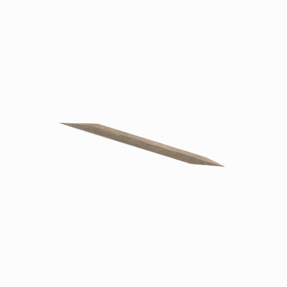

# Unidentified model (afgh_brbw001_dbri001)

Native model reference; a readable object identification has not been reviewed.

[Library](../README.md) | [Category](../tables/unclassified-components-1.md) | [Source / advanced data](../catalogue.json) | [Credits](../sources-and-credits.md)

**Game filename:** afgh_brbw001_dbri001.fmdl  
**Category:** Unclassified &gt; Unclassified components  
**Variant:** No explicit variant token; **LOD:** 0  
**Tags:** 

## Still reference


## 360-degree reference



The camera circles a static model. This is not a native animation. Source base textures and UVs use approximate studio shading; interaction, collision, complete assembly and FOX shader equivalence are not established.

## Identity and naming

| Field | Value |
|---|---|
| Library ID | mgsv-tpp-afgh_brbw001_dbri001-46d6ff1653bba8b0 |
| Naming status | unidentified |
| Naming confidence | unknown |
| Naming evidence | {} |
| Native model | /Assets/tpp/environ/object/afghanistan/barbwire/afgh_brbw001/scenes/afgh_brbw001_dbri001.fmdl |
| Model SHA256 | a9d97f219af1d4b94c48133c5f964d38a5bde3a03b904054bca85701de643102 |
| Container | /Assets/tpp/pack/location/afgh/pack_common/afgh_common.fpk |
| Container SHA256 | 810fe68a28c81299da7ef00849d2905b640d0a2da970f1b312e953a2c7b5df48 |
| Captured source / location scope | Selected native member/content and captured installed-source chain; full archive SHA/runtime priority unresolved |
| Raw record SHA256 | ed309dae5add522bfa18c16f3332b94b170565edeb6b9eb94b4006660db71f48 |

Naming review is descriptive metadata only. It does not change model completion or identify a working game interaction.

## Native LOD inventory

| Native LOD | Triangles | Preview status | Decoded indices SHA256 |
|---|---:|---|---|
| 0 | 14 | rendered | 05fd0b5fc5ba9f37c20800335e3a29beaed2b789cea3e93a797c4ee8b25e18e4 |
| 1 | 12 | not separately rendered | f66e687ea9fbbc4f2b36beded900a3b07b456512ea1dc9e68bec6c3064cd0a4b |
| 2 | 12 | not separately rendered | f66e687ea9fbbc4f2b36beded900a3b07b456512ea1dc9e68bec6c3064cd0a4b |
| 3 | 12 | not separately rendered | f66e687ea9fbbc4f2b36beded900a3b07b456512ea1dc9e68bec6c3064cd0a4b |

Mesh detail and texture pixels/mips are separate. Index hashes describe decoded triangle arrays, not packed index-buffer bytes. Only source-recorded native levels are listed.

<details>
<summary>Texture, source and naming technical metadata</summary>

```json
{
  "source": {
    "nativePath": "/Assets/tpp/environ/object/afghanistan/barbwire/afgh_brbw001/scenes/afgh_brbw001_dbri001.fmdl",
    "nativeSha256": "a9d97f219af1d4b94c48133c5f964d38a5bde3a03b904054bca85701de643102",
    "stableIdentity": "/assets/tpp/environ/object/afghanistan/barbwire/afgh_brbw001/scenes/afgh_brbw001_dbri001.fmdl#a9d97f219af1d4b94c48133c5f964d38a5bde3a03b904054bca85701de643102#ed902c49fa2ead85e12237297a39dc4c43c8ac1c2b3d8e737ab270708410fabb",
    "container": {
      "nativePath": "/Assets/tpp/pack/location/afgh/pack_common/afgh_common.fpk",
      "sha256": "810fe68a28c81299da7ef00849d2905b640d0a2da970f1b312e953a2c7b5df48",
      "status": "Selected installed-source container/member chain captured by community reader"
    },
    "historicalDatOrigin": null,
    "sourceArchiveAtCapture": "master/0/00.dat",
    "locationStatus": "Selected native member/content and captured installed-source chain; full archive SHA/runtime priority unresolved",
    "currentInstalledDatVerified": false,
    "selectedInstalledMemberVerified": true,
    "evidence": {
      "archive_helper_executable_sha256": "6f8e39a436af3b024bbd0504966ab3d5d9d0cb05d86689bf3e83d15e68df613f",
      "archive_helper_source_sha256": "f662d3b63e066a0afc77ffe22ea0e564222d14469648300dba2c4f8e9b43446b",
      "archive_index_recipe": "54acff767f08d76ad6056c5387328759bc883df507788f398de6c2c04fac12db",
      "archive_reader": "Atvaark GzsTool.Core 0.5.3",
      "archive_reader_core_sha256": "9da447ae3c375cce2e46744eeff6af50f1591062afdf479d1a0b49edb47daaa3",
      "archive_tool_and_dictionary_sha256": {
        "CityHash.dll": "def6c4506d461b65e4059b2936b2cbd5f852ba5d1d8a1a527f1c0e6dc7008c8f",
        "GzsTool.Core.dll": "9da447ae3c375cce2e46744eeff6af50f1591062afdf479d1a0b49edb47daaa3",
        "GzsTool.exe": "1a9c5b11e2355383ff485aee7e86abc026f5c1fad729daf8c0fd15ee0aae1c10",
        "Zlib.Portable.dll": "fe84781ba35ca9cc5ff5f73fd08d2a66c59e5257b4573f5fe59743f30bf78e42",
        "fpk_dictionary.txt": "b82f9a8d6c10a68ba9471eca9d815c21355a53b5e68753d8ad7db7fd01bf401d",
        "qar_dictionary.txt": "1558c248ed0a4bb827888261563fbb91a2df4f03999682f85d637ff70d9d5fb2"
      },
      "bytes": 1824,
      "container_chain": [
        {
          "content_sha256": null,
          "depth": 0,
          "id": "3f19555d27c2ebecdfbad26aadd88b9f62e9fb6092c04c712963ef73c67ccb42",
          "index_sha256": "9acd3675d6e1500e0e18430cba0fdc70a5718ad7d6b62f13905891a35d59f18a",
          "kind": "qar",
          "name": "master/0/00.dat",
          "parent_occurrence": null
        },
        {
          "content_sha256": "810fe68a28c81299da7ef00849d2905b640d0a2da970f1b312e953a2c7b5df48",
          "depth": 1,
          "id": "19e9adf189f5f5e9c624197357336d49999dc3525b83bd8c71cf525fcd2100e2",
          "index_sha256": "924ec10c5736f8b618238e2523664271e558a6ad49aefdaf2473ccbad50f1231",
          "kind": "fpk",
          "name": "/Assets/tpp/pack/location/afgh/pack_common/afgh_common.fpk",
          "parent_occurrence": "e35acf6999427a88778266baae8c014a0c20a82388f8ff04caca6a88d977a6d1"
        }
      ],
      "contentSha256": "a9d97f219af1d4b94c48133c5f964d38a5bde3a03b904054bca85701de643102",
      "member": {
        "actual_size": 1824,
        "compressed_size": null,
        "content_sha256": "a9d97f219af1d4b94c48133c5f964d38a5bde3a03b904054bca85701de643102",
        "declared_size": 1824,
        "extension": "fmdl",
        "hash_hex": null,
        "name": "/Assets/tpp/environ/object/afghanistan/barbwire/afgh_brbw001/scenes/afgh_brbw001_dbri001.fmdl",
        "name_origin": "embedded",
        "offset": 2141328,
        "ordinal": 17,
        "path_hash": null,
        "resolved": 1
      },
      "occurrenceId": "d6b14f8c4b60827bb29d054ddcb39c18db37ec4eaca152d0cd08b12c6e4b2f25",
      "occurrence_id": "d6b14f8c4b60827bb29d054ddcb39c18db37ec4eaca152d0cd08b12c6e4b2f25",
      "primary_source_revision": "fc4a8196555638c6cf8aa1b7c8dc34ccd5c69cb5",
      "source_adapter": "community_core_selective_export",
      "source_id": "7f6bb743fb4c487f0e9522f9c7fac280c46cf6b1051e0fc75a93602c8eb451f0",
      "source_path": "master/0/00.dat",
      "source_snapshot": "{\"bytes\":768788480,\"device\":621747392682911458,\"file_id\":844424931596481,\"header_sha256\":\"ead50f0a9a37e4285323b9c6fa0ec75fe75e518c63147e63158eeb2892c6589e\",\"mtime_ns\":1791852224238580700}",
      "virtualPath": "/Assets/tpp/environ/object/afghanistan/barbwire/afgh_brbw001/scenes/afgh_brbw001_dbri001.fmdl"
    }
  },
  "materials": [
    {
      "sampler": "Base_Tex_SRGB",
      "materialIndex": 0,
      "nativePathHash": "1542957312127160836",
      "nativeVirtualPath": null,
      "nativeBinding": {
        "familyId": "55985e096bab8b0435fc4c50f8a3c7aea4f5f76e61406e31d40c2d3ad867bd22",
        "height": 512,
        "materialIndex": 0,
        "mipCount": 8,
        "nativeMipCountVerified": true,
        "nativePath": null,
        "nativePathHash": "1542957312127160836",
        "nativeTexture": {
          "additionalFtexsFileCount": 2,
          "depth": 1,
          "ftexsFileCount": 3,
          "height": 512,
          "metadataBytes": 192,
          "mipCount": 8,
          "mips": [
            {
              "chunks": 8,
              "decodedBytes": 131072,
              "mip": 0,
              "offset": 0,
              "storedBytes": 109840,
              "streamNumber": 3
            },
            {
              "chunks": 2,
              "decodedBytes": 32768,
              "mip": 1,
              "offset": 0,
              "storedBytes": 27824,
              "streamNumber": 2
            },
            {
              "chunks": 1,
              "decodedBytes": 8192,
              "mip": 2,
              "offset": 2584,
              "storedBytes": 6928,
              "streamNumber": 1
            },
            {
              "chunks": 1,
              "decodedBytes": 2048,
              "mip": 3,
              "offset": 752,
              "storedBytes": 1824,
              "streamNumber": 1
            },
            {
              "chunks": 1,
              "decodedBytes": 512,
              "mip": 4,
              "offset": 232,
              "storedBytes": 512,
              "streamNumber": 1
            },
            {
              "chunks": 1,
              "decodedBytes": 128,
              "mip": 5,
              "offset": 80,
              "storedBytes": 144,
              "streamNumber": 1
            },
            {
              "chunks": 1,
              "decodedBytes": 32,
              "mip": 6,
              "offset": 24,
              "storedBytes": 48,
              "streamNumber": 1
            },
            {
              "chunks": 1,
              "decodedBytes": 8,
              "mip": 7,
              "offset": 0,
              "storedBytes": 16,
              "streamNumber": 1
            }
          ],
          "nativeHeaderHash": "180f53f3cad75f8a04d83b5291395b35",
          "nrtFlag": 2,
          "pixelFormat": 2,
          "requiredStreamNumbers": [
            1,
            2,
            3
          ],
          "textureType": 16777219,
          "unknownFlags": 273,
          "width": 512
        },
        "samplerName": "Base_Tex_SRGB",
        "samplerNameHash": "72475356961633",
        "sha256": "509c4abe59dce1427558acc7c218b9b9c4bf4e9a527fb4e43b768c5a78b8eb2b",
        "sourceOccurrences": [
          {
            "archive_helper_executable_sha256": "6f8e39a436af3b024bbd0504966ab3d5d9d0cb05d86689bf3e83d15e68df613f",
            "archive_helper_source_sha256": "f662d3b63e066a0afc77ffe22ea0e564222d14469648300dba2c4f8e9b43446b",
            "archive_index_recipe": "54acff767f08d76ad6056c5387328759bc883df507788f398de6c2c04fac12db",
            "archive_reader": "Atvaark GzsTool.Core 0.5.3",
            "archive_reader_core_sha256": "9da447ae3c375cce2e46744eeff6af50f1591062afdf479d1a0b49edb47daaa3",
            "archive_tool_and_dictionary_sha256": {
              "CityHash.dll": "def6c4506d461b65e4059b2936b2cbd5f852ba5d1d8a1a527f1c0e6dc7008c8f",
              "GzsTool.Core.dll": "9da447ae3c375cce2e46744eeff6af50f1591062afdf479d1a0b49edb47daaa3",
              "GzsTool.exe": "1a9c5b11e2355383ff485aee7e86abc026f5c1fad729daf8c0fd15ee0aae1c10",
              "Zlib.Portable.dll": "fe84781ba35ca9cc5ff5f73fd08d2a66c59e5257b4573f5fe59743f30bf78e42",
              "fpk_dictionary.txt": "b82f9a8d6c10a68ba9471eca9d815c21355a53b5e68753d8ad7db7fd01bf401d",
              "qar_dictionary.txt": "1558c248ed0a4bb827888261563fbb91a2df4f03999682f85d637ff70d9d5fb2"
            },
            "bytes": 192,
            "container_chain": [
              {
                "content_sha256": null,
                "depth": 0,
                "id": "436c8cfb4f382de93365b167a61aa81383299b7bad18205d60f1d0beeb3919e3",
                "index_sha256": "2d7b45c6ca65418839618e978562cac336091c06eb56dfe99f762b07a4016960",
                "kind": "qar",
                "name": "master/texture4.dat",
                "parent_occurrence": null
              }
            ],
            "contentSha256": "5a6390bbb31979d14237c014ab04c8e36867f0159ff89d7c4cbca257f74e43db",
            "member": {
              "actual_size": 192,
              "compressed_size": 192,
              "content_sha256": "5a6390bbb31979d14237c014ab04c8e36867f0159ff89d7c4cbca257f74e43db",
              "declared_size": 192,
              "extension": "ftex",
              "hash_hex": "1569af801cee5204",
              "name": "/Assets/tpp/environ/object/afghanistan/barbwire/afgh_brbw001/sourceimages/afgh_brbw001_tr_bsm.ftex",
              "name_origin": "dictionary",
              "offset": 803917856,
              "ordinal": 4759,
              "path_hash": "1af801cee5204",
              "resolved": 1
            },
            "occurrenceId": "00524a3b1c04d61d351e7016e1afb8779cdbac277a4a5c4f48a0df83ebe9f173",
            "occurrence_id": "00524a3b1c04d61d351e7016e1afb8779cdbac277a4a5c4f48a0df83ebe9f173",
            "primary_source_revision": "fc4a8196555638c6cf8aa1b7c8dc34ccd5c69cb5",
            "source_adapter": "community_core_selective_export",
            "source_id": "6c31b98b4db9b88eb76cfcb538f5f34b4729531266a9459584126720a4fc14aa",
            "source_path": "master/texture4.dat",
            "source_snapshot": "{\"bytes\":2031604736,\"device\":621747392682911458,\"file_id\":562949953639628,\"header_sha256\":\"40ee2c6917b338f7f68c49847c97fe92b978506a1ba847fcc94d28c931c8711a\",\"mtime_ns\":1791224675561235200}",
            "virtualPath": "/Assets/tpp/environ/object/afghanistan/barbwire/afgh_brbw001/sourceimages/afgh_brbw001_tr_bsm.ftex"
          },
          {
            "archive_helper_executable_sha256": "6f8e39a436af3b024bbd0504966ab3d5d9d0cb05d86689bf3e83d15e68df613f",
            "archive_helper_source_sha256": "f662d3b63e066a0afc77ffe22ea0e564222d14469648300dba2c4f8e9b43446b",
            "archive_index_recipe": "54acff767f08d76ad6056c5387328759bc883df507788f398de6c2c04fac12db",
            "archive_reader": "Atvaark GzsTool.Core 0.5.3",
            "archive_reader_core_sha256": "9da447ae3c375cce2e46744eeff6af50f1591062afdf479d1a0b49edb47daaa3",
            "archive_tool_and_dictionary_sha256": {
              "CityHash.dll": "def6c4506d461b65e4059b2936b2cbd5f852ba5d1d8a1a527f1c0e6dc7008c8f",
              "GzsTool.Core.dll": "9da447ae3c375cce2e46744eeff6af50f1591062afdf479d1a0b49edb47daaa3",
              "GzsTool.exe": "1a9c5b11e2355383ff485aee7e86abc026f5c1fad729daf8c0fd15ee0aae1c10",
              "Zlib.Portable.dll": "fe84781ba35ca9cc5ff5f73fd08d2a66c59e5257b4573f5fe59743f30bf78e42",
              "fpk_dictionary.txt": "b82f9a8d6c10a68ba9471eca9d815c21355a53b5e68753d8ad7db7fd01bf401d",
              "qar_dictionary.txt": "1558c248ed0a4bb827888261563fbb91a2df4f03999682f85d637ff70d9d5fb2"
            },
            "bytes": 9520,
            "container_chain": [
              {
                "content_sha256": null,
                "depth": 0,
                "id": "436c8cfb4f382de93365b167a61aa81383299b7bad18205d60f1d0beeb3919e3",
                "index_sha256": "2d7b45c6ca65418839618e978562cac336091c06eb56dfe99f762b07a4016960",
                "kind": "qar",
                "name": "master/texture4.dat",
                "parent_occurrence": null
              }
            ],
            "contentSha256": "8e42706f86c9d36beeebc5b0428a6c80249b7ef8786772352771c0d37d7adbec",
            "member": {
              "actual_size": 9520,
              "compressed_size": 9520,
              "content_sha256": "8e42706f86c9d36beeebc5b0428a6c80249b7ef8786772352771c0d37d7adbec",
              "declared_size": 9520,
              "extension": "1.ftexs",
              "hash_hex": "b2c1af801cee5204",
              "name": "/Assets/tpp/environ/object/afghanistan/barbwire/afgh_brbw001/sourceimages/afgh_brbw001_tr_bsm.1.ftexs",
              "name_origin": "dictionary",
              "offset": 803768352,
              "ordinal": 4756,
              "path_hash": "1af801cee5204",
              "resolved": 1
            },
            "occurrenceId": "2dbfa73816346e0c0adeabdc038eea78854bb352f75c50e8b882cc3eb5d98901",
            "occurrence_id": "2dbfa73816346e0c0adeabdc038eea78854bb352f75c50e8b882cc3eb5d98901",
            "primary_source_revision": "fc4a8196555638c6cf8aa1b7c8dc34ccd5c69cb5",
            "source_adapter": "community_core_selective_export",
            "source_id": "6c31b98b4db9b88eb76cfcb538f5f34b4729531266a9459584126720a4fc14aa",
            "source_path": "master/texture4.dat",
            "source_snapshot": "{\"bytes\":2031604736,\"device\":621747392682911458,\"file_id\":562949953639628,\"header_sha256\":\"40ee2c6917b338f7f68c49847c97fe92b978506a1ba847fcc94d28c931c8711a\",\"mtime_ns\":1791224675561235200}",
            "virtualPath": "/Assets/tpp/environ/object/afghanistan/barbwire/afgh_brbw001/sourceimages/afgh_brbw001_tr_bsm.1.ftexs"
          },
          {
            "archive_helper_executable_sha256": "6f8e39a436af3b024bbd0504966ab3d5d9d0cb05d86689bf3e83d15e68df613f",
            "archive_helper_source_sha256": "f662d3b63e066a0afc77ffe22ea0e564222d14469648300dba2c4f8e9b43446b",
            "archive_index_recipe": "54acff767f08d76ad6056c5387328759bc883df507788f398de6c2c04fac12db",
            "archive_reader": "Atvaark GzsTool.Core 0.5.3",
            "archive_reader_core_sha256": "9da447ae3c375cce2e46744eeff6af50f1591062afdf479d1a0b49edb47daaa3",
            "archive_tool_and_dictionary_sha256": {
              "CityHash.dll": "def6c4506d461b65e4059b2936b2cbd5f852ba5d1d8a1a527f1c0e6dc7008c8f",
              "GzsTool.Core.dll": "9da447ae3c375cce2e46744eeff6af50f1591062afdf479d1a0b49edb47daaa3",
              "GzsTool.exe": "1a9c5b11e2355383ff485aee7e86abc026f5c1fad729daf8c0fd15ee0aae1c10",
              "Zlib.Portable.dll": "fe84781ba35ca9cc5ff5f73fd08d2a66c59e5257b4573f5fe59743f30bf78e42",
              "fpk_dictionary.txt": "b82f9a8d6c10a68ba9471eca9d815c21355a53b5e68753d8ad7db7fd01bf401d",
              "qar_dictionary.txt": "1558c248ed0a4bb827888261563fbb91a2df4f03999682f85d637ff70d9d5fb2"
            },
            "bytes": 27840,
            "container_chain": [
              {
                "content_sha256": null,
                "depth": 0,
                "id": "e73d96973ade76f7a00afdbea486dd110896ace97da0791f56899647de46f210",
                "index_sha256": "5a818609a652a10d90fb90015661d0cb80898096bbb3aac36382172988d8736d",
                "kind": "qar",
                "name": "mgo/texture0.dat",
                "parent_occurrence": null
              }
            ],
            "contentSha256": "e603db1bc752bbb916dbf92242c300ff992245550b08df41bc2b6fa26dcc9205",
            "member": {
              "actual_size": 27840,
              "compressed_size": 27840,
              "content_sha256": "e603db1bc752bbb916dbf92242c300ff992245550b08df41bc2b6fa26dcc9205",
              "declared_size": 27840,
              "extension": "2.ftexs",
              "hash_hex": "b571af801cee5204",
              "name": "/Assets/tpp/environ/object/afghanistan/barbwire/afgh_brbw001/sourceimages/afgh_brbw001_tr_bsm.2.ftexs",
              "name_origin": "dictionary",
              "offset": 3068110880,
              "ordinal": 11744,
              "path_hash": "1af801cee5204",
              "resolved": 1
            },
            "occurrenceId": "223007bd4e685cd24be48a5b8c7c20fd4f9aae9cdd9f16ff08ed9c4d21054046",
            "occurrence_id": "223007bd4e685cd24be48a5b8c7c20fd4f9aae9cdd9f16ff08ed9c4d21054046",
            "primary_source_revision": "fc4a8196555638c6cf8aa1b7c8dc34ccd5c69cb5",
            "source_adapter": "community_core_selective_export",
            "source_id": "03f5942f0e1af8040ae05b95c43716d75f5933971d78324bf7cfea291297f3f4",
            "source_path": "mgo/texture0.dat",
            "source_snapshot": "{\"bytes\":4492370944,\"device\":621747392682911458,\"file_id\":562949953639631,\"header_sha256\":\"6108fbacb65c84d041742c39e5ca630745240453b336f1059a13b91943f0b011\",\"mtime_ns\":1791224675562234400}",
            "virtualPath": "/Assets/tpp/environ/object/afghanistan/barbwire/afgh_brbw001/sourceimages/afgh_brbw001_tr_bsm.2.ftexs"
          },
          {
            "archive_helper_executable_sha256": "6f8e39a436af3b024bbd0504966ab3d5d9d0cb05d86689bf3e83d15e68df613f",
            "archive_helper_source_sha256": "f662d3b63e066a0afc77ffe22ea0e564222d14469648300dba2c4f8e9b43446b",
            "archive_index_recipe": "54acff767f08d76ad6056c5387328759bc883df507788f398de6c2c04fac12db",
            "archive_reader": "Atvaark GzsTool.Core 0.5.3",
            "archive_reader_core_sha256": "9da447ae3c375cce2e46744eeff6af50f1591062afdf479d1a0b49edb47daaa3",
            "archive_tool_and_dictionary_sha256": {
              "CityHash.dll": "def6c4506d461b65e4059b2936b2cbd5f852ba5d1d8a1a527f1c0e6dc7008c8f",
              "GzsTool.Core.dll": "9da447ae3c375cce2e46744eeff6af50f1591062afdf479d1a0b49edb47daaa3",
              "GzsTool.exe": "1a9c5b11e2355383ff485aee7e86abc026f5c1fad729daf8c0fd15ee0aae1c10",
              "Zlib.Portable.dll": "fe84781ba35ca9cc5ff5f73fd08d2a66c59e5257b4573f5fe59743f30bf78e42",
              "fpk_dictionary.txt": "b82f9a8d6c10a68ba9471eca9d815c21355a53b5e68753d8ad7db7fd01bf401d",
              "qar_dictionary.txt": "1558c248ed0a4bb827888261563fbb91a2df4f03999682f85d637ff70d9d5fb2"
            },
            "bytes": 109904,
            "container_chain": [
              {
                "content_sha256": null,
                "depth": 0,
                "id": "436c8cfb4f382de93365b167a61aa81383299b7bad18205d60f1d0beeb3919e3",
                "index_sha256": "2d7b45c6ca65418839618e978562cac336091c06eb56dfe99f762b07a4016960",
                "kind": "qar",
                "name": "master/texture4.dat",
                "parent_occurrence": null
              }
            ],
            "contentSha256": "ec067e383a9ebdf6df71d096a1af73f8bf841ac5a6d4bf7aae6f8240957cb1fa",
            "member": {
              "actual_size": 109904,
              "compressed_size": 109904,
              "content_sha256": "ec067e383a9ebdf6df71d096a1af73f8bf841ac5a6d4bf7aae6f8240957cb1fa",
              "declared_size": 109904,
              "extension": "3.ftexs",
              "hash_hex": "5719af801cee5204",
              "name": "/Assets/tpp/environ/object/afghanistan/barbwire/afgh_brbw001/sourceimages/afgh_brbw001_tr_bsm.3.ftexs",
              "name_origin": "dictionary",
              "offset": 803807264,
              "ordinal": 4758,
              "path_hash": "1af801cee5204",
              "resolved": 1
            },
            "occurrenceId": "8f50e2e476409029e510d92933439fe7e82c63e83d1135ce0d8d4b14c0ff33f8",
            "occurrence_id": "8f50e2e476409029e510d92933439fe7e82c63e83d1135ce0d8d4b14c0ff33f8",
            "primary_source_revision": "fc4a8196555638c6cf8aa1b7c8dc34ccd5c69cb5",
            "source_adapter": "community_core_selective_export",
            "source_id": "6c31b98b4db9b88eb76cfcb538f5f34b4729531266a9459584126720a4fc14aa",
            "source_path": "master/texture4.dat",
            "source_snapshot": "{\"bytes\":2031604736,\"device\":621747392682911458,\"file_id\":562949953639628,\"header_sha256\":\"40ee2c6917b338f7f68c49847c97fe92b978506a1ba847fcc94d28c931c8711a\",\"mtime_ns\":1791224675561235200}",
            "virtualPath": "/Assets/tpp/environ/object/afghanistan/barbwire/afgh_brbw001/sourceimages/afgh_brbw001_tr_bsm.3.ftexs"
          }
        ],
        "width": 512
      },
      "ddsSha256": "509c4abe59dce1427558acc7c218b9b9c4bf4e9a527fb4e43b768c5a78b8eb2b",
      "dimensions": [
        512,
        512
      ],
      "mipCount": 8,
      "nativeMipCountVerified": true,
      "connectedInPreview": true
    }
  ],
  "quality": {
    "decodedIndicesHashDerivation": "SHA256 of canonical UTF-8 JSON decoded triangle indices grouped by mesh; not packed buffer bytes",
    "highestRetainedGeometricLod": 0,
    "distinctNativeLods": 2,
    "baseTextureDimensions": [
      512,
      512
    ],
    "baseTextureNativeMipCount": 8,
    "largerRetainedBaseTextureFound": null,
    "nativeLods": [
      {
        "indicesSha256": "05fd0b5fc5ba9f37c20800335e3a29beaed2b789cea3e93a797c4ee8b25e18e4",
        "nativeLod": 0,
        "triangles": 14
      },
      {
        "indicesSha256": "f66e687ea9fbbc4f2b36beded900a3b07b456512ea1dc9e68bec6c3064cd0a4b",
        "nativeLod": 1,
        "triangles": 12
      },
      {
        "duplicateOf": 1,
        "indicesSha256": "f66e687ea9fbbc4f2b36beded900a3b07b456512ea1dc9e68bec6c3064cd0a4b",
        "nativeLod": 2,
        "triangles": 12
      },
      {
        "duplicateOf": 1,
        "indicesSha256": "f66e687ea9fbbc4f2b36beded900a3b07b456512ea1dc9e68bec6c3064cd0a4b",
        "nativeLod": 3,
        "triangles": 12
      }
    ],
    "renderedNativeLods": [
      0
    ],
    "baseTextureSummary": "512 x 512; 8 native/DDS mips",
    "highestDetailScope": "Triangle-count comparison within captured FMDL only"
  }
}
```

</details>

[Original source / advanced record](../catalogue.json)
