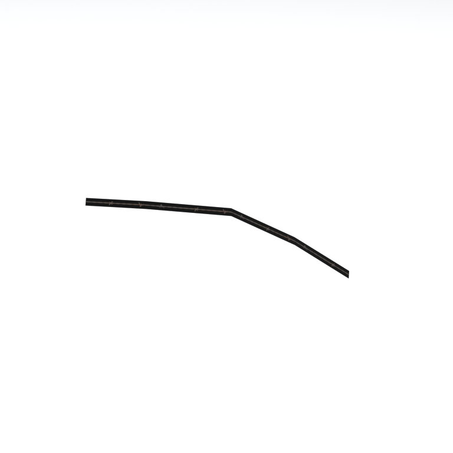

# Unidentified model (afgh_brbw001_dbri003)

Native model reference; a readable object identification has not been reviewed.

[Library](../README.md) | [Category](../tables/unclassified-components-1.md) | [Source / advanced data](../catalogue.json) | [Credits](../sources-and-credits.md)

**Game filename:** afgh_brbw001_dbri003.fmdl  
**Category:** Unclassified &gt; Unclassified components  
**Variant:** No explicit variant token; **LOD:** 0  
**Tags:** 

## Still reference



## 360-degree reference


The camera circles a static model. This is not a native animation. Source base textures and UVs use approximate studio shading; interaction, collision, complete assembly and FOX shader equivalence are not established.

## Identity and naming

| Field | Value |
|---|---|
| Library ID | mgsv-tpp-afgh_brbw001_dbri003-3bc1beaa3d9eb17d |
| Naming status | unidentified |
| Naming confidence | unknown |
| Naming evidence | {} |
| Native model | /Assets/tpp/environ/object/afghanistan/barbwire/afgh_brbw001/scenes/afgh_brbw001_dbri003.fmdl |
| Model SHA256 | ce78944f0631627eab4336b4cd97409486719331c53cc54d23bb5408ad47f156 |
| Container | /Assets/tpp/pack/location/afgh/pack_common/afgh_common.fpk |
| Container SHA256 | 810fe68a28c81299da7ef00849d2905b640d0a2da970f1b312e953a2c7b5df48 |
| Captured source / location scope | Selected native member/content and captured installed-source chain; full archive SHA/runtime priority unresolved |
| Raw record SHA256 | 300c34c69c85e66654aa10ac6ad8730eb092b76529fd6406c2abeef9ed6983ff |

Naming review is descriptive metadata only. It does not change model completion or identify a working game interaction.

## Native LOD inventory

| Native LOD | Triangles | Preview status | Decoded indices SHA256 |
|---|---:|---|---|
| 0 | 8 | rendered | 1840a6bbd1dbdd47806ee41f50309c21fc8cbf3dffb94114f62562b83ea3d4a2 |
| 1 | 4 | not separately rendered | d408bde757eb9f796967a4e7079bd2f150773360355e8a08a68f1ee687696811 |
| 2 | 3 | not separately rendered | 91ccf6f420f54a4272165365ba017fdcedc4b0ca7a8af476bd93cc4228127e87 |
| 3 | 1 | not separately rendered | 5f30320bc9bfa47cfb37a7c67162e36d9b54feab56a5c20a8948146bdc9830e2 |

Mesh detail and texture pixels/mips are separate. Index hashes describe decoded triangle arrays, not packed index-buffer bytes. Only source-recorded native levels are listed.

<details>
<summary>Texture, source and naming technical metadata</summary>

```json
{
  "source": {
    "nativePath": "/Assets/tpp/environ/object/afghanistan/barbwire/afgh_brbw001/scenes/afgh_brbw001_dbri003.fmdl",
    "nativeSha256": "ce78944f0631627eab4336b4cd97409486719331c53cc54d23bb5408ad47f156",
    "stableIdentity": "/assets/tpp/environ/object/afghanistan/barbwire/afgh_brbw001/scenes/afgh_brbw001_dbri003.fmdl#ce78944f0631627eab4336b4cd97409486719331c53cc54d23bb5408ad47f156#b14170d0353f3828c1914b433e15a17da7ee2fbd0ab1dc49cf59b1acb226980f",
    "container": {
      "nativePath": "/Assets/tpp/pack/location/afgh/pack_common/afgh_common.fpk",
      "sha256": "810fe68a28c81299da7ef00849d2905b640d0a2da970f1b312e953a2c7b5df48",
      "status": "Selected installed-source container/member chain captured by community reader"
    },
    "historicalDatOrigin": null,
    "sourceArchiveAtCapture": "master/0/00.dat",
    "locationStatus": "Selected native member/content and captured installed-source chain; full archive SHA/runtime priority unresolved",
    "currentInstalledDatVerified": false,
    "selectedInstalledMemberVerified": true,
    "evidence": {
      "archive_helper_executable_sha256": "6f8e39a436af3b024bbd0504966ab3d5d9d0cb05d86689bf3e83d15e68df613f",
      "archive_helper_source_sha256": "f662d3b63e066a0afc77ffe22ea0e564222d14469648300dba2c4f8e9b43446b",
      "archive_index_recipe": "54acff767f08d76ad6056c5387328759bc883df507788f398de6c2c04fac12db",
      "archive_reader": "Atvaark GzsTool.Core 0.5.3",
      "archive_reader_core_sha256": "9da447ae3c375cce2e46744eeff6af50f1591062afdf479d1a0b49edb47daaa3",
      "archive_tool_and_dictionary_sha256": {
        "CityHash.dll": "def6c4506d461b65e4059b2936b2cbd5f852ba5d1d8a1a527f1c0e6dc7008c8f",
        "GzsTool.Core.dll": "9da447ae3c375cce2e46744eeff6af50f1591062afdf479d1a0b49edb47daaa3",
        "GzsTool.exe": "1a9c5b11e2355383ff485aee7e86abc026f5c1fad729daf8c0fd15ee0aae1c10",
        "Zlib.Portable.dll": "fe84781ba35ca9cc5ff5f73fd08d2a66c59e5257b4573f5fe59743f30bf78e42",
        "fpk_dictionary.txt": "b82f9a8d6c10a68ba9471eca9d815c21355a53b5e68753d8ad7db7fd01bf401d",
        "qar_dictionary.txt": "1558c248ed0a4bb827888261563fbb91a2df4f03999682f85d637ff70d9d5fb2"
      },
      "bytes": 1248,
      "container_chain": [
        {
          "content_sha256": null,
          "depth": 0,
          "id": "3f19555d27c2ebecdfbad26aadd88b9f62e9fb6092c04c712963ef73c67ccb42",
          "index_sha256": "9acd3675d6e1500e0e18430cba0fdc70a5718ad7d6b62f13905891a35d59f18a",
          "kind": "qar",
          "name": "master/0/00.dat",
          "parent_occurrence": null
        },
        {
          "content_sha256": "810fe68a28c81299da7ef00849d2905b640d0a2da970f1b312e953a2c7b5df48",
          "depth": 1,
          "id": "19e9adf189f5f5e9c624197357336d49999dc3525b83bd8c71cf525fcd2100e2",
          "index_sha256": "924ec10c5736f8b618238e2523664271e558a6ad49aefdaf2473ccbad50f1231",
          "kind": "fpk",
          "name": "/Assets/tpp/pack/location/afgh/pack_common/afgh_common.fpk",
          "parent_occurrence": "e35acf6999427a88778266baae8c014a0c20a82388f8ff04caca6a88d977a6d1"
        }
      ],
      "contentSha256": "ce78944f0631627eab4336b4cd97409486719331c53cc54d23bb5408ad47f156",
      "member": {
        "actual_size": 1248,
        "compressed_size": null,
        "content_sha256": "ce78944f0631627eab4336b4cd97409486719331c53cc54d23bb5408ad47f156",
        "declared_size": 1248,
        "extension": "fmdl",
        "hash_hex": null,
        "name": "/Assets/tpp/environ/object/afghanistan/barbwire/afgh_brbw001/scenes/afgh_brbw001_dbri003.fmdl",
        "name_origin": "embedded",
        "offset": 2145152,
        "ordinal": 19,
        "path_hash": null,
        "resolved": 1
      },
      "occurrenceId": "06a2f4c63ad675b9afdb0664330df26b6bda067374ce279eed8d392c3c7e7f02",
      "occurrence_id": "06a2f4c63ad675b9afdb0664330df26b6bda067374ce279eed8d392c3c7e7f02",
      "primary_source_revision": "fc4a8196555638c6cf8aa1b7c8dc34ccd5c69cb5",
      "source_adapter": "community_core_selective_export",
      "source_id": "7f6bb743fb4c487f0e9522f9c7fac280c46cf6b1051e0fc75a93602c8eb451f0",
      "source_path": "master/0/00.dat",
      "source_snapshot": "{\"bytes\":768788480,\"device\":621747392682911458,\"file_id\":844424931596481,\"header_sha256\":\"ead50f0a9a37e4285323b9c6fa0ec75fe75e518c63147e63158eeb2892c6589e\",\"mtime_ns\":1791852224238580700}",
      "virtualPath": "/Assets/tpp/environ/object/afghanistan/barbwire/afgh_brbw001/scenes/afgh_brbw001_dbri003.fmdl"
    }
  },
  "materials": [
    {
      "sampler": "Base_Tex_SRGB",
      "materialIndex": 0,
      "nativePathHash": "1543498105586063662",
      "nativeVirtualPath": null,
      "nativeBinding": {
        "familyId": "9fb46a51bc5362c4cd750b1f8e44cef5f2b4408db90ff8200ecbe6694fd802a7",
        "height": 128,
        "materialIndex": 0,
        "mipCount": 7,
        "nativeMipCountVerified": true,
        "nativePath": null,
        "nativePathHash": "1543498105586063662",
        "nativeTexture": {
          "additionalFtexsFileCount": 1,
          "depth": 1,
          "ftexsFileCount": 2,
          "height": 128,
          "metadataBytes": 176,
          "mipCount": 7,
          "mips": [
            {
              "chunks": 2,
              "decodedBytes": 32768,
              "mip": 0,
              "offset": 0,
              "storedBytes": 14912,
              "streamNumber": 2
            },
            {
              "chunks": 1,
              "decodedBytes": 8192,
              "mip": 1,
              "offset": 1848,
              "storedBytes": 4272,
              "streamNumber": 1
            },
            {
              "chunks": 1,
              "decodedBytes": 2048,
              "mip": 2,
              "offset": 640,
              "storedBytes": 1200,
              "streamNumber": 1
            },
            {
              "chunks": 1,
              "decodedBytes": 512,
              "mip": 3,
              "offset": 232,
              "storedBytes": 400,
              "streamNumber": 1
            },
            {
              "chunks": 1,
              "decodedBytes": 128,
              "mip": 4,
              "offset": 96,
              "storedBytes": 128,
              "streamNumber": 1
            },
            {
              "chunks": 1,
              "decodedBytes": 32,
              "mip": 5,
              "offset": 40,
              "storedBytes": 48,
              "streamNumber": 1
            },
            {
              "chunks": 1,
              "decodedBytes": 16,
              "mip": 6,
              "offset": 0,
              "storedBytes": 32,
              "streamNumber": 1
            }
          ],
          "nativeHeaderHash": "533462fab52391751f6160c4cebea3b8",
          "nrtFlag": 2,
          "pixelFormat": 4,
          "requiredStreamNumbers": [
            1,
            2
          ],
          "textureType": 16777219,
          "unknownFlags": 273,
          "width": 256
        },
        "samplerName": "Base_Tex_SRGB",
        "samplerNameHash": "72475356961633",
        "sha256": "009768b9041c9529d8472365bbbf5c1eabb39de7a4279d820de5dd7b4b453403",
        "sourceOccurrences": [
          {
            "archive_helper_executable_sha256": "6f8e39a436af3b024bbd0504966ab3d5d9d0cb05d86689bf3e83d15e68df613f",
            "archive_helper_source_sha256": "f662d3b63e066a0afc77ffe22ea0e564222d14469648300dba2c4f8e9b43446b",
            "archive_index_recipe": "54acff767f08d76ad6056c5387328759bc883df507788f398de6c2c04fac12db",
            "archive_reader": "Atvaark GzsTool.Core 0.5.3",
            "archive_reader_core_sha256": "9da447ae3c375cce2e46744eeff6af50f1591062afdf479d1a0b49edb47daaa3",
            "archive_tool_and_dictionary_sha256": {
              "CityHash.dll": "def6c4506d461b65e4059b2936b2cbd5f852ba5d1d8a1a527f1c0e6dc7008c8f",
              "GzsTool.Core.dll": "9da447ae3c375cce2e46744eeff6af50f1591062afdf479d1a0b49edb47daaa3",
              "GzsTool.exe": "1a9c5b11e2355383ff485aee7e86abc026f5c1fad729daf8c0fd15ee0aae1c10",
              "Zlib.Portable.dll": "fe84781ba35ca9cc5ff5f73fd08d2a66c59e5257b4573f5fe59743f30bf78e42",
              "fpk_dictionary.txt": "b82f9a8d6c10a68ba9471eca9d815c21355a53b5e68753d8ad7db7fd01bf401d",
              "qar_dictionary.txt": "1558c248ed0a4bb827888261563fbb91a2df4f03999682f85d637ff70d9d5fb2"
            },
            "bytes": 176,
            "container_chain": [
              {
                "content_sha256": null,
                "depth": 0,
                "id": "3f19555d27c2ebecdfbad26aadd88b9f62e9fb6092c04c712963ef73c67ccb42",
                "index_sha256": "9acd3675d6e1500e0e18430cba0fdc70a5718ad7d6b62f13905891a35d59f18a",
                "kind": "qar",
                "name": "master/0/00.dat",
                "parent_occurrence": null
              },
              {
                "content_sha256": "7784c61d48c2a829a8a3be8bea91819ed320466e84615e1196c12dc4390190ea",
                "depth": 1,
                "id": "a7374ee4090f72cbecb7df25f172141b83da2b51b8b38b375af7a4f0f577fc67",
                "index_sha256": "7f78072384a5e4f07d09223009a06931047d1b3d6ae36512b9bb7ef91d1fe958",
                "kind": "pftxs",
                "name": "/Assets/mgo/pack/location/afda/pack_common/afda_common.pftxs",
                "parent_occurrence": "e3bb44002c453c106548f7190291b4a4c22da16a7eebd82d6a8dac6ab3844ca7"
              }
            ],
            "contentSha256": "e01e8bdad808501bf89f42c95d05daf1c8904990001b6633061a101931d70b5a",
            "member": {
              "actual_size": 176,
              "compressed_size": null,
              "content_sha256": "e01e8bdad808501bf89f42c95d05daf1c8904990001b6633061a101931d70b5a",
              "declared_size": 176,
              "extension": "ftex",
              "hash_hex": "156b9b5966f2192e",
              "name": "156b9b5966f2192e.ftex",
              "name_origin": "hash_fallback",
              "offset": 17685488,
              "ordinal": 1378,
              "path_hash": null,
              "resolved": 0
            },
            "occurrenceId": "2686aeede801a71a4937ad54478089919b197461c85465ebe015f805facf27da",
            "occurrence_id": "2686aeede801a71a4937ad54478089919b197461c85465ebe015f805facf27da",
            "primary_source_revision": "fc4a8196555638c6cf8aa1b7c8dc34ccd5c69cb5",
            "source_adapter": "community_core_selective_export",
            "source_id": "7f6bb743fb4c487f0e9522f9c7fac280c46cf6b1051e0fc75a93602c8eb451f0",
            "source_path": "master/0/00.dat",
            "source_snapshot": "{\"bytes\":768788480,\"device\":621747392682911458,\"file_id\":844424931596481,\"header_sha256\":\"ead50f0a9a37e4285323b9c6fa0ec75fe75e518c63147e63158eeb2892c6589e\",\"mtime_ns\":1791852224238580700}",
            "virtualPath": "156b9b5966f2192e.ftex"
          },
          {
            "archive_helper_executable_sha256": "6f8e39a436af3b024bbd0504966ab3d5d9d0cb05d86689bf3e83d15e68df613f",
            "archive_helper_source_sha256": "f662d3b63e066a0afc77ffe22ea0e564222d14469648300dba2c4f8e9b43446b",
            "archive_index_recipe": "54acff767f08d76ad6056c5387328759bc883df507788f398de6c2c04fac12db",
            "archive_reader": "Atvaark GzsTool.Core 0.5.3",
            "archive_reader_core_sha256": "9da447ae3c375cce2e46744eeff6af50f1591062afdf479d1a0b49edb47daaa3",
            "archive_tool_and_dictionary_sha256": {
              "CityHash.dll": "def6c4506d461b65e4059b2936b2cbd5f852ba5d1d8a1a527f1c0e6dc7008c8f",
              "GzsTool.Core.dll": "9da447ae3c375cce2e46744eeff6af50f1591062afdf479d1a0b49edb47daaa3",
              "GzsTool.exe": "1a9c5b11e2355383ff485aee7e86abc026f5c1fad729daf8c0fd15ee0aae1c10",
              "Zlib.Portable.dll": "fe84781ba35ca9cc5ff5f73fd08d2a66c59e5257b4573f5fe59743f30bf78e42",
              "fpk_dictionary.txt": "b82f9a8d6c10a68ba9471eca9d815c21355a53b5e68753d8ad7db7fd01bf401d",
              "qar_dictionary.txt": "1558c248ed0a4bb827888261563fbb91a2df4f03999682f85d637ff70d9d5fb2"
            },
            "bytes": 6128,
            "container_chain": [
              {
                "content_sha256": null,
                "depth": 0,
                "id": "0b473016351235050c2f6af21454bd979a0ad4602a9860137c807c894c5eba4d",
                "index_sha256": "ac9b4dae0dd0166db3a6ec8da18524dffebcbaf9004569af631de82913bf49a3",
                "kind": "qar",
                "name": "master/texture2.dat",
                "parent_occurrence": null
              }
            ],
            "contentSha256": "5a8198f74215f580a75695a749ce90011e3ca13e679f5a236c7f92adcde35255",
            "member": {
              "actual_size": 6128,
              "compressed_size": 6128,
              "content_sha256": "5a8198f74215f580a75695a749ce90011e3ca13e679f5a236c7f92adcde35255",
              "declared_size": 6128,
              "extension": "1.ftexs",
              "hash_hex": "b2c39b5966f2192e",
              "name": "/Assets/tpp/environ/object/afghanistan/barbwire/afgh_brbw001/sourceimages/afgh_brbw001_bsm_alp.1.ftexs",
              "name_origin": "dictionary",
              "offset": 1255211040,
              "ordinal": 6823,
              "path_hash": "39b5966f2192e",
              "resolved": 1
            },
            "occurrenceId": "242d65439068485c14490b4b7dd62c16afcac74272d2c1a50884bb9cdc44d4fa",
            "occurrence_id": "242d65439068485c14490b4b7dd62c16afcac74272d2c1a50884bb9cdc44d4fa",
            "primary_source_revision": "fc4a8196555638c6cf8aa1b7c8dc34ccd5c69cb5",
            "source_adapter": "community_core_selective_export",
            "source_id": "85e8296057664cbc6ebaf6bd43d1c6d18528bbd8a6fae920bdf4d5eb69f6a93d",
            "source_path": "master/texture2.dat",
            "source_snapshot": "{\"bytes\":2920239104,\"device\":621747392682911458,\"file_id\":562949953639626,\"header_sha256\":\"72bfee707623afb5f3abd8382035d3d4258b4941ac583a56f5a447f47123dcab\",\"mtime_ns\":1791224675561235200}",
            "virtualPath": "/Assets/tpp/environ/object/afghanistan/barbwire/afgh_brbw001/sourceimages/afgh_brbw001_bsm_alp.1.ftexs"
          },
          {
            "archive_helper_executable_sha256": "6f8e39a436af3b024bbd0504966ab3d5d9d0cb05d86689bf3e83d15e68df613f",
            "archive_helper_source_sha256": "f662d3b63e066a0afc77ffe22ea0e564222d14469648300dba2c4f8e9b43446b",
            "archive_index_recipe": "54acff767f08d76ad6056c5387328759bc883df507788f398de6c2c04fac12db",
            "archive_reader": "Atvaark GzsTool.Core 0.5.3",
            "archive_reader_core_sha256": "9da447ae3c375cce2e46744eeff6af50f1591062afdf479d1a0b49edb47daaa3",
            "archive_tool_and_dictionary_sha256": {
              "CityHash.dll": "def6c4506d461b65e4059b2936b2cbd5f852ba5d1d8a1a527f1c0e6dc7008c8f",
              "GzsTool.Core.dll": "9da447ae3c375cce2e46744eeff6af50f1591062afdf479d1a0b49edb47daaa3",
              "GzsTool.exe": "1a9c5b11e2355383ff485aee7e86abc026f5c1fad729daf8c0fd15ee0aae1c10",
              "Zlib.Portable.dll": "fe84781ba35ca9cc5ff5f73fd08d2a66c59e5257b4573f5fe59743f30bf78e42",
              "fpk_dictionary.txt": "b82f9a8d6c10a68ba9471eca9d815c21355a53b5e68753d8ad7db7fd01bf401d",
              "qar_dictionary.txt": "1558c248ed0a4bb827888261563fbb91a2df4f03999682f85d637ff70d9d5fb2"
            },
            "bytes": 14928,
            "container_chain": [
              {
                "content_sha256": null,
                "depth": 0,
                "id": "436c8cfb4f382de93365b167a61aa81383299b7bad18205d60f1d0beeb3919e3",
                "index_sha256": "2d7b45c6ca65418839618e978562cac336091c06eb56dfe99f762b07a4016960",
                "kind": "qar",
                "name": "master/texture4.dat",
                "parent_occurrence": null
              }
            ],
            "contentSha256": "d64bd3d969ef2c3407168fa9b7a76b778dffad96963e9f347c84cb1bb4578ef0",
            "member": {
              "actual_size": 14928,
              "compressed_size": 14928,
              "content_sha256": "d64bd3d969ef2c3407168fa9b7a76b778dffad96963e9f347c84cb1bb4578ef0",
              "declared_size": 14928,
              "extension": "2.ftexs",
              "hash_hex": "b5739b5966f2192e",
              "name": "/Assets/tpp/environ/object/afghanistan/barbwire/afgh_brbw001/sourceimages/afgh_brbw001_bsm_alp.2.ftexs",
              "name_origin": "dictionary",
              "offset": 803722272,
              "ordinal": 4748,
              "path_hash": "39b5966f2192e",
              "resolved": 1
            },
            "occurrenceId": "2edbbdafa8154ccb5b8a9ecf10b495ceae5b2a2a8d59f2f6f4e6b8280bb8caf0",
            "occurrence_id": "2edbbdafa8154ccb5b8a9ecf10b495ceae5b2a2a8d59f2f6f4e6b8280bb8caf0",
            "primary_source_revision": "fc4a8196555638c6cf8aa1b7c8dc34ccd5c69cb5",
            "source_adapter": "community_core_selective_export",
            "source_id": "6c31b98b4db9b88eb76cfcb538f5f34b4729531266a9459584126720a4fc14aa",
            "source_path": "master/texture4.dat",
            "source_snapshot": "{\"bytes\":2031604736,\"device\":621747392682911458,\"file_id\":562949953639628,\"header_sha256\":\"40ee2c6917b338f7f68c49847c97fe92b978506a1ba847fcc94d28c931c8711a\",\"mtime_ns\":1791224675561235200}",
            "virtualPath": "/Assets/tpp/environ/object/afghanistan/barbwire/afgh_brbw001/sourceimages/afgh_brbw001_bsm_alp.2.ftexs"
          }
        ],
        "width": 256
      },
      "ddsSha256": "009768b9041c9529d8472365bbbf5c1eabb39de7a4279d820de5dd7b4b453403",
      "dimensions": [
        256,
        128
      ],
      "mipCount": 7,
      "nativeMipCountVerified": true,
      "connectedInPreview": true
    }
  ],
  "quality": {
    "decodedIndicesHashDerivation": "SHA256 of canonical UTF-8 JSON decoded triangle indices grouped by mesh; not packed buffer bytes",
    "highestRetainedGeometricLod": 0,
    "distinctNativeLods": 4,
    "baseTextureDimensions": [
      256,
      128
    ],
    "baseTextureNativeMipCount": 7,
    "largerRetainedBaseTextureFound": null,
    "nativeLods": [
      {
        "indicesSha256": "1840a6bbd1dbdd47806ee41f50309c21fc8cbf3dffb94114f62562b83ea3d4a2",
        "nativeLod": 0,
        "triangles": 8
      },
      {
        "indicesSha256": "d408bde757eb9f796967a4e7079bd2f150773360355e8a08a68f1ee687696811",
        "nativeLod": 1,
        "triangles": 4
      },
      {
        "indicesSha256": "91ccf6f420f54a4272165365ba017fdcedc4b0ca7a8af476bd93cc4228127e87",
        "nativeLod": 2,
        "triangles": 3
      },
      {
        "indicesSha256": "5f30320bc9bfa47cfb37a7c67162e36d9b54feab56a5c20a8948146bdc9830e2",
        "nativeLod": 3,
        "triangles": 1
      }
    ],
    "renderedNativeLods": [
      0
    ],
    "baseTextureSummary": "256 x 128; 7 native/DDS mips",
    "highestDetailScope": "Triangle-count comparison within captured FMDL only"
  }
}
```

</details>

[Original source / advanced record](../catalogue.json)
