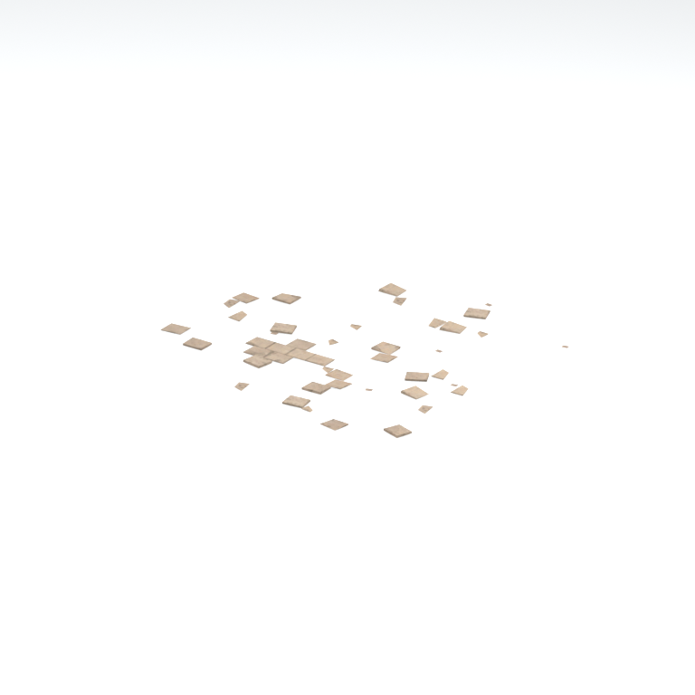
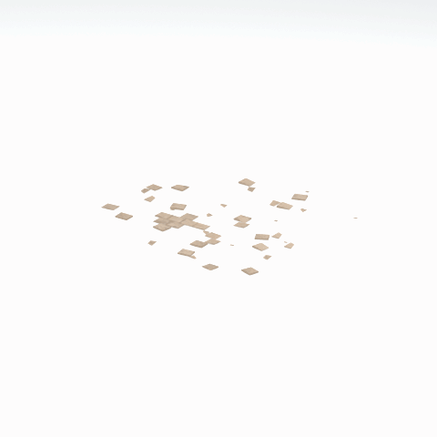

# Unidentified model (afgh_brck001_vrtn001)

Native model reference; a readable object identification has not been reviewed.

[Library](../README.md) | [Category](../tables/unclassified-components-1.md) | [Source / advanced data](../catalogue.json) | [Credits](../sources-and-credits.md)

**Game filename:** afgh_brck001_vrtn001.fmdl  
**Category:** Unclassified &gt; Unclassified components  
**Variant:** vrtn001; **LOD:** 0  
**Tags:** 

## Still reference



## 360-degree reference



The camera circles a static model. This is not a native animation. Source base textures and UVs use approximate studio shading; interaction, collision, complete assembly and FOX shader equivalence are not established.

## Identity and naming

| Field | Value |
|---|---|
| Library ID | mgsv-tpp-afgh_brck001_vrtn001-31d1eb031355393f |
| Naming status | unidentified |
| Naming confidence | unknown |
| Naming evidence | {} |
| Native model | /Assets/tpp/environ/object/afghanistan/brick/afgh_brck001/scenes/afgh_brck001_vrtn001.fmdl |
| Model SHA256 | e763290bbc869c404e7f2bc3543c7eb0ee628ca2ae60fef626ec15925d89cd27 |
| Container | /Assets/tpp/pack/location/afgh/pack_common/afgh_common.fpk |
| Container SHA256 | 810fe68a28c81299da7ef00849d2905b640d0a2da970f1b312e953a2c7b5df48 |
| Captured source / location scope | Selected native member/content and captured installed-source chain; full archive SHA/runtime priority unresolved |
| Raw record SHA256 | 3727b7f4a06ea4d7bb92c24e87d40fed63a64cb90eaa1210f1b3e4b58ae08450 |

Naming review is descriptive metadata only. It does not change model completion or identify a working game interaction.

## Native LOD inventory

| Native LOD | Triangles | Preview status | Decoded indices SHA256 |
|---|---:|---|---|
| 0 | 280 | rendered | 5173186ac8bdb07fe23d6a8baaee254ffee261e8d0b5eefffbf557376ec4020f |
| 1 | 280 | not separately rendered | 5173186ac8bdb07fe23d6a8baaee254ffee261e8d0b5eefffbf557376ec4020f |
| 2 | 280 | not separately rendered | 5173186ac8bdb07fe23d6a8baaee254ffee261e8d0b5eefffbf557376ec4020f |
| 3 | 280 | not separately rendered | 5173186ac8bdb07fe23d6a8baaee254ffee261e8d0b5eefffbf557376ec4020f |

Mesh detail and texture pixels/mips are separate. Index hashes describe decoded triangle arrays, not packed index-buffer bytes. Only source-recorded native levels are listed.

<details>
<summary>Texture, source and naming technical metadata</summary>

```json
{
  "source": {
    "nativePath": "/Assets/tpp/environ/object/afghanistan/brick/afgh_brck001/scenes/afgh_brck001_vrtn001.fmdl",
    "nativeSha256": "e763290bbc869c404e7f2bc3543c7eb0ee628ca2ae60fef626ec15925d89cd27",
    "stableIdentity": "/assets/tpp/environ/object/afghanistan/brick/afgh_brck001/scenes/afgh_brck001_vrtn001.fmdl#e763290bbc869c404e7f2bc3543c7eb0ee628ca2ae60fef626ec15925d89cd27#51a2c8d0f003c95a00577ce818776f9ff1948098429fd09e09727283ad26022b",
    "container": {
      "nativePath": "/Assets/tpp/pack/location/afgh/pack_common/afgh_common.fpk",
      "sha256": "810fe68a28c81299da7ef00849d2905b640d0a2da970f1b312e953a2c7b5df48",
      "status": "Selected installed-source container/member chain captured by community reader"
    },
    "historicalDatOrigin": null,
    "sourceArchiveAtCapture": "master/0/00.dat",
    "locationStatus": "Selected native member/content and captured installed-source chain; full archive SHA/runtime priority unresolved",
    "currentInstalledDatVerified": false,
    "selectedInstalledMemberVerified": true,
    "evidence": {
      "archive_helper_executable_sha256": "6f8e39a436af3b024bbd0504966ab3d5d9d0cb05d86689bf3e83d15e68df613f",
      "archive_helper_source_sha256": "f662d3b63e066a0afc77ffe22ea0e564222d14469648300dba2c4f8e9b43446b",
      "archive_index_recipe": "54acff767f08d76ad6056c5387328759bc883df507788f398de6c2c04fac12db",
      "archive_reader": "Atvaark GzsTool.Core 0.5.3",
      "archive_reader_core_sha256": "9da447ae3c375cce2e46744eeff6af50f1591062afdf479d1a0b49edb47daaa3",
      "archive_tool_and_dictionary_sha256": {
        "CityHash.dll": "def6c4506d461b65e4059b2936b2cbd5f852ba5d1d8a1a527f1c0e6dc7008c8f",
        "GzsTool.Core.dll": "9da447ae3c375cce2e46744eeff6af50f1591062afdf479d1a0b49edb47daaa3",
        "GzsTool.exe": "1a9c5b11e2355383ff485aee7e86abc026f5c1fad729daf8c0fd15ee0aae1c10",
        "Zlib.Portable.dll": "fe84781ba35ca9cc5ff5f73fd08d2a66c59e5257b4573f5fe59743f30bf78e42",
        "fpk_dictionary.txt": "b82f9a8d6c10a68ba9471eca9d815c21355a53b5e68753d8ad7db7fd01bf401d",
        "qar_dictionary.txt": "1558c248ed0a4bb827888261563fbb91a2df4f03999682f85d637ff70d9d5fb2"
      },
      "bytes": 22304,
      "container_chain": [
        {
          "content_sha256": null,
          "depth": 0,
          "id": "3f19555d27c2ebecdfbad26aadd88b9f62e9fb6092c04c712963ef73c67ccb42",
          "index_sha256": "9acd3675d6e1500e0e18430cba0fdc70a5718ad7d6b62f13905891a35d59f18a",
          "kind": "qar",
          "name": "master/0/00.dat",
          "parent_occurrence": null
        },
        {
          "content_sha256": "810fe68a28c81299da7ef00849d2905b640d0a2da970f1b312e953a2c7b5df48",
          "depth": 1,
          "id": "19e9adf189f5f5e9c624197357336d49999dc3525b83bd8c71cf525fcd2100e2",
          "index_sha256": "924ec10c5736f8b618238e2523664271e558a6ad49aefdaf2473ccbad50f1231",
          "kind": "fpk",
          "name": "/Assets/tpp/pack/location/afgh/pack_common/afgh_common.fpk",
          "parent_occurrence": "e35acf6999427a88778266baae8c014a0c20a82388f8ff04caca6a88d977a6d1"
        }
      ],
      "contentSha256": "e763290bbc869c404e7f2bc3543c7eb0ee628ca2ae60fef626ec15925d89cd27",
      "member": {
        "actual_size": 22304,
        "compressed_size": null,
        "content_sha256": "e763290bbc869c404e7f2bc3543c7eb0ee628ca2ae60fef626ec15925d89cd27",
        "declared_size": 22304,
        "extension": "fmdl",
        "hash_hex": null,
        "name": "/Assets/tpp/environ/object/afghanistan/brick/afgh_brck001/scenes/afgh_brck001_vrtn001.fmdl",
        "name_origin": "embedded",
        "offset": 2316448,
        "ordinal": 33,
        "path_hash": null,
        "resolved": 1
      },
      "occurrenceId": "f71701d95731595c5e1592831a64117790e0c61eef8960875e13deeb632a5e0c",
      "occurrence_id": "f71701d95731595c5e1592831a64117790e0c61eef8960875e13deeb632a5e0c",
      "primary_source_revision": "fc4a8196555638c6cf8aa1b7c8dc34ccd5c69cb5",
      "source_adapter": "community_core_selective_export",
      "source_id": "7f6bb743fb4c487f0e9522f9c7fac280c46cf6b1051e0fc75a93602c8eb451f0",
      "source_path": "master/0/00.dat",
      "source_snapshot": "{\"bytes\":768788480,\"device\":621747392682911458,\"file_id\":844424931596481,\"header_sha256\":\"ead50f0a9a37e4285323b9c6fa0ec75fe75e518c63147e63158eeb2892c6589e\",\"mtime_ns\":1791852224238580700}",
      "virtualPath": "/Assets/tpp/environ/object/afghanistan/brick/afgh_brck001/scenes/afgh_brck001_vrtn001.fmdl"
    }
  },
  "materials": [
    {
      "sampler": "Base_Tex_SRGB",
      "materialIndex": 0,
      "nativePathHash": "1542487895520419810",
      "nativeVirtualPath": null,
      "nativeBinding": {
        "familyId": "e6778077c80d156635a02b0df3e940d616a7a12046923149bc39e4f8d2f56d05",
        "height": 1024,
        "materialIndex": 0,
        "mipCount": 9,
        "nativeMipCountVerified": true,
        "nativePath": null,
        "nativePathHash": "1542487895520419810",
        "nativeTexture": {
          "additionalFtexsFileCount": 2,
          "depth": 1,
          "ftexsFileCount": 3,
          "height": 1024,
          "metadataBytes": 208,
          "mipCount": 9,
          "mips": [
            {
              "chunks": 32,
              "decodedBytes": 524288,
              "mip": 0,
              "offset": 0,
              "storedBytes": 376864,
              "streamNumber": 3
            },
            {
              "chunks": 8,
              "decodedBytes": 131072,
              "mip": 1,
              "offset": 0,
              "storedBytes": 95968,
              "streamNumber": 2
            },
            {
              "chunks": 2,
              "decodedBytes": 32768,
              "mip": 2,
              "offset": 8224,
              "storedBytes": 23792,
              "streamNumber": 1
            },
            {
              "chunks": 1,
              "decodedBytes": 8192,
              "mip": 3,
              "offset": 2264,
              "storedBytes": 5952,
              "streamNumber": 1
            },
            {
              "chunks": 1,
              "decodedBytes": 2048,
              "mip": 4,
              "offset": 672,
              "storedBytes": 1584,
              "streamNumber": 1
            },
            {
              "chunks": 1,
              "decodedBytes": 512,
              "mip": 5,
              "offset": 216,
              "storedBytes": 448,
              "streamNumber": 1
            },
            {
              "chunks": 1,
              "decodedBytes": 128,
              "mip": 6,
              "offset": 80,
              "storedBytes": 128,
              "streamNumber": 1
            },
            {
              "chunks": 1,
              "decodedBytes": 32,
              "mip": 7,
              "offset": 24,
              "storedBytes": 48,
              "streamNumber": 1
            },
            {
              "chunks": 1,
              "decodedBytes": 8,
              "mip": 8,
              "offset": 0,
              "storedBytes": 16,
              "streamNumber": 1
            }
          ],
          "nativeHeaderHash": "99b1d42c99ef621f44cac083eb014d6a",
          "nrtFlag": 2,
          "pixelFormat": 2,
          "requiredStreamNumbers": [
            1,
            2,
            3
          ],
          "textureType": 16777219,
          "unknownFlags": 273,
          "width": 1024
        },
        "samplerName": "Base_Tex_SRGB",
        "samplerNameHash": "72475356961633",
        "sha256": "f47344d7b3d321909053045a74376336adf7a11aaae42fdff00f364d0ddca12d",
        "sourceOccurrences": [
          {
            "archive_helper_executable_sha256": "6f8e39a436af3b024bbd0504966ab3d5d9d0cb05d86689bf3e83d15e68df613f",
            "archive_helper_source_sha256": "f662d3b63e066a0afc77ffe22ea0e564222d14469648300dba2c4f8e9b43446b",
            "archive_index_recipe": "54acff767f08d76ad6056c5387328759bc883df507788f398de6c2c04fac12db",
            "archive_reader": "Atvaark GzsTool.Core 0.5.3",
            "archive_reader_core_sha256": "9da447ae3c375cce2e46744eeff6af50f1591062afdf479d1a0b49edb47daaa3",
            "archive_tool_and_dictionary_sha256": {
              "CityHash.dll": "def6c4506d461b65e4059b2936b2cbd5f852ba5d1d8a1a527f1c0e6dc7008c8f",
              "GzsTool.Core.dll": "9da447ae3c375cce2e46744eeff6af50f1591062afdf479d1a0b49edb47daaa3",
              "GzsTool.exe": "1a9c5b11e2355383ff485aee7e86abc026f5c1fad729daf8c0fd15ee0aae1c10",
              "Zlib.Portable.dll": "fe84781ba35ca9cc5ff5f73fd08d2a66c59e5257b4573f5fe59743f30bf78e42",
              "fpk_dictionary.txt": "b82f9a8d6c10a68ba9471eca9d815c21355a53b5e68753d8ad7db7fd01bf401d",
              "qar_dictionary.txt": "1558c248ed0a4bb827888261563fbb91a2df4f03999682f85d637ff70d9d5fb2"
            },
            "bytes": 208,
            "container_chain": [
              {
                "content_sha256": null,
                "depth": 0,
                "id": "0b473016351235050c2f6af21454bd979a0ad4602a9860137c807c894c5eba4d",
                "index_sha256": "ac9b4dae0dd0166db3a6ec8da18524dffebcbaf9004569af631de82913bf49a3",
                "kind": "qar",
                "name": "master/texture2.dat",
                "parent_occurrence": null
              }
            ],
            "contentSha256": "eb150a46dba55ae1cb18359b9303788ec25aadeb5c1f26895675a5d17bc03132",
            "member": {
              "actual_size": 208,
              "compressed_size": 208,
              "content_sha256": "eb150a46dba55ae1cb18359b9303788ec25aadeb5c1f26895675a5d17bc03132",
              "declared_size": 208,
              "extension": "ftex",
              "hash_hex": "156804918ad59fe2",
              "name": "4918ad59fe2.ftex",
              "name_origin": "hash_fallback",
              "offset": 1276520480,
              "ordinal": 7184,
              "path_hash": "4918ad59fe2",
              "resolved": 0
            },
            "occurrenceId": "b141be1c074721e087cc5dea84899e2dfea8a0f10a028eab1cca228fa48e2c5e",
            "occurrence_id": "b141be1c074721e087cc5dea84899e2dfea8a0f10a028eab1cca228fa48e2c5e",
            "primary_source_revision": "fc4a8196555638c6cf8aa1b7c8dc34ccd5c69cb5",
            "source_adapter": "community_core_selective_export",
            "source_id": "85e8296057664cbc6ebaf6bd43d1c6d18528bbd8a6fae920bdf4d5eb69f6a93d",
            "source_path": "master/texture2.dat",
            "source_snapshot": "{\"bytes\":2920239104,\"device\":621747392682911458,\"file_id\":562949953639626,\"header_sha256\":\"72bfee707623afb5f3abd8382035d3d4258b4941ac583a56f5a447f47123dcab\",\"mtime_ns\":1791224675561235200}",
            "virtualPath": "4918ad59fe2.ftex"
          },
          {
            "archive_helper_executable_sha256": "6f8e39a436af3b024bbd0504966ab3d5d9d0cb05d86689bf3e83d15e68df613f",
            "archive_helper_source_sha256": "f662d3b63e066a0afc77ffe22ea0e564222d14469648300dba2c4f8e9b43446b",
            "archive_index_recipe": "54acff767f08d76ad6056c5387328759bc883df507788f398de6c2c04fac12db",
            "archive_reader": "Atvaark GzsTool.Core 0.5.3",
            "archive_reader_core_sha256": "9da447ae3c375cce2e46744eeff6af50f1591062afdf479d1a0b49edb47daaa3",
            "archive_tool_and_dictionary_sha256": {
              "CityHash.dll": "def6c4506d461b65e4059b2936b2cbd5f852ba5d1d8a1a527f1c0e6dc7008c8f",
              "GzsTool.Core.dll": "9da447ae3c375cce2e46744eeff6af50f1591062afdf479d1a0b49edb47daaa3",
              "GzsTool.exe": "1a9c5b11e2355383ff485aee7e86abc026f5c1fad729daf8c0fd15ee0aae1c10",
              "Zlib.Portable.dll": "fe84781ba35ca9cc5ff5f73fd08d2a66c59e5257b4573f5fe59743f30bf78e42",
              "fpk_dictionary.txt": "b82f9a8d6c10a68ba9471eca9d815c21355a53b5e68753d8ad7db7fd01bf401d",
              "qar_dictionary.txt": "1558c248ed0a4bb827888261563fbb91a2df4f03999682f85d637ff70d9d5fb2"
            },
            "bytes": 32032,
            "container_chain": [
              {
                "content_sha256": null,
                "depth": 0,
                "id": "0b473016351235050c2f6af21454bd979a0ad4602a9860137c807c894c5eba4d",
                "index_sha256": "ac9b4dae0dd0166db3a6ec8da18524dffebcbaf9004569af631de82913bf49a3",
                "kind": "qar",
                "name": "master/texture2.dat",
                "parent_occurrence": null
              }
            ],
            "contentSha256": "e2fd9426e6270deb1e5f249dde8ec66cb55c2092c5b4980dad32c46b879e0163",
            "member": {
              "actual_size": 32032,
              "compressed_size": 32032,
              "content_sha256": "e2fd9426e6270deb1e5f249dde8ec66cb55c2092c5b4980dad32c46b879e0163",
              "declared_size": 32032,
              "extension": "1.ftexs",
              "hash_hex": "b2c004918ad59fe2",
              "name": "4918ad59fe2.1.ftexs",
              "name_origin": "hash_fallback",
              "offset": 1276013600,
              "ordinal": 7181,
              "path_hash": "4918ad59fe2",
              "resolved": 0
            },
            "occurrenceId": "772546738bc12ba061a3093c1a9d9338d4f42249b33705fe0c5a42f0f65e4884",
            "occurrence_id": "772546738bc12ba061a3093c1a9d9338d4f42249b33705fe0c5a42f0f65e4884",
            "primary_source_revision": "fc4a8196555638c6cf8aa1b7c8dc34ccd5c69cb5",
            "source_adapter": "community_core_selective_export",
            "source_id": "85e8296057664cbc6ebaf6bd43d1c6d18528bbd8a6fae920bdf4d5eb69f6a93d",
            "source_path": "master/texture2.dat",
            "source_snapshot": "{\"bytes\":2920239104,\"device\":621747392682911458,\"file_id\":562949953639626,\"header_sha256\":\"72bfee707623afb5f3abd8382035d3d4258b4941ac583a56f5a447f47123dcab\",\"mtime_ns\":1791224675561235200}",
            "virtualPath": "4918ad59fe2.1.ftexs"
          },
          {
            "archive_helper_executable_sha256": "6f8e39a436af3b024bbd0504966ab3d5d9d0cb05d86689bf3e83d15e68df613f",
            "archive_helper_source_sha256": "f662d3b63e066a0afc77ffe22ea0e564222d14469648300dba2c4f8e9b43446b",
            "archive_index_recipe": "54acff767f08d76ad6056c5387328759bc883df507788f398de6c2c04fac12db",
            "archive_reader": "Atvaark GzsTool.Core 0.5.3",
            "archive_reader_core_sha256": "9da447ae3c375cce2e46744eeff6af50f1591062afdf479d1a0b49edb47daaa3",
            "archive_tool_and_dictionary_sha256": {
              "CityHash.dll": "def6c4506d461b65e4059b2936b2cbd5f852ba5d1d8a1a527f1c0e6dc7008c8f",
              "GzsTool.Core.dll": "9da447ae3c375cce2e46744eeff6af50f1591062afdf479d1a0b49edb47daaa3",
              "GzsTool.exe": "1a9c5b11e2355383ff485aee7e86abc026f5c1fad729daf8c0fd15ee0aae1c10",
              "Zlib.Portable.dll": "fe84781ba35ca9cc5ff5f73fd08d2a66c59e5257b4573f5fe59743f30bf78e42",
              "fpk_dictionary.txt": "b82f9a8d6c10a68ba9471eca9d815c21355a53b5e68753d8ad7db7fd01bf401d",
              "qar_dictionary.txt": "1558c248ed0a4bb827888261563fbb91a2df4f03999682f85d637ff70d9d5fb2"
            },
            "bytes": 96032,
            "container_chain": [
              {
                "content_sha256": null,
                "depth": 0,
                "id": "0b473016351235050c2f6af21454bd979a0ad4602a9860137c807c894c5eba4d",
                "index_sha256": "ac9b4dae0dd0166db3a6ec8da18524dffebcbaf9004569af631de82913bf49a3",
                "kind": "qar",
                "name": "master/texture2.dat",
                "parent_occurrence": null
              }
            ],
            "contentSha256": "a0f156eee76e0bd4b79102c551f56bde3cd23ae618824ded3cfe4a5d34fe3e36",
            "member": {
              "actual_size": 96032,
              "compressed_size": 96032,
              "content_sha256": "a0f156eee76e0bd4b79102c551f56bde3cd23ae618824ded3cfe4a5d34fe3e36",
              "declared_size": 96032,
              "extension": "2.ftexs",
              "hash_hex": "b57004918ad59fe2",
              "name": "4918ad59fe2.2.ftexs",
              "name_origin": "hash_fallback",
              "offset": 1276046368,
              "ordinal": 7182,
              "path_hash": "4918ad59fe2",
              "resolved": 0
            },
            "occurrenceId": "c64dace0d001678dca10b41f4394e5d1a60de88dedfe3fe7060d916fef0ea20a",
            "occurrence_id": "c64dace0d001678dca10b41f4394e5d1a60de88dedfe3fe7060d916fef0ea20a",
            "primary_source_revision": "fc4a8196555638c6cf8aa1b7c8dc34ccd5c69cb5",
            "source_adapter": "community_core_selective_export",
            "source_id": "85e8296057664cbc6ebaf6bd43d1c6d18528bbd8a6fae920bdf4d5eb69f6a93d",
            "source_path": "master/texture2.dat",
            "source_snapshot": "{\"bytes\":2920239104,\"device\":621747392682911458,\"file_id\":562949953639626,\"header_sha256\":\"72bfee707623afb5f3abd8382035d3d4258b4941ac583a56f5a447f47123dcab\",\"mtime_ns\":1791224675561235200}",
            "virtualPath": "4918ad59fe2.2.ftexs"
          },
          {
            "archive_helper_executable_sha256": "6f8e39a436af3b024bbd0504966ab3d5d9d0cb05d86689bf3e83d15e68df613f",
            "archive_helper_source_sha256": "f662d3b63e066a0afc77ffe22ea0e564222d14469648300dba2c4f8e9b43446b",
            "archive_index_recipe": "54acff767f08d76ad6056c5387328759bc883df507788f398de6c2c04fac12db",
            "archive_reader": "Atvaark GzsTool.Core 0.5.3",
            "archive_reader_core_sha256": "9da447ae3c375cce2e46744eeff6af50f1591062afdf479d1a0b49edb47daaa3",
            "archive_tool_and_dictionary_sha256": {
              "CityHash.dll": "def6c4506d461b65e4059b2936b2cbd5f852ba5d1d8a1a527f1c0e6dc7008c8f",
              "GzsTool.Core.dll": "9da447ae3c375cce2e46744eeff6af50f1591062afdf479d1a0b49edb47daaa3",
              "GzsTool.exe": "1a9c5b11e2355383ff485aee7e86abc026f5c1fad729daf8c0fd15ee0aae1c10",
              "Zlib.Portable.dll": "fe84781ba35ca9cc5ff5f73fd08d2a66c59e5257b4573f5fe59743f30bf78e42",
              "fpk_dictionary.txt": "b82f9a8d6c10a68ba9471eca9d815c21355a53b5e68753d8ad7db7fd01bf401d",
              "qar_dictionary.txt": "1558c248ed0a4bb827888261563fbb91a2df4f03999682f85d637ff70d9d5fb2"
            },
            "bytes": 377120,
            "container_chain": [
              {
                "content_sha256": null,
                "depth": 0,
                "id": "0b473016351235050c2f6af21454bd979a0ad4602a9860137c807c894c5eba4d",
                "index_sha256": "ac9b4dae0dd0166db3a6ec8da18524dffebcbaf9004569af631de82913bf49a3",
                "kind": "qar",
                "name": "master/texture2.dat",
                "parent_occurrence": null
              }
            ],
            "contentSha256": "77d5717406a66790b85cca81608532fee998eb31bf32f79482d4135f6ab1214e",
            "member": {
              "actual_size": 377120,
              "compressed_size": 377120,
              "content_sha256": "77d5717406a66790b85cca81608532fee998eb31bf32f79482d4135f6ab1214e",
              "declared_size": 377120,
              "extension": "3.ftexs",
              "hash_hex": "571804918ad59fe2",
              "name": "4918ad59fe2.3.ftexs",
              "name_origin": "hash_fallback",
              "offset": 1276142624,
              "ordinal": 7183,
              "path_hash": "4918ad59fe2",
              "resolved": 0
            },
            "occurrenceId": "c9cf5d088e339acc6e601fb82917ff288072206f24e9122a0b8b5526859b8370",
            "occurrence_id": "c9cf5d088e339acc6e601fb82917ff288072206f24e9122a0b8b5526859b8370",
            "primary_source_revision": "fc4a8196555638c6cf8aa1b7c8dc34ccd5c69cb5",
            "source_adapter": "community_core_selective_export",
            "source_id": "85e8296057664cbc6ebaf6bd43d1c6d18528bbd8a6fae920bdf4d5eb69f6a93d",
            "source_path": "master/texture2.dat",
            "source_snapshot": "{\"bytes\":2920239104,\"device\":621747392682911458,\"file_id\":562949953639626,\"header_sha256\":\"72bfee707623afb5f3abd8382035d3d4258b4941ac583a56f5a447f47123dcab\",\"mtime_ns\":1791224675561235200}",
            "virtualPath": "4918ad59fe2.3.ftexs"
          }
        ],
        "width": 1024
      },
      "ddsSha256": "f47344d7b3d321909053045a74376336adf7a11aaae42fdff00f364d0ddca12d",
      "dimensions": [
        1024,
        1024
      ],
      "mipCount": 9,
      "nativeMipCountVerified": true,
      "connectedInPreview": true
    }
  ],
  "quality": {
    "decodedIndicesHashDerivation": "SHA256 of canonical UTF-8 JSON decoded triangle indices grouped by mesh; not packed buffer bytes",
    "highestRetainedGeometricLod": 0,
    "distinctNativeLods": 1,
    "baseTextureDimensions": [
      1024,
      1024
    ],
    "baseTextureNativeMipCount": 9,
    "largerRetainedBaseTextureFound": null,
    "nativeLods": [
      {
        "indicesSha256": "5173186ac8bdb07fe23d6a8baaee254ffee261e8d0b5eefffbf557376ec4020f",
        "nativeLod": 0,
        "triangles": 280
      },
      {
        "duplicateOf": 0,
        "indicesSha256": "5173186ac8bdb07fe23d6a8baaee254ffee261e8d0b5eefffbf557376ec4020f",
        "nativeLod": 1,
        "triangles": 280
      },
      {
        "duplicateOf": 0,
        "indicesSha256": "5173186ac8bdb07fe23d6a8baaee254ffee261e8d0b5eefffbf557376ec4020f",
        "nativeLod": 2,
        "triangles": 280
      },
      {
        "duplicateOf": 0,
        "indicesSha256": "5173186ac8bdb07fe23d6a8baaee254ffee261e8d0b5eefffbf557376ec4020f",
        "nativeLod": 3,
        "triangles": 280
      }
    ],
    "renderedNativeLods": [
      0
    ],
    "baseTextureSummary": "1024 x 1024; 9 native/DDS mips",
    "highestDetailScope": "Triangle-count comparison within captured FMDL only"
  }
}
```

</details>

[Original source / advanced record](../catalogue.json)
