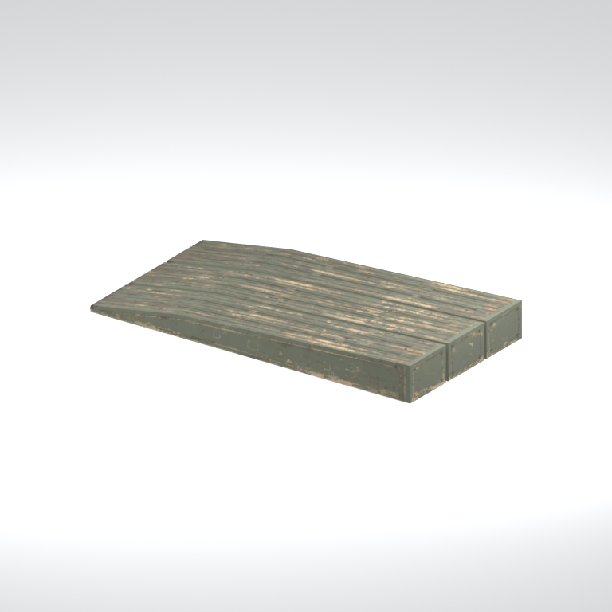
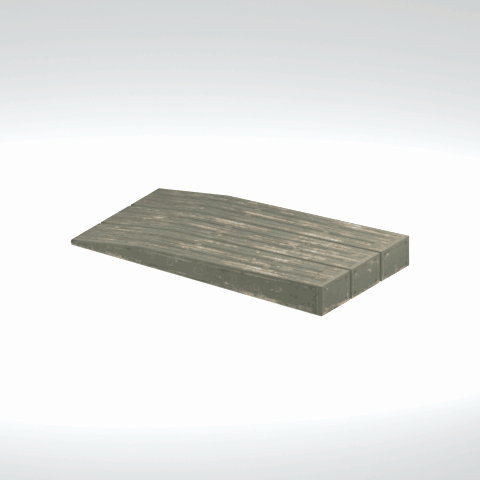

# Bridge component

A native bridge model component. Its specific form and assembly have not been visually reviewed.

[Library](../README.md) | [Category](../tables/bridge-components-1.md) | [Source / advanced data](../catalogue.json) | [Credits](../sources-and-credits.md)

**Game filename:** afgh_brdg003.fmdl  
**Category:** Infrastructure &gt; Bridge components  
**Variant:** No explicit variant token; **LOD:** 0  
**Tags:** bridge, component

## Still reference



## 360-degree reference



The camera circles a static model. This is not a native animation. Source base textures and UVs use approximate studio shading; interaction, collision, complete assembly and FOX shader equivalence are not established.

## Identity and naming

| Field | Value |
|---|---|
| Library ID | mgsv-tpp-afgh_brdg003-b2695f911e4123e7 |
| Naming status | path-derived |
| Naming confidence | medium |
| Naming evidence | {"kind": "native-folder", "note": "Conservative folder dictionary; not visual identification, color, function or completeness proof", "source": "bridge"} |
| Native model | /Assets/tpp/environ/object/afghanistan/bridge/afgh_brdg003/scenes/afgh_brdg003.fmdl |
| Model SHA256 | 2d77545b38f863b1d38d0ef69a4f58dba274e84348a496099b90961dc062bc28 |
| Container | /Assets/mgo/pack/location/afn0/pack_common/afn0_common.fpk |
| Container SHA256 | 793152d916d15d32b16935c3069b2171c7229092e9d1d3f1dd464e87ea95f415 |
| Captured source / location scope | Selected native member/content and captured installed-source chain; full archive SHA/runtime priority unresolved |
| Raw record SHA256 | 5d1ea84f97fe5585164f5570eaa73d98cc9fc15b9fe55e08e950ae3b2cd97aa8 |

Naming review is descriptive metadata only. It does not change model completion or identify a working game interaction.

## Native LOD inventory

| Native LOD | Triangles | Preview status | Decoded indices SHA256 |
|---|---:|---|---|
| 0 | 72 | rendered | af7637c12b7081edb9418e758adb75e29d34c747ffe521b14b5ad769e48ff982 |
| 1 | 66 | not separately rendered | aac4ae1c9791f57033803baef092caec13ce407b8ef72faf5f93c66cb83be117 |
| 2 | 62 | not separately rendered | ba8ae8d34565142dc19b6fdfb4c2315de9bd9290bc678fad6816c91bc773f7ee |
| 3 | 60 | not separately rendered | 199a40d1683491710230935feb32067db14393eb2bb49f257d86356643923464 |

Mesh detail and texture pixels/mips are separate. Index hashes describe decoded triangle arrays, not packed index-buffer bytes. Only source-recorded native levels are listed.

<details>
<summary>Texture, source and naming technical metadata</summary>

```json
{
  "source": {
    "nativePath": "/Assets/tpp/environ/object/afghanistan/bridge/afgh_brdg003/scenes/afgh_brdg003.fmdl",
    "nativeSha256": "2d77545b38f863b1d38d0ef69a4f58dba274e84348a496099b90961dc062bc28",
    "stableIdentity": "/assets/tpp/environ/object/afghanistan/bridge/afgh_brdg003/scenes/afgh_brdg003.fmdl#2d77545b38f863b1d38d0ef69a4f58dba274e84348a496099b90961dc062bc28#1e8ccd53a30de34e17b12eee30bb6937419166561850cb9739957a3728aa6ac7",
    "container": {
      "nativePath": "/Assets/mgo/pack/location/afn0/pack_common/afn0_common.fpk",
      "sha256": "793152d916d15d32b16935c3069b2171c7229092e9d1d3f1dd464e87ea95f415",
      "status": "Selected installed-source container/member chain captured by community reader"
    },
    "historicalDatOrigin": null,
    "sourceArchiveAtCapture": "master/0/00.dat",
    "locationStatus": "Selected native member/content and captured installed-source chain; full archive SHA/runtime priority unresolved",
    "currentInstalledDatVerified": false,
    "selectedInstalledMemberVerified": true,
    "evidence": {
      "archive_helper_executable_sha256": "6f8e39a436af3b024bbd0504966ab3d5d9d0cb05d86689bf3e83d15e68df613f",
      "archive_helper_source_sha256": "f662d3b63e066a0afc77ffe22ea0e564222d14469648300dba2c4f8e9b43446b",
      "archive_index_recipe": "54acff767f08d76ad6056c5387328759bc883df507788f398de6c2c04fac12db",
      "archive_reader": "Atvaark GzsTool.Core 0.5.3",
      "archive_reader_core_sha256": "9da447ae3c375cce2e46744eeff6af50f1591062afdf479d1a0b49edb47daaa3",
      "archive_tool_and_dictionary_sha256": {
        "CityHash.dll": "def6c4506d461b65e4059b2936b2cbd5f852ba5d1d8a1a527f1c0e6dc7008c8f",
        "GzsTool.Core.dll": "9da447ae3c375cce2e46744eeff6af50f1591062afdf479d1a0b49edb47daaa3",
        "GzsTool.exe": "1a9c5b11e2355383ff485aee7e86abc026f5c1fad729daf8c0fd15ee0aae1c10",
        "Zlib.Portable.dll": "fe84781ba35ca9cc5ff5f73fd08d2a66c59e5257b4573f5fe59743f30bf78e42",
        "fpk_dictionary.txt": "b82f9a8d6c10a68ba9471eca9d815c21355a53b5e68753d8ad7db7fd01bf401d",
        "qar_dictionary.txt": "1558c248ed0a4bb827888261563fbb91a2df4f03999682f85d637ff70d9d5fb2"
      },
      "bytes": 6416,
      "container_chain": [
        {
          "content_sha256": null,
          "depth": 0,
          "id": "3f19555d27c2ebecdfbad26aadd88b9f62e9fb6092c04c712963ef73c67ccb42",
          "index_sha256": "9acd3675d6e1500e0e18430cba0fdc70a5718ad7d6b62f13905891a35d59f18a",
          "kind": "qar",
          "name": "master/0/00.dat",
          "parent_occurrence": null
        },
        {
          "content_sha256": "793152d916d15d32b16935c3069b2171c7229092e9d1d3f1dd464e87ea95f415",
          "depth": 1,
          "id": "cdd16b801ab3d8abcb0eff58c5ffda33e686dfce824b125f6dae66b5b2538516",
          "index_sha256": "b576db71a757f0e278c2d308819efc35b981eb97da938ab92207c1f37446927a",
          "kind": "fpk",
          "name": "/Assets/mgo/pack/location/afn0/pack_common/afn0_common.fpk",
          "parent_occurrence": "629fd67dc6977d93ec9e65215d23dc6a6ff93ef5e14be9b3ffb02ad030ecfdde"
        }
      ],
      "contentSha256": "2d77545b38f863b1d38d0ef69a4f58dba274e84348a496099b90961dc062bc28",
      "member": {
        "actual_size": 6416,
        "compressed_size": null,
        "content_sha256": "2d77545b38f863b1d38d0ef69a4f58dba274e84348a496099b90961dc062bc28",
        "declared_size": 6416,
        "extension": "fmdl",
        "hash_hex": null,
        "name": "/Assets/tpp/environ/object/afghanistan/bridge/afgh_brdg003/scenes/afgh_brdg003.fmdl",
        "name_origin": "embedded",
        "offset": 6043968,
        "ordinal": 171,
        "path_hash": null,
        "resolved": 1
      },
      "occurrenceId": "ab4f89489ceb5e83c6c9ab0cb5c3bf59ba9e4cdac2b484abee57b2f9b121197a",
      "occurrence_id": "ab4f89489ceb5e83c6c9ab0cb5c3bf59ba9e4cdac2b484abee57b2f9b121197a",
      "primary_source_revision": "fc4a8196555638c6cf8aa1b7c8dc34ccd5c69cb5",
      "source_adapter": "community_core_selective_export",
      "source_id": "7f6bb743fb4c487f0e9522f9c7fac280c46cf6b1051e0fc75a93602c8eb451f0",
      "source_path": "master/0/00.dat",
      "source_snapshot": "{\"bytes\":768788480,\"device\":621747392682911458,\"file_id\":844424931596481,\"header_sha256\":\"ead50f0a9a37e4285323b9c6fa0ec75fe75e518c63147e63158eeb2892c6589e\",\"mtime_ns\":1791852224238580700}",
      "virtualPath": "/Assets/tpp/environ/object/afghanistan/bridge/afgh_brdg003/scenes/afgh_brdg003.fmdl"
    }
  },
  "materials": [
    {
      "sampler": "Base_Tex_SRGB",
      "materialIndex": 0,
      "nativePathHash": "1543077998539863552",
      "nativeVirtualPath": null,
      "nativeBinding": {
        "familyId": "c9d484f7d0a487a64f7770b6e64a22037023d0890deb142ee0bed3625eca8b13",
        "height": 1024,
        "materialIndex": 0,
        "mipCount": 9,
        "nativeMipCountVerified": true,
        "nativePath": null,
        "nativePathHash": "1543077998539863552",
        "nativeTexture": {
          "additionalFtexsFileCount": 2,
          "depth": 1,
          "ftexsFileCount": 3,
          "height": 1024,
          "metadataBytes": 208,
          "mipCount": 9,
          "mips": [
            {
              "chunks": 32,
              "decodedBytes": 524288,
              "mip": 0,
              "offset": 0,
              "storedBytes": 364144,
              "streamNumber": 3
            },
            {
              "chunks": 8,
              "decodedBytes": 131072,
              "mip": 1,
              "offset": 0,
              "storedBytes": 98544,
              "streamNumber": 2
            },
            {
              "chunks": 2,
              "decodedBytes": 32768,
              "mip": 2,
              "offset": 9216,
              "storedBytes": 25584,
              "streamNumber": 1
            },
            {
              "chunks": 1,
              "decodedBytes": 8192,
              "mip": 3,
              "offset": 2520,
              "storedBytes": 6688,
              "streamNumber": 1
            },
            {
              "chunks": 1,
              "decodedBytes": 2048,
              "mip": 4,
              "offset": 752,
              "storedBytes": 1760,
              "streamNumber": 1
            },
            {
              "chunks": 1,
              "decodedBytes": 512,
              "mip": 5,
              "offset": 232,
              "storedBytes": 512,
              "streamNumber": 1
            },
            {
              "chunks": 1,
              "decodedBytes": 128,
              "mip": 6,
              "offset": 80,
              "storedBytes": 144,
              "streamNumber": 1
            },
            {
              "chunks": 1,
              "decodedBytes": 32,
              "mip": 7,
              "offset": 24,
              "storedBytes": 48,
              "streamNumber": 1
            },
            {
              "chunks": 1,
              "decodedBytes": 8,
              "mip": 8,
              "offset": 0,
              "storedBytes": 16,
              "streamNumber": 1
            }
          ],
          "nativeHeaderHash": "92a4fe57d0c647d17c9e881dcac2ec7f",
          "nrtFlag": 2,
          "pixelFormat": 2,
          "requiredStreamNumbers": [
            1,
            2,
            3
          ],
          "textureType": 16777219,
          "unknownFlags": 273,
          "width": 1024
        },
        "samplerName": "Base_Tex_SRGB",
        "samplerNameHash": "72475356961633",
        "sha256": "c12db310c265d1685a225d95ce4cec0a126417a00c78a0b6f4ec55e18fa7d4a8",
        "sourceOccurrences": [
          {
            "archive_helper_executable_sha256": "6f8e39a436af3b024bbd0504966ab3d5d9d0cb05d86689bf3e83d15e68df613f",
            "archive_helper_source_sha256": "f662d3b63e066a0afc77ffe22ea0e564222d14469648300dba2c4f8e9b43446b",
            "archive_index_recipe": "54acff767f08d76ad6056c5387328759bc883df507788f398de6c2c04fac12db",
            "archive_reader": "Atvaark GzsTool.Core 0.5.3",
            "archive_reader_core_sha256": "9da447ae3c375cce2e46744eeff6af50f1591062afdf479d1a0b49edb47daaa3",
            "archive_tool_and_dictionary_sha256": {
              "CityHash.dll": "def6c4506d461b65e4059b2936b2cbd5f852ba5d1d8a1a527f1c0e6dc7008c8f",
              "GzsTool.Core.dll": "9da447ae3c375cce2e46744eeff6af50f1591062afdf479d1a0b49edb47daaa3",
              "GzsTool.exe": "1a9c5b11e2355383ff485aee7e86abc026f5c1fad729daf8c0fd15ee0aae1c10",
              "Zlib.Portable.dll": "fe84781ba35ca9cc5ff5f73fd08d2a66c59e5257b4573f5fe59743f30bf78e42",
              "fpk_dictionary.txt": "b82f9a8d6c10a68ba9471eca9d815c21355a53b5e68753d8ad7db7fd01bf401d",
              "qar_dictionary.txt": "1558c248ed0a4bb827888261563fbb91a2df4f03999682f85d637ff70d9d5fb2"
            },
            "bytes": 208,
            "container_chain": [
              {
                "content_sha256": null,
                "depth": 0,
                "id": "0b473016351235050c2f6af21454bd979a0ad4602a9860137c807c894c5eba4d",
                "index_sha256": "ac9b4dae0dd0166db3a6ec8da18524dffebcbaf9004569af631de82913bf49a3",
                "kind": "qar",
                "name": "master/texture2.dat",
                "parent_occurrence": null
              }
            ],
            "contentSha256": "921941592922f3e933b08baab3c3acf4fbea35e5ce058343dc868a9ac3e9333b",
            "member": {
              "actual_size": 208,
              "compressed_size": 208,
              "content_sha256": "921941592922f3e933b08baab3c3acf4fbea35e5ce058343dc868a9ac3e9333b",
              "declared_size": 208,
              "extension": "ftex",
              "hash_hex": "156a1d439bb07600",
              "name": "/Assets/tpp/environ/object/afghanistan/bridge/afgh_brdg003/sourceimages/afgh_brdg003_bsm.ftex",
              "name_origin": "dictionary",
              "offset": 1289879584,
              "ordinal": 7292,
              "path_hash": "21d439bb07600",
              "resolved": 1
            },
            "occurrenceId": "12d9ffde85c0dfc0822c09eb9d78d3557852d1880d1ec101f460b274c412da9d",
            "occurrence_id": "12d9ffde85c0dfc0822c09eb9d78d3557852d1880d1ec101f460b274c412da9d",
            "primary_source_revision": "fc4a8196555638c6cf8aa1b7c8dc34ccd5c69cb5",
            "source_adapter": "community_core_selective_export",
            "source_id": "85e8296057664cbc6ebaf6bd43d1c6d18528bbd8a6fae920bdf4d5eb69f6a93d",
            "source_path": "master/texture2.dat",
            "source_snapshot": "{\"bytes\":2920239104,\"device\":621747392682911458,\"file_id\":562949953639626,\"header_sha256\":\"72bfee707623afb5f3abd8382035d3d4258b4941ac583a56f5a447f47123dcab\",\"mtime_ns\":1791224675561235200}",
            "virtualPath": "/Assets/tpp/environ/object/afghanistan/bridge/afgh_brdg003/sourceimages/afgh_brdg003_bsm.ftex"
          },
          {
            "archive_helper_executable_sha256": "6f8e39a436af3b024bbd0504966ab3d5d9d0cb05d86689bf3e83d15e68df613f",
            "archive_helper_source_sha256": "f662d3b63e066a0afc77ffe22ea0e564222d14469648300dba2c4f8e9b43446b",
            "archive_index_recipe": "54acff767f08d76ad6056c5387328759bc883df507788f398de6c2c04fac12db",
            "archive_reader": "Atvaark GzsTool.Core 0.5.3",
            "archive_reader_core_sha256": "9da447ae3c375cce2e46744eeff6af50f1591062afdf479d1a0b49edb47daaa3",
            "archive_tool_and_dictionary_sha256": {
              "CityHash.dll": "def6c4506d461b65e4059b2936b2cbd5f852ba5d1d8a1a527f1c0e6dc7008c8f",
              "GzsTool.Core.dll": "9da447ae3c375cce2e46744eeff6af50f1591062afdf479d1a0b49edb47daaa3",
              "GzsTool.exe": "1a9c5b11e2355383ff485aee7e86abc026f5c1fad729daf8c0fd15ee0aae1c10",
              "Zlib.Portable.dll": "fe84781ba35ca9cc5ff5f73fd08d2a66c59e5257b4573f5fe59743f30bf78e42",
              "fpk_dictionary.txt": "b82f9a8d6c10a68ba9471eca9d815c21355a53b5e68753d8ad7db7fd01bf401d",
              "qar_dictionary.txt": "1558c248ed0a4bb827888261563fbb91a2df4f03999682f85d637ff70d9d5fb2"
            },
            "bytes": 34816,
            "container_chain": [
              {
                "content_sha256": null,
                "depth": 0,
                "id": "0b473016351235050c2f6af21454bd979a0ad4602a9860137c807c894c5eba4d",
                "index_sha256": "ac9b4dae0dd0166db3a6ec8da18524dffebcbaf9004569af631de82913bf49a3",
                "kind": "qar",
                "name": "master/texture2.dat",
                "parent_occurrence": null
              }
            ],
            "contentSha256": "167e11344ee0a02ded8b26a45cb6480ddf92a616de7d65fad35071bc3969984d",
            "member": {
              "actual_size": 34816,
              "compressed_size": 34816,
              "content_sha256": "167e11344ee0a02ded8b26a45cb6480ddf92a616de7d65fad35071bc3969984d",
              "declared_size": 34816,
              "extension": "1.ftexs",
              "hash_hex": "b2c21d439bb07600",
              "name": "/Assets/tpp/environ/object/afghanistan/bridge/afgh_brdg003/sourceimages/afgh_brdg003_bsm.1.ftexs",
              "name_origin": "dictionary",
              "offset": 1289379872,
              "ordinal": 7289,
              "path_hash": "21d439bb07600",
              "resolved": 1
            },
            "occurrenceId": "6851f3fc5fc1b24bfafa9b4c9c7fcd9f92e7cba8e76605f27c3eb7c7fb0b4331",
            "occurrence_id": "6851f3fc5fc1b24bfafa9b4c9c7fcd9f92e7cba8e76605f27c3eb7c7fb0b4331",
            "primary_source_revision": "fc4a8196555638c6cf8aa1b7c8dc34ccd5c69cb5",
            "source_adapter": "community_core_selective_export",
            "source_id": "85e8296057664cbc6ebaf6bd43d1c6d18528bbd8a6fae920bdf4d5eb69f6a93d",
            "source_path": "master/texture2.dat",
            "source_snapshot": "{\"bytes\":2920239104,\"device\":621747392682911458,\"file_id\":562949953639626,\"header_sha256\":\"72bfee707623afb5f3abd8382035d3d4258b4941ac583a56f5a447f47123dcab\",\"mtime_ns\":1791224675561235200}",
            "virtualPath": "/Assets/tpp/environ/object/afghanistan/bridge/afgh_brdg003/sourceimages/afgh_brdg003_bsm.1.ftexs"
          },
          {
            "archive_helper_executable_sha256": "6f8e39a436af3b024bbd0504966ab3d5d9d0cb05d86689bf3e83d15e68df613f",
            "archive_helper_source_sha256": "f662d3b63e066a0afc77ffe22ea0e564222d14469648300dba2c4f8e9b43446b",
            "archive_index_recipe": "54acff767f08d76ad6056c5387328759bc883df507788f398de6c2c04fac12db",
            "archive_reader": "Atvaark GzsTool.Core 0.5.3",
            "archive_reader_core_sha256": "9da447ae3c375cce2e46744eeff6af50f1591062afdf479d1a0b49edb47daaa3",
            "archive_tool_and_dictionary_sha256": {
              "CityHash.dll": "def6c4506d461b65e4059b2936b2cbd5f852ba5d1d8a1a527f1c0e6dc7008c8f",
              "GzsTool.Core.dll": "9da447ae3c375cce2e46744eeff6af50f1591062afdf479d1a0b49edb47daaa3",
              "GzsTool.exe": "1a9c5b11e2355383ff485aee7e86abc026f5c1fad729daf8c0fd15ee0aae1c10",
              "Zlib.Portable.dll": "fe84781ba35ca9cc5ff5f73fd08d2a66c59e5257b4573f5fe59743f30bf78e42",
              "fpk_dictionary.txt": "b82f9a8d6c10a68ba9471eca9d815c21355a53b5e68753d8ad7db7fd01bf401d",
              "qar_dictionary.txt": "1558c248ed0a4bb827888261563fbb91a2df4f03999682f85d637ff70d9d5fb2"
            },
            "bytes": 98608,
            "container_chain": [
              {
                "content_sha256": null,
                "depth": 0,
                "id": "0b473016351235050c2f6af21454bd979a0ad4602a9860137c807c894c5eba4d",
                "index_sha256": "ac9b4dae0dd0166db3a6ec8da18524dffebcbaf9004569af631de82913bf49a3",
                "kind": "qar",
                "name": "master/texture2.dat",
                "parent_occurrence": null
              }
            ],
            "contentSha256": "9cc19a793d2f2bb9fdfae95696877026ef7ab4fe5ea99ad44b1e3a420441a982",
            "member": {
              "actual_size": 98608,
              "compressed_size": 98608,
              "content_sha256": "9cc19a793d2f2bb9fdfae95696877026ef7ab4fe5ea99ad44b1e3a420441a982",
              "declared_size": 98608,
              "extension": "2.ftexs",
              "hash_hex": "b5721d439bb07600",
              "name": "/Assets/tpp/environ/object/afghanistan/bridge/afgh_brdg003/sourceimages/afgh_brdg003_bsm.2.ftexs",
              "name_origin": "dictionary",
              "offset": 1289415712,
              "ordinal": 7290,
              "path_hash": "21d439bb07600",
              "resolved": 1
            },
            "occurrenceId": "9a60d66202d859da52899e13357b932de1545e8a599232d5fe6ffe4d9d2f01ea",
            "occurrence_id": "9a60d66202d859da52899e13357b932de1545e8a599232d5fe6ffe4d9d2f01ea",
            "primary_source_revision": "fc4a8196555638c6cf8aa1b7c8dc34ccd5c69cb5",
            "source_adapter": "community_core_selective_export",
            "source_id": "85e8296057664cbc6ebaf6bd43d1c6d18528bbd8a6fae920bdf4d5eb69f6a93d",
            "source_path": "master/texture2.dat",
            "source_snapshot": "{\"bytes\":2920239104,\"device\":621747392682911458,\"file_id\":562949953639626,\"header_sha256\":\"72bfee707623afb5f3abd8382035d3d4258b4941ac583a56f5a447f47123dcab\",\"mtime_ns\":1791224675561235200}",
            "virtualPath": "/Assets/tpp/environ/object/afghanistan/bridge/afgh_brdg003/sourceimages/afgh_brdg003_bsm.2.ftexs"
          },
          {
            "archive_helper_executable_sha256": "6f8e39a436af3b024bbd0504966ab3d5d9d0cb05d86689bf3e83d15e68df613f",
            "archive_helper_source_sha256": "f662d3b63e066a0afc77ffe22ea0e564222d14469648300dba2c4f8e9b43446b",
            "archive_index_recipe": "54acff767f08d76ad6056c5387328759bc883df507788f398de6c2c04fac12db",
            "archive_reader": "Atvaark GzsTool.Core 0.5.3",
            "archive_reader_core_sha256": "9da447ae3c375cce2e46744eeff6af50f1591062afdf479d1a0b49edb47daaa3",
            "archive_tool_and_dictionary_sha256": {
              "CityHash.dll": "def6c4506d461b65e4059b2936b2cbd5f852ba5d1d8a1a527f1c0e6dc7008c8f",
              "GzsTool.Core.dll": "9da447ae3c375cce2e46744eeff6af50f1591062afdf479d1a0b49edb47daaa3",
              "GzsTool.exe": "1a9c5b11e2355383ff485aee7e86abc026f5c1fad729daf8c0fd15ee0aae1c10",
              "Zlib.Portable.dll": "fe84781ba35ca9cc5ff5f73fd08d2a66c59e5257b4573f5fe59743f30bf78e42",
              "fpk_dictionary.txt": "b82f9a8d6c10a68ba9471eca9d815c21355a53b5e68753d8ad7db7fd01bf401d",
              "qar_dictionary.txt": "1558c248ed0a4bb827888261563fbb91a2df4f03999682f85d637ff70d9d5fb2"
            },
            "bytes": 364400,
            "container_chain": [
              {
                "content_sha256": null,
                "depth": 0,
                "id": "e73d96973ade76f7a00afdbea486dd110896ace97da0791f56899647de46f210",
                "index_sha256": "5a818609a652a10d90fb90015661d0cb80898096bbb3aac36382172988d8736d",
                "kind": "qar",
                "name": "mgo/texture0.dat",
                "parent_occurrence": null
              }
            ],
            "contentSha256": "90b5289ca1ff093faac97788515f23ad41f9ff3ab1fd830c4beaa960d021ec38",
            "member": {
              "actual_size": 364400,
              "compressed_size": 364400,
              "content_sha256": "90b5289ca1ff093faac97788515f23ad41f9ff3ab1fd830c4beaa960d021ec38",
              "declared_size": 364400,
              "extension": "3.ftexs",
              "hash_hex": "571a1d439bb07600",
              "name": "/Assets/tpp/environ/object/afghanistan/bridge/afgh_brdg003/sourceimages/afgh_brdg003_bsm.3.ftexs",
              "name_origin": "dictionary",
              "offset": 3080098848,
              "ordinal": 11815,
              "path_hash": "21d439bb07600",
              "resolved": 1
            },
            "occurrenceId": "3d4f2d377c67b1db01bb2a009905e3d16292fd58214a8f282fc575f76453b826",
            "occurrence_id": "3d4f2d377c67b1db01bb2a009905e3d16292fd58214a8f282fc575f76453b826",
            "primary_source_revision": "fc4a8196555638c6cf8aa1b7c8dc34ccd5c69cb5",
            "source_adapter": "community_core_selective_export",
            "source_id": "03f5942f0e1af8040ae05b95c43716d75f5933971d78324bf7cfea291297f3f4",
            "source_path": "mgo/texture0.dat",
            "source_snapshot": "{\"bytes\":4492370944,\"device\":621747392682911458,\"file_id\":562949953639631,\"header_sha256\":\"6108fbacb65c84d041742c39e5ca630745240453b336f1059a13b91943f0b011\",\"mtime_ns\":1791224675562234400}",
            "virtualPath": "/Assets/tpp/environ/object/afghanistan/bridge/afgh_brdg003/sourceimages/afgh_brdg003_bsm.3.ftexs"
          }
        ],
        "width": 1024
      },
      "ddsSha256": "c12db310c265d1685a225d95ce4cec0a126417a00c78a0b6f4ec55e18fa7d4a8",
      "dimensions": [
        1024,
        1024
      ],
      "mipCount": 9,
      "nativeMipCountVerified": true,
      "connectedInPreview": true
    }
  ],
  "quality": {
    "decodedIndicesHashDerivation": "SHA256 of canonical UTF-8 JSON decoded triangle indices grouped by mesh; not packed buffer bytes",
    "highestRetainedGeometricLod": 0,
    "distinctNativeLods": 4,
    "baseTextureDimensions": [
      1024,
      1024
    ],
    "baseTextureNativeMipCount": 9,
    "largerRetainedBaseTextureFound": null,
    "nativeLods": [
      {
        "indicesSha256": "af7637c12b7081edb9418e758adb75e29d34c747ffe521b14b5ad769e48ff982",
        "nativeLod": 0,
        "triangles": 72
      },
      {
        "indicesSha256": "aac4ae1c9791f57033803baef092caec13ce407b8ef72faf5f93c66cb83be117",
        "nativeLod": 1,
        "triangles": 66
      },
      {
        "indicesSha256": "ba8ae8d34565142dc19b6fdfb4c2315de9bd9290bc678fad6816c91bc773f7ee",
        "nativeLod": 2,
        "triangles": 62
      },
      {
        "indicesSha256": "199a40d1683491710230935feb32067db14393eb2bb49f257d86356643923464",
        "nativeLod": 3,
        "triangles": 60
      }
    ],
    "renderedNativeLods": [
      0
    ],
    "baseTextureSummary": "1024 x 1024; 9 native/DDS mips",
    "highestDetailScope": "Triangle-count comparison within captured FMDL only"
  }
}
```

</details>

[Original source / advanced record](../catalogue.json)
