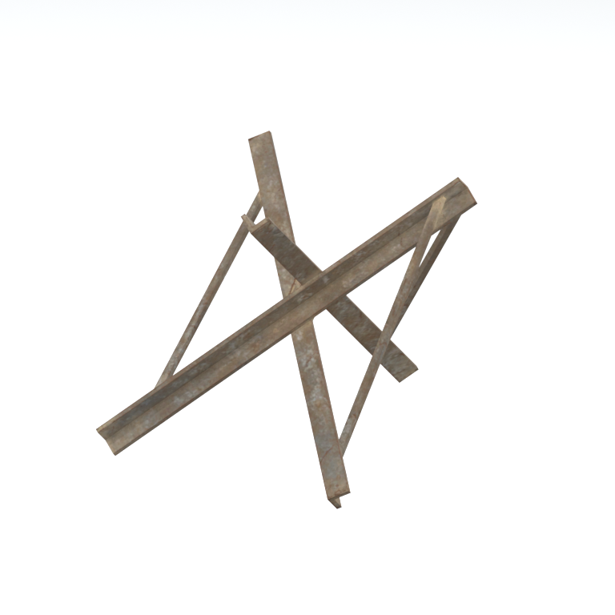
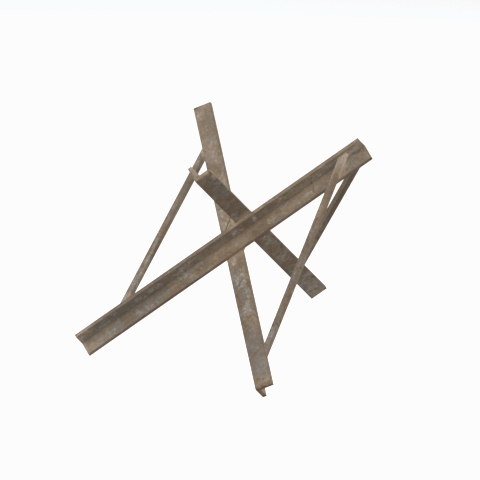

# Unidentified model (afgh_brrc001)

Native model reference; a readable object identification has not been reviewed.

[Library](../README.md) | [Category](../tables/unclassified-components-1.md) | [Source / advanced data](../catalogue.json) | [Credits](../sources-and-credits.md)

**Game filename:** afgh_brrc001.fmdl  
**Category:** Unclassified &gt; Unclassified components  
**Variant:** No explicit variant token; **LOD:** 0  
**Tags:** 

## Still reference



## 360-degree reference



The camera circles a static model. This is not a native animation. Source base textures and UVs use approximate studio shading; interaction, collision, complete assembly and FOX shader equivalence are not established.

## Identity and naming

| Field | Value |
|---|---|
| Library ID | mgsv-tpp-afgh_brrc001-488bb44fccc7adc5 |
| Naming status | unidentified |
| Naming confidence | unknown |
| Naming evidence | {} |
| Native model | /Assets/tpp/environ/object/afghanistan/barricade/afgh_brrc001/scenes/afgh_brrc001.fmdl |
| Model SHA256 | db944aa4e303b827c19bc9acf5d5fce23fed360d905428c8999992763c8245f9 |
| Container | /Assets/tpp/pack/location/mafr/pack_common/mafr_common.fpk |
| Container SHA256 | f190fe3f9abedbe057970d3cd4cd0577c2f8c5e3742465b644d9588b9f28c1dd |
| Captured source / location scope | Selected native member/content and captured installed-source chain; full archive SHA/runtime priority unresolved |
| Raw record SHA256 | 6ea6dce9bfbf9e1f2b0ceeecabf07395b80031c9bde7f87ab27794f46a994927 |

Naming review is descriptive metadata only. It does not change model completion or identify a working game interaction.

## Native LOD inventory

| Native LOD | Triangles | Preview status | Decoded indices SHA256 |
|---|---:|---|---|
| 0 | 108 | rendered | fc217093a476ffef5199b65bfdb61c37d3451ff66482ecdc1d1beb69eaa102d2 |
| 1 | 108 | not separately rendered | fc217093a476ffef5199b65bfdb61c37d3451ff66482ecdc1d1beb69eaa102d2 |
| 2 | 108 | not separately rendered | fc217093a476ffef5199b65bfdb61c37d3451ff66482ecdc1d1beb69eaa102d2 |
| 3 | 108 | not separately rendered | fc217093a476ffef5199b65bfdb61c37d3451ff66482ecdc1d1beb69eaa102d2 |

Mesh detail and texture pixels/mips are separate. Index hashes describe decoded triangle arrays, not packed index-buffer bytes. Only source-recorded native levels are listed.

<details>
<summary>Texture, source and naming technical metadata</summary>

```json
{
  "source": {
    "nativePath": "/Assets/tpp/environ/object/afghanistan/barricade/afgh_brrc001/scenes/afgh_brrc001.fmdl",
    "nativeSha256": "db944aa4e303b827c19bc9acf5d5fce23fed360d905428c8999992763c8245f9",
    "stableIdentity": "/assets/tpp/environ/object/afghanistan/barricade/afgh_brrc001/scenes/afgh_brrc001.fmdl#db944aa4e303b827c19bc9acf5d5fce23fed360d905428c8999992763c8245f9#2096f3076602a10759d3811d15748c5627aec2947bb93c306db30648fdde7aa4",
    "container": {
      "nativePath": "/Assets/tpp/pack/location/mafr/pack_common/mafr_common.fpk",
      "sha256": "f190fe3f9abedbe057970d3cd4cd0577c2f8c5e3742465b644d9588b9f28c1dd",
      "status": "Selected installed-source container/member chain captured by community reader"
    },
    "historicalDatOrigin": null,
    "sourceArchiveAtCapture": "master/0/00.dat",
    "locationStatus": "Selected native member/content and captured installed-source chain; full archive SHA/runtime priority unresolved",
    "currentInstalledDatVerified": false,
    "selectedInstalledMemberVerified": true,
    "evidence": {
      "archive_helper_executable_sha256": "6f8e39a436af3b024bbd0504966ab3d5d9d0cb05d86689bf3e83d15e68df613f",
      "archive_helper_source_sha256": "f662d3b63e066a0afc77ffe22ea0e564222d14469648300dba2c4f8e9b43446b",
      "archive_index_recipe": "54acff767f08d76ad6056c5387328759bc883df507788f398de6c2c04fac12db",
      "archive_reader": "Atvaark GzsTool.Core 0.5.3",
      "archive_reader_core_sha256": "9da447ae3c375cce2e46744eeff6af50f1591062afdf479d1a0b49edb47daaa3",
      "archive_tool_and_dictionary_sha256": {
        "CityHash.dll": "def6c4506d461b65e4059b2936b2cbd5f852ba5d1d8a1a527f1c0e6dc7008c8f",
        "GzsTool.Core.dll": "9da447ae3c375cce2e46744eeff6af50f1591062afdf479d1a0b49edb47daaa3",
        "GzsTool.exe": "1a9c5b11e2355383ff485aee7e86abc026f5c1fad729daf8c0fd15ee0aae1c10",
        "Zlib.Portable.dll": "fe84781ba35ca9cc5ff5f73fd08d2a66c59e5257b4573f5fe59743f30bf78e42",
        "fpk_dictionary.txt": "b82f9a8d6c10a68ba9471eca9d815c21355a53b5e68753d8ad7db7fd01bf401d",
        "qar_dictionary.txt": "1558c248ed0a4bb827888261563fbb91a2df4f03999682f85d637ff70d9d5fb2"
      },
      "bytes": 8400,
      "container_chain": [
        {
          "content_sha256": null,
          "depth": 0,
          "id": "3f19555d27c2ebecdfbad26aadd88b9f62e9fb6092c04c712963ef73c67ccb42",
          "index_sha256": "9acd3675d6e1500e0e18430cba0fdc70a5718ad7d6b62f13905891a35d59f18a",
          "kind": "qar",
          "name": "master/0/00.dat",
          "parent_occurrence": null
        },
        {
          "content_sha256": "f190fe3f9abedbe057970d3cd4cd0577c2f8c5e3742465b644d9588b9f28c1dd",
          "depth": 1,
          "id": "83d676db80f7630da732fdad03f7fe1025886077b82004976becc58ef390bb63",
          "index_sha256": "14377a1d728f7204eef604f74df308bc5054ed3e46c71785e4ef95c39fe398ab",
          "kind": "fpk",
          "name": "/Assets/tpp/pack/location/mafr/pack_common/mafr_common.fpk",
          "parent_occurrence": "393d9716b360dcbb6d5a57d979acbb87ade6a922d939f1c79a31222858343158"
        }
      ],
      "contentSha256": "db944aa4e303b827c19bc9acf5d5fce23fed360d905428c8999992763c8245f9",
      "member": {
        "actual_size": 8400,
        "compressed_size": null,
        "content_sha256": "db944aa4e303b827c19bc9acf5d5fce23fed360d905428c8999992763c8245f9",
        "declared_size": 8400,
        "extension": "fmdl",
        "hash_hex": null,
        "name": "/Assets/tpp/environ/object/afghanistan/barricade/afgh_brrc001/scenes/afgh_brrc001.fmdl",
        "name_origin": "embedded",
        "offset": 1938288,
        "ordinal": 16,
        "path_hash": null,
        "resolved": 1
      },
      "occurrenceId": "03ef1a6b9ac99b84b71046190adfd11283b25d315845e9eeed62ad1429ed8074",
      "occurrence_id": "03ef1a6b9ac99b84b71046190adfd11283b25d315845e9eeed62ad1429ed8074",
      "primary_source_revision": "fc4a8196555638c6cf8aa1b7c8dc34ccd5c69cb5",
      "source_adapter": "community_core_selective_export",
      "source_id": "7f6bb743fb4c487f0e9522f9c7fac280c46cf6b1051e0fc75a93602c8eb451f0",
      "source_path": "master/0/00.dat",
      "source_snapshot": "{\"bytes\":768788480,\"device\":621747392682911458,\"file_id\":844424931596481,\"header_sha256\":\"ead50f0a9a37e4285323b9c6fa0ec75fe75e518c63147e63158eeb2892c6589e\",\"mtime_ns\":1791852224238580700}",
      "virtualPath": "/Assets/tpp/environ/object/afghanistan/barricade/afgh_brrc001/scenes/afgh_brrc001.fmdl"
    }
  },
  "materials": [
    {
      "sampler": "Base_Tex_SRGB",
      "materialIndex": 0,
      "nativePathHash": "1542911970296337290",
      "nativeVirtualPath": null,
      "nativeBinding": {
        "familyId": "4ee53d1d7f39f6d2925a01697fcc19ad1f8e8a3a43fb6f21e453743fc6549eab",
        "height": 512,
        "materialIndex": 0,
        "mipCount": 8,
        "nativeMipCountVerified": true,
        "nativePath": null,
        "nativePathHash": "1542911970296337290",
        "nativeTexture": {
          "additionalFtexsFileCount": 2,
          "depth": 1,
          "ftexsFileCount": 3,
          "height": 512,
          "metadataBytes": 192,
          "mipCount": 8,
          "mips": [
            {
              "chunks": 8,
              "decodedBytes": 131072,
              "mip": 0,
              "offset": 0,
              "storedBytes": 102528,
              "streamNumber": 3
            },
            {
              "chunks": 2,
              "decodedBytes": 32768,
              "mip": 1,
              "offset": 0,
              "storedBytes": 26848,
              "streamNumber": 2
            },
            {
              "chunks": 1,
              "decodedBytes": 8192,
              "mip": 2,
              "offset": 2552,
              "storedBytes": 6896,
              "streamNumber": 1
            },
            {
              "chunks": 1,
              "decodedBytes": 2048,
              "mip": 3,
              "offset": 752,
              "storedBytes": 1792,
              "streamNumber": 1
            },
            {
              "chunks": 1,
              "decodedBytes": 512,
              "mip": 4,
              "offset": 232,
              "storedBytes": 512,
              "streamNumber": 1
            },
            {
              "chunks": 1,
              "decodedBytes": 128,
              "mip": 5,
              "offset": 80,
              "storedBytes": 144,
              "streamNumber": 1
            },
            {
              "chunks": 1,
              "decodedBytes": 32,
              "mip": 6,
              "offset": 24,
              "storedBytes": 48,
              "streamNumber": 1
            },
            {
              "chunks": 1,
              "decodedBytes": 8,
              "mip": 7,
              "offset": 0,
              "storedBytes": 16,
              "streamNumber": 1
            }
          ],
          "nativeHeaderHash": "fafef7de562d888a2d5bec7bd058a79a",
          "nrtFlag": 2,
          "pixelFormat": 2,
          "requiredStreamNumbers": [
            1,
            2,
            3
          ],
          "textureType": 16777219,
          "unknownFlags": 273,
          "width": 512
        },
        "samplerName": "Base_Tex_SRGB",
        "samplerNameHash": "72475356961633",
        "sha256": "6d3a37bd968828f4651eec8b16f94d01014ba925132cace0adb0e5fe17c7ae4d",
        "sourceOccurrences": [
          {
            "archive_helper_executable_sha256": "6f8e39a436af3b024bbd0504966ab3d5d9d0cb05d86689bf3e83d15e68df613f",
            "archive_helper_source_sha256": "f662d3b63e066a0afc77ffe22ea0e564222d14469648300dba2c4f8e9b43446b",
            "archive_index_recipe": "54acff767f08d76ad6056c5387328759bc883df507788f398de6c2c04fac12db",
            "archive_reader": "Atvaark GzsTool.Core 0.5.3",
            "archive_reader_core_sha256": "9da447ae3c375cce2e46744eeff6af50f1591062afdf479d1a0b49edb47daaa3",
            "archive_tool_and_dictionary_sha256": {
              "CityHash.dll": "def6c4506d461b65e4059b2936b2cbd5f852ba5d1d8a1a527f1c0e6dc7008c8f",
              "GzsTool.Core.dll": "9da447ae3c375cce2e46744eeff6af50f1591062afdf479d1a0b49edb47daaa3",
              "GzsTool.exe": "1a9c5b11e2355383ff485aee7e86abc026f5c1fad729daf8c0fd15ee0aae1c10",
              "Zlib.Portable.dll": "fe84781ba35ca9cc5ff5f73fd08d2a66c59e5257b4573f5fe59743f30bf78e42",
              "fpk_dictionary.txt": "b82f9a8d6c10a68ba9471eca9d815c21355a53b5e68753d8ad7db7fd01bf401d",
              "qar_dictionary.txt": "1558c248ed0a4bb827888261563fbb91a2df4f03999682f85d637ff70d9d5fb2"
            },
            "bytes": 192,
            "container_chain": [
              {
                "content_sha256": null,
                "depth": 0,
                "id": "3f19555d27c2ebecdfbad26aadd88b9f62e9fb6092c04c712963ef73c67ccb42",
                "index_sha256": "9acd3675d6e1500e0e18430cba0fdc70a5718ad7d6b62f13905891a35d59f18a",
                "kind": "qar",
                "name": "master/0/00.dat",
                "parent_occurrence": null
              },
              {
                "content_sha256": "7784c61d48c2a829a8a3be8bea91819ed320466e84615e1196c12dc4390190ea",
                "depth": 1,
                "id": "a7374ee4090f72cbecb7df25f172141b83da2b51b8b38b375af7a4f0f577fc67",
                "index_sha256": "7f78072384a5e4f07d09223009a06931047d1b3d6ae36512b9bb7ef91d1fe958",
                "kind": "pftxs",
                "name": "/Assets/mgo/pack/location/afda/pack_common/afda_common.pftxs",
                "parent_occurrence": "e3bb44002c453c106548f7190291b4a4c22da16a7eebd82d6a8dac6ab3844ca7"
              }
            ],
            "contentSha256": "360e87ec8fa310dce652edd80d7e938756acdd28c323697d1d6d7f8af7865f86",
            "member": {
              "actual_size": 192,
              "compressed_size": null,
              "content_sha256": "360e87ec8fa310dce652edd80d7e938756acdd28c323697d1d6d7f8af7865f86",
              "declared_size": 192,
              "extension": "ftex",
              "hash_hex": "156986432536138a",
              "name": "156986432536138a.ftex",
              "name_origin": "hash_fallback",
              "offset": 17699952,
              "ordinal": 1384,
              "path_hash": null,
              "resolved": 0
            },
            "occurrenceId": "a30d0c06c7e106e02b8b5c260d44a361d1fbb4c2fed3ac768cba2cbb57ff9917",
            "occurrence_id": "a30d0c06c7e106e02b8b5c260d44a361d1fbb4c2fed3ac768cba2cbb57ff9917",
            "primary_source_revision": "fc4a8196555638c6cf8aa1b7c8dc34ccd5c69cb5",
            "source_adapter": "community_core_selective_export",
            "source_id": "7f6bb743fb4c487f0e9522f9c7fac280c46cf6b1051e0fc75a93602c8eb451f0",
            "source_path": "master/0/00.dat",
            "source_snapshot": "{\"bytes\":768788480,\"device\":621747392682911458,\"file_id\":844424931596481,\"header_sha256\":\"ead50f0a9a37e4285323b9c6fa0ec75fe75e518c63147e63158eeb2892c6589e\",\"mtime_ns\":1791852224238580700}",
            "virtualPath": "156986432536138a.ftex"
          },
          {
            "archive_helper_executable_sha256": "6f8e39a436af3b024bbd0504966ab3d5d9d0cb05d86689bf3e83d15e68df613f",
            "archive_helper_source_sha256": "f662d3b63e066a0afc77ffe22ea0e564222d14469648300dba2c4f8e9b43446b",
            "archive_index_recipe": "54acff767f08d76ad6056c5387328759bc883df507788f398de6c2c04fac12db",
            "archive_reader": "Atvaark GzsTool.Core 0.5.3",
            "archive_reader_core_sha256": "9da447ae3c375cce2e46744eeff6af50f1591062afdf479d1a0b49edb47daaa3",
            "archive_tool_and_dictionary_sha256": {
              "CityHash.dll": "def6c4506d461b65e4059b2936b2cbd5f852ba5d1d8a1a527f1c0e6dc7008c8f",
              "GzsTool.Core.dll": "9da447ae3c375cce2e46744eeff6af50f1591062afdf479d1a0b49edb47daaa3",
              "GzsTool.exe": "1a9c5b11e2355383ff485aee7e86abc026f5c1fad729daf8c0fd15ee0aae1c10",
              "Zlib.Portable.dll": "fe84781ba35ca9cc5ff5f73fd08d2a66c59e5257b4573f5fe59743f30bf78e42",
              "fpk_dictionary.txt": "b82f9a8d6c10a68ba9471eca9d815c21355a53b5e68753d8ad7db7fd01bf401d",
              "qar_dictionary.txt": "1558c248ed0a4bb827888261563fbb91a2df4f03999682f85d637ff70d9d5fb2"
            },
            "bytes": 9456,
            "container_chain": [
              {
                "content_sha256": null,
                "depth": 0,
                "id": "436c8cfb4f382de93365b167a61aa81383299b7bad18205d60f1d0beeb3919e3",
                "index_sha256": "2d7b45c6ca65418839618e978562cac336091c06eb56dfe99f762b07a4016960",
                "kind": "qar",
                "name": "master/texture4.dat",
                "parent_occurrence": null
              }
            ],
            "contentSha256": "e735de3620b739234327d527a074ad797994d4eeb89c9d632cdc07d8b4e1bec2",
            "member": {
              "actual_size": 9456,
              "compressed_size": 9456,
              "content_sha256": "e735de3620b739234327d527a074ad797994d4eeb89c9d632cdc07d8b4e1bec2",
              "declared_size": 9456,
              "extension": "1.ftexs",
              "hash_hex": "b2c186432536138a",
              "name": "/Assets/tpp/environ/object/afghanistan/barricade/afgh_brrc001/sourceimages/afgh_brrc001_bsm.1.ftexs",
              "name_origin": "dictionary",
              "offset": 804361248,
              "ordinal": 4768,
              "path_hash": "186432536138a",
              "resolved": 1
            },
            "occurrenceId": "5391e01c65c874ae9f70dfc5e1990bf33c33def15f6f48de027d4a0c9b1a5845",
            "occurrence_id": "5391e01c65c874ae9f70dfc5e1990bf33c33def15f6f48de027d4a0c9b1a5845",
            "primary_source_revision": "fc4a8196555638c6cf8aa1b7c8dc34ccd5c69cb5",
            "source_adapter": "community_core_selective_export",
            "source_id": "6c31b98b4db9b88eb76cfcb538f5f34b4729531266a9459584126720a4fc14aa",
            "source_path": "master/texture4.dat",
            "source_snapshot": "{\"bytes\":2031604736,\"device\":621747392682911458,\"file_id\":562949953639628,\"header_sha256\":\"40ee2c6917b338f7f68c49847c97fe92b978506a1ba847fcc94d28c931c8711a\",\"mtime_ns\":1791224675561235200}",
            "virtualPath": "/Assets/tpp/environ/object/afghanistan/barricade/afgh_brrc001/sourceimages/afgh_brrc001_bsm.1.ftexs"
          },
          {
            "archive_helper_executable_sha256": "6f8e39a436af3b024bbd0504966ab3d5d9d0cb05d86689bf3e83d15e68df613f",
            "archive_helper_source_sha256": "f662d3b63e066a0afc77ffe22ea0e564222d14469648300dba2c4f8e9b43446b",
            "archive_index_recipe": "54acff767f08d76ad6056c5387328759bc883df507788f398de6c2c04fac12db",
            "archive_reader": "Atvaark GzsTool.Core 0.5.3",
            "archive_reader_core_sha256": "9da447ae3c375cce2e46744eeff6af50f1591062afdf479d1a0b49edb47daaa3",
            "archive_tool_and_dictionary_sha256": {
              "CityHash.dll": "def6c4506d461b65e4059b2936b2cbd5f852ba5d1d8a1a527f1c0e6dc7008c8f",
              "GzsTool.Core.dll": "9da447ae3c375cce2e46744eeff6af50f1591062afdf479d1a0b49edb47daaa3",
              "GzsTool.exe": "1a9c5b11e2355383ff485aee7e86abc026f5c1fad729daf8c0fd15ee0aae1c10",
              "Zlib.Portable.dll": "fe84781ba35ca9cc5ff5f73fd08d2a66c59e5257b4573f5fe59743f30bf78e42",
              "fpk_dictionary.txt": "b82f9a8d6c10a68ba9471eca9d815c21355a53b5e68753d8ad7db7fd01bf401d",
              "qar_dictionary.txt": "1558c248ed0a4bb827888261563fbb91a2df4f03999682f85d637ff70d9d5fb2"
            },
            "bytes": 26864,
            "container_chain": [
              {
                "content_sha256": null,
                "depth": 0,
                "id": "1cc220d9409d7163b6aca295ed89fd8c7befca6a8f849a8d5d09a2499724c863",
                "index_sha256": "5a818609a652a10d90fb90015661d0cb80898096bbb3aac36382172988d8736d",
                "kind": "qar",
                "name": "master/texture5_mgo0.dat",
                "parent_occurrence": null
              }
            ],
            "contentSha256": "aa53afd915ecf7bd57bbaad38f96986949efe42ce9a564c259b1e39f856fb5cc",
            "member": {
              "actual_size": 26864,
              "compressed_size": 26864,
              "content_sha256": "aa53afd915ecf7bd57bbaad38f96986949efe42ce9a564c259b1e39f856fb5cc",
              "declared_size": 26864,
              "extension": "2.ftexs",
              "hash_hex": "b57186432536138a",
              "name": "/Assets/tpp/environ/object/afghanistan/barricade/afgh_brrc001/sourceimages/afgh_brrc001_bsm.2.ftexs",
              "name_origin": "dictionary",
              "offset": 3068661792,
              "ordinal": 11750,
              "path_hash": "186432536138a",
              "resolved": 1
            },
            "occurrenceId": "6b814f0886dfbc531b1e3913aacab574f1fb8e9e97b265f116584f5fa7a121e7",
            "occurrence_id": "6b814f0886dfbc531b1e3913aacab574f1fb8e9e97b265f116584f5fa7a121e7",
            "primary_source_revision": "fc4a8196555638c6cf8aa1b7c8dc34ccd5c69cb5",
            "source_adapter": "community_core_selective_export",
            "source_id": "24f8989ccaae47940dc20e54ba67442ad562ac0032ab6e3d475e927c81444b56",
            "source_path": "master/texture5_mgo0.dat",
            "source_snapshot": "{\"bytes\":4492370944,\"device\":621747392682911458,\"file_id\":13510798883237422,\"header_sha256\":\"6108fbacb65c84d041742c39e5ca630745240453b336f1059a13b91943f0b011\",\"mtime_ns\":1791224675562234400}",
            "virtualPath": "/Assets/tpp/environ/object/afghanistan/barricade/afgh_brrc001/sourceimages/afgh_brrc001_bsm.2.ftexs"
          },
          {
            "archive_helper_executable_sha256": "6f8e39a436af3b024bbd0504966ab3d5d9d0cb05d86689bf3e83d15e68df613f",
            "archive_helper_source_sha256": "f662d3b63e066a0afc77ffe22ea0e564222d14469648300dba2c4f8e9b43446b",
            "archive_index_recipe": "54acff767f08d76ad6056c5387328759bc883df507788f398de6c2c04fac12db",
            "archive_reader": "Atvaark GzsTool.Core 0.5.3",
            "archive_reader_core_sha256": "9da447ae3c375cce2e46744eeff6af50f1591062afdf479d1a0b49edb47daaa3",
            "archive_tool_and_dictionary_sha256": {
              "CityHash.dll": "def6c4506d461b65e4059b2936b2cbd5f852ba5d1d8a1a527f1c0e6dc7008c8f",
              "GzsTool.Core.dll": "9da447ae3c375cce2e46744eeff6af50f1591062afdf479d1a0b49edb47daaa3",
              "GzsTool.exe": "1a9c5b11e2355383ff485aee7e86abc026f5c1fad729daf8c0fd15ee0aae1c10",
              "Zlib.Portable.dll": "fe84781ba35ca9cc5ff5f73fd08d2a66c59e5257b4573f5fe59743f30bf78e42",
              "fpk_dictionary.txt": "b82f9a8d6c10a68ba9471eca9d815c21355a53b5e68753d8ad7db7fd01bf401d",
              "qar_dictionary.txt": "1558c248ed0a4bb827888261563fbb91a2df4f03999682f85d637ff70d9d5fb2"
            },
            "bytes": 102592,
            "container_chain": [
              {
                "content_sha256": null,
                "depth": 0,
                "id": "0b473016351235050c2f6af21454bd979a0ad4602a9860137c807c894c5eba4d",
                "index_sha256": "ac9b4dae0dd0166db3a6ec8da18524dffebcbaf9004569af631de82913bf49a3",
                "kind": "qar",
                "name": "master/texture2.dat",
                "parent_occurrence": null
              }
            ],
            "contentSha256": "3712adeb435fb0b97ec99181e23b996ee00b51c9c110ffbe16efc599194e1df9",
            "member": {
              "actual_size": 102592,
              "compressed_size": 102592,
              "content_sha256": "3712adeb435fb0b97ec99181e23b996ee00b51c9c110ffbe16efc599194e1df9",
              "declared_size": 102592,
              "extension": "3.ftexs",
              "hash_hex": "571986432536138a",
              "name": "/Assets/tpp/environ/object/afghanistan/barricade/afgh_brrc001/sourceimages/afgh_brrc001_bsm.3.ftexs",
              "name_origin": "dictionary",
              "offset": 1255895072,
              "ordinal": 6846,
              "path_hash": "186432536138a",
              "resolved": 1
            },
            "occurrenceId": "841f16986e949d65dc4bb2a4fc16b59658eeccce6eed331e0a4d08f0fb6ae030",
            "occurrence_id": "841f16986e949d65dc4bb2a4fc16b59658eeccce6eed331e0a4d08f0fb6ae030",
            "primary_source_revision": "fc4a8196555638c6cf8aa1b7c8dc34ccd5c69cb5",
            "source_adapter": "community_core_selective_export",
            "source_id": "85e8296057664cbc6ebaf6bd43d1c6d18528bbd8a6fae920bdf4d5eb69f6a93d",
            "source_path": "master/texture2.dat",
            "source_snapshot": "{\"bytes\":2920239104,\"device\":621747392682911458,\"file_id\":562949953639626,\"header_sha256\":\"72bfee707623afb5f3abd8382035d3d4258b4941ac583a56f5a447f47123dcab\",\"mtime_ns\":1791224675561235200}",
            "virtualPath": "/Assets/tpp/environ/object/afghanistan/barricade/afgh_brrc001/sourceimages/afgh_brrc001_bsm.3.ftexs"
          }
        ],
        "width": 512
      },
      "ddsSha256": "6d3a37bd968828f4651eec8b16f94d01014ba925132cace0adb0e5fe17c7ae4d",
      "dimensions": [
        512,
        512
      ],
      "mipCount": 8,
      "nativeMipCountVerified": true,
      "connectedInPreview": true
    }
  ],
  "quality": {
    "decodedIndicesHashDerivation": "SHA256 of canonical UTF-8 JSON decoded triangle indices grouped by mesh; not packed buffer bytes",
    "highestRetainedGeometricLod": 0,
    "distinctNativeLods": 1,
    "baseTextureDimensions": [
      512,
      512
    ],
    "baseTextureNativeMipCount": 8,
    "largerRetainedBaseTextureFound": null,
    "nativeLods": [
      {
        "indicesSha256": "fc217093a476ffef5199b65bfdb61c37d3451ff66482ecdc1d1beb69eaa102d2",
        "nativeLod": 0,
        "triangles": 108
      },
      {
        "duplicateOf": 0,
        "indicesSha256": "fc217093a476ffef5199b65bfdb61c37d3451ff66482ecdc1d1beb69eaa102d2",
        "nativeLod": 1,
        "triangles": 108
      },
      {
        "duplicateOf": 0,
        "indicesSha256": "fc217093a476ffef5199b65bfdb61c37d3451ff66482ecdc1d1beb69eaa102d2",
        "nativeLod": 2,
        "triangles": 108
      },
      {
        "duplicateOf": 0,
        "indicesSha256": "fc217093a476ffef5199b65bfdb61c37d3451ff66482ecdc1d1beb69eaa102d2",
        "nativeLod": 3,
        "triangles": 108
      }
    ],
    "renderedNativeLods": [
      0
    ],
    "baseTextureSummary": "512 x 512; 8 native/DDS mips",
    "highestDetailScope": "Triangle-count comparison within captured FMDL only"
  }
}
```

</details>

[Original source / advanced record](../catalogue.json)
