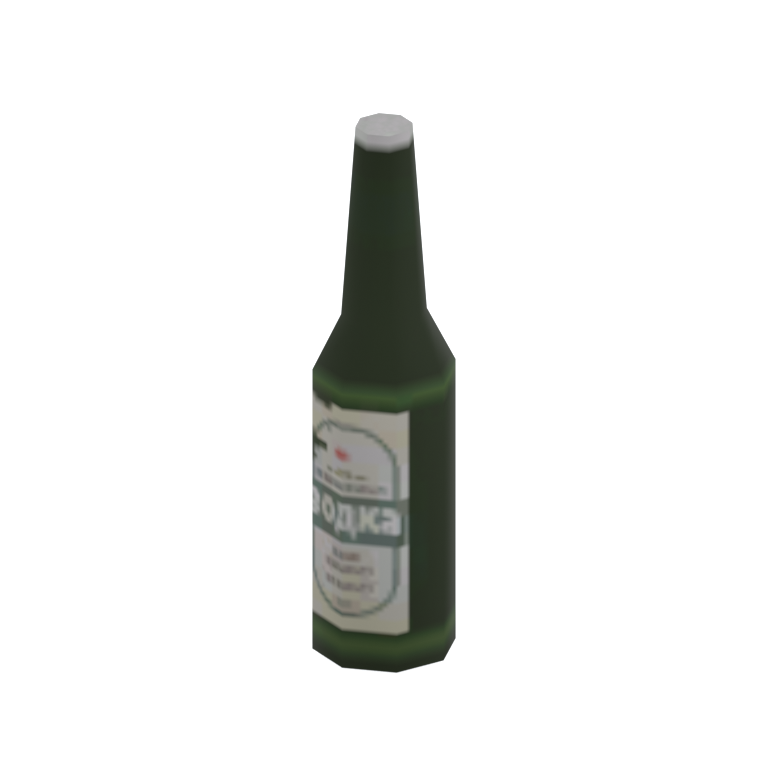

# Unidentified model (afgh_bttl001_br)

Native model reference; a readable object identification has not been reviewed.

[Library](../README.md) | [Category](../tables/unclassified-components-1.md) | [Source / advanced data](../catalogue.json) | [Credits](../sources-and-credits.md)

**Game filename:** afgh_bttl001_br.fmdl  
**Category:** Unclassified &gt; Unclassified components  
**Variant:** No explicit variant token; **LOD:** 0  
**Tags:** 

## Still reference



## 360-degree reference


The camera circles a static model. This is not a native animation. Source base textures and UVs use approximate studio shading; interaction, collision, complete assembly and FOX shader equivalence are not established.

## Identity and naming

| Field | Value |
|---|---|
| Library ID | mgsv-tpp-afgh_bttl001_br-1ff66e7a74fa563a |
| Naming status | unidentified |
| Naming confidence | unknown |
| Naming evidence | {} |
| Native model | /Assets/tpp/environ/object/afghanistan/bottle/afgh_bttl001/scenes/afgh_bttl001_br.fmdl |
| Model SHA256 | 9b6a5962a07f67a106994ec438bfedc454e68ed26edc7cd01612078c7bd923dd |
| Container | /Assets/tpp/pack/location/afgh/pack_common/afgh_common.fpk |
| Container SHA256 | 810fe68a28c81299da7ef00849d2905b640d0a2da970f1b312e953a2c7b5df48 |
| Captured source / location scope | Selected native member/content and captured installed-source chain; full archive SHA/runtime priority unresolved |
| Raw record SHA256 | c57c824e71994681c35f60e99fba2766aa9a98a9d13d7fc2c78853e48245c0c2 |

Naming review is descriptive metadata only. It does not change model completion or identify a working game interaction.

## Native LOD inventory

| Native LOD | Triangles | Preview status | Decoded indices SHA256 |
|---|---:|---|---|
| 0 | 60 | rendered | a06cd9a5f16f710b71ab86e6a8b5f80767d5fdbce4cde139848de4d106f13bf2 |
| 1 | 56 | not separately rendered | a8b7e9fac46460c0a5b1a5c8c451be17d1969a8078a6b1b2d2ccc37c871c872e |
| 2 | 52 | not separately rendered | c705932dba0afcc73639531472b8de513e551c508036760353bc8cfa5f16b189 |
| 3 | 50 | not separately rendered | 2276e5b87db510407e3e21ca0f48454044ffa5ebdec7bb92b42fdc7422e9516d |

Mesh detail and texture pixels/mips are separate. Index hashes describe decoded triangle arrays, not packed index-buffer bytes. Only source-recorded native levels are listed.

<details>
<summary>Texture, source and naming technical metadata</summary>

```json
{
  "source": {
    "nativePath": "/Assets/tpp/environ/object/afghanistan/bottle/afgh_bttl001/scenes/afgh_bttl001_br.fmdl",
    "nativeSha256": "9b6a5962a07f67a106994ec438bfedc454e68ed26edc7cd01612078c7bd923dd",
    "stableIdentity": "/assets/tpp/environ/object/afghanistan/bottle/afgh_bttl001/scenes/afgh_bttl001_br.fmdl#9b6a5962a07f67a106994ec438bfedc454e68ed26edc7cd01612078c7bd923dd#705331a7d69a8cbf06719375c15f3bcc520fee5d14828bd048330cca2bbca8d8",
    "container": {
      "nativePath": "/Assets/tpp/pack/location/afgh/pack_common/afgh_common.fpk",
      "sha256": "810fe68a28c81299da7ef00849d2905b640d0a2da970f1b312e953a2c7b5df48",
      "status": "Selected installed-source container/member chain captured by community reader"
    },
    "historicalDatOrigin": null,
    "sourceArchiveAtCapture": "master/0/00.dat",
    "locationStatus": "Selected native member/content and captured installed-source chain; full archive SHA/runtime priority unresolved",
    "currentInstalledDatVerified": false,
    "selectedInstalledMemberVerified": true,
    "evidence": {
      "archive_helper_executable_sha256": "6f8e39a436af3b024bbd0504966ab3d5d9d0cb05d86689bf3e83d15e68df613f",
      "archive_helper_source_sha256": "f662d3b63e066a0afc77ffe22ea0e564222d14469648300dba2c4f8e9b43446b",
      "archive_index_recipe": "54acff767f08d76ad6056c5387328759bc883df507788f398de6c2c04fac12db",
      "archive_reader": "Atvaark GzsTool.Core 0.5.3",
      "archive_reader_core_sha256": "9da447ae3c375cce2e46744eeff6af50f1591062afdf479d1a0b49edb47daaa3",
      "archive_tool_and_dictionary_sha256": {
        "CityHash.dll": "def6c4506d461b65e4059b2936b2cbd5f852ba5d1d8a1a527f1c0e6dc7008c8f",
        "GzsTool.Core.dll": "9da447ae3c375cce2e46744eeff6af50f1591062afdf479d1a0b49edb47daaa3",
        "GzsTool.exe": "1a9c5b11e2355383ff485aee7e86abc026f5c1fad729daf8c0fd15ee0aae1c10",
        "Zlib.Portable.dll": "fe84781ba35ca9cc5ff5f73fd08d2a66c59e5257b4573f5fe59743f30bf78e42",
        "fpk_dictionary.txt": "b82f9a8d6c10a68ba9471eca9d815c21355a53b5e68753d8ad7db7fd01bf401d",
        "qar_dictionary.txt": "1558c248ed0a4bb827888261563fbb91a2df4f03999682f85d637ff70d9d5fb2"
      },
      "bytes": 3232,
      "container_chain": [
        {
          "content_sha256": null,
          "depth": 0,
          "id": "3f19555d27c2ebecdfbad26aadd88b9f62e9fb6092c04c712963ef73c67ccb42",
          "index_sha256": "9acd3675d6e1500e0e18430cba0fdc70a5718ad7d6b62f13905891a35d59f18a",
          "kind": "qar",
          "name": "master/0/00.dat",
          "parent_occurrence": null
        },
        {
          "content_sha256": "810fe68a28c81299da7ef00849d2905b640d0a2da970f1b312e953a2c7b5df48",
          "depth": 1,
          "id": "19e9adf189f5f5e9c624197357336d49999dc3525b83bd8c71cf525fcd2100e2",
          "index_sha256": "924ec10c5736f8b618238e2523664271e558a6ad49aefdaf2473ccbad50f1231",
          "kind": "fpk",
          "name": "/Assets/tpp/pack/location/afgh/pack_common/afgh_common.fpk",
          "parent_occurrence": "e35acf6999427a88778266baae8c014a0c20a82388f8ff04caca6a88d977a6d1"
        }
      ],
      "contentSha256": "9b6a5962a07f67a106994ec438bfedc454e68ed26edc7cd01612078c7bd923dd",
      "member": {
        "actual_size": 3232,
        "compressed_size": null,
        "content_sha256": "9b6a5962a07f67a106994ec438bfedc454e68ed26edc7cd01612078c7bd923dd",
        "declared_size": 3232,
        "extension": "fmdl",
        "hash_hex": null,
        "name": "/Assets/tpp/environ/object/afghanistan/bottle/afgh_bttl001/scenes/afgh_bttl001_br.fmdl",
        "name_origin": "embedded",
        "offset": 2279008,
        "ordinal": 30,
        "path_hash": null,
        "resolved": 1
      },
      "occurrenceId": "b8157a09849d34335fef0736e8ec60f22a1b945b6f8cf7e60bf6065f93f1fb4d",
      "occurrence_id": "b8157a09849d34335fef0736e8ec60f22a1b945b6f8cf7e60bf6065f93f1fb4d",
      "primary_source_revision": "fc4a8196555638c6cf8aa1b7c8dc34ccd5c69cb5",
      "source_adapter": "community_core_selective_export",
      "source_id": "7f6bb743fb4c487f0e9522f9c7fac280c46cf6b1051e0fc75a93602c8eb451f0",
      "source_path": "master/0/00.dat",
      "source_snapshot": "{\"bytes\":768788480,\"device\":621747392682911458,\"file_id\":844424931596481,\"header_sha256\":\"ead50f0a9a37e4285323b9c6fa0ec75fe75e518c63147e63158eeb2892c6589e\",\"mtime_ns\":1791852224238580700}",
      "virtualPath": "/Assets/tpp/environ/object/afghanistan/bottle/afgh_bttl001/scenes/afgh_bttl001_br.fmdl"
    }
  },
  "materials": [
    {
      "sampler": "Base_Tex_SRGB",
      "materialIndex": 0,
      "nativePathHash": "1543081316028918989",
      "nativeVirtualPath": null,
      "nativeBinding": {
        "familyId": "27202212a4ade00c992db24d1d688161e3c87e667465213a4d13644f35e12c7a",
        "height": 128,
        "materialIndex": 0,
        "mipCount": 6,
        "nativeMipCountVerified": true,
        "nativePath": null,
        "nativePathHash": "1543081316028918989",
        "nativeTexture": {
          "additionalFtexsFileCount": 0,
          "depth": 1,
          "ftexsFileCount": 1,
          "height": 128,
          "metadataBytes": 160,
          "mipCount": 6,
          "mips": [
            {
              "chunks": 1,
              "decodedBytes": 8192,
              "mip": 0,
              "offset": 1528,
              "storedBytes": 2080,
              "streamNumber": 1
            },
            {
              "chunks": 1,
              "decodedBytes": 2048,
              "mip": 1,
              "offset": 592,
              "storedBytes": 928,
              "streamNumber": 1
            },
            {
              "chunks": 1,
              "decodedBytes": 512,
              "mip": 2,
              "offset": 216,
              "storedBytes": 368,
              "streamNumber": 1
            },
            {
              "chunks": 1,
              "decodedBytes": 128,
              "mip": 3,
              "offset": 80,
              "storedBytes": 128,
              "streamNumber": 1
            },
            {
              "chunks": 1,
              "decodedBytes": 32,
              "mip": 4,
              "offset": 24,
              "storedBytes": 48,
              "streamNumber": 1
            },
            {
              "chunks": 1,
              "decodedBytes": 8,
              "mip": 5,
              "offset": 0,
              "storedBytes": 16,
              "streamNumber": 1
            }
          ],
          "nativeHeaderHash": "2c2135b57b5fccbbabd7ef9758328adf",
          "nrtFlag": 2,
          "pixelFormat": 2,
          "requiredStreamNumbers": [
            1
          ],
          "textureType": 16777219,
          "unknownFlags": 273,
          "width": 128
        },
        "samplerName": "Base_Tex_SRGB",
        "samplerNameHash": "72475356961633",
        "sha256": "a12c0b2b68f27736515ce64ff233287589aac639e1eb9774ec398062bc69e939",
        "sourceOccurrences": [
          {
            "archive_helper_executable_sha256": "6f8e39a436af3b024bbd0504966ab3d5d9d0cb05d86689bf3e83d15e68df613f",
            "archive_helper_source_sha256": "f662d3b63e066a0afc77ffe22ea0e564222d14469648300dba2c4f8e9b43446b",
            "archive_index_recipe": "54acff767f08d76ad6056c5387328759bc883df507788f398de6c2c04fac12db",
            "archive_reader": "Atvaark GzsTool.Core 0.5.3",
            "archive_reader_core_sha256": "9da447ae3c375cce2e46744eeff6af50f1591062afdf479d1a0b49edb47daaa3",
            "archive_tool_and_dictionary_sha256": {
              "CityHash.dll": "def6c4506d461b65e4059b2936b2cbd5f852ba5d1d8a1a527f1c0e6dc7008c8f",
              "GzsTool.Core.dll": "9da447ae3c375cce2e46744eeff6af50f1591062afdf479d1a0b49edb47daaa3",
              "GzsTool.exe": "1a9c5b11e2355383ff485aee7e86abc026f5c1fad729daf8c0fd15ee0aae1c10",
              "Zlib.Portable.dll": "fe84781ba35ca9cc5ff5f73fd08d2a66c59e5257b4573f5fe59743f30bf78e42",
              "fpk_dictionary.txt": "b82f9a8d6c10a68ba9471eca9d815c21355a53b5e68753d8ad7db7fd01bf401d",
              "qar_dictionary.txt": "1558c248ed0a4bb827888261563fbb91a2df4f03999682f85d637ff70d9d5fb2"
            },
            "bytes": 160,
            "container_chain": [
              {
                "content_sha256": null,
                "depth": 0,
                "id": "0b473016351235050c2f6af21454bd979a0ad4602a9860137c807c894c5eba4d",
                "index_sha256": "ac9b4dae0dd0166db3a6ec8da18524dffebcbaf9004569af631de82913bf49a3",
                "kind": "qar",
                "name": "master/texture2.dat",
                "parent_occurrence": null
              }
            ],
            "contentSha256": "06f7bb650f3d2b6b10432732358537e88c57f5d90f845f78f5eb6e81a652d682",
            "member": {
              "actual_size": 160,
              "compressed_size": 160,
              "content_sha256": "06f7bb650f3d2b6b10432732358537e88c57f5d90f845f78f5eb6e81a652d682",
              "declared_size": 160,
              "extension": "ftex",
              "hash_hex": "156a204805722ccd",
              "name": "2204805722ccd.ftex",
              "name_origin": "hash_fallback",
              "offset": 1272731680,
              "ordinal": 7138,
              "path_hash": "2204805722ccd",
              "resolved": 0
            },
            "occurrenceId": "245c69fe01ab38e7d069f9a4d59fd3ddcd0ee658ef36805aba8e269666a27734",
            "occurrence_id": "245c69fe01ab38e7d069f9a4d59fd3ddcd0ee658ef36805aba8e269666a27734",
            "primary_source_revision": "fc4a8196555638c6cf8aa1b7c8dc34ccd5c69cb5",
            "source_adapter": "community_core_selective_export",
            "source_id": "85e8296057664cbc6ebaf6bd43d1c6d18528bbd8a6fae920bdf4d5eb69f6a93d",
            "source_path": "master/texture2.dat",
            "source_snapshot": "{\"bytes\":2920239104,\"device\":621747392682911458,\"file_id\":562949953639626,\"header_sha256\":\"72bfee707623afb5f3abd8382035d3d4258b4941ac583a56f5a447f47123dcab\",\"mtime_ns\":1791224675561235200}",
            "virtualPath": "2204805722ccd.ftex"
          },
          {
            "archive_helper_executable_sha256": "6f8e39a436af3b024bbd0504966ab3d5d9d0cb05d86689bf3e83d15e68df613f",
            "archive_helper_source_sha256": "f662d3b63e066a0afc77ffe22ea0e564222d14469648300dba2c4f8e9b43446b",
            "archive_index_recipe": "54acff767f08d76ad6056c5387328759bc883df507788f398de6c2c04fac12db",
            "archive_reader": "Atvaark GzsTool.Core 0.5.3",
            "archive_reader_core_sha256": "9da447ae3c375cce2e46744eeff6af50f1591062afdf479d1a0b49edb47daaa3",
            "archive_tool_and_dictionary_sha256": {
              "CityHash.dll": "def6c4506d461b65e4059b2936b2cbd5f852ba5d1d8a1a527f1c0e6dc7008c8f",
              "GzsTool.Core.dll": "9da447ae3c375cce2e46744eeff6af50f1591062afdf479d1a0b49edb47daaa3",
              "GzsTool.exe": "1a9c5b11e2355383ff485aee7e86abc026f5c1fad729daf8c0fd15ee0aae1c10",
              "Zlib.Portable.dll": "fe84781ba35ca9cc5ff5f73fd08d2a66c59e5257b4573f5fe59743f30bf78e42",
              "fpk_dictionary.txt": "b82f9a8d6c10a68ba9471eca9d815c21355a53b5e68753d8ad7db7fd01bf401d",
              "qar_dictionary.txt": "1558c248ed0a4bb827888261563fbb91a2df4f03999682f85d637ff70d9d5fb2"
            },
            "bytes": 3616,
            "container_chain": [
              {
                "content_sha256": null,
                "depth": 0,
                "id": "0b473016351235050c2f6af21454bd979a0ad4602a9860137c807c894c5eba4d",
                "index_sha256": "ac9b4dae0dd0166db3a6ec8da18524dffebcbaf9004569af631de82913bf49a3",
                "kind": "qar",
                "name": "master/texture2.dat",
                "parent_occurrence": null
              }
            ],
            "contentSha256": "590c04b1893dc0b1977fa78f73d2997763ad3de8692596280faf123c9e28773e",
            "member": {
              "actual_size": 3616,
              "compressed_size": 3616,
              "content_sha256": "590c04b1893dc0b1977fa78f73d2997763ad3de8692596280faf123c9e28773e",
              "declared_size": 3616,
              "extension": "1.ftexs",
              "hash_hex": "b2c2204805722ccd",
              "name": "2204805722ccd.1.ftexs",
              "name_origin": "hash_fallback",
              "offset": 1272727584,
              "ordinal": 7137,
              "path_hash": "2204805722ccd",
              "resolved": 0
            },
            "occurrenceId": "50129ba04effa32a52523b30ffe9b7b8402b02ecc164728503dd64b5efb1c7eb",
            "occurrence_id": "50129ba04effa32a52523b30ffe9b7b8402b02ecc164728503dd64b5efb1c7eb",
            "primary_source_revision": "fc4a8196555638c6cf8aa1b7c8dc34ccd5c69cb5",
            "source_adapter": "community_core_selective_export",
            "source_id": "85e8296057664cbc6ebaf6bd43d1c6d18528bbd8a6fae920bdf4d5eb69f6a93d",
            "source_path": "master/texture2.dat",
            "source_snapshot": "{\"bytes\":2920239104,\"device\":621747392682911458,\"file_id\":562949953639626,\"header_sha256\":\"72bfee707623afb5f3abd8382035d3d4258b4941ac583a56f5a447f47123dcab\",\"mtime_ns\":1791224675561235200}",
            "virtualPath": "2204805722ccd.1.ftexs"
          }
        ],
        "width": 128
      },
      "ddsSha256": "a12c0b2b68f27736515ce64ff233287589aac639e1eb9774ec398062bc69e939",
      "dimensions": [
        128,
        128
      ],
      "mipCount": 6,
      "nativeMipCountVerified": true,
      "connectedInPreview": true
    }
  ],
  "quality": {
    "decodedIndicesHashDerivation": "SHA256 of canonical UTF-8 JSON decoded triangle indices grouped by mesh; not packed buffer bytes",
    "highestRetainedGeometricLod": 0,
    "distinctNativeLods": 4,
    "baseTextureDimensions": [
      128,
      128
    ],
    "baseTextureNativeMipCount": 6,
    "largerRetainedBaseTextureFound": null,
    "nativeLods": [
      {
        "indicesSha256": "a06cd9a5f16f710b71ab86e6a8b5f80767d5fdbce4cde139848de4d106f13bf2",
        "nativeLod": 0,
        "triangles": 60
      },
      {
        "indicesSha256": "a8b7e9fac46460c0a5b1a5c8c451be17d1969a8078a6b1b2d2ccc37c871c872e",
        "nativeLod": 1,
        "triangles": 56
      },
      {
        "indicesSha256": "c705932dba0afcc73639531472b8de513e551c508036760353bc8cfa5f16b189",
        "nativeLod": 2,
        "triangles": 52
      },
      {
        "indicesSha256": "2276e5b87db510407e3e21ca0f48454044ffa5ebdec7bb92b42fdc7422e9516d",
        "nativeLod": 3,
        "triangles": 50
      }
    ],
    "renderedNativeLods": [
      0
    ],
    "baseTextureSummary": "128 x 128; 6 native/DDS mips",
    "highestDetailScope": "Triangle-count comparison within captured FMDL only"
  }
}
```

</details>

[Original source / advanced record](../catalogue.json)
