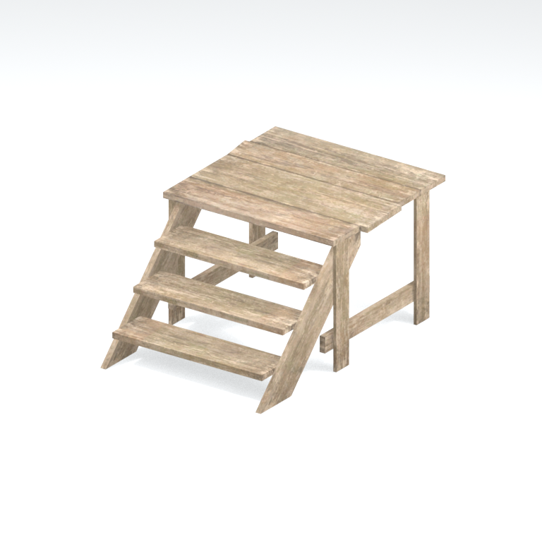
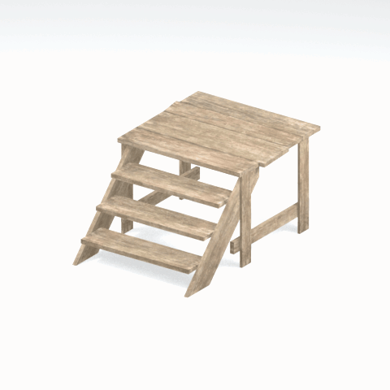

# Unidentified model (afgh_buld005_star002)

Native model reference; a readable object identification has not been reviewed.

[Library](../README.md) | [Category](../tables/unclassified-components-1.md) | [Source / advanced data](../catalogue.json) | [Credits](../sources-and-credits.md)

**Game filename:** afgh_buld005_star002.fmdl  
**Category:** Unclassified &gt; Unclassified components  
**Variant:** No explicit variant token; **LOD:** 0  
**Tags:** 

## Still reference



## 360-degree reference



The camera circles a static model. This is not a native animation. Source base textures and UVs use approximate studio shading; interaction, collision, complete assembly and FOX shader equivalence are not established.

## Identity and naming

| Field | Value |
|---|---|
| Library ID | mgsv-tpp-afgh_buld005_star002-a07ebb16125a2d4f |
| Naming status | unidentified |
| Naming confidence | unknown |
| Naming evidence | {} |
| Native model | /Assets/tpp/environ/object/afghanistan/building/afgh_buld005/scenes/afgh_buld005_star002.fmdl |
| Model SHA256 | 24859187c94293a2be3c01c1f407c7e88bb0c5e170ac6bb27d1829cf86ae0bf9 |
| Container | /Assets/mgo/pack/location/afn0/pack_common/afn0_common.fpk |
| Container SHA256 | 793152d916d15d32b16935c3069b2171c7229092e9d1d3f1dd464e87ea95f415 |
| Captured source / location scope | Selected native member/content and captured installed-source chain; full archive SHA/runtime priority unresolved |
| Raw record SHA256 | 7fc87cdafd45dc753d9ab7eb81027607e4b9b0bf2cac6807fcefe98925d4e53c |

Naming review is descriptive metadata only. It does not change model completion or identify a working game interaction.

## Native LOD inventory

| Native LOD | Triangles | Preview status | Decoded indices SHA256 |
|---|---:|---|---|
| 0 | 154 | rendered | eeb4b2dd072585ee7d6fea0df2f499b117727d498d5d27cb501e04472c5e6118 |
| 1 | 148 | not separately rendered | 06cecf7fc24ed4a370fe212704850e854a5a1ef1a5ff26df096c8841751dd62b |
| 2 | 144 | not separately rendered | d1e8e9ce0c8864834630c7d8134756ee19e4f8eeeb19a9e5c7b81990ef714452 |
| 3 | 142 | not separately rendered | 6076979d29112779fff193128e3fca7be0ff04e1c25f527bef503e0fb030764c |

Mesh detail and texture pixels/mips are separate. Index hashes describe decoded triangle arrays, not packed index-buffer bytes. Only source-recorded native levels are listed.

<details>
<summary>Texture, source and naming technical metadata</summary>

```json
{
  "source": {
    "nativePath": "/Assets/tpp/environ/object/afghanistan/building/afgh_buld005/scenes/afgh_buld005_star002.fmdl",
    "nativeSha256": "24859187c94293a2be3c01c1f407c7e88bb0c5e170ac6bb27d1829cf86ae0bf9",
    "stableIdentity": "/assets/tpp/environ/object/afghanistan/building/afgh_buld005/scenes/afgh_buld005_star002.fmdl#24859187c94293a2be3c01c1f407c7e88bb0c5e170ac6bb27d1829cf86ae0bf9#15f46e3626270b5eb3dc08f9d1732d761cb7f06b1544f84b84607d4dba75cc29",
    "container": {
      "nativePath": "/Assets/mgo/pack/location/afn0/pack_common/afn0_common.fpk",
      "sha256": "793152d916d15d32b16935c3069b2171c7229092e9d1d3f1dd464e87ea95f415",
      "status": "Selected installed-source container/member chain captured by community reader"
    },
    "historicalDatOrigin": null,
    "sourceArchiveAtCapture": "master/0/00.dat",
    "locationStatus": "Selected native member/content and captured installed-source chain; full archive SHA/runtime priority unresolved",
    "currentInstalledDatVerified": false,
    "selectedInstalledMemberVerified": true,
    "evidence": {
      "archive_helper_executable_sha256": "6f8e39a436af3b024bbd0504966ab3d5d9d0cb05d86689bf3e83d15e68df613f",
      "archive_helper_source_sha256": "f662d3b63e066a0afc77ffe22ea0e564222d14469648300dba2c4f8e9b43446b",
      "archive_index_recipe": "54acff767f08d76ad6056c5387328759bc883df507788f398de6c2c04fac12db",
      "archive_reader": "Atvaark GzsTool.Core 0.5.3",
      "archive_reader_core_sha256": "9da447ae3c375cce2e46744eeff6af50f1591062afdf479d1a0b49edb47daaa3",
      "archive_tool_and_dictionary_sha256": {
        "CityHash.dll": "def6c4506d461b65e4059b2936b2cbd5f852ba5d1d8a1a527f1c0e6dc7008c8f",
        "GzsTool.Core.dll": "9da447ae3c375cce2e46744eeff6af50f1591062afdf479d1a0b49edb47daaa3",
        "GzsTool.exe": "1a9c5b11e2355383ff485aee7e86abc026f5c1fad729daf8c0fd15ee0aae1c10",
        "Zlib.Portable.dll": "fe84781ba35ca9cc5ff5f73fd08d2a66c59e5257b4573f5fe59743f30bf78e42",
        "fpk_dictionary.txt": "b82f9a8d6c10a68ba9471eca9d815c21355a53b5e68753d8ad7db7fd01bf401d",
        "qar_dictionary.txt": "1558c248ed0a4bb827888261563fbb91a2df4f03999682f85d637ff70d9d5fb2"
      },
      "bytes": 11872,
      "container_chain": [
        {
          "content_sha256": null,
          "depth": 0,
          "id": "3f19555d27c2ebecdfbad26aadd88b9f62e9fb6092c04c712963ef73c67ccb42",
          "index_sha256": "9acd3675d6e1500e0e18430cba0fdc70a5718ad7d6b62f13905891a35d59f18a",
          "kind": "qar",
          "name": "master/0/00.dat",
          "parent_occurrence": null
        },
        {
          "content_sha256": "793152d916d15d32b16935c3069b2171c7229092e9d1d3f1dd464e87ea95f415",
          "depth": 1,
          "id": "cdd16b801ab3d8abcb0eff58c5ffda33e686dfce824b125f6dae66b5b2538516",
          "index_sha256": "b576db71a757f0e278c2d308819efc35b981eb97da938ab92207c1f37446927a",
          "kind": "fpk",
          "name": "/Assets/mgo/pack/location/afn0/pack_common/afn0_common.fpk",
          "parent_occurrence": "629fd67dc6977d93ec9e65215d23dc6a6ff93ef5e14be9b3ffb02ad030ecfdde"
        }
      ],
      "contentSha256": "24859187c94293a2be3c01c1f407c7e88bb0c5e170ac6bb27d1829cf86ae0bf9",
      "member": {
        "actual_size": 11872,
        "compressed_size": null,
        "content_sha256": "24859187c94293a2be3c01c1f407c7e88bb0c5e170ac6bb27d1829cf86ae0bf9",
        "declared_size": 11872,
        "extension": "fmdl",
        "hash_hex": null,
        "name": "/Assets/tpp/environ/object/afghanistan/building/afgh_buld005/scenes/afgh_buld005_star002.fmdl",
        "name_origin": "embedded",
        "offset": 6050384,
        "ordinal": 172,
        "path_hash": null,
        "resolved": 1
      },
      "occurrenceId": "9ce853e96b56e8165e787739435c48b8ac071f557d7fb901a11d828b66b68855",
      "occurrence_id": "9ce853e96b56e8165e787739435c48b8ac071f557d7fb901a11d828b66b68855",
      "primary_source_revision": "fc4a8196555638c6cf8aa1b7c8dc34ccd5c69cb5",
      "source_adapter": "community_core_selective_export",
      "source_id": "7f6bb743fb4c487f0e9522f9c7fac280c46cf6b1051e0fc75a93602c8eb451f0",
      "source_path": "master/0/00.dat",
      "source_snapshot": "{\"bytes\":768788480,\"device\":621747392682911458,\"file_id\":844424931596481,\"header_sha256\":\"ead50f0a9a37e4285323b9c6fa0ec75fe75e518c63147e63158eeb2892c6589e\",\"mtime_ns\":1791852224238580700}",
      "virtualPath": "/Assets/tpp/environ/object/afghanistan/building/afgh_buld005/scenes/afgh_buld005_star002.fmdl"
    }
  },
  "materials": [
    {
      "sampler": "Base_Tex_SRGB",
      "materialIndex": 0,
      "nativePathHash": "1542976711026054087",
      "nativeVirtualPath": null,
      "nativeBinding": {
        "familyId": "2584c233affca10b13d259e4ca52c0f516f5fe3867dfb8179cef88bb85ee829e",
        "height": 1024,
        "materialIndex": 0,
        "mipCount": 9,
        "nativeMipCountVerified": true,
        "nativePath": null,
        "nativePathHash": "1542976711026054087",
        "nativeTexture": {
          "additionalFtexsFileCount": 2,
          "depth": 1,
          "ftexsFileCount": 3,
          "height": 1024,
          "metadataBytes": 208,
          "mipCount": 9,
          "mips": [
            {
              "chunks": 32,
              "decodedBytes": 524288,
              "mip": 0,
              "offset": 0,
              "storedBytes": 379296,
              "streamNumber": 3
            },
            {
              "chunks": 8,
              "decodedBytes": 131072,
              "mip": 1,
              "offset": 0,
              "storedBytes": 100000,
              "streamNumber": 2
            },
            {
              "chunks": 2,
              "decodedBytes": 32768,
              "mip": 2,
              "offset": 9152,
              "storedBytes": 25696,
              "streamNumber": 1
            },
            {
              "chunks": 1,
              "decodedBytes": 8192,
              "mip": 3,
              "offset": 2488,
              "storedBytes": 6656,
              "streamNumber": 1
            },
            {
              "chunks": 1,
              "decodedBytes": 2048,
              "mip": 4,
              "offset": 736,
              "storedBytes": 1744,
              "streamNumber": 1
            },
            {
              "chunks": 1,
              "decodedBytes": 512,
              "mip": 5,
              "offset": 232,
              "storedBytes": 496,
              "streamNumber": 1
            },
            {
              "chunks": 1,
              "decodedBytes": 128,
              "mip": 6,
              "offset": 80,
              "storedBytes": 144,
              "streamNumber": 1
            },
            {
              "chunks": 1,
              "decodedBytes": 32,
              "mip": 7,
              "offset": 24,
              "storedBytes": 48,
              "streamNumber": 1
            },
            {
              "chunks": 1,
              "decodedBytes": 8,
              "mip": 8,
              "offset": 0,
              "storedBytes": 16,
              "streamNumber": 1
            }
          ],
          "nativeHeaderHash": "227f5dad76e673b0c67169dbe2ff17b6",
          "nrtFlag": 2,
          "pixelFormat": 2,
          "requiredStreamNumbers": [
            1,
            2,
            3
          ],
          "textureType": 16777219,
          "unknownFlags": 273,
          "width": 1024
        },
        "samplerName": "Base_Tex_SRGB",
        "samplerNameHash": "72475356961633",
        "sha256": "c056c2ec533b106e75d3ca450f6a7e9fa01bb389e2b79c9f3dab5dfc5e005502",
        "sourceOccurrences": [
          {
            "archive_helper_executable_sha256": "6f8e39a436af3b024bbd0504966ab3d5d9d0cb05d86689bf3e83d15e68df613f",
            "archive_helper_source_sha256": "f662d3b63e066a0afc77ffe22ea0e564222d14469648300dba2c4f8e9b43446b",
            "archive_index_recipe": "54acff767f08d76ad6056c5387328759bc883df507788f398de6c2c04fac12db",
            "archive_reader": "Atvaark GzsTool.Core 0.5.3",
            "archive_reader_core_sha256": "9da447ae3c375cce2e46744eeff6af50f1591062afdf479d1a0b49edb47daaa3",
            "archive_tool_and_dictionary_sha256": {
              "CityHash.dll": "def6c4506d461b65e4059b2936b2cbd5f852ba5d1d8a1a527f1c0e6dc7008c8f",
              "GzsTool.Core.dll": "9da447ae3c375cce2e46744eeff6af50f1591062afdf479d1a0b49edb47daaa3",
              "GzsTool.exe": "1a9c5b11e2355383ff485aee7e86abc026f5c1fad729daf8c0fd15ee0aae1c10",
              "Zlib.Portable.dll": "fe84781ba35ca9cc5ff5f73fd08d2a66c59e5257b4573f5fe59743f30bf78e42",
              "fpk_dictionary.txt": "b82f9a8d6c10a68ba9471eca9d815c21355a53b5e68753d8ad7db7fd01bf401d",
              "qar_dictionary.txt": "1558c248ed0a4bb827888261563fbb91a2df4f03999682f85d637ff70d9d5fb2"
            },
            "bytes": 208,
            "container_chain": [
              {
                "content_sha256": null,
                "depth": 0,
                "id": "0b473016351235050c2f6af21454bd979a0ad4602a9860137c807c894c5eba4d",
                "index_sha256": "ac9b4dae0dd0166db3a6ec8da18524dffebcbaf9004569af631de82913bf49a3",
                "kind": "qar",
                "name": "master/texture2.dat",
                "parent_occurrence": null
              }
            ],
            "contentSha256": "0f0c842d7b2e43e6c1c15344497d127dee1e65bab33240811136214c8f15e572",
            "member": {
              "actual_size": 208,
              "compressed_size": 208,
              "content_sha256": "0f0c842d7b2e43e6c1c15344497d127dee1e65bab33240811136214c8f15e572",
              "declared_size": 208,
              "extension": "ftex",
              "hash_hex": "1569c124c56893c7",
              "name": "/Assets/tpp/environ/object/afghanistan/building/afgh_buld005/sourceimages/afgh_buld005_bsm.ftex",
              "name_origin": "dictionary",
              "offset": 1424804896,
              "ordinal": 8140,
              "path_hash": "1c124c56893c7",
              "resolved": 1
            },
            "occurrenceId": "38afeb789cdbebfe2e8f44f22d8b97898616b0c879ef5f6260bf587a18f4a4ca",
            "occurrence_id": "38afeb789cdbebfe2e8f44f22d8b97898616b0c879ef5f6260bf587a18f4a4ca",
            "primary_source_revision": "fc4a8196555638c6cf8aa1b7c8dc34ccd5c69cb5",
            "source_adapter": "community_core_selective_export",
            "source_id": "85e8296057664cbc6ebaf6bd43d1c6d18528bbd8a6fae920bdf4d5eb69f6a93d",
            "source_path": "master/texture2.dat",
            "source_snapshot": "{\"bytes\":2920239104,\"device\":621747392682911458,\"file_id\":562949953639626,\"header_sha256\":\"72bfee707623afb5f3abd8382035d3d4258b4941ac583a56f5a447f47123dcab\",\"mtime_ns\":1791224675561235200}",
            "virtualPath": "/Assets/tpp/environ/object/afghanistan/building/afgh_buld005/sourceimages/afgh_buld005_bsm.ftex"
          },
          {
            "archive_helper_executable_sha256": "6f8e39a436af3b024bbd0504966ab3d5d9d0cb05d86689bf3e83d15e68df613f",
            "archive_helper_source_sha256": "f662d3b63e066a0afc77ffe22ea0e564222d14469648300dba2c4f8e9b43446b",
            "archive_index_recipe": "54acff767f08d76ad6056c5387328759bc883df507788f398de6c2c04fac12db",
            "archive_reader": "Atvaark GzsTool.Core 0.5.3",
            "archive_reader_core_sha256": "9da447ae3c375cce2e46744eeff6af50f1591062afdf479d1a0b49edb47daaa3",
            "archive_tool_and_dictionary_sha256": {
              "CityHash.dll": "def6c4506d461b65e4059b2936b2cbd5f852ba5d1d8a1a527f1c0e6dc7008c8f",
              "GzsTool.Core.dll": "9da447ae3c375cce2e46744eeff6af50f1591062afdf479d1a0b49edb47daaa3",
              "GzsTool.exe": "1a9c5b11e2355383ff485aee7e86abc026f5c1fad729daf8c0fd15ee0aae1c10",
              "Zlib.Portable.dll": "fe84781ba35ca9cc5ff5f73fd08d2a66c59e5257b4573f5fe59743f30bf78e42",
              "fpk_dictionary.txt": "b82f9a8d6c10a68ba9471eca9d815c21355a53b5e68753d8ad7db7fd01bf401d",
              "qar_dictionary.txt": "1558c248ed0a4bb827888261563fbb91a2df4f03999682f85d637ff70d9d5fb2"
            },
            "bytes": 34864,
            "container_chain": [
              {
                "content_sha256": null,
                "depth": 0,
                "id": "3f19555d27c2ebecdfbad26aadd88b9f62e9fb6092c04c712963ef73c67ccb42",
                "index_sha256": "9acd3675d6e1500e0e18430cba0fdc70a5718ad7d6b62f13905891a35d59f18a",
                "kind": "qar",
                "name": "master/0/00.dat",
                "parent_occurrence": null
              },
              {
                "content_sha256": "7784c61d48c2a829a8a3be8bea91819ed320466e84615e1196c12dc4390190ea",
                "depth": 1,
                "id": "a7374ee4090f72cbecb7df25f172141b83da2b51b8b38b375af7a4f0f577fc67",
                "index_sha256": "7f78072384a5e4f07d09223009a06931047d1b3d6ae36512b9bb7ef91d1fe958",
                "kind": "pftxs",
                "name": "/Assets/mgo/pack/location/afda/pack_common/afda_common.pftxs",
                "parent_occurrence": "e3bb44002c453c106548f7190291b4a4c22da16a7eebd82d6a8dac6ab3844ca7"
              }
            ],
            "contentSha256": "5dd600ee7f13fefb38d13ba012e8045e1b003205c8370c152bc647d440809bdf",
            "member": {
              "actual_size": 34864,
              "compressed_size": null,
              "content_sha256": "5dd600ee7f13fefb38d13ba012e8045e1b003205c8370c152bc647d440809bdf",
              "declared_size": 34864,
              "extension": "1.ftexs",
              "hash_hex": "b2c1c124c56893c7",
              "name": "b2c1c124c56893c7.1.ftexs",
              "name_origin": "hash_fallback",
              "offset": 6022624,
              "ordinal": 509,
              "path_hash": null,
              "resolved": 0
            },
            "occurrenceId": "0cc439395e449b16fa02c3abc14d670c3242d2f321e236bb27899227c87ad09c",
            "occurrence_id": "0cc439395e449b16fa02c3abc14d670c3242d2f321e236bb27899227c87ad09c",
            "primary_source_revision": "fc4a8196555638c6cf8aa1b7c8dc34ccd5c69cb5",
            "source_adapter": "community_core_selective_export",
            "source_id": "7f6bb743fb4c487f0e9522f9c7fac280c46cf6b1051e0fc75a93602c8eb451f0",
            "source_path": "master/0/00.dat",
            "source_snapshot": "{\"bytes\":768788480,\"device\":621747392682911458,\"file_id\":844424931596481,\"header_sha256\":\"ead50f0a9a37e4285323b9c6fa0ec75fe75e518c63147e63158eeb2892c6589e\",\"mtime_ns\":1791852224238580700}",
            "virtualPath": "b2c1c124c56893c7.1.ftexs"
          },
          {
            "archive_helper_executable_sha256": "6f8e39a436af3b024bbd0504966ab3d5d9d0cb05d86689bf3e83d15e68df613f",
            "archive_helper_source_sha256": "f662d3b63e066a0afc77ffe22ea0e564222d14469648300dba2c4f8e9b43446b",
            "archive_index_recipe": "54acff767f08d76ad6056c5387328759bc883df507788f398de6c2c04fac12db",
            "archive_reader": "Atvaark GzsTool.Core 0.5.3",
            "archive_reader_core_sha256": "9da447ae3c375cce2e46744eeff6af50f1591062afdf479d1a0b49edb47daaa3",
            "archive_tool_and_dictionary_sha256": {
              "CityHash.dll": "def6c4506d461b65e4059b2936b2cbd5f852ba5d1d8a1a527f1c0e6dc7008c8f",
              "GzsTool.Core.dll": "9da447ae3c375cce2e46744eeff6af50f1591062afdf479d1a0b49edb47daaa3",
              "GzsTool.exe": "1a9c5b11e2355383ff485aee7e86abc026f5c1fad729daf8c0fd15ee0aae1c10",
              "Zlib.Portable.dll": "fe84781ba35ca9cc5ff5f73fd08d2a66c59e5257b4573f5fe59743f30bf78e42",
              "fpk_dictionary.txt": "b82f9a8d6c10a68ba9471eca9d815c21355a53b5e68753d8ad7db7fd01bf401d",
              "qar_dictionary.txt": "1558c248ed0a4bb827888261563fbb91a2df4f03999682f85d637ff70d9d5fb2"
            },
            "bytes": 100064,
            "container_chain": [
              {
                "content_sha256": null,
                "depth": 0,
                "id": "e73d96973ade76f7a00afdbea486dd110896ace97da0791f56899647de46f210",
                "index_sha256": "5a818609a652a10d90fb90015661d0cb80898096bbb3aac36382172988d8736d",
                "kind": "qar",
                "name": "mgo/texture0.dat",
                "parent_occurrence": null
              }
            ],
            "contentSha256": "f08f32ec5608f224d3db6c8eaeaf2e350b81b9a0fb91ac202bb0d5fedee45313",
            "member": {
              "actual_size": 100064,
              "compressed_size": 100064,
              "content_sha256": "f08f32ec5608f224d3db6c8eaeaf2e350b81b9a0fb91ac202bb0d5fedee45313",
              "declared_size": 100064,
              "extension": "2.ftexs",
              "hash_hex": "b571c124c56893c7",
              "name": "/Assets/tpp/environ/object/afghanistan/building/afgh_buld005/sourceimages/afgh_buld005_bsm.2.ftexs",
              "name_origin": "dictionary",
              "offset": 3187391520,
              "ordinal": 12146,
              "path_hash": "1c124c56893c7",
              "resolved": 1
            },
            "occurrenceId": "0da4285fa3663fa3330a38277348a205a332ac5cba43e1ccbb4ba8a1f517540f",
            "occurrence_id": "0da4285fa3663fa3330a38277348a205a332ac5cba43e1ccbb4ba8a1f517540f",
            "primary_source_revision": "fc4a8196555638c6cf8aa1b7c8dc34ccd5c69cb5",
            "source_adapter": "community_core_selective_export",
            "source_id": "03f5942f0e1af8040ae05b95c43716d75f5933971d78324bf7cfea291297f3f4",
            "source_path": "mgo/texture0.dat",
            "source_snapshot": "{\"bytes\":4492370944,\"device\":621747392682911458,\"file_id\":562949953639631,\"header_sha256\":\"6108fbacb65c84d041742c39e5ca630745240453b336f1059a13b91943f0b011\",\"mtime_ns\":1791224675562234400}",
            "virtualPath": "/Assets/tpp/environ/object/afghanistan/building/afgh_buld005/sourceimages/afgh_buld005_bsm.2.ftexs"
          },
          {
            "archive_helper_executable_sha256": "6f8e39a436af3b024bbd0504966ab3d5d9d0cb05d86689bf3e83d15e68df613f",
            "archive_helper_source_sha256": "f662d3b63e066a0afc77ffe22ea0e564222d14469648300dba2c4f8e9b43446b",
            "archive_index_recipe": "54acff767f08d76ad6056c5387328759bc883df507788f398de6c2c04fac12db",
            "archive_reader": "Atvaark GzsTool.Core 0.5.3",
            "archive_reader_core_sha256": "9da447ae3c375cce2e46744eeff6af50f1591062afdf479d1a0b49edb47daaa3",
            "archive_tool_and_dictionary_sha256": {
              "CityHash.dll": "def6c4506d461b65e4059b2936b2cbd5f852ba5d1d8a1a527f1c0e6dc7008c8f",
              "GzsTool.Core.dll": "9da447ae3c375cce2e46744eeff6af50f1591062afdf479d1a0b49edb47daaa3",
              "GzsTool.exe": "1a9c5b11e2355383ff485aee7e86abc026f5c1fad729daf8c0fd15ee0aae1c10",
              "Zlib.Portable.dll": "fe84781ba35ca9cc5ff5f73fd08d2a66c59e5257b4573f5fe59743f30bf78e42",
              "fpk_dictionary.txt": "b82f9a8d6c10a68ba9471eca9d815c21355a53b5e68753d8ad7db7fd01bf401d",
              "qar_dictionary.txt": "1558c248ed0a4bb827888261563fbb91a2df4f03999682f85d637ff70d9d5fb2"
            },
            "bytes": 379552,
            "container_chain": [
              {
                "content_sha256": null,
                "depth": 0,
                "id": "e73d96973ade76f7a00afdbea486dd110896ace97da0791f56899647de46f210",
                "index_sha256": "5a818609a652a10d90fb90015661d0cb80898096bbb3aac36382172988d8736d",
                "kind": "qar",
                "name": "mgo/texture0.dat",
                "parent_occurrence": null
              }
            ],
            "contentSha256": "3f42f33d69d95b8d332a309e25258116c6979bcddc884c5bb3c53c4c8197e429",
            "member": {
              "actual_size": 379552,
              "compressed_size": 379552,
              "content_sha256": "3f42f33d69d95b8d332a309e25258116c6979bcddc884c5bb3c53c4c8197e429",
              "declared_size": 379552,
              "extension": "3.ftexs",
              "hash_hex": "5719c124c56893c7",
              "name": "/Assets/tpp/environ/object/afghanistan/building/afgh_buld005/sourceimages/afgh_buld005_bsm.3.ftexs",
              "name_origin": "dictionary",
              "offset": 3187491872,
              "ordinal": 12147,
              "path_hash": "1c124c56893c7",
              "resolved": 1
            },
            "occurrenceId": "350f0f91d48be348f8a2f1d3bbd0e3b641e6e9827551796996994dc4e4c9fce0",
            "occurrence_id": "350f0f91d48be348f8a2f1d3bbd0e3b641e6e9827551796996994dc4e4c9fce0",
            "primary_source_revision": "fc4a8196555638c6cf8aa1b7c8dc34ccd5c69cb5",
            "source_adapter": "community_core_selective_export",
            "source_id": "03f5942f0e1af8040ae05b95c43716d75f5933971d78324bf7cfea291297f3f4",
            "source_path": "mgo/texture0.dat",
            "source_snapshot": "{\"bytes\":4492370944,\"device\":621747392682911458,\"file_id\":562949953639631,\"header_sha256\":\"6108fbacb65c84d041742c39e5ca630745240453b336f1059a13b91943f0b011\",\"mtime_ns\":1791224675562234400}",
            "virtualPath": "/Assets/tpp/environ/object/afghanistan/building/afgh_buld005/sourceimages/afgh_buld005_bsm.3.ftexs"
          }
        ],
        "width": 1024
      },
      "ddsSha256": "c056c2ec533b106e75d3ca450f6a7e9fa01bb389e2b79c9f3dab5dfc5e005502",
      "dimensions": [
        1024,
        1024
      ],
      "mipCount": 9,
      "nativeMipCountVerified": true,
      "connectedInPreview": true
    }
  ],
  "quality": {
    "decodedIndicesHashDerivation": "SHA256 of canonical UTF-8 JSON decoded triangle indices grouped by mesh; not packed buffer bytes",
    "highestRetainedGeometricLod": 0,
    "distinctNativeLods": 4,
    "baseTextureDimensions": [
      1024,
      1024
    ],
    "baseTextureNativeMipCount": 9,
    "largerRetainedBaseTextureFound": null,
    "nativeLods": [
      {
        "indicesSha256": "eeb4b2dd072585ee7d6fea0df2f499b117727d498d5d27cb501e04472c5e6118",
        "nativeLod": 0,
        "triangles": 154
      },
      {
        "indicesSha256": "06cecf7fc24ed4a370fe212704850e854a5a1ef1a5ff26df096c8841751dd62b",
        "nativeLod": 1,
        "triangles": 148
      },
      {
        "indicesSha256": "d1e8e9ce0c8864834630c7d8134756ee19e4f8eeeb19a9e5c7b81990ef714452",
        "nativeLod": 2,
        "triangles": 144
      },
      {
        "indicesSha256": "6076979d29112779fff193128e3fca7be0ff04e1c25f527bef503e0fb030764c",
        "nativeLod": 3,
        "triangles": 142
      }
    ],
    "renderedNativeLods": [
      0
    ],
    "baseTextureSummary": "1024 x 1024; 9 native/DDS mips",
    "highestDetailScope": "Triangle-count comparison within captured FMDL only"
  }
}
```

</details>

[Original source / advanced record](../catalogue.json)
