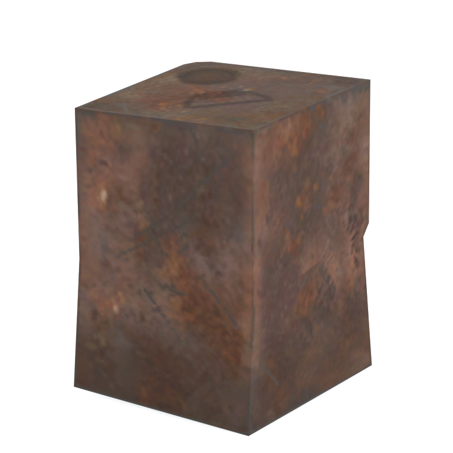

# Unidentified model (afgh_cann004)

Native model reference; a readable object identification has not been reviewed.

[Library](../README.md) | [Category](../tables/unclassified-components-1.md) | [Source / advanced data](../catalogue.json) | [Credits](../sources-and-credits.md)

**Game filename:** afgh_cann004.fmdl  
**Category:** Unclassified &gt; Unclassified components  
**Variant:** No explicit variant token; **LOD:** 0  
**Tags:** 

## Still reference



## 360-degree reference


The camera circles a static model. This is not a native animation. Source base textures and UVs use approximate studio shading; interaction, collision, complete assembly and FOX shader equivalence are not established.

## Identity and naming

| Field | Value |
|---|---|
| Library ID | mgsv-tpp-afgh_cann004-d44c1c0604c4c0b7 |
| Naming status | unidentified |
| Naming confidence | unknown |
| Naming evidence | {} |
| Native model | /Assets/tpp/environ/object/afghanistan/can/afgh_cann004/scenes/afgh_cann004.fmdl |
| Model SHA256 | 48ac55b6ac3f446f68b3c0526c9213bf353ffd72a0e4fd006499d76bd6bea997 |
| Container | /Assets/tpp/pack/location/afgh/pack_common/afgh_common.fpk |
| Container SHA256 | 810fe68a28c81299da7ef00849d2905b640d0a2da970f1b312e953a2c7b5df48 |
| Captured source / location scope | Selected native member/content and captured installed-source chain; full archive SHA/runtime priority unresolved |
| Raw record SHA256 | 230bd2e76f1d43c1aaf8ac0f4825eccaa29b4334e62106dcb2cb88c0b5316fc1 |

Naming review is descriptive metadata only. It does not change model completion or identify a working game interaction.

## Native LOD inventory

| Native LOD | Triangles | Preview status | Decoded indices SHA256 |
|---|---:|---|---|
| 0 | 32 | rendered | d3ef6f42a0531c28a7d68337e9550b29d3cafe5eaed0a93304faf2cfa613a1b4 |
| 1 | 20 | not separately rendered | 32a96569b5f341a8ad4ac55f96e842605b4820df192493a53999c727b8704c9d |
| 2 | 14 | not separately rendered | ed9acccb75b0ecc5bfb5b2036d0c9d863438929989ed420ba32f35ac48682371 |
| 3 | 10 | not separately rendered | 3a38ea6c719c94610b7ff509a558427a569d90ecc26516bb76586fc6eb489dcc |

Mesh detail and texture pixels/mips are separate. Index hashes describe decoded triangle arrays, not packed index-buffer bytes. Only source-recorded native levels are listed.

<details>
<summary>Texture, source and naming technical metadata</summary>

```json
{
  "source": {
    "nativePath": "/Assets/tpp/environ/object/afghanistan/can/afgh_cann004/scenes/afgh_cann004.fmdl",
    "nativeSha256": "48ac55b6ac3f446f68b3c0526c9213bf353ffd72a0e4fd006499d76bd6bea997",
    "stableIdentity": "/assets/tpp/environ/object/afghanistan/can/afgh_cann004/scenes/afgh_cann004.fmdl#48ac55b6ac3f446f68b3c0526c9213bf353ffd72a0e4fd006499d76bd6bea997#0d17283a60e8b721db0523cdb185bd211d369bb34f8157ef1c7352366e53e5aa",
    "container": {
      "nativePath": "/Assets/tpp/pack/location/afgh/pack_common/afgh_common.fpk",
      "sha256": "810fe68a28c81299da7ef00849d2905b640d0a2da970f1b312e953a2c7b5df48",
      "status": "Selected installed-source container/member chain captured by community reader"
    },
    "historicalDatOrigin": null,
    "sourceArchiveAtCapture": "master/0/00.dat",
    "locationStatus": "Selected native member/content and captured installed-source chain; full archive SHA/runtime priority unresolved",
    "currentInstalledDatVerified": false,
    "selectedInstalledMemberVerified": true,
    "evidence": {
      "archive_helper_executable_sha256": "6f8e39a436af3b024bbd0504966ab3d5d9d0cb05d86689bf3e83d15e68df613f",
      "archive_helper_source_sha256": "f662d3b63e066a0afc77ffe22ea0e564222d14469648300dba2c4f8e9b43446b",
      "archive_index_recipe": "54acff767f08d76ad6056c5387328759bc883df507788f398de6c2c04fac12db",
      "archive_reader": "Atvaark GzsTool.Core 0.5.3",
      "archive_reader_core_sha256": "9da447ae3c375cce2e46744eeff6af50f1591062afdf479d1a0b49edb47daaa3",
      "archive_tool_and_dictionary_sha256": {
        "CityHash.dll": "def6c4506d461b65e4059b2936b2cbd5f852ba5d1d8a1a527f1c0e6dc7008c8f",
        "GzsTool.Core.dll": "9da447ae3c375cce2e46744eeff6af50f1591062afdf479d1a0b49edb47daaa3",
        "GzsTool.exe": "1a9c5b11e2355383ff485aee7e86abc026f5c1fad729daf8c0fd15ee0aae1c10",
        "Zlib.Portable.dll": "fe84781ba35ca9cc5ff5f73fd08d2a66c59e5257b4573f5fe59743f30bf78e42",
        "fpk_dictionary.txt": "b82f9a8d6c10a68ba9471eca9d815c21355a53b5e68753d8ad7db7fd01bf401d",
        "qar_dictionary.txt": "1558c248ed0a4bb827888261563fbb91a2df4f03999682f85d637ff70d9d5fb2"
      },
      "bytes": 2416,
      "container_chain": [
        {
          "content_sha256": null,
          "depth": 0,
          "id": "3f19555d27c2ebecdfbad26aadd88b9f62e9fb6092c04c712963ef73c67ccb42",
          "index_sha256": "9acd3675d6e1500e0e18430cba0fdc70a5718ad7d6b62f13905891a35d59f18a",
          "kind": "qar",
          "name": "master/0/00.dat",
          "parent_occurrence": null
        },
        {
          "content_sha256": "810fe68a28c81299da7ef00849d2905b640d0a2da970f1b312e953a2c7b5df48",
          "depth": 1,
          "id": "19e9adf189f5f5e9c624197357336d49999dc3525b83bd8c71cf525fcd2100e2",
          "index_sha256": "924ec10c5736f8b618238e2523664271e558a6ad49aefdaf2473ccbad50f1231",
          "kind": "fpk",
          "name": "/Assets/tpp/pack/location/afgh/pack_common/afgh_common.fpk",
          "parent_occurrence": "e35acf6999427a88778266baae8c014a0c20a82388f8ff04caca6a88d977a6d1"
        }
      ],
      "contentSha256": "48ac55b6ac3f446f68b3c0526c9213bf353ffd72a0e4fd006499d76bd6bea997",
      "member": {
        "actual_size": 2416,
        "compressed_size": null,
        "content_sha256": "48ac55b6ac3f446f68b3c0526c9213bf353ffd72a0e4fd006499d76bd6bea997",
        "declared_size": 2416,
        "extension": "fmdl",
        "hash_hex": null,
        "name": "/Assets/tpp/environ/object/afghanistan/can/afgh_cann004/scenes/afgh_cann004.fmdl",
        "name_origin": "embedded",
        "offset": 2338752,
        "ordinal": 34,
        "path_hash": null,
        "resolved": 1
      },
      "occurrenceId": "1d3f68df91208e016f5fdd8803fd9deb0639f82df1b5749cd1de0a7b1d0d2a78",
      "occurrence_id": "1d3f68df91208e016f5fdd8803fd9deb0639f82df1b5749cd1de0a7b1d0d2a78",
      "primary_source_revision": "fc4a8196555638c6cf8aa1b7c8dc34ccd5c69cb5",
      "source_adapter": "community_core_selective_export",
      "source_id": "7f6bb743fb4c487f0e9522f9c7fac280c46cf6b1051e0fc75a93602c8eb451f0",
      "source_path": "master/0/00.dat",
      "source_snapshot": "{\"bytes\":768788480,\"device\":621747392682911458,\"file_id\":844424931596481,\"header_sha256\":\"ead50f0a9a37e4285323b9c6fa0ec75fe75e518c63147e63158eeb2892c6589e\",\"mtime_ns\":1791852224238580700}",
      "virtualPath": "/Assets/tpp/environ/object/afghanistan/can/afgh_cann004/scenes/afgh_cann004.fmdl"
    }
  },
  "materials": [
    {
      "sampler": "Base_Tex_SRGB",
      "materialIndex": 0,
      "nativePathHash": "1542704782787792606",
      "nativeVirtualPath": null,
      "nativeBinding": {
        "familyId": "f69a04315f11453f9b3201bca457f4c61db5e529b270c61493b049a74984ce58",
        "height": 256,
        "materialIndex": 0,
        "mipCount": 7,
        "nativeMipCountVerified": true,
        "nativePath": null,
        "nativePathHash": "1542704782787792606",
        "nativeTexture": {
          "additionalFtexsFileCount": 1,
          "depth": 1,
          "ftexsFileCount": 2,
          "height": 256,
          "metadataBytes": 176,
          "mipCount": 7,
          "mips": [
            {
              "chunks": 2,
              "decodedBytes": 32768,
              "mip": 0,
              "offset": 0,
              "storedBytes": 25952,
              "streamNumber": 2
            },
            {
              "chunks": 1,
              "decodedBytes": 8192,
              "mip": 1,
              "offset": 2648,
              "storedBytes": 6992,
              "streamNumber": 1
            },
            {
              "chunks": 1,
              "decodedBytes": 2048,
              "mip": 2,
              "offset": 768,
              "storedBytes": 1872,
              "streamNumber": 1
            },
            {
              "chunks": 1,
              "decodedBytes": 512,
              "mip": 3,
              "offset": 232,
              "storedBytes": 528,
              "streamNumber": 1
            },
            {
              "chunks": 1,
              "decodedBytes": 128,
              "mip": 4,
              "offset": 80,
              "storedBytes": 144,
              "streamNumber": 1
            },
            {
              "chunks": 1,
              "decodedBytes": 32,
              "mip": 5,
              "offset": 24,
              "storedBytes": 48,
              "streamNumber": 1
            },
            {
              "chunks": 1,
              "decodedBytes": 8,
              "mip": 6,
              "offset": 0,
              "storedBytes": 16,
              "streamNumber": 1
            }
          ],
          "nativeHeaderHash": "a3cfed9b40acd580a5f7a1f1752731d5",
          "nrtFlag": 2,
          "pixelFormat": 2,
          "requiredStreamNumbers": [
            1,
            2
          ],
          "textureType": 16777219,
          "unknownFlags": 273,
          "width": 256
        },
        "samplerName": "Base_Tex_SRGB",
        "samplerNameHash": "72475356961633",
        "sha256": "3b3c5b60520281f3469651a38c0c91a7e8959c9638b5d6aa8b2e79c0766002e3",
        "sourceOccurrences": [
          {
            "archive_helper_executable_sha256": "6f8e39a436af3b024bbd0504966ab3d5d9d0cb05d86689bf3e83d15e68df613f",
            "archive_helper_source_sha256": "f662d3b63e066a0afc77ffe22ea0e564222d14469648300dba2c4f8e9b43446b",
            "archive_index_recipe": "54acff767f08d76ad6056c5387328759bc883df507788f398de6c2c04fac12db",
            "archive_reader": "Atvaark GzsTool.Core 0.5.3",
            "archive_reader_core_sha256": "9da447ae3c375cce2e46744eeff6af50f1591062afdf479d1a0b49edb47daaa3",
            "archive_tool_and_dictionary_sha256": {
              "CityHash.dll": "def6c4506d461b65e4059b2936b2cbd5f852ba5d1d8a1a527f1c0e6dc7008c8f",
              "GzsTool.Core.dll": "9da447ae3c375cce2e46744eeff6af50f1591062afdf479d1a0b49edb47daaa3",
              "GzsTool.exe": "1a9c5b11e2355383ff485aee7e86abc026f5c1fad729daf8c0fd15ee0aae1c10",
              "Zlib.Portable.dll": "fe84781ba35ca9cc5ff5f73fd08d2a66c59e5257b4573f5fe59743f30bf78e42",
              "fpk_dictionary.txt": "b82f9a8d6c10a68ba9471eca9d815c21355a53b5e68753d8ad7db7fd01bf401d",
              "qar_dictionary.txt": "1558c248ed0a4bb827888261563fbb91a2df4f03999682f85d637ff70d9d5fb2"
            },
            "bytes": 176,
            "container_chain": [
              {
                "content_sha256": null,
                "depth": 0,
                "id": "0b473016351235050c2f6af21454bd979a0ad4602a9860137c807c894c5eba4d",
                "index_sha256": "ac9b4dae0dd0166db3a6ec8da18524dffebcbaf9004569af631de82913bf49a3",
                "kind": "qar",
                "name": "master/texture2.dat",
                "parent_occurrence": null
              }
            ],
            "contentSha256": "4f3dc50805102b3fd5215d85b466c72991111b8edc99e2bc94b7b4986c10e39c",
            "member": {
              "actual_size": 176,
              "compressed_size": 176,
              "content_sha256": "4f3dc50805102b3fd5215d85b466c72991111b8edc99e2bc94b7b4986c10e39c",
              "declared_size": 176,
              "extension": "ftex",
              "hash_hex": "1568c9d38b5ccede",
              "name": "c9d38b5ccede.ftex",
              "name_origin": "hash_fallback",
              "offset": 1471531040,
              "ordinal": 8522,
              "path_hash": "c9d38b5ccede",
              "resolved": 0
            },
            "occurrenceId": "0c109c78233a5291183a43ec8b7a00f12a57ad5fb863a6ca00db3abb7585ba09",
            "occurrence_id": "0c109c78233a5291183a43ec8b7a00f12a57ad5fb863a6ca00db3abb7585ba09",
            "primary_source_revision": "fc4a8196555638c6cf8aa1b7c8dc34ccd5c69cb5",
            "source_adapter": "community_core_selective_export",
            "source_id": "85e8296057664cbc6ebaf6bd43d1c6d18528bbd8a6fae920bdf4d5eb69f6a93d",
            "source_path": "master/texture2.dat",
            "source_snapshot": "{\"bytes\":2920239104,\"device\":621747392682911458,\"file_id\":562949953639626,\"header_sha256\":\"72bfee707623afb5f3abd8382035d3d4258b4941ac583a56f5a447f47123dcab\",\"mtime_ns\":1791224675561235200}",
            "virtualPath": "c9d38b5ccede.ftex"
          },
          {
            "archive_helper_executable_sha256": "6f8e39a436af3b024bbd0504966ab3d5d9d0cb05d86689bf3e83d15e68df613f",
            "archive_helper_source_sha256": "f662d3b63e066a0afc77ffe22ea0e564222d14469648300dba2c4f8e9b43446b",
            "archive_index_recipe": "54acff767f08d76ad6056c5387328759bc883df507788f398de6c2c04fac12db",
            "archive_reader": "Atvaark GzsTool.Core 0.5.3",
            "archive_reader_core_sha256": "9da447ae3c375cce2e46744eeff6af50f1591062afdf479d1a0b49edb47daaa3",
            "archive_tool_and_dictionary_sha256": {
              "CityHash.dll": "def6c4506d461b65e4059b2936b2cbd5f852ba5d1d8a1a527f1c0e6dc7008c8f",
              "GzsTool.Core.dll": "9da447ae3c375cce2e46744eeff6af50f1591062afdf479d1a0b49edb47daaa3",
              "GzsTool.exe": "1a9c5b11e2355383ff485aee7e86abc026f5c1fad729daf8c0fd15ee0aae1c10",
              "Zlib.Portable.dll": "fe84781ba35ca9cc5ff5f73fd08d2a66c59e5257b4573f5fe59743f30bf78e42",
              "fpk_dictionary.txt": "b82f9a8d6c10a68ba9471eca9d815c21355a53b5e68753d8ad7db7fd01bf401d",
              "qar_dictionary.txt": "1558c248ed0a4bb827888261563fbb91a2df4f03999682f85d637ff70d9d5fb2"
            },
            "bytes": 9648,
            "container_chain": [
              {
                "content_sha256": null,
                "depth": 0,
                "id": "0b473016351235050c2f6af21454bd979a0ad4602a9860137c807c894c5eba4d",
                "index_sha256": "ac9b4dae0dd0166db3a6ec8da18524dffebcbaf9004569af631de82913bf49a3",
                "kind": "qar",
                "name": "master/texture2.dat",
                "parent_occurrence": null
              }
            ],
            "contentSha256": "3a470d6bde3413b1985d488af2885332c4a299675e3ddf6c8ea4661068171716",
            "member": {
              "actual_size": 9648,
              "compressed_size": 9648,
              "content_sha256": "3a470d6bde3413b1985d488af2885332c4a299675e3ddf6c8ea4661068171716",
              "declared_size": 9648,
              "extension": "1.ftexs",
              "hash_hex": "b2c0c9d38b5ccede",
              "name": "c9d38b5ccede.1.ftexs",
              "name_origin": "hash_fallback",
              "offset": 1471494176,
              "ordinal": 8520,
              "path_hash": "c9d38b5ccede",
              "resolved": 0
            },
            "occurrenceId": "7f0c5390a3969cd9aa4c8c1355b27ada25aa2ffdc5f3b93cdb449a97083b18d6",
            "occurrence_id": "7f0c5390a3969cd9aa4c8c1355b27ada25aa2ffdc5f3b93cdb449a97083b18d6",
            "primary_source_revision": "fc4a8196555638c6cf8aa1b7c8dc34ccd5c69cb5",
            "source_adapter": "community_core_selective_export",
            "source_id": "85e8296057664cbc6ebaf6bd43d1c6d18528bbd8a6fae920bdf4d5eb69f6a93d",
            "source_path": "master/texture2.dat",
            "source_snapshot": "{\"bytes\":2920239104,\"device\":621747392682911458,\"file_id\":562949953639626,\"header_sha256\":\"72bfee707623afb5f3abd8382035d3d4258b4941ac583a56f5a447f47123dcab\",\"mtime_ns\":1791224675561235200}",
            "virtualPath": "c9d38b5ccede.1.ftexs"
          },
          {
            "archive_helper_executable_sha256": "6f8e39a436af3b024bbd0504966ab3d5d9d0cb05d86689bf3e83d15e68df613f",
            "archive_helper_source_sha256": "f662d3b63e066a0afc77ffe22ea0e564222d14469648300dba2c4f8e9b43446b",
            "archive_index_recipe": "54acff767f08d76ad6056c5387328759bc883df507788f398de6c2c04fac12db",
            "archive_reader": "Atvaark GzsTool.Core 0.5.3",
            "archive_reader_core_sha256": "9da447ae3c375cce2e46744eeff6af50f1591062afdf479d1a0b49edb47daaa3",
            "archive_tool_and_dictionary_sha256": {
              "CityHash.dll": "def6c4506d461b65e4059b2936b2cbd5f852ba5d1d8a1a527f1c0e6dc7008c8f",
              "GzsTool.Core.dll": "9da447ae3c375cce2e46744eeff6af50f1591062afdf479d1a0b49edb47daaa3",
              "GzsTool.exe": "1a9c5b11e2355383ff485aee7e86abc026f5c1fad729daf8c0fd15ee0aae1c10",
              "Zlib.Portable.dll": "fe84781ba35ca9cc5ff5f73fd08d2a66c59e5257b4573f5fe59743f30bf78e42",
              "fpk_dictionary.txt": "b82f9a8d6c10a68ba9471eca9d815c21355a53b5e68753d8ad7db7fd01bf401d",
              "qar_dictionary.txt": "1558c248ed0a4bb827888261563fbb91a2df4f03999682f85d637ff70d9d5fb2"
            },
            "bytes": 25968,
            "container_chain": [
              {
                "content_sha256": null,
                "depth": 0,
                "id": "0b473016351235050c2f6af21454bd979a0ad4602a9860137c807c894c5eba4d",
                "index_sha256": "ac9b4dae0dd0166db3a6ec8da18524dffebcbaf9004569af631de82913bf49a3",
                "kind": "qar",
                "name": "master/texture2.dat",
                "parent_occurrence": null
              }
            ],
            "contentSha256": "33de039de8c0b70e63cfbf178f83b0607141af61ed6350cfdad205a57852e246",
            "member": {
              "actual_size": 25968,
              "compressed_size": 25968,
              "content_sha256": "33de039de8c0b70e63cfbf178f83b0607141af61ed6350cfdad205a57852e246",
              "declared_size": 25968,
              "extension": "2.ftexs",
              "hash_hex": "b570c9d38b5ccede",
              "name": "c9d38b5ccede.2.ftexs",
              "name_origin": "hash_fallback",
              "offset": 1471504416,
              "ordinal": 8521,
              "path_hash": "c9d38b5ccede",
              "resolved": 0
            },
            "occurrenceId": "a4f058179df334b70944c338b069ad72987ce5096beaeea245600e3ae202926b",
            "occurrence_id": "a4f058179df334b70944c338b069ad72987ce5096beaeea245600e3ae202926b",
            "primary_source_revision": "fc4a8196555638c6cf8aa1b7c8dc34ccd5c69cb5",
            "source_adapter": "community_core_selective_export",
            "source_id": "85e8296057664cbc6ebaf6bd43d1c6d18528bbd8a6fae920bdf4d5eb69f6a93d",
            "source_path": "master/texture2.dat",
            "source_snapshot": "{\"bytes\":2920239104,\"device\":621747392682911458,\"file_id\":562949953639626,\"header_sha256\":\"72bfee707623afb5f3abd8382035d3d4258b4941ac583a56f5a447f47123dcab\",\"mtime_ns\":1791224675561235200}",
            "virtualPath": "c9d38b5ccede.2.ftexs"
          }
        ],
        "width": 256
      },
      "ddsSha256": "3b3c5b60520281f3469651a38c0c91a7e8959c9638b5d6aa8b2e79c0766002e3",
      "dimensions": [
        256,
        256
      ],
      "mipCount": 7,
      "nativeMipCountVerified": true,
      "connectedInPreview": true
    }
  ],
  "quality": {
    "decodedIndicesHashDerivation": "SHA256 of canonical UTF-8 JSON decoded triangle indices grouped by mesh; not packed buffer bytes",
    "highestRetainedGeometricLod": 0,
    "distinctNativeLods": 4,
    "baseTextureDimensions": [
      256,
      256
    ],
    "baseTextureNativeMipCount": 7,
    "largerRetainedBaseTextureFound": null,
    "nativeLods": [
      {
        "indicesSha256": "d3ef6f42a0531c28a7d68337e9550b29d3cafe5eaed0a93304faf2cfa613a1b4",
        "nativeLod": 0,
        "triangles": 32
      },
      {
        "indicesSha256": "32a96569b5f341a8ad4ac55f96e842605b4820df192493a53999c727b8704c9d",
        "nativeLod": 1,
        "triangles": 20
      },
      {
        "indicesSha256": "ed9acccb75b0ecc5bfb5b2036d0c9d863438929989ed420ba32f35ac48682371",
        "nativeLod": 2,
        "triangles": 14
      },
      {
        "indicesSha256": "3a38ea6c719c94610b7ff509a558427a569d90ecc26516bb76586fc6eb489dcc",
        "nativeLod": 3,
        "triangles": 10
      }
    ],
    "renderedNativeLods": [
      0
    ],
    "baseTextureSummary": "256 x 256; 7 native/DDS mips",
    "highestDetailScope": "Triangle-count comparison within captured FMDL only"
  }
}
```

</details>

[Original source / advanced record](../catalogue.json)
