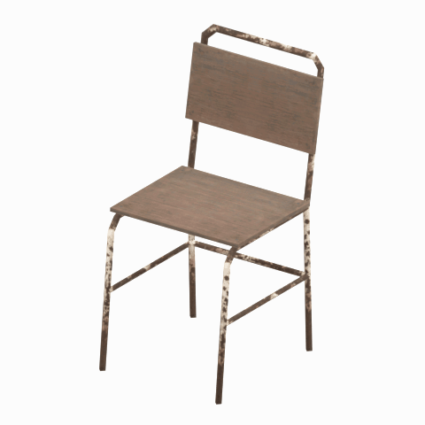

# Chair component

A native chair model component. Its specific form and assembly have not been visually reviewed.

[Library](../README.md) | [Category](../tables/seating-1.md) | [Source / advanced data](../catalogue.json) | [Credits](../sources-and-credits.md)

**Game filename:** afgh_char002.fmdl  
**Category:** Furniture &gt; Seating  
**Variant:** No explicit variant token; **LOD:** 0  
**Tags:** seating, component

## Still reference


## 360-degree reference



The camera circles a static model. This is not a native animation. Source base textures and UVs use approximate studio shading; interaction, collision, complete assembly and FOX shader equivalence are not established.

## Identity and naming

| Field | Value |
|---|---|
| Library ID | mgsv-tpp-afgh_char002-963284acd943ba8d |
| Naming status | path-derived |
| Naming confidence | medium |
| Naming evidence | {"kind": "native-folder", "note": "Conservative folder dictionary; not visual identification, color, function or completeness proof", "source": "chair"} |
| Native model | /Assets/tpp/environ/object/afghanistan/chair/afgh_char002/scenes/afgh_char002.fmdl |
| Model SHA256 | 1333cb635b3bc99aa55a13d71c141fb80aee8ca928f1b3f4dfd448ad46a54e44 |
| Container | /Assets/mgo/pack/location/afc0/pack_common/afc0_common.fpk |
| Container SHA256 | 20a950cab0d6912ac3a270b90dc6dc673f2d13859eb636819bfa3955fca6e320 |
| Captured source / location scope | Selected native member/content and captured installed-source chain; full archive SHA/runtime priority unresolved |
| Raw record SHA256 | 69c649def5516a7d6c4efcc0bc399af400494d5e25379ae2fc7b4103c774ea57 |

Naming review is descriptive metadata only. It does not change model completion or identify a working game interaction.

## Native LOD inventory

| Native LOD | Triangles | Preview status | Decoded indices SHA256 |
|---|---:|---|---|
| 0 | 184 | rendered | 4a87d6929235eed00ddbd025adcb23a87b6ba10465eeced044263e77711d481a |
| 1 | 163 | not separately rendered | 671464e230c3e183eff4dc731dc003ecc1dcf9bedee5145241c37cba93c87e3a |
| 2 | 144 | not separately rendered | 20e2cf17f4860bc32398d8c69e112a09c69827f1491c0546d45bc57f1ae45c35 |
| 3 | 133 | not separately rendered | af21538cbd53271bf905363589561e738717afce12646e141aeb00085eadb130 |

Mesh detail and texture pixels/mips are separate. Index hashes describe decoded triangle arrays, not packed index-buffer bytes. Only source-recorded native levels are listed.

<details>
<summary>Texture, source and naming technical metadata</summary>

```json
{
  "source": {
    "nativePath": "/Assets/tpp/environ/object/afghanistan/chair/afgh_char002/scenes/afgh_char002.fmdl",
    "nativeSha256": "1333cb635b3bc99aa55a13d71c141fb80aee8ca928f1b3f4dfd448ad46a54e44",
    "stableIdentity": "/assets/tpp/environ/object/afghanistan/chair/afgh_char002/scenes/afgh_char002.fmdl#1333cb635b3bc99aa55a13d71c141fb80aee8ca928f1b3f4dfd448ad46a54e44#a5b6a8bb0c152ace219f0bc4e1a64579809b4821b7c8f8cd388d4e5ab871d29a",
    "container": {
      "nativePath": "/Assets/mgo/pack/location/afc0/pack_common/afc0_common.fpk",
      "sha256": "20a950cab0d6912ac3a270b90dc6dc673f2d13859eb636819bfa3955fca6e320",
      "status": "Selected installed-source container/member chain captured by community reader"
    },
    "historicalDatOrigin": null,
    "sourceArchiveAtCapture": "master/0/00.dat",
    "locationStatus": "Selected native member/content and captured installed-source chain; full archive SHA/runtime priority unresolved",
    "currentInstalledDatVerified": false,
    "selectedInstalledMemberVerified": true,
    "evidence": {
      "archive_helper_executable_sha256": "6f8e39a436af3b024bbd0504966ab3d5d9d0cb05d86689bf3e83d15e68df613f",
      "archive_helper_source_sha256": "f662d3b63e066a0afc77ffe22ea0e564222d14469648300dba2c4f8e9b43446b",
      "archive_index_recipe": "54acff767f08d76ad6056c5387328759bc883df507788f398de6c2c04fac12db",
      "archive_reader": "Atvaark GzsTool.Core 0.5.3",
      "archive_reader_core_sha256": "9da447ae3c375cce2e46744eeff6af50f1591062afdf479d1a0b49edb47daaa3",
      "archive_tool_and_dictionary_sha256": {
        "CityHash.dll": "def6c4506d461b65e4059b2936b2cbd5f852ba5d1d8a1a527f1c0e6dc7008c8f",
        "GzsTool.Core.dll": "9da447ae3c375cce2e46744eeff6af50f1591062afdf479d1a0b49edb47daaa3",
        "GzsTool.exe": "1a9c5b11e2355383ff485aee7e86abc026f5c1fad729daf8c0fd15ee0aae1c10",
        "Zlib.Portable.dll": "fe84781ba35ca9cc5ff5f73fd08d2a66c59e5257b4573f5fe59743f30bf78e42",
        "fpk_dictionary.txt": "b82f9a8d6c10a68ba9471eca9d815c21355a53b5e68753d8ad7db7fd01bf401d",
        "qar_dictionary.txt": "1558c248ed0a4bb827888261563fbb91a2df4f03999682f85d637ff70d9d5fb2"
      },
      "bytes": 10912,
      "container_chain": [
        {
          "content_sha256": null,
          "depth": 0,
          "id": "3f19555d27c2ebecdfbad26aadd88b9f62e9fb6092c04c712963ef73c67ccb42",
          "index_sha256": "9acd3675d6e1500e0e18430cba0fdc70a5718ad7d6b62f13905891a35d59f18a",
          "kind": "qar",
          "name": "master/0/00.dat",
          "parent_occurrence": null
        },
        {
          "content_sha256": "20a950cab0d6912ac3a270b90dc6dc673f2d13859eb636819bfa3955fca6e320",
          "depth": 1,
          "id": "f1334a28f5fb887d989a9c548d11dccada12186358e0a4b4e7fc9831f6f42881",
          "index_sha256": "e15578c97612208569f283c28408f389fb560576e3976adf9d7aa8ed9c9aaf87",
          "kind": "fpk",
          "name": "/Assets/mgo/pack/location/afc0/pack_common/afc0_common.fpk",
          "parent_occurrence": "348190d8da3d429c2cdae58af0494f023c46b80f66da14d484dc54a7e17a97df"
        }
      ],
      "contentSha256": "1333cb635b3bc99aa55a13d71c141fb80aee8ca928f1b3f4dfd448ad46a54e44",
      "member": {
        "actual_size": 10912,
        "compressed_size": null,
        "content_sha256": "1333cb635b3bc99aa55a13d71c141fb80aee8ca928f1b3f4dfd448ad46a54e44",
        "declared_size": 10912,
        "extension": "fmdl",
        "hash_hex": null,
        "name": "/Assets/tpp/environ/object/afghanistan/chair/afgh_char002/scenes/afgh_char002.fmdl",
        "name_origin": "embedded",
        "offset": 5698080,
        "ordinal": 168,
        "path_hash": null,
        "resolved": 1
      },
      "occurrenceId": "bab92c7b7c544b99f710f18d7a9e9fb2054653e011b166a3ac4f9a1ae161b6df",
      "occurrence_id": "bab92c7b7c544b99f710f18d7a9e9fb2054653e011b166a3ac4f9a1ae161b6df",
      "primary_source_revision": "fc4a8196555638c6cf8aa1b7c8dc34ccd5c69cb5",
      "source_adapter": "community_core_selective_export",
      "source_id": "7f6bb743fb4c487f0e9522f9c7fac280c46cf6b1051e0fc75a93602c8eb451f0",
      "source_path": "master/0/00.dat",
      "source_snapshot": "{\"bytes\":768788480,\"device\":621747392682911458,\"file_id\":844424931596481,\"header_sha256\":\"ead50f0a9a37e4285323b9c6fa0ec75fe75e518c63147e63158eeb2892c6589e\",\"mtime_ns\":1791852224238580700}",
      "virtualPath": "/Assets/tpp/environ/object/afghanistan/chair/afgh_char002/scenes/afgh_char002.fmdl"
    }
  },
  "materials": [
    {
      "sampler": "Base_Tex_SRGB",
      "materialIndex": 0,
      "nativePathHash": "1542904133079033988",
      "nativeVirtualPath": null,
      "nativeBinding": {
        "familyId": "d023b1c241304df21064c06cafc5cfbc7db297c8e01bd21e098781822fe6d059",
        "height": 256,
        "materialIndex": 0,
        "mipCount": 7,
        "nativeMipCountVerified": true,
        "nativePath": null,
        "nativePathHash": "1542904133079033988",
        "nativeTexture": {
          "additionalFtexsFileCount": 1,
          "depth": 1,
          "ftexsFileCount": 2,
          "height": 256,
          "metadataBytes": 176,
          "mipCount": 7,
          "mips": [
            {
              "chunks": 2,
              "decodedBytes": 32768,
              "mip": 0,
              "offset": 0,
              "storedBytes": 25712,
              "streamNumber": 2
            },
            {
              "chunks": 1,
              "decodedBytes": 8192,
              "mip": 1,
              "offset": 2696,
              "storedBytes": 7056,
              "streamNumber": 1
            },
            {
              "chunks": 1,
              "decodedBytes": 2048,
              "mip": 2,
              "offset": 768,
              "storedBytes": 1920,
              "streamNumber": 1
            },
            {
              "chunks": 1,
              "decodedBytes": 512,
              "mip": 3,
              "offset": 232,
              "storedBytes": 528,
              "streamNumber": 1
            },
            {
              "chunks": 1,
              "decodedBytes": 128,
              "mip": 4,
              "offset": 80,
              "storedBytes": 144,
              "streamNumber": 1
            },
            {
              "chunks": 1,
              "decodedBytes": 32,
              "mip": 5,
              "offset": 24,
              "storedBytes": 48,
              "streamNumber": 1
            },
            {
              "chunks": 1,
              "decodedBytes": 8,
              "mip": 6,
              "offset": 0,
              "storedBytes": 16,
              "streamNumber": 1
            }
          ],
          "nativeHeaderHash": "c03138ab3b442f4eb9ca1023ca7913db",
          "nrtFlag": 2,
          "pixelFormat": 2,
          "requiredStreamNumbers": [
            1,
            2
          ],
          "textureType": 16777219,
          "unknownFlags": 273,
          "width": 256
        },
        "samplerName": "Base_Tex_SRGB",
        "samplerNameHash": "72475356961633",
        "sha256": "daef8921f0df580888351805c5b0537977cfb31c7d220b29d88b61b61225ffd8",
        "sourceOccurrences": [
          {
            "archive_helper_executable_sha256": "6f8e39a436af3b024bbd0504966ab3d5d9d0cb05d86689bf3e83d15e68df613f",
            "archive_helper_source_sha256": "f662d3b63e066a0afc77ffe22ea0e564222d14469648300dba2c4f8e9b43446b",
            "archive_index_recipe": "54acff767f08d76ad6056c5387328759bc883df507788f398de6c2c04fac12db",
            "archive_reader": "Atvaark GzsTool.Core 0.5.3",
            "archive_reader_core_sha256": "9da447ae3c375cce2e46744eeff6af50f1591062afdf479d1a0b49edb47daaa3",
            "archive_tool_and_dictionary_sha256": {
              "CityHash.dll": "def6c4506d461b65e4059b2936b2cbd5f852ba5d1d8a1a527f1c0e6dc7008c8f",
              "GzsTool.Core.dll": "9da447ae3c375cce2e46744eeff6af50f1591062afdf479d1a0b49edb47daaa3",
              "GzsTool.exe": "1a9c5b11e2355383ff485aee7e86abc026f5c1fad729daf8c0fd15ee0aae1c10",
              "Zlib.Portable.dll": "fe84781ba35ca9cc5ff5f73fd08d2a66c59e5257b4573f5fe59743f30bf78e42",
              "fpk_dictionary.txt": "b82f9a8d6c10a68ba9471eca9d815c21355a53b5e68753d8ad7db7fd01bf401d",
              "qar_dictionary.txt": "1558c248ed0a4bb827888261563fbb91a2df4f03999682f85d637ff70d9d5fb2"
            },
            "bytes": 176,
            "container_chain": [
              {
                "content_sha256": null,
                "depth": 0,
                "id": "0b473016351235050c2f6af21454bd979a0ad4602a9860137c807c894c5eba4d",
                "index_sha256": "ac9b4dae0dd0166db3a6ec8da18524dffebcbaf9004569af631de82913bf49a3",
                "kind": "qar",
                "name": "master/texture2.dat",
                "parent_occurrence": null
              }
            ],
            "contentSha256": "d83ff1f7b2e773d375b33d6485f5558703d5d72354308b5562ac85bcb0a0a459",
            "member": {
              "actual_size": 176,
              "compressed_size": 176,
              "content_sha256": "d83ff1f7b2e773d375b33d6485f5558703d5d72354308b5562ac85bcb0a0a459",
              "declared_size": 176,
              "extension": "ftex",
              "hash_hex": "15697f2266a86884",
              "name": "/Assets/tpp/environ/object/afghanistan/chair/afgh_char002/sourceimages/afgh_char002_bsm.ftex",
              "name_origin": "dictionary",
              "offset": 1481554976,
              "ordinal": 8702,
              "path_hash": "17f2266a86884",
              "resolved": 1
            },
            "occurrenceId": "217d93e75f1d27b21fc852bfddb163b32da1dc5a0b8c51c55e46a86688e7852a",
            "occurrence_id": "217d93e75f1d27b21fc852bfddb163b32da1dc5a0b8c51c55e46a86688e7852a",
            "primary_source_revision": "fc4a8196555638c6cf8aa1b7c8dc34ccd5c69cb5",
            "source_adapter": "community_core_selective_export",
            "source_id": "85e8296057664cbc6ebaf6bd43d1c6d18528bbd8a6fae920bdf4d5eb69f6a93d",
            "source_path": "master/texture2.dat",
            "source_snapshot": "{\"bytes\":2920239104,\"device\":621747392682911458,\"file_id\":562949953639626,\"header_sha256\":\"72bfee707623afb5f3abd8382035d3d4258b4941ac583a56f5a447f47123dcab\",\"mtime_ns\":1791224675561235200}",
            "virtualPath": "/Assets/tpp/environ/object/afghanistan/chair/afgh_char002/sourceimages/afgh_char002_bsm.ftex"
          },
          {
            "archive_helper_executable_sha256": "6f8e39a436af3b024bbd0504966ab3d5d9d0cb05d86689bf3e83d15e68df613f",
            "archive_helper_source_sha256": "f662d3b63e066a0afc77ffe22ea0e564222d14469648300dba2c4f8e9b43446b",
            "archive_index_recipe": "54acff767f08d76ad6056c5387328759bc883df507788f398de6c2c04fac12db",
            "archive_reader": "Atvaark GzsTool.Core 0.5.3",
            "archive_reader_core_sha256": "9da447ae3c375cce2e46744eeff6af50f1591062afdf479d1a0b49edb47daaa3",
            "archive_tool_and_dictionary_sha256": {
              "CityHash.dll": "def6c4506d461b65e4059b2936b2cbd5f852ba5d1d8a1a527f1c0e6dc7008c8f",
              "GzsTool.Core.dll": "9da447ae3c375cce2e46744eeff6af50f1591062afdf479d1a0b49edb47daaa3",
              "GzsTool.exe": "1a9c5b11e2355383ff485aee7e86abc026f5c1fad729daf8c0fd15ee0aae1c10",
              "Zlib.Portable.dll": "fe84781ba35ca9cc5ff5f73fd08d2a66c59e5257b4573f5fe59743f30bf78e42",
              "fpk_dictionary.txt": "b82f9a8d6c10a68ba9471eca9d815c21355a53b5e68753d8ad7db7fd01bf401d",
              "qar_dictionary.txt": "1558c248ed0a4bb827888261563fbb91a2df4f03999682f85d637ff70d9d5fb2"
            },
            "bytes": 9760,
            "container_chain": [
              {
                "content_sha256": null,
                "depth": 0,
                "id": "0b473016351235050c2f6af21454bd979a0ad4602a9860137c807c894c5eba4d",
                "index_sha256": "ac9b4dae0dd0166db3a6ec8da18524dffebcbaf9004569af631de82913bf49a3",
                "kind": "qar",
                "name": "master/texture2.dat",
                "parent_occurrence": null
              }
            ],
            "contentSha256": "48717185436e39062f3b14a096c81d80ed7c4db33067c718b9d03043c6c864e0",
            "member": {
              "actual_size": 9760,
              "compressed_size": 9760,
              "content_sha256": "48717185436e39062f3b14a096c81d80ed7c4db33067c718b9d03043c6c864e0",
              "declared_size": 9760,
              "extension": "1.ftexs",
              "hash_hex": "b2c17f2266a86884",
              "name": "/Assets/tpp/environ/object/afghanistan/chair/afgh_char002/sourceimages/afgh_char002_bsm.1.ftexs",
              "name_origin": "dictionary",
              "offset": 1481518112,
              "ordinal": 8700,
              "path_hash": "17f2266a86884",
              "resolved": 1
            },
            "occurrenceId": "4acc517e786ea3440821adef73e109104d11cc0ce2039c3b594419842d7e5eea",
            "occurrence_id": "4acc517e786ea3440821adef73e109104d11cc0ce2039c3b594419842d7e5eea",
            "primary_source_revision": "fc4a8196555638c6cf8aa1b7c8dc34ccd5c69cb5",
            "source_adapter": "community_core_selective_export",
            "source_id": "85e8296057664cbc6ebaf6bd43d1c6d18528bbd8a6fae920bdf4d5eb69f6a93d",
            "source_path": "master/texture2.dat",
            "source_snapshot": "{\"bytes\":2920239104,\"device\":621747392682911458,\"file_id\":562949953639626,\"header_sha256\":\"72bfee707623afb5f3abd8382035d3d4258b4941ac583a56f5a447f47123dcab\",\"mtime_ns\":1791224675561235200}",
            "virtualPath": "/Assets/tpp/environ/object/afghanistan/chair/afgh_char002/sourceimages/afgh_char002_bsm.1.ftexs"
          },
          {
            "archive_helper_executable_sha256": "6f8e39a436af3b024bbd0504966ab3d5d9d0cb05d86689bf3e83d15e68df613f",
            "archive_helper_source_sha256": "f662d3b63e066a0afc77ffe22ea0e564222d14469648300dba2c4f8e9b43446b",
            "archive_index_recipe": "54acff767f08d76ad6056c5387328759bc883df507788f398de6c2c04fac12db",
            "archive_reader": "Atvaark GzsTool.Core 0.5.3",
            "archive_reader_core_sha256": "9da447ae3c375cce2e46744eeff6af50f1591062afdf479d1a0b49edb47daaa3",
            "archive_tool_and_dictionary_sha256": {
              "CityHash.dll": "def6c4506d461b65e4059b2936b2cbd5f852ba5d1d8a1a527f1c0e6dc7008c8f",
              "GzsTool.Core.dll": "9da447ae3c375cce2e46744eeff6af50f1591062afdf479d1a0b49edb47daaa3",
              "GzsTool.exe": "1a9c5b11e2355383ff485aee7e86abc026f5c1fad729daf8c0fd15ee0aae1c10",
              "Zlib.Portable.dll": "fe84781ba35ca9cc5ff5f73fd08d2a66c59e5257b4573f5fe59743f30bf78e42",
              "fpk_dictionary.txt": "b82f9a8d6c10a68ba9471eca9d815c21355a53b5e68753d8ad7db7fd01bf401d",
              "qar_dictionary.txt": "1558c248ed0a4bb827888261563fbb91a2df4f03999682f85d637ff70d9d5fb2"
            },
            "bytes": 25728,
            "container_chain": [
              {
                "content_sha256": null,
                "depth": 0,
                "id": "0b473016351235050c2f6af21454bd979a0ad4602a9860137c807c894c5eba4d",
                "index_sha256": "ac9b4dae0dd0166db3a6ec8da18524dffebcbaf9004569af631de82913bf49a3",
                "kind": "qar",
                "name": "master/texture2.dat",
                "parent_occurrence": null
              }
            ],
            "contentSha256": "12f05020455f1e00d16219176e58476b50309a976134bbb029486933dd30086c",
            "member": {
              "actual_size": 25728,
              "compressed_size": 25728,
              "content_sha256": "12f05020455f1e00d16219176e58476b50309a976134bbb029486933dd30086c",
              "declared_size": 25728,
              "extension": "2.ftexs",
              "hash_hex": "b5717f2266a86884",
              "name": "/Assets/tpp/environ/object/afghanistan/chair/afgh_char002/sourceimages/afgh_char002_bsm.2.ftexs",
              "name_origin": "dictionary",
              "offset": 1481528352,
              "ordinal": 8701,
              "path_hash": "17f2266a86884",
              "resolved": 1
            },
            "occurrenceId": "0c2dcf714d4a35653df1b13d71984343177a1e8e425f4ea4dbef6747b7be1278",
            "occurrence_id": "0c2dcf714d4a35653df1b13d71984343177a1e8e425f4ea4dbef6747b7be1278",
            "primary_source_revision": "fc4a8196555638c6cf8aa1b7c8dc34ccd5c69cb5",
            "source_adapter": "community_core_selective_export",
            "source_id": "85e8296057664cbc6ebaf6bd43d1c6d18528bbd8a6fae920bdf4d5eb69f6a93d",
            "source_path": "master/texture2.dat",
            "source_snapshot": "{\"bytes\":2920239104,\"device\":621747392682911458,\"file_id\":562949953639626,\"header_sha256\":\"72bfee707623afb5f3abd8382035d3d4258b4941ac583a56f5a447f47123dcab\",\"mtime_ns\":1791224675561235200}",
            "virtualPath": "/Assets/tpp/environ/object/afghanistan/chair/afgh_char002/sourceimages/afgh_char002_bsm.2.ftexs"
          }
        ],
        "width": 256
      },
      "ddsSha256": "daef8921f0df580888351805c5b0537977cfb31c7d220b29d88b61b61225ffd8",
      "dimensions": [
        256,
        256
      ],
      "mipCount": 7,
      "nativeMipCountVerified": true,
      "connectedInPreview": true
    }
  ],
  "quality": {
    "decodedIndicesHashDerivation": "SHA256 of canonical UTF-8 JSON decoded triangle indices grouped by mesh; not packed buffer bytes",
    "highestRetainedGeometricLod": 0,
    "distinctNativeLods": 4,
    "baseTextureDimensions": [
      256,
      256
    ],
    "baseTextureNativeMipCount": 7,
    "largerRetainedBaseTextureFound": null,
    "nativeLods": [
      {
        "indicesSha256": "4a87d6929235eed00ddbd025adcb23a87b6ba10465eeced044263e77711d481a",
        "nativeLod": 0,
        "triangles": 184
      },
      {
        "indicesSha256": "671464e230c3e183eff4dc731dc003ecc1dcf9bedee5145241c37cba93c87e3a",
        "nativeLod": 1,
        "triangles": 163
      },
      {
        "indicesSha256": "20e2cf17f4860bc32398d8c69e112a09c69827f1491c0546d45bc57f1ae45c35",
        "nativeLod": 2,
        "triangles": 144
      },
      {
        "indicesSha256": "af21538cbd53271bf905363589561e738717afce12646e141aeb00085eadb130",
        "nativeLod": 3,
        "triangles": 133
      }
    ],
    "renderedNativeLods": [
      0
    ],
    "baseTextureSummary": "256 x 256; 7 native/DDS mips",
    "highestDetailScope": "Triangle-count comparison within captured FMDL only"
  }
}
```

</details>

[Original source / advanced record](../catalogue.json)
