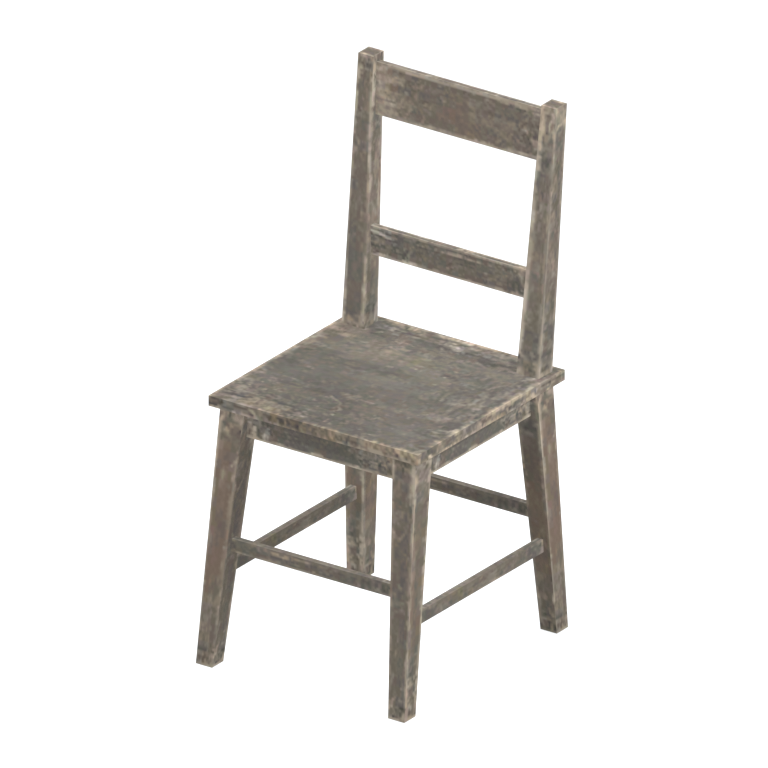
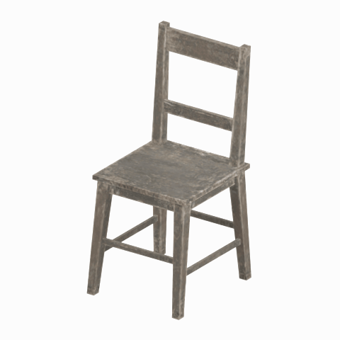

# Chair component

A native chair model component. Its specific form and assembly have not been visually reviewed.

[Library](../README.md) | [Category](../tables/seating-1.md) | [Source / advanced data](../catalogue.json) | [Credits](../sources-and-credits.md)

**Game filename:** afgh_char003.fmdl  
**Category:** Furniture &gt; Seating  
**Variant:** No explicit variant token; **LOD:** 0  
**Tags:** seating, component

## Still reference



## 360-degree reference



The camera circles a static model. This is not a native animation. Source base textures and UVs use approximate studio shading; interaction, collision, complete assembly and FOX shader equivalence are not established.

## Identity and naming

| Field | Value |
|---|---|
| Library ID | mgsv-tpp-afgh_char003-b28756c2244e12cd |
| Naming status | path-derived |
| Naming confidence | medium |
| Naming evidence | {"kind": "native-folder", "note": "Conservative folder dictionary; not visual identification, color, function or completeness proof", "source": "chair"} |
| Native model | /Assets/tpp/environ/object/afghanistan/chair/afgh_char003/scenes/afgh_char003.fmdl |
| Model SHA256 | 8e3819cc8fdd92319d68aa27c2a5a7cb5eacfabfc6d8557f547ab75fc5d4065e |
| Container | /Assets/tpp/pack/location/afgh/pack_common/afgh_common.fpk |
| Container SHA256 | 810fe68a28c81299da7ef00849d2905b640d0a2da970f1b312e953a2c7b5df48 |
| Captured source / location scope | Selected native member/content and captured installed-source chain; full archive SHA/runtime priority unresolved |
| Raw record SHA256 | 715d34eb0d058be8998b99a00da6de14cb0cef3b2e7f19e938108a2e58b08cd6 |

Naming review is descriptive metadata only. It does not change model completion or identify a working game interaction.

## Native LOD inventory

| Native LOD | Triangles | Preview status | Decoded indices SHA256 |
|---|---:|---|---|
| 0 | 152 | rendered | 63ad9bf11df39166b39f06e38dd891e7d6c96ca5ec6e4d3e93822c62c50a9833 |
| 1 | 141 | not separately rendered | ec0bdbdab93189063bc7620c97413757fe53de08e3e31c8b71fa3e6034e6b543 |
| 2 | 133 | not separately rendered | df82db72ef4d83b0557c421a2d4b057b9139917ae25d01431a68734f0a6fe5bc |
| 3 | 127 | not separately rendered | dfb037cafec4381639c5fa6f292ad7314add0b8c9b6630f54a97daf237b0fe0a |
| 4 | 119 | not separately rendered | cd6085232e1a9d1258a35b1ea63628e80ba4c0522e87a9727a8de480d17f1c7c |
| 5 | 111 | not separately rendered | a69636f12146ae1b2c53c1eaad1915ee1f400d9e4f04e4ff0f3ef36958c0c0f1 |
| 6 | 108 | not separately rendered | 75d98c1d8c115327a1597a431d3b012311b8be96762be7cb7b6c87b75c17ae1f |
| 7 | 105 | not separately rendered | 119074688683d1b74a16d1c18ea3aecbff33510c4bd1c26d4e3af6ee69df1337 |

Mesh detail and texture pixels/mips are separate. Index hashes describe decoded triangle arrays, not packed index-buffer bytes. Only source-recorded native levels are listed.

<details>
<summary>Texture, source and naming technical metadata</summary>

```json
{
  "source": {
    "nativePath": "/Assets/tpp/environ/object/afghanistan/chair/afgh_char003/scenes/afgh_char003.fmdl",
    "nativeSha256": "8e3819cc8fdd92319d68aa27c2a5a7cb5eacfabfc6d8557f547ab75fc5d4065e",
    "stableIdentity": "/assets/tpp/environ/object/afghanistan/chair/afgh_char003/scenes/afgh_char003.fmdl#8e3819cc8fdd92319d68aa27c2a5a7cb5eacfabfc6d8557f547ab75fc5d4065e#2be473987304075ec1cbab7a8c2502fdc6843e0642e72e31a58cca67bc4f2849",
    "container": {
      "nativePath": "/Assets/tpp/pack/location/afgh/pack_common/afgh_common.fpk",
      "sha256": "810fe68a28c81299da7ef00849d2905b640d0a2da970f1b312e953a2c7b5df48",
      "status": "Selected installed-source container/member chain captured by community reader"
    },
    "historicalDatOrigin": null,
    "sourceArchiveAtCapture": "master/0/00.dat",
    "locationStatus": "Selected native member/content and captured installed-source chain; full archive SHA/runtime priority unresolved",
    "currentInstalledDatVerified": false,
    "selectedInstalledMemberVerified": true,
    "evidence": {
      "archive_helper_executable_sha256": "6f8e39a436af3b024bbd0504966ab3d5d9d0cb05d86689bf3e83d15e68df613f",
      "archive_helper_source_sha256": "f662d3b63e066a0afc77ffe22ea0e564222d14469648300dba2c4f8e9b43446b",
      "archive_index_recipe": "54acff767f08d76ad6056c5387328759bc883df507788f398de6c2c04fac12db",
      "archive_reader": "Atvaark GzsTool.Core 0.5.3",
      "archive_reader_core_sha256": "9da447ae3c375cce2e46744eeff6af50f1591062afdf479d1a0b49edb47daaa3",
      "archive_tool_and_dictionary_sha256": {
        "CityHash.dll": "def6c4506d461b65e4059b2936b2cbd5f852ba5d1d8a1a527f1c0e6dc7008c8f",
        "GzsTool.Core.dll": "9da447ae3c375cce2e46744eeff6af50f1591062afdf479d1a0b49edb47daaa3",
        "GzsTool.exe": "1a9c5b11e2355383ff485aee7e86abc026f5c1fad729daf8c0fd15ee0aae1c10",
        "Zlib.Portable.dll": "fe84781ba35ca9cc5ff5f73fd08d2a66c59e5257b4573f5fe59743f30bf78e42",
        "fpk_dictionary.txt": "b82f9a8d6c10a68ba9471eca9d815c21355a53b5e68753d8ad7db7fd01bf401d",
        "qar_dictionary.txt": "1558c248ed0a4bb827888261563fbb91a2df4f03999682f85d637ff70d9d5fb2"
      },
      "bytes": 13840,
      "container_chain": [
        {
          "content_sha256": null,
          "depth": 0,
          "id": "3f19555d27c2ebecdfbad26aadd88b9f62e9fb6092c04c712963ef73c67ccb42",
          "index_sha256": "9acd3675d6e1500e0e18430cba0fdc70a5718ad7d6b62f13905891a35d59f18a",
          "kind": "qar",
          "name": "master/0/00.dat",
          "parent_occurrence": null
        },
        {
          "content_sha256": "810fe68a28c81299da7ef00849d2905b640d0a2da970f1b312e953a2c7b5df48",
          "depth": 1,
          "id": "19e9adf189f5f5e9c624197357336d49999dc3525b83bd8c71cf525fcd2100e2",
          "index_sha256": "924ec10c5736f8b618238e2523664271e558a6ad49aefdaf2473ccbad50f1231",
          "kind": "fpk",
          "name": "/Assets/tpp/pack/location/afgh/pack_common/afgh_common.fpk",
          "parent_occurrence": "e35acf6999427a88778266baae8c014a0c20a82388f8ff04caca6a88d977a6d1"
        }
      ],
      "contentSha256": "8e3819cc8fdd92319d68aa27c2a5a7cb5eacfabfc6d8557f547ab75fc5d4065e",
      "member": {
        "actual_size": 13840,
        "compressed_size": null,
        "content_sha256": "8e3819cc8fdd92319d68aa27c2a5a7cb5eacfabfc6d8557f547ab75fc5d4065e",
        "declared_size": 13840,
        "extension": "fmdl",
        "hash_hex": null,
        "name": "/Assets/tpp/environ/object/afghanistan/chair/afgh_char003/scenes/afgh_char003.fmdl",
        "name_origin": "embedded",
        "offset": 2355824,
        "ordinal": 37,
        "path_hash": null,
        "resolved": 1
      },
      "occurrenceId": "ac5be05be37f05ea0a6ebe1ea39b03ded9cddfac969a884228251cec11eed8d2",
      "occurrence_id": "ac5be05be37f05ea0a6ebe1ea39b03ded9cddfac969a884228251cec11eed8d2",
      "primary_source_revision": "fc4a8196555638c6cf8aa1b7c8dc34ccd5c69cb5",
      "source_adapter": "community_core_selective_export",
      "source_id": "7f6bb743fb4c487f0e9522f9c7fac280c46cf6b1051e0fc75a93602c8eb451f0",
      "source_path": "master/0/00.dat",
      "source_snapshot": "{\"bytes\":768788480,\"device\":621747392682911458,\"file_id\":844424931596481,\"header_sha256\":\"ead50f0a9a37e4285323b9c6fa0ec75fe75e518c63147e63158eeb2892c6589e\",\"mtime_ns\":1791852224238580700}",
      "virtualPath": "/Assets/tpp/environ/object/afghanistan/chair/afgh_char003/scenes/afgh_char003.fmdl"
    }
  },
  "materials": [
    {
      "sampler": "Base_Tex_SRGB",
      "materialIndex": 0,
      "nativePathHash": "1542494759103662146",
      "nativeVirtualPath": null,
      "nativeBinding": {
        "familyId": "73541d43d7fa872f76eb3a56d6ebc85c7f94b95ede84b4cf5922728ebc319af5",
        "height": 256,
        "materialIndex": 0,
        "mipCount": 7,
        "nativeMipCountVerified": true,
        "nativePath": null,
        "nativePathHash": "1542494759103662146",
        "nativeTexture": {
          "additionalFtexsFileCount": 1,
          "depth": 1,
          "ftexsFileCount": 2,
          "height": 256,
          "metadataBytes": 176,
          "mipCount": 7,
          "mips": [
            {
              "chunks": 2,
              "decodedBytes": 32768,
              "mip": 0,
              "offset": 0,
              "storedBytes": 25456,
              "streamNumber": 2
            },
            {
              "chunks": 1,
              "decodedBytes": 8192,
              "mip": 1,
              "offset": 2584,
              "storedBytes": 6720,
              "streamNumber": 1
            },
            {
              "chunks": 1,
              "decodedBytes": 2048,
              "mip": 2,
              "offset": 768,
              "storedBytes": 1808,
              "streamNumber": 1
            },
            {
              "chunks": 1,
              "decodedBytes": 512,
              "mip": 3,
              "offset": 232,
              "storedBytes": 528,
              "streamNumber": 1
            },
            {
              "chunks": 1,
              "decodedBytes": 128,
              "mip": 4,
              "offset": 80,
              "storedBytes": 144,
              "streamNumber": 1
            },
            {
              "chunks": 1,
              "decodedBytes": 32,
              "mip": 5,
              "offset": 24,
              "storedBytes": 48,
              "streamNumber": 1
            },
            {
              "chunks": 1,
              "decodedBytes": 8,
              "mip": 6,
              "offset": 0,
              "storedBytes": 16,
              "streamNumber": 1
            }
          ],
          "nativeHeaderHash": "ff8e3a55547450350ab8375fddd9b3f0",
          "nrtFlag": 2,
          "pixelFormat": 2,
          "requiredStreamNumbers": [
            1,
            2
          ],
          "textureType": 16777219,
          "unknownFlags": 273,
          "width": 256
        },
        "samplerName": "Base_Tex_SRGB",
        "samplerNameHash": "72475356961633",
        "sha256": "e8c1f2cce3d0110bc51cc0b653d4fcef9c8d5c03b6fdf99889a1f3673b918882",
        "sourceOccurrences": [
          {
            "archive_helper_executable_sha256": "6f8e39a436af3b024bbd0504966ab3d5d9d0cb05d86689bf3e83d15e68df613f",
            "archive_helper_source_sha256": "f662d3b63e066a0afc77ffe22ea0e564222d14469648300dba2c4f8e9b43446b",
            "archive_index_recipe": "54acff767f08d76ad6056c5387328759bc883df507788f398de6c2c04fac12db",
            "archive_reader": "Atvaark GzsTool.Core 0.5.3",
            "archive_reader_core_sha256": "9da447ae3c375cce2e46744eeff6af50f1591062afdf479d1a0b49edb47daaa3",
            "archive_tool_and_dictionary_sha256": {
              "CityHash.dll": "def6c4506d461b65e4059b2936b2cbd5f852ba5d1d8a1a527f1c0e6dc7008c8f",
              "GzsTool.Core.dll": "9da447ae3c375cce2e46744eeff6af50f1591062afdf479d1a0b49edb47daaa3",
              "GzsTool.exe": "1a9c5b11e2355383ff485aee7e86abc026f5c1fad729daf8c0fd15ee0aae1c10",
              "Zlib.Portable.dll": "fe84781ba35ca9cc5ff5f73fd08d2a66c59e5257b4573f5fe59743f30bf78e42",
              "fpk_dictionary.txt": "b82f9a8d6c10a68ba9471eca9d815c21355a53b5e68753d8ad7db7fd01bf401d",
              "qar_dictionary.txt": "1558c248ed0a4bb827888261563fbb91a2df4f03999682f85d637ff70d9d5fb2"
            },
            "bytes": 176,
            "container_chain": [
              {
                "content_sha256": null,
                "depth": 0,
                "id": "0b473016351235050c2f6af21454bd979a0ad4602a9860137c807c894c5eba4d",
                "index_sha256": "ac9b4dae0dd0166db3a6ec8da18524dffebcbaf9004569af631de82913bf49a3",
                "kind": "qar",
                "name": "master/texture2.dat",
                "parent_occurrence": null
              }
            ],
            "contentSha256": "03dd651ee3439167f4ed84b0a4b14f6c66d70972b54c6982e671bd356d1e288f",
            "member": {
              "actual_size": 176,
              "compressed_size": 176,
              "content_sha256": "03dd651ee3439167f4ed84b0a4b14f6c66d70972b54c6982e671bd356d1e288f",
              "declared_size": 176,
              "extension": "ftex",
              "hash_hex": "15680acf98468842",
              "name": "/Assets/tpp/environ/object/afghanistan/chair/afgh_char003/sourceimages/afgh_char003_bsm.ftex",
              "name_origin": "dictionary",
              "offset": 1481701408,
              "ordinal": 8712,
              "path_hash": "acf98468842",
              "resolved": 1
            },
            "occurrenceId": "378ea5928d57c7ddef4e27360e58fea4f9add228e20ccb00cd526606952aa258",
            "occurrence_id": "378ea5928d57c7ddef4e27360e58fea4f9add228e20ccb00cd526606952aa258",
            "primary_source_revision": "fc4a8196555638c6cf8aa1b7c8dc34ccd5c69cb5",
            "source_adapter": "community_core_selective_export",
            "source_id": "85e8296057664cbc6ebaf6bd43d1c6d18528bbd8a6fae920bdf4d5eb69f6a93d",
            "source_path": "master/texture2.dat",
            "source_snapshot": "{\"bytes\":2920239104,\"device\":621747392682911458,\"file_id\":562949953639626,\"header_sha256\":\"72bfee707623afb5f3abd8382035d3d4258b4941ac583a56f5a447f47123dcab\",\"mtime_ns\":1791224675561235200}",
            "virtualPath": "/Assets/tpp/environ/object/afghanistan/chair/afgh_char003/sourceimages/afgh_char003_bsm.ftex"
          },
          {
            "archive_helper_executable_sha256": "6f8e39a436af3b024bbd0504966ab3d5d9d0cb05d86689bf3e83d15e68df613f",
            "archive_helper_source_sha256": "f662d3b63e066a0afc77ffe22ea0e564222d14469648300dba2c4f8e9b43446b",
            "archive_index_recipe": "54acff767f08d76ad6056c5387328759bc883df507788f398de6c2c04fac12db",
            "archive_reader": "Atvaark GzsTool.Core 0.5.3",
            "archive_reader_core_sha256": "9da447ae3c375cce2e46744eeff6af50f1591062afdf479d1a0b49edb47daaa3",
            "archive_tool_and_dictionary_sha256": {
              "CityHash.dll": "def6c4506d461b65e4059b2936b2cbd5f852ba5d1d8a1a527f1c0e6dc7008c8f",
              "GzsTool.Core.dll": "9da447ae3c375cce2e46744eeff6af50f1591062afdf479d1a0b49edb47daaa3",
              "GzsTool.exe": "1a9c5b11e2355383ff485aee7e86abc026f5c1fad729daf8c0fd15ee0aae1c10",
              "Zlib.Portable.dll": "fe84781ba35ca9cc5ff5f73fd08d2a66c59e5257b4573f5fe59743f30bf78e42",
              "fpk_dictionary.txt": "b82f9a8d6c10a68ba9471eca9d815c21355a53b5e68753d8ad7db7fd01bf401d",
              "qar_dictionary.txt": "1558c248ed0a4bb827888261563fbb91a2df4f03999682f85d637ff70d9d5fb2"
            },
            "bytes": 9312,
            "container_chain": [
              {
                "content_sha256": null,
                "depth": 0,
                "id": "0b473016351235050c2f6af21454bd979a0ad4602a9860137c807c894c5eba4d",
                "index_sha256": "ac9b4dae0dd0166db3a6ec8da18524dffebcbaf9004569af631de82913bf49a3",
                "kind": "qar",
                "name": "master/texture2.dat",
                "parent_occurrence": null
              }
            ],
            "contentSha256": "9fd8c2133b2c69b64d2ae8cdc62cb5d15e66f8787e29e006e9548794e2a5dcf7",
            "member": {
              "actual_size": 9312,
              "compressed_size": 9312,
              "content_sha256": "9fd8c2133b2c69b64d2ae8cdc62cb5d15e66f8787e29e006e9548794e2a5dcf7",
              "declared_size": 9312,
              "extension": "1.ftexs",
              "hash_hex": "b2c00acf98468842",
              "name": "/Assets/tpp/environ/object/afghanistan/chair/afgh_char003/sourceimages/afgh_char003_bsm.1.ftexs",
              "name_origin": "dictionary",
              "offset": 1481665568,
              "ordinal": 8710,
              "path_hash": "acf98468842",
              "resolved": 1
            },
            "occurrenceId": "4b0c80d34d2f41a5538ad1874104f4480cf0b2cf768c5f62bf7a75808cb18d07",
            "occurrence_id": "4b0c80d34d2f41a5538ad1874104f4480cf0b2cf768c5f62bf7a75808cb18d07",
            "primary_source_revision": "fc4a8196555638c6cf8aa1b7c8dc34ccd5c69cb5",
            "source_adapter": "community_core_selective_export",
            "source_id": "85e8296057664cbc6ebaf6bd43d1c6d18528bbd8a6fae920bdf4d5eb69f6a93d",
            "source_path": "master/texture2.dat",
            "source_snapshot": "{\"bytes\":2920239104,\"device\":621747392682911458,\"file_id\":562949953639626,\"header_sha256\":\"72bfee707623afb5f3abd8382035d3d4258b4941ac583a56f5a447f47123dcab\",\"mtime_ns\":1791224675561235200}",
            "virtualPath": "/Assets/tpp/environ/object/afghanistan/chair/afgh_char003/sourceimages/afgh_char003_bsm.1.ftexs"
          },
          {
            "archive_helper_executable_sha256": "6f8e39a436af3b024bbd0504966ab3d5d9d0cb05d86689bf3e83d15e68df613f",
            "archive_helper_source_sha256": "f662d3b63e066a0afc77ffe22ea0e564222d14469648300dba2c4f8e9b43446b",
            "archive_index_recipe": "54acff767f08d76ad6056c5387328759bc883df507788f398de6c2c04fac12db",
            "archive_reader": "Atvaark GzsTool.Core 0.5.3",
            "archive_reader_core_sha256": "9da447ae3c375cce2e46744eeff6af50f1591062afdf479d1a0b49edb47daaa3",
            "archive_tool_and_dictionary_sha256": {
              "CityHash.dll": "def6c4506d461b65e4059b2936b2cbd5f852ba5d1d8a1a527f1c0e6dc7008c8f",
              "GzsTool.Core.dll": "9da447ae3c375cce2e46744eeff6af50f1591062afdf479d1a0b49edb47daaa3",
              "GzsTool.exe": "1a9c5b11e2355383ff485aee7e86abc026f5c1fad729daf8c0fd15ee0aae1c10",
              "Zlib.Portable.dll": "fe84781ba35ca9cc5ff5f73fd08d2a66c59e5257b4573f5fe59743f30bf78e42",
              "fpk_dictionary.txt": "b82f9a8d6c10a68ba9471eca9d815c21355a53b5e68753d8ad7db7fd01bf401d",
              "qar_dictionary.txt": "1558c248ed0a4bb827888261563fbb91a2df4f03999682f85d637ff70d9d5fb2"
            },
            "bytes": 25472,
            "container_chain": [
              {
                "content_sha256": null,
                "depth": 0,
                "id": "1cc220d9409d7163b6aca295ed89fd8c7befca6a8f849a8d5d09a2499724c863",
                "index_sha256": "5a818609a652a10d90fb90015661d0cb80898096bbb3aac36382172988d8736d",
                "kind": "qar",
                "name": "master/texture5_mgo0.dat",
                "parent_occurrence": null
              }
            ],
            "contentSha256": "7bf3837930d5ae7529ace00db2ab1ff18d0b4d05b2035ae737ba34cb2ba8d2d1",
            "member": {
              "actual_size": 25472,
              "compressed_size": 25472,
              "content_sha256": "7bf3837930d5ae7529ace00db2ab1ff18d0b4d05b2035ae737ba34cb2ba8d2d1",
              "declared_size": 25472,
              "extension": "2.ftexs",
              "hash_hex": "b5700acf98468842",
              "name": "/Assets/tpp/environ/object/afghanistan/chair/afgh_char003/sourceimages/afgh_char003_bsm.2.ftexs",
              "name_origin": "dictionary",
              "offset": 3203056672,
              "ordinal": 12249,
              "path_hash": "acf98468842",
              "resolved": 1
            },
            "occurrenceId": "aa8bd8dd1631ecc9660bef023c666d164f781ec828e95f571a5f5d76fa3942a5",
            "occurrence_id": "aa8bd8dd1631ecc9660bef023c666d164f781ec828e95f571a5f5d76fa3942a5",
            "primary_source_revision": "fc4a8196555638c6cf8aa1b7c8dc34ccd5c69cb5",
            "source_adapter": "community_core_selective_export",
            "source_id": "24f8989ccaae47940dc20e54ba67442ad562ac0032ab6e3d475e927c81444b56",
            "source_path": "master/texture5_mgo0.dat",
            "source_snapshot": "{\"bytes\":4492370944,\"device\":621747392682911458,\"file_id\":13510798883237422,\"header_sha256\":\"6108fbacb65c84d041742c39e5ca630745240453b336f1059a13b91943f0b011\",\"mtime_ns\":1791224675562234400}",
            "virtualPath": "/Assets/tpp/environ/object/afghanistan/chair/afgh_char003/sourceimages/afgh_char003_bsm.2.ftexs"
          }
        ],
        "width": 256
      },
      "ddsSha256": "e8c1f2cce3d0110bc51cc0b653d4fcef9c8d5c03b6fdf99889a1f3673b918882",
      "dimensions": [
        256,
        256
      ],
      "mipCount": 7,
      "nativeMipCountVerified": true,
      "connectedInPreview": true
    }
  ],
  "quality": {
    "decodedIndicesHashDerivation": "SHA256 of canonical UTF-8 JSON decoded triangle indices grouped by mesh; not packed buffer bytes",
    "highestRetainedGeometricLod": 0,
    "distinctNativeLods": 8,
    "baseTextureDimensions": [
      256,
      256
    ],
    "baseTextureNativeMipCount": 7,
    "largerRetainedBaseTextureFound": null,
    "nativeLods": [
      {
        "indicesSha256": "63ad9bf11df39166b39f06e38dd891e7d6c96ca5ec6e4d3e93822c62c50a9833",
        "nativeLod": 0,
        "triangles": 152
      },
      {
        "indicesSha256": "ec0bdbdab93189063bc7620c97413757fe53de08e3e31c8b71fa3e6034e6b543",
        "nativeLod": 1,
        "triangles": 141
      },
      {
        "indicesSha256": "df82db72ef4d83b0557c421a2d4b057b9139917ae25d01431a68734f0a6fe5bc",
        "nativeLod": 2,
        "triangles": 133
      },
      {
        "indicesSha256": "dfb037cafec4381639c5fa6f292ad7314add0b8c9b6630f54a97daf237b0fe0a",
        "nativeLod": 3,
        "triangles": 127
      },
      {
        "indicesSha256": "cd6085232e1a9d1258a35b1ea63628e80ba4c0522e87a9727a8de480d17f1c7c",
        "nativeLod": 4,
        "triangles": 119
      },
      {
        "indicesSha256": "a69636f12146ae1b2c53c1eaad1915ee1f400d9e4f04e4ff0f3ef36958c0c0f1",
        "nativeLod": 5,
        "triangles": 111
      },
      {
        "indicesSha256": "75d98c1d8c115327a1597a431d3b012311b8be96762be7cb7b6c87b75c17ae1f",
        "nativeLod": 6,
        "triangles": 108
      },
      {
        "indicesSha256": "119074688683d1b74a16d1c18ea3aecbff33510c4bd1c26d4e3af6ee69df1337",
        "nativeLod": 7,
        "triangles": 105
      }
    ],
    "renderedNativeLods": [
      0
    ],
    "baseTextureSummary": "256 x 256; 7 native/DDS mips",
    "highestDetailScope": "Triangle-count comparison within captured FMDL only"
  }
}
```

</details>

[Original source / advanced record](../catalogue.json)
