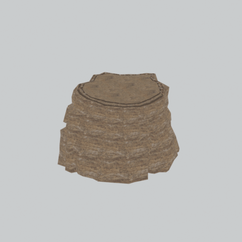

# Cliff component

A native cliff model component. Its specific form and assembly have not been visually reviewed.

[Library](../README.md) | [Category](../tables/cliffs-1.md) | [Source / advanced data](../catalogue.json) | [Credits](../sources-and-credits.md)

**Game filename:** afgh_clff022_vrtn008.fmdl  
**Category:** Terrain &gt; Cliffs  
**Variant:** vrtn008; **LOD:** 0  
**Tags:** cliff, component

## Still reference


## 360-degree reference



The camera circles a static model. This is not a native animation. Source base textures and UVs use approximate studio shading; interaction, collision, complete assembly and FOX shader equivalence are not established.

## Identity and naming

| Field | Value |
|---|---|
| Library ID | mgsv-tpp-afgh_clff022_vrtn008-31e09d2045a2d859 |
| Naming status | path-derived |
| Naming confidence | medium |
| Naming evidence | {"kind": "native-folder", "note": "Conservative folder dictionary; not visual identification, color, function or completeness proof", "source": "cliff"} |
| Native model | /Assets/tpp/environ/object/afghanistan/cliff/afgh_clff022/scenes/afgh_clff022_vrtn008.fmdl |
| Model SHA256 | 3fabfac0cd6400f1a599653223df86abf34f98312f59a3d1f7c67dca99ae529e |
| Container | /Assets/tpp/pack/location/afgh/pack_common/afgh_common.fpk |
| Container SHA256 | 810fe68a28c81299da7ef00849d2905b640d0a2da970f1b312e953a2c7b5df48 |
| Captured source / location scope | Selected native member/content and captured installed-source chain; full archive SHA/runtime priority unresolved |
| Raw record SHA256 | 9632323c10c2f41b0bb75bfd0009e504d1deae06a8da450ec350f0c2e8398071 |

Naming review is descriptive metadata only. It does not change model completion or identify a working game interaction.

## Native LOD inventory

| Native LOD | Triangles | Preview status | Decoded indices SHA256 |
|---|---:|---|---|
| 0 | 929 | rendered | 3157a75b240cb0007f65f8ef5b20a68dfea25c3184ece148d133b1a135eafaab |
| 1 | 543 | not separately rendered | 07cf786caba8e3646d7d6ed0d1074ca3af8b2c6f5276715911f60d0ae55f7581 |
| 2 | 315 | not separately rendered | c596a1ae73bdf9349057f8f72c418750b7fb6e04a10b6571821624208a45976d |
| 3 | 185 | not separately rendered | e5ebb2b9cc2fe275535f87a7ea1bc014e1fa98c9e8b918aed0a320ffb56c1686 |

Mesh detail and texture pixels/mips are separate. Index hashes describe decoded triangle arrays, not packed index-buffer bytes. Only source-recorded native levels are listed.

<details>
<summary>Texture, source and naming technical metadata</summary>

```json
{
  "source": {
    "nativePath": "/Assets/tpp/environ/object/afghanistan/cliff/afgh_clff022/scenes/afgh_clff022_vrtn008.fmdl",
    "nativeSha256": "3fabfac0cd6400f1a599653223df86abf34f98312f59a3d1f7c67dca99ae529e",
    "stableIdentity": "/assets/tpp/environ/object/afghanistan/cliff/afgh_clff022/scenes/afgh_clff022_vrtn008.fmdl#3fabfac0cd6400f1a599653223df86abf34f98312f59a3d1f7c67dca99ae529e#e48f7e985ff7fd2b71db3128bc8122e8f78a5418285cb60d591e639052a5b330",
    "container": {
      "nativePath": "/Assets/tpp/pack/location/afgh/pack_common/afgh_common.fpk",
      "sha256": "810fe68a28c81299da7ef00849d2905b640d0a2da970f1b312e953a2c7b5df48",
      "status": "Selected installed-source container/member chain captured by community reader"
    },
    "historicalDatOrigin": null,
    "sourceArchiveAtCapture": "master/0/00.dat",
    "locationStatus": "Selected native member/content and captured installed-source chain; full archive SHA/runtime priority unresolved",
    "currentInstalledDatVerified": false,
    "selectedInstalledMemberVerified": true,
    "evidence": {
      "archive_helper_executable_sha256": "6f8e39a436af3b024bbd0504966ab3d5d9d0cb05d86689bf3e83d15e68df613f",
      "archive_helper_source_sha256": "f662d3b63e066a0afc77ffe22ea0e564222d14469648300dba2c4f8e9b43446b",
      "archive_index_recipe": "54acff767f08d76ad6056c5387328759bc883df507788f398de6c2c04fac12db",
      "archive_reader": "Atvaark GzsTool.Core 0.5.3",
      "archive_reader_core_sha256": "9da447ae3c375cce2e46744eeff6af50f1591062afdf479d1a0b49edb47daaa3",
      "archive_tool_and_dictionary_sha256": {
        "CityHash.dll": "def6c4506d461b65e4059b2936b2cbd5f852ba5d1d8a1a527f1c0e6dc7008c8f",
        "GzsTool.Core.dll": "9da447ae3c375cce2e46744eeff6af50f1591062afdf479d1a0b49edb47daaa3",
        "GzsTool.exe": "1a9c5b11e2355383ff485aee7e86abc026f5c1fad729daf8c0fd15ee0aae1c10",
        "Zlib.Portable.dll": "fe84781ba35ca9cc5ff5f73fd08d2a66c59e5257b4573f5fe59743f30bf78e42",
        "fpk_dictionary.txt": "b82f9a8d6c10a68ba9471eca9d815c21355a53b5e68753d8ad7db7fd01bf401d",
        "qar_dictionary.txt": "1558c248ed0a4bb827888261563fbb91a2df4f03999682f85d637ff70d9d5fb2"
      },
      "bytes": 36912,
      "container_chain": [
        {
          "content_sha256": null,
          "depth": 0,
          "id": "3f19555d27c2ebecdfbad26aadd88b9f62e9fb6092c04c712963ef73c67ccb42",
          "index_sha256": "9acd3675d6e1500e0e18430cba0fdc70a5718ad7d6b62f13905891a35d59f18a",
          "kind": "qar",
          "name": "master/0/00.dat",
          "parent_occurrence": null
        },
        {
          "content_sha256": "810fe68a28c81299da7ef00849d2905b640d0a2da970f1b312e953a2c7b5df48",
          "depth": 1,
          "id": "19e9adf189f5f5e9c624197357336d49999dc3525b83bd8c71cf525fcd2100e2",
          "index_sha256": "924ec10c5736f8b618238e2523664271e558a6ad49aefdaf2473ccbad50f1231",
          "kind": "fpk",
          "name": "/Assets/tpp/pack/location/afgh/pack_common/afgh_common.fpk",
          "parent_occurrence": "e35acf6999427a88778266baae8c014a0c20a82388f8ff04caca6a88d977a6d1"
        }
      ],
      "contentSha256": "3fabfac0cd6400f1a599653223df86abf34f98312f59a3d1f7c67dca99ae529e",
      "member": {
        "actual_size": 36912,
        "compressed_size": null,
        "content_sha256": "3fabfac0cd6400f1a599653223df86abf34f98312f59a3d1f7c67dca99ae529e",
        "declared_size": 36912,
        "extension": "fmdl",
        "hash_hex": null,
        "name": "/Assets/tpp/environ/object/afghanistan/cliff/afgh_clff022/scenes/afgh_clff022_vrtn008.fmdl",
        "name_origin": "embedded",
        "offset": 2552112,
        "ordinal": 44,
        "path_hash": null,
        "resolved": 1
      },
      "occurrenceId": "97b0985f9e236061ae2c728b811c3315fa3e416876ce18b4a5ba5083937d7799",
      "occurrence_id": "97b0985f9e236061ae2c728b811c3315fa3e416876ce18b4a5ba5083937d7799",
      "primary_source_revision": "fc4a8196555638c6cf8aa1b7c8dc34ccd5c69cb5",
      "source_adapter": "community_core_selective_export",
      "source_id": "7f6bb743fb4c487f0e9522f9c7fac280c46cf6b1051e0fc75a93602c8eb451f0",
      "source_path": "master/0/00.dat",
      "source_snapshot": "{\"bytes\":768788480,\"device\":621747392682911458,\"file_id\":844424931596481,\"header_sha256\":\"ead50f0a9a37e4285323b9c6fa0ec75fe75e518c63147e63158eeb2892c6589e\",\"mtime_ns\":1791852224238580700}",
      "virtualPath": "/Assets/tpp/environ/object/afghanistan/cliff/afgh_clff022/scenes/afgh_clff022_vrtn008.fmdl"
    }
  },
  "materials": [
    {
      "sampler": "Base_Tex_SRGB",
      "materialIndex": 0,
      "nativePathHash": "1543511914134198169",
      "nativeVirtualPath": null,
      "nativeBinding": {
        "familyId": "a11514eb3b2073a47601ed9e9499f66cdb161dc079b9c13c5357e920f184ad2a",
        "height": 1024,
        "materialIndex": 0,
        "mipCount": 10,
        "nativeMipCountVerified": true,
        "nativePath": null,
        "nativePathHash": "1543511914134198169",
        "nativeTexture": {
          "additionalFtexsFileCount": 2,
          "depth": 1,
          "ftexsFileCount": 3,
          "height": 1024,
          "metadataBytes": 224,
          "mipCount": 10,
          "mips": [
            {
              "chunks": 64,
              "decodedBytes": 1048576,
              "mip": 0,
              "offset": 0,
              "storedBytes": 864592,
              "streamNumber": 3
            },
            {
              "chunks": 16,
              "decodedBytes": 262144,
              "mip": 1,
              "offset": 0,
              "storedBytes": 229552,
              "streamNumber": 2
            },
            {
              "chunks": 4,
              "decodedBytes": 65536,
              "mip": 2,
              "offset": 19304,
              "storedBytes": 57664,
              "streamNumber": 1
            },
            {
              "chunks": 1,
              "decodedBytes": 16384,
              "mip": 3,
              "offset": 5072,
              "storedBytes": 14224,
              "streamNumber": 1
            },
            {
              "chunks": 1,
              "decodedBytes": 4096,
              "mip": 4,
              "offset": 1416,
              "storedBytes": 3648,
              "streamNumber": 1
            },
            {
              "chunks": 1,
              "decodedBytes": 1024,
              "mip": 5,
              "offset": 432,
              "storedBytes": 976,
              "streamNumber": 1
            },
            {
              "chunks": 1,
              "decodedBytes": 256,
              "mip": 6,
              "offset": 152,
              "storedBytes": 272,
              "streamNumber": 1
            },
            {
              "chunks": 1,
              "decodedBytes": 64,
              "mip": 7,
              "offset": 64,
              "storedBytes": 80,
              "streamNumber": 1
            },
            {
              "chunks": 1,
              "decodedBytes": 16,
              "mip": 8,
              "offset": 24,
              "storedBytes": 32,
              "streamNumber": 1
            },
            {
              "chunks": 1,
              "decodedBytes": 8,
              "mip": 9,
              "offset": 0,
              "storedBytes": 16,
              "streamNumber": 1
            }
          ],
          "nativeHeaderHash": "45a969f77b4d98021da71a25ac9de75b",
          "nrtFlag": 2,
          "pixelFormat": 2,
          "requiredStreamNumbers": [
            1,
            2,
            3
          ],
          "textureType": 16777219,
          "unknownFlags": 273,
          "width": 2048
        },
        "samplerName": "Base_Tex_SRGB",
        "samplerNameHash": "72475356961633",
        "sha256": "86cf8c406bd4a35f90b4f6a541ad9d20b49d7bf731199c187066bd25203a8eb6",
        "sourceOccurrences": [
          {
            "archive_helper_executable_sha256": "6f8e39a436af3b024bbd0504966ab3d5d9d0cb05d86689bf3e83d15e68df613f",
            "archive_helper_source_sha256": "f662d3b63e066a0afc77ffe22ea0e564222d14469648300dba2c4f8e9b43446b",
            "archive_index_recipe": "54acff767f08d76ad6056c5387328759bc883df507788f398de6c2c04fac12db",
            "archive_reader": "Atvaark GzsTool.Core 0.5.3",
            "archive_reader_core_sha256": "9da447ae3c375cce2e46744eeff6af50f1591062afdf479d1a0b49edb47daaa3",
            "archive_tool_and_dictionary_sha256": {
              "CityHash.dll": "def6c4506d461b65e4059b2936b2cbd5f852ba5d1d8a1a527f1c0e6dc7008c8f",
              "GzsTool.Core.dll": "9da447ae3c375cce2e46744eeff6af50f1591062afdf479d1a0b49edb47daaa3",
              "GzsTool.exe": "1a9c5b11e2355383ff485aee7e86abc026f5c1fad729daf8c0fd15ee0aae1c10",
              "Zlib.Portable.dll": "fe84781ba35ca9cc5ff5f73fd08d2a66c59e5257b4573f5fe59743f30bf78e42",
              "fpk_dictionary.txt": "b82f9a8d6c10a68ba9471eca9d815c21355a53b5e68753d8ad7db7fd01bf401d",
              "qar_dictionary.txt": "1558c248ed0a4bb827888261563fbb91a2df4f03999682f85d637ff70d9d5fb2"
            },
            "bytes": 224,
            "container_chain": [
              {
                "content_sha256": null,
                "depth": 0,
                "id": "0b473016351235050c2f6af21454bd979a0ad4602a9860137c807c894c5eba4d",
                "index_sha256": "ac9b4dae0dd0166db3a6ec8da18524dffebcbaf9004569af631de82913bf49a3",
                "kind": "qar",
                "name": "master/texture2.dat",
                "parent_occurrence": null
              }
            ],
            "contentSha256": "c66b69085cf6613f62027e103f5790ba4b0b2ec39d930b8d77269b0e0360f0ac",
            "member": {
              "actual_size": 224,
              "compressed_size": 224,
              "content_sha256": "c66b69085cf6613f62027e103f5790ba4b0b2ec39d930b8d77269b0e0360f0ac",
              "declared_size": 224,
              "extension": "ftex",
              "hash_hex": "156ba7e8748d5799",
              "name": "/Assets/tpp/common_source/environ/afghanistan/cm_afgh_clff002/sourceimages/cm_afgh_clff002_v2_bsm.ftex",
              "name_origin": "dictionary",
              "offset": 432588832,
              "ordinal": 1586,
              "path_hash": "3a7e8748d5799",
              "resolved": 1
            },
            "occurrenceId": "1025670b72b8578490085d6c3c6a9ccc2185aeef79382bec3f2c3e09b48f0118",
            "occurrence_id": "1025670b72b8578490085d6c3c6a9ccc2185aeef79382bec3f2c3e09b48f0118",
            "primary_source_revision": "fc4a8196555638c6cf8aa1b7c8dc34ccd5c69cb5",
            "source_adapter": "community_core_selective_export",
            "source_id": "85e8296057664cbc6ebaf6bd43d1c6d18528bbd8a6fae920bdf4d5eb69f6a93d",
            "source_path": "master/texture2.dat",
            "source_snapshot": "{\"bytes\":2920239104,\"device\":621747392682911458,\"file_id\":562949953639626,\"header_sha256\":\"72bfee707623afb5f3abd8382035d3d4258b4941ac583a56f5a447f47123dcab\",\"mtime_ns\":1791224675561235200}",
            "virtualPath": "/Assets/tpp/common_source/environ/afghanistan/cm_afgh_clff002/sourceimages/cm_afgh_clff002_v2_bsm.ftex"
          },
          {
            "archive_helper_executable_sha256": "6f8e39a436af3b024bbd0504966ab3d5d9d0cb05d86689bf3e83d15e68df613f",
            "archive_helper_source_sha256": "f662d3b63e066a0afc77ffe22ea0e564222d14469648300dba2c4f8e9b43446b",
            "archive_index_recipe": "54acff767f08d76ad6056c5387328759bc883df507788f398de6c2c04fac12db",
            "archive_reader": "Atvaark GzsTool.Core 0.5.3",
            "archive_reader_core_sha256": "9da447ae3c375cce2e46744eeff6af50f1591062afdf479d1a0b49edb47daaa3",
            "archive_tool_and_dictionary_sha256": {
              "CityHash.dll": "def6c4506d461b65e4059b2936b2cbd5f852ba5d1d8a1a527f1c0e6dc7008c8f",
              "GzsTool.Core.dll": "9da447ae3c375cce2e46744eeff6af50f1591062afdf479d1a0b49edb47daaa3",
              "GzsTool.exe": "1a9c5b11e2355383ff485aee7e86abc026f5c1fad729daf8c0fd15ee0aae1c10",
              "Zlib.Portable.dll": "fe84781ba35ca9cc5ff5f73fd08d2a66c59e5257b4573f5fe59743f30bf78e42",
              "fpk_dictionary.txt": "b82f9a8d6c10a68ba9471eca9d815c21355a53b5e68753d8ad7db7fd01bf401d",
              "qar_dictionary.txt": "1558c248ed0a4bb827888261563fbb91a2df4f03999682f85d637ff70d9d5fb2"
            },
            "bytes": 77000,
            "container_chain": [
              {
                "content_sha256": null,
                "depth": 0,
                "id": "0b473016351235050c2f6af21454bd979a0ad4602a9860137c807c894c5eba4d",
                "index_sha256": "ac9b4dae0dd0166db3a6ec8da18524dffebcbaf9004569af631de82913bf49a3",
                "kind": "qar",
                "name": "master/texture2.dat",
                "parent_occurrence": null
              }
            ],
            "contentSha256": "445fab5ca9efcf026e46ab1594e7de05cfda7ba5d9a37dd3a9ad58a5e0aa1b19",
            "member": {
              "actual_size": 77000,
              "compressed_size": 77000,
              "content_sha256": "445fab5ca9efcf026e46ab1594e7de05cfda7ba5d9a37dd3a9ad58a5e0aa1b19",
              "declared_size": 77000,
              "extension": "1.ftexs",
              "hash_hex": "b2c3a7e8748d5799",
              "name": "/Assets/tpp/common_source/environ/afghanistan/cm_afgh_clff002/sourceimages/cm_afgh_clff002_v2_bsm.1.ftexs",
              "name_origin": "dictionary",
              "offset": 431415328,
              "ordinal": 1583,
              "path_hash": "3a7e8748d5799",
              "resolved": 1
            },
            "occurrenceId": "9069a00114034276697f45d39430ff20eec06cb277d48d8f03051ea203cee091",
            "occurrence_id": "9069a00114034276697f45d39430ff20eec06cb277d48d8f03051ea203cee091",
            "primary_source_revision": "fc4a8196555638c6cf8aa1b7c8dc34ccd5c69cb5",
            "source_adapter": "community_core_selective_export",
            "source_id": "85e8296057664cbc6ebaf6bd43d1c6d18528bbd8a6fae920bdf4d5eb69f6a93d",
            "source_path": "master/texture2.dat",
            "source_snapshot": "{\"bytes\":2920239104,\"device\":621747392682911458,\"file_id\":562949953639626,\"header_sha256\":\"72bfee707623afb5f3abd8382035d3d4258b4941ac583a56f5a447f47123dcab\",\"mtime_ns\":1791224675561235200}",
            "virtualPath": "/Assets/tpp/common_source/environ/afghanistan/cm_afgh_clff002/sourceimages/cm_afgh_clff002_v2_bsm.1.ftexs"
          },
          {
            "archive_helper_executable_sha256": "6f8e39a436af3b024bbd0504966ab3d5d9d0cb05d86689bf3e83d15e68df613f",
            "archive_helper_source_sha256": "f662d3b63e066a0afc77ffe22ea0e564222d14469648300dba2c4f8e9b43446b",
            "archive_index_recipe": "54acff767f08d76ad6056c5387328759bc883df507788f398de6c2c04fac12db",
            "archive_reader": "Atvaark GzsTool.Core 0.5.3",
            "archive_reader_core_sha256": "9da447ae3c375cce2e46744eeff6af50f1591062afdf479d1a0b49edb47daaa3",
            "archive_tool_and_dictionary_sha256": {
              "CityHash.dll": "def6c4506d461b65e4059b2936b2cbd5f852ba5d1d8a1a527f1c0e6dc7008c8f",
              "GzsTool.Core.dll": "9da447ae3c375cce2e46744eeff6af50f1591062afdf479d1a0b49edb47daaa3",
              "GzsTool.exe": "1a9c5b11e2355383ff485aee7e86abc026f5c1fad729daf8c0fd15ee0aae1c10",
              "Zlib.Portable.dll": "fe84781ba35ca9cc5ff5f73fd08d2a66c59e5257b4573f5fe59743f30bf78e42",
              "fpk_dictionary.txt": "b82f9a8d6c10a68ba9471eca9d815c21355a53b5e68753d8ad7db7fd01bf401d",
              "qar_dictionary.txt": "1558c248ed0a4bb827888261563fbb91a2df4f03999682f85d637ff70d9d5fb2"
            },
            "bytes": 229680,
            "container_chain": [
              {
                "content_sha256": null,
                "depth": 0,
                "id": "e73d96973ade76f7a00afdbea486dd110896ace97da0791f56899647de46f210",
                "index_sha256": "5a818609a652a10d90fb90015661d0cb80898096bbb3aac36382172988d8736d",
                "kind": "qar",
                "name": "mgo/texture0.dat",
                "parent_occurrence": null
              }
            ],
            "contentSha256": "688d4a891b1c995f4cee8ceb3061fb6d1ce066a28371bc08448225603f0c86a9",
            "member": {
              "actual_size": 229680,
              "compressed_size": 229680,
              "content_sha256": "688d4a891b1c995f4cee8ceb3061fb6d1ce066a28371bc08448225603f0c86a9",
              "declared_size": 229680,
              "extension": "2.ftexs",
              "hash_hex": "b573a7e8748d5799",
              "name": "/Assets/tpp/common_source/environ/afghanistan/cm_afgh_clff002/sourceimages/cm_afgh_clff002_v2_bsm.2.ftexs",
              "name_origin": "dictionary",
              "offset": 2034293792,
              "ordinal": 7505,
              "path_hash": "3a7e8748d5799",
              "resolved": 1
            },
            "occurrenceId": "9deec9e6a3ecdb74cd868fecb63ce1d428a23cc95b9450eebcc532935a47fd0b",
            "occurrence_id": "9deec9e6a3ecdb74cd868fecb63ce1d428a23cc95b9450eebcc532935a47fd0b",
            "primary_source_revision": "fc4a8196555638c6cf8aa1b7c8dc34ccd5c69cb5",
            "source_adapter": "community_core_selective_export",
            "source_id": "03f5942f0e1af8040ae05b95c43716d75f5933971d78324bf7cfea291297f3f4",
            "source_path": "mgo/texture0.dat",
            "source_snapshot": "{\"bytes\":4492370944,\"device\":621747392682911458,\"file_id\":562949953639631,\"header_sha256\":\"6108fbacb65c84d041742c39e5ca630745240453b336f1059a13b91943f0b011\",\"mtime_ns\":1791224675562234400}",
            "virtualPath": "/Assets/tpp/common_source/environ/afghanistan/cm_afgh_clff002/sourceimages/cm_afgh_clff002_v2_bsm.2.ftexs"
          },
          {
            "archive_helper_executable_sha256": "6f8e39a436af3b024bbd0504966ab3d5d9d0cb05d86689bf3e83d15e68df613f",
            "archive_helper_source_sha256": "f662d3b63e066a0afc77ffe22ea0e564222d14469648300dba2c4f8e9b43446b",
            "archive_index_recipe": "54acff767f08d76ad6056c5387328759bc883df507788f398de6c2c04fac12db",
            "archive_reader": "Atvaark GzsTool.Core 0.5.3",
            "archive_reader_core_sha256": "9da447ae3c375cce2e46744eeff6af50f1591062afdf479d1a0b49edb47daaa3",
            "archive_tool_and_dictionary_sha256": {
              "CityHash.dll": "def6c4506d461b65e4059b2936b2cbd5f852ba5d1d8a1a527f1c0e6dc7008c8f",
              "GzsTool.Core.dll": "9da447ae3c375cce2e46744eeff6af50f1591062afdf479d1a0b49edb47daaa3",
              "GzsTool.exe": "1a9c5b11e2355383ff485aee7e86abc026f5c1fad729daf8c0fd15ee0aae1c10",
              "Zlib.Portable.dll": "fe84781ba35ca9cc5ff5f73fd08d2a66c59e5257b4573f5fe59743f30bf78e42",
              "fpk_dictionary.txt": "b82f9a8d6c10a68ba9471eca9d815c21355a53b5e68753d8ad7db7fd01bf401d",
              "qar_dictionary.txt": "1558c248ed0a4bb827888261563fbb91a2df4f03999682f85d637ff70d9d5fb2"
            },
            "bytes": 865104,
            "container_chain": [
              {
                "content_sha256": null,
                "depth": 0,
                "id": "0b473016351235050c2f6af21454bd979a0ad4602a9860137c807c894c5eba4d",
                "index_sha256": "ac9b4dae0dd0166db3a6ec8da18524dffebcbaf9004569af631de82913bf49a3",
                "kind": "qar",
                "name": "master/texture2.dat",
                "parent_occurrence": null
              }
            ],
            "contentSha256": "b4eafb301d2aa0146164b4e35fa4c94d1cccab685838cb6a50c44a3402f58a9f",
            "member": {
              "actual_size": 865104,
              "compressed_size": 865104,
              "content_sha256": "b4eafb301d2aa0146164b4e35fa4c94d1cccab685838cb6a50c44a3402f58a9f",
              "declared_size": 865104,
              "extension": "3.ftexs",
              "hash_hex": "571ba7e8748d5799",
              "name": "/Assets/tpp/common_source/environ/afghanistan/cm_afgh_clff002/sourceimages/cm_afgh_clff002_v2_bsm.3.ftexs",
              "name_origin": "dictionary",
              "offset": 431723552,
              "ordinal": 1585,
              "path_hash": "3a7e8748d5799",
              "resolved": 1
            },
            "occurrenceId": "2b6e901ec3f76a57346d200916b348bc8fa6af6df75641b76cee42712eb58f39",
            "occurrence_id": "2b6e901ec3f76a57346d200916b348bc8fa6af6df75641b76cee42712eb58f39",
            "primary_source_revision": "fc4a8196555638c6cf8aa1b7c8dc34ccd5c69cb5",
            "source_adapter": "community_core_selective_export",
            "source_id": "85e8296057664cbc6ebaf6bd43d1c6d18528bbd8a6fae920bdf4d5eb69f6a93d",
            "source_path": "master/texture2.dat",
            "source_snapshot": "{\"bytes\":2920239104,\"device\":621747392682911458,\"file_id\":562949953639626,\"header_sha256\":\"72bfee707623afb5f3abd8382035d3d4258b4941ac583a56f5a447f47123dcab\",\"mtime_ns\":1791224675561235200}",
            "virtualPath": "/Assets/tpp/common_source/environ/afghanistan/cm_afgh_clff002/sourceimages/cm_afgh_clff002_v2_bsm.3.ftexs"
          }
        ],
        "width": 2048
      },
      "ddsSha256": "86cf8c406bd4a35f90b4f6a541ad9d20b49d7bf731199c187066bd25203a8eb6",
      "dimensions": [
        2048,
        1024
      ],
      "mipCount": 10,
      "nativeMipCountVerified": true,
      "connectedInPreview": true
    },
    {
      "sampler": "Base_Tex_SRGB",
      "materialIndex": 1,
      "nativePathHash": "1543315891949203708",
      "nativeVirtualPath": null,
      "nativeBinding": {
        "familyId": "c88a2dc7b617f0f3a7da0f0fea904cdf7b386d025c36ba1dbc16bbafe59983da",
        "height": 1024,
        "materialIndex": 1,
        "mipCount": 9,
        "nativeMipCountVerified": true,
        "nativePath": null,
        "nativePathHash": "1543315891949203708",
        "nativeTexture": {
          "additionalFtexsFileCount": 2,
          "depth": 1,
          "ftexsFileCount": 3,
          "height": 1024,
          "metadataBytes": 208,
          "mipCount": 9,
          "mips": [
            {
              "chunks": 32,
              "decodedBytes": 524288,
              "mip": 0,
              "offset": 0,
              "storedBytes": 433520,
              "streamNumber": 3
            },
            {
              "chunks": 8,
              "decodedBytes": 131072,
              "mip": 1,
              "offset": 0,
              "storedBytes": 110336,
              "streamNumber": 2
            },
            {
              "chunks": 2,
              "decodedBytes": 32768,
              "mip": 2,
              "offset": 9328,
              "storedBytes": 27328,
              "streamNumber": 1
            },
            {
              "chunks": 1,
              "decodedBytes": 8192,
              "mip": 3,
              "offset": 2520,
              "storedBytes": 6800,
              "streamNumber": 1
            },
            {
              "chunks": 1,
              "decodedBytes": 2048,
              "mip": 4,
              "offset": 736,
              "storedBytes": 1776,
              "streamNumber": 1
            },
            {
              "chunks": 1,
              "decodedBytes": 512,
              "mip": 5,
              "offset": 232,
              "storedBytes": 496,
              "streamNumber": 1
            },
            {
              "chunks": 1,
              "decodedBytes": 128,
              "mip": 6,
              "offset": 80,
              "storedBytes": 144,
              "streamNumber": 1
            },
            {
              "chunks": 1,
              "decodedBytes": 32,
              "mip": 7,
              "offset": 24,
              "storedBytes": 48,
              "streamNumber": 1
            },
            {
              "chunks": 1,
              "decodedBytes": 8,
              "mip": 8,
              "offset": 0,
              "storedBytes": 16,
              "streamNumber": 1
            }
          ],
          "nativeHeaderHash": "c63defd79f9346598a64b1b14c6298c6",
          "nrtFlag": 2,
          "pixelFormat": 2,
          "requiredStreamNumbers": [
            1,
            2,
            3
          ],
          "textureType": 16777219,
          "unknownFlags": 273,
          "width": 1024
        },
        "samplerName": "Base_Tex_SRGB",
        "samplerNameHash": "72475356961633",
        "sha256": "7e05f72594b2fe1d155dacbff36f1e43241a13a2a25ac53ffc39cc6dd8e71839",
        "sourceOccurrences": [
          {
            "archive_helper_executable_sha256": "6f8e39a436af3b024bbd0504966ab3d5d9d0cb05d86689bf3e83d15e68df613f",
            "archive_helper_source_sha256": "f662d3b63e066a0afc77ffe22ea0e564222d14469648300dba2c4f8e9b43446b",
            "archive_index_recipe": "54acff767f08d76ad6056c5387328759bc883df507788f398de6c2c04fac12db",
            "archive_reader": "Atvaark GzsTool.Core 0.5.3",
            "archive_reader_core_sha256": "9da447ae3c375cce2e46744eeff6af50f1591062afdf479d1a0b49edb47daaa3",
            "archive_tool_and_dictionary_sha256": {
              "CityHash.dll": "def6c4506d461b65e4059b2936b2cbd5f852ba5d1d8a1a527f1c0e6dc7008c8f",
              "GzsTool.Core.dll": "9da447ae3c375cce2e46744eeff6af50f1591062afdf479d1a0b49edb47daaa3",
              "GzsTool.exe": "1a9c5b11e2355383ff485aee7e86abc026f5c1fad729daf8c0fd15ee0aae1c10",
              "Zlib.Portable.dll": "fe84781ba35ca9cc5ff5f73fd08d2a66c59e5257b4573f5fe59743f30bf78e42",
              "fpk_dictionary.txt": "b82f9a8d6c10a68ba9471eca9d815c21355a53b5e68753d8ad7db7fd01bf401d",
              "qar_dictionary.txt": "1558c248ed0a4bb827888261563fbb91a2df4f03999682f85d637ff70d9d5fb2"
            },
            "bytes": 208,
            "container_chain": [
              {
                "content_sha256": null,
                "depth": 0,
                "id": "0b473016351235050c2f6af21454bd979a0ad4602a9860137c807c894c5eba4d",
                "index_sha256": "ac9b4dae0dd0166db3a6ec8da18524dffebcbaf9004569af631de82913bf49a3",
                "kind": "qar",
                "name": "master/texture2.dat",
                "parent_occurrence": null
              }
            ],
            "contentSha256": "f2da93d89083076d4d39d991a85604018631ca014b5a2f2caf643c7a11ae0192",
            "member": {
              "actual_size": 208,
              "compressed_size": 208,
              "content_sha256": "f2da93d89083076d4d39d991a85604018631ca014b5a2f2caf643c7a11ae0192",
              "declared_size": 208,
              "extension": "ftex",
              "hash_hex": "156af5a07bd8f0fc",
              "name": "/Assets/tpp/common_source/environ/afghanistan/cm_afgh_rock001/sourceimages/cm_afgh_rock001_bsm.ftex",
              "name_origin": "dictionary",
              "offset": 618912800,
              "ordinal": 2625,
              "path_hash": "2f5a07bd8f0fc",
              "resolved": 1
            },
            "occurrenceId": "50a81e863d684b0eeb8e30f3a3999581c42f995855083ad42eee6c217fe0985b",
            "occurrence_id": "50a81e863d684b0eeb8e30f3a3999581c42f995855083ad42eee6c217fe0985b",
            "primary_source_revision": "fc4a8196555638c6cf8aa1b7c8dc34ccd5c69cb5",
            "source_adapter": "community_core_selective_export",
            "source_id": "85e8296057664cbc6ebaf6bd43d1c6d18528bbd8a6fae920bdf4d5eb69f6a93d",
            "source_path": "master/texture2.dat",
            "source_snapshot": "{\"bytes\":2920239104,\"device\":621747392682911458,\"file_id\":562949953639626,\"header_sha256\":\"72bfee707623afb5f3abd8382035d3d4258b4941ac583a56f5a447f47123dcab\",\"mtime_ns\":1791224675561235200}",
            "virtualPath": "/Assets/tpp/common_source/environ/afghanistan/cm_afgh_rock001/sourceimages/cm_afgh_rock001_bsm.ftex"
          },
          {
            "archive_helper_executable_sha256": "6f8e39a436af3b024bbd0504966ab3d5d9d0cb05d86689bf3e83d15e68df613f",
            "archive_helper_source_sha256": "f662d3b63e066a0afc77ffe22ea0e564222d14469648300dba2c4f8e9b43446b",
            "archive_index_recipe": "54acff767f08d76ad6056c5387328759bc883df507788f398de6c2c04fac12db",
            "archive_reader": "Atvaark GzsTool.Core 0.5.3",
            "archive_reader_core_sha256": "9da447ae3c375cce2e46744eeff6af50f1591062afdf479d1a0b49edb47daaa3",
            "archive_tool_and_dictionary_sha256": {
              "CityHash.dll": "def6c4506d461b65e4059b2936b2cbd5f852ba5d1d8a1a527f1c0e6dc7008c8f",
              "GzsTool.Core.dll": "9da447ae3c375cce2e46744eeff6af50f1591062afdf479d1a0b49edb47daaa3",
              "GzsTool.exe": "1a9c5b11e2355383ff485aee7e86abc026f5c1fad729daf8c0fd15ee0aae1c10",
              "Zlib.Portable.dll": "fe84781ba35ca9cc5ff5f73fd08d2a66c59e5257b4573f5fe59743f30bf78e42",
              "fpk_dictionary.txt": "b82f9a8d6c10a68ba9471eca9d815c21355a53b5e68753d8ad7db7fd01bf401d",
              "qar_dictionary.txt": "1558c248ed0a4bb827888261563fbb91a2df4f03999682f85d637ff70d9d5fb2"
            },
            "bytes": 36672,
            "container_chain": [
              {
                "content_sha256": null,
                "depth": 0,
                "id": "0b473016351235050c2f6af21454bd979a0ad4602a9860137c807c894c5eba4d",
                "index_sha256": "ac9b4dae0dd0166db3a6ec8da18524dffebcbaf9004569af631de82913bf49a3",
                "kind": "qar",
                "name": "master/texture2.dat",
                "parent_occurrence": null
              }
            ],
            "contentSha256": "80234d5596141ff16abb5ae4f96e274a3874b5e51cc922d7779719a464f44ef7",
            "member": {
              "actual_size": 36672,
              "compressed_size": 36672,
              "content_sha256": "80234d5596141ff16abb5ae4f96e274a3874b5e51cc922d7779719a464f44ef7",
              "declared_size": 36672,
              "extension": "1.ftexs",
              "hash_hex": "b2c2f5a07bd8f0fc",
              "name": "/Assets/tpp/common_source/environ/afghanistan/cm_afgh_rock001/sourceimages/cm_afgh_rock001_bsm.1.ftexs",
              "name_origin": "dictionary",
              "offset": 618331168,
              "ordinal": 2622,
              "path_hash": "2f5a07bd8f0fc",
              "resolved": 1
            },
            "occurrenceId": "8036ba3e6f0a92ea72c9b6de4524971f0374041b96716fc9471d421aea4d41f9",
            "occurrence_id": "8036ba3e6f0a92ea72c9b6de4524971f0374041b96716fc9471d421aea4d41f9",
            "primary_source_revision": "fc4a8196555638c6cf8aa1b7c8dc34ccd5c69cb5",
            "source_adapter": "community_core_selective_export",
            "source_id": "85e8296057664cbc6ebaf6bd43d1c6d18528bbd8a6fae920bdf4d5eb69f6a93d",
            "source_path": "master/texture2.dat",
            "source_snapshot": "{\"bytes\":2920239104,\"device\":621747392682911458,\"file_id\":562949953639626,\"header_sha256\":\"72bfee707623afb5f3abd8382035d3d4258b4941ac583a56f5a447f47123dcab\",\"mtime_ns\":1791224675561235200}",
            "virtualPath": "/Assets/tpp/common_source/environ/afghanistan/cm_afgh_rock001/sourceimages/cm_afgh_rock001_bsm.1.ftexs"
          },
          {
            "archive_helper_executable_sha256": "6f8e39a436af3b024bbd0504966ab3d5d9d0cb05d86689bf3e83d15e68df613f",
            "archive_helper_source_sha256": "f662d3b63e066a0afc77ffe22ea0e564222d14469648300dba2c4f8e9b43446b",
            "archive_index_recipe": "54acff767f08d76ad6056c5387328759bc883df507788f398de6c2c04fac12db",
            "archive_reader": "Atvaark GzsTool.Core 0.5.3",
            "archive_reader_core_sha256": "9da447ae3c375cce2e46744eeff6af50f1591062afdf479d1a0b49edb47daaa3",
            "archive_tool_and_dictionary_sha256": {
              "CityHash.dll": "def6c4506d461b65e4059b2936b2cbd5f852ba5d1d8a1a527f1c0e6dc7008c8f",
              "GzsTool.Core.dll": "9da447ae3c375cce2e46744eeff6af50f1591062afdf479d1a0b49edb47daaa3",
              "GzsTool.exe": "1a9c5b11e2355383ff485aee7e86abc026f5c1fad729daf8c0fd15ee0aae1c10",
              "Zlib.Portable.dll": "fe84781ba35ca9cc5ff5f73fd08d2a66c59e5257b4573f5fe59743f30bf78e42",
              "fpk_dictionary.txt": "b82f9a8d6c10a68ba9471eca9d815c21355a53b5e68753d8ad7db7fd01bf401d",
              "qar_dictionary.txt": "1558c248ed0a4bb827888261563fbb91a2df4f03999682f85d637ff70d9d5fb2"
            },
            "bytes": 110400,
            "container_chain": [
              {
                "content_sha256": null,
                "depth": 0,
                "id": "e73d96973ade76f7a00afdbea486dd110896ace97da0791f56899647de46f210",
                "index_sha256": "5a818609a652a10d90fb90015661d0cb80898096bbb3aac36382172988d8736d",
                "kind": "qar",
                "name": "mgo/texture0.dat",
                "parent_occurrence": null
              }
            ],
            "contentSha256": "ef6a80b893ad0a2a2213d420aa996305593304dba158bf7113245d55d106556a",
            "member": {
              "actual_size": 110400,
              "compressed_size": 110400,
              "content_sha256": "ef6a80b893ad0a2a2213d420aa996305593304dba158bf7113245d55d106556a",
              "declared_size": 110400,
              "extension": "2.ftexs",
              "hash_hex": "b572f5a07bd8f0fc",
              "name": "/Assets/tpp/common_source/environ/afghanistan/cm_afgh_rock001/sourceimages/cm_afgh_rock001_bsm.2.ftexs",
              "name_origin": "dictionary",
              "offset": 2108797984,
              "ordinal": 7788,
              "path_hash": "2f5a07bd8f0fc",
              "resolved": 1
            },
            "occurrenceId": "25b6406a0874d7d6b4bab3be4efbc8c716c22629c7b42509decffcf5b8e40f45",
            "occurrence_id": "25b6406a0874d7d6b4bab3be4efbc8c716c22629c7b42509decffcf5b8e40f45",
            "primary_source_revision": "fc4a8196555638c6cf8aa1b7c8dc34ccd5c69cb5",
            "source_adapter": "community_core_selective_export",
            "source_id": "03f5942f0e1af8040ae05b95c43716d75f5933971d78324bf7cfea291297f3f4",
            "source_path": "mgo/texture0.dat",
            "source_snapshot": "{\"bytes\":4492370944,\"device\":621747392682911458,\"file_id\":562949953639631,\"header_sha256\":\"6108fbacb65c84d041742c39e5ca630745240453b336f1059a13b91943f0b011\",\"mtime_ns\":1791224675562234400}",
            "virtualPath": "/Assets/tpp/common_source/environ/afghanistan/cm_afgh_rock001/sourceimages/cm_afgh_rock001_bsm.2.ftexs"
          },
          {
            "archive_helper_executable_sha256": "6f8e39a436af3b024bbd0504966ab3d5d9d0cb05d86689bf3e83d15e68df613f",
            "archive_helper_source_sha256": "f662d3b63e066a0afc77ffe22ea0e564222d14469648300dba2c4f8e9b43446b",
            "archive_index_recipe": "54acff767f08d76ad6056c5387328759bc883df507788f398de6c2c04fac12db",
            "archive_reader": "Atvaark GzsTool.Core 0.5.3",
            "archive_reader_core_sha256": "9da447ae3c375cce2e46744eeff6af50f1591062afdf479d1a0b49edb47daaa3",
            "archive_tool_and_dictionary_sha256": {
              "CityHash.dll": "def6c4506d461b65e4059b2936b2cbd5f852ba5d1d8a1a527f1c0e6dc7008c8f",
              "GzsTool.Core.dll": "9da447ae3c375cce2e46744eeff6af50f1591062afdf479d1a0b49edb47daaa3",
              "GzsTool.exe": "1a9c5b11e2355383ff485aee7e86abc026f5c1fad729daf8c0fd15ee0aae1c10",
              "Zlib.Portable.dll": "fe84781ba35ca9cc5ff5f73fd08d2a66c59e5257b4573f5fe59743f30bf78e42",
              "fpk_dictionary.txt": "b82f9a8d6c10a68ba9471eca9d815c21355a53b5e68753d8ad7db7fd01bf401d",
              "qar_dictionary.txt": "1558c248ed0a4bb827888261563fbb91a2df4f03999682f85d637ff70d9d5fb2"
            },
            "bytes": 433776,
            "container_chain": [
              {
                "content_sha256": null,
                "depth": 0,
                "id": "0b473016351235050c2f6af21454bd979a0ad4602a9860137c807c894c5eba4d",
                "index_sha256": "ac9b4dae0dd0166db3a6ec8da18524dffebcbaf9004569af631de82913bf49a3",
                "kind": "qar",
                "name": "master/texture2.dat",
                "parent_occurrence": null
              }
            ],
            "contentSha256": "68a120bc94742c8b9ead886d3a7d266db80d7e2c88e956942de72fd957e87ba4",
            "member": {
              "actual_size": 433776,
              "compressed_size": 433776,
              "content_sha256": "68a120bc94742c8b9ead886d3a7d266db80d7e2c88e956942de72fd957e87ba4",
              "declared_size": 433776,
              "extension": "3.ftexs",
              "hash_hex": "571af5a07bd8f0fc",
              "name": "/Assets/tpp/common_source/environ/afghanistan/cm_afgh_rock001/sourceimages/cm_afgh_rock001_bsm.3.ftexs",
              "name_origin": "dictionary",
              "offset": 618478624,
              "ordinal": 2624,
              "path_hash": "2f5a07bd8f0fc",
              "resolved": 1
            },
            "occurrenceId": "4006a7ed55c91e2f432138d1233016e6aead9f69fac6a404344c9722a4ff630c",
            "occurrence_id": "4006a7ed55c91e2f432138d1233016e6aead9f69fac6a404344c9722a4ff630c",
            "primary_source_revision": "fc4a8196555638c6cf8aa1b7c8dc34ccd5c69cb5",
            "source_adapter": "community_core_selective_export",
            "source_id": "85e8296057664cbc6ebaf6bd43d1c6d18528bbd8a6fae920bdf4d5eb69f6a93d",
            "source_path": "master/texture2.dat",
            "source_snapshot": "{\"bytes\":2920239104,\"device\":621747392682911458,\"file_id\":562949953639626,\"header_sha256\":\"72bfee707623afb5f3abd8382035d3d4258b4941ac583a56f5a447f47123dcab\",\"mtime_ns\":1791224675561235200}",
            "virtualPath": "/Assets/tpp/common_source/environ/afghanistan/cm_afgh_rock001/sourceimages/cm_afgh_rock001_bsm.3.ftexs"
          }
        ],
        "width": 1024
      },
      "ddsSha256": "7e05f72594b2fe1d155dacbff36f1e43241a13a2a25ac53ffc39cc6dd8e71839",
      "dimensions": [
        1024,
        1024
      ],
      "mipCount": 9,
      "nativeMipCountVerified": true,
      "connectedInPreview": true
    },
    {
      "sampler": "Base_Tex_SRGB",
      "materialIndex": 2,
      "nativePathHash": "1543298006188637853",
      "nativeVirtualPath": null,
      "nativeBinding": {
        "familyId": "acc702d6b902a18b58fc243493a677573fa71f56dab700d9f0a72079bf87a0a9",
        "height": 256,
        "materialIndex": 2,
        "mipCount": 9,
        "nativeMipCountVerified": true,
        "nativePath": null,
        "nativePathHash": "1543298006188637853",
        "nativeTexture": {
          "additionalFtexsFileCount": 2,
          "depth": 1,
          "ftexsFileCount": 3,
          "height": 256,
          "metadataBytes": 208,
          "mipCount": 9,
          "mips": [
            {
              "chunks": 16,
              "decodedBytes": 262144,
              "mip": 0,
              "offset": 0,
              "storedBytes": 187712,
              "streamNumber": 3
            },
            {
              "chunks": 4,
              "decodedBytes": 65536,
              "mip": 1,
              "offset": 0,
              "storedBytes": 47760,
              "streamNumber": 2
            },
            {
              "chunks": 1,
              "decodedBytes": 16384,
              "mip": 2,
              "offset": 4672,
              "storedBytes": 12192,
              "streamNumber": 1
            },
            {
              "chunks": 1,
              "decodedBytes": 4096,
              "mip": 3,
              "offset": 1416,
              "storedBytes": 3248,
              "streamNumber": 1
            },
            {
              "chunks": 1,
              "decodedBytes": 1024,
              "mip": 4,
              "offset": 464,
              "storedBytes": 944,
              "streamNumber": 1
            },
            {
              "chunks": 1,
              "decodedBytes": 256,
              "mip": 5,
              "offset": 184,
              "storedBytes": 272,
              "streamNumber": 1
            },
            {
              "chunks": 1,
              "decodedBytes": 64,
              "mip": 6,
              "offset": 96,
              "storedBytes": 80,
              "streamNumber": 1
            },
            {
              "chunks": 1,
              "decodedBytes": 32,
              "mip": 7,
              "offset": 40,
              "storedBytes": 48,
              "streamNumber": 1
            },
            {
              "chunks": 1,
              "decodedBytes": 16,
              "mip": 8,
              "offset": 0,
              "storedBytes": 32,
              "streamNumber": 1
            }
          ],
          "nativeHeaderHash": "ddd919f568924d8958a12619f189a327",
          "nrtFlag": 2,
          "pixelFormat": 4,
          "requiredStreamNumbers": [
            1,
            2,
            3
          ],
          "textureType": 16777219,
          "unknownFlags": 273,
          "width": 1024
        },
        "samplerName": "Base_Tex_SRGB",
        "samplerNameHash": "72475356961633",
        "sha256": "b3eb07f413e4dc20ddd7051205f3aa3d96f108a5190c002c5a8a3d4485fdfb47",
        "sourceOccurrences": [
          {
            "archive_helper_executable_sha256": "6f8e39a436af3b024bbd0504966ab3d5d9d0cb05d86689bf3e83d15e68df613f",
            "archive_helper_source_sha256": "f662d3b63e066a0afc77ffe22ea0e564222d14469648300dba2c4f8e9b43446b",
            "archive_index_recipe": "54acff767f08d76ad6056c5387328759bc883df507788f398de6c2c04fac12db",
            "archive_reader": "Atvaark GzsTool.Core 0.5.3",
            "archive_reader_core_sha256": "9da447ae3c375cce2e46744eeff6af50f1591062afdf479d1a0b49edb47daaa3",
            "archive_tool_and_dictionary_sha256": {
              "CityHash.dll": "def6c4506d461b65e4059b2936b2cbd5f852ba5d1d8a1a527f1c0e6dc7008c8f",
              "GzsTool.Core.dll": "9da447ae3c375cce2e46744eeff6af50f1591062afdf479d1a0b49edb47daaa3",
              "GzsTool.exe": "1a9c5b11e2355383ff485aee7e86abc026f5c1fad729daf8c0fd15ee0aae1c10",
              "Zlib.Portable.dll": "fe84781ba35ca9cc5ff5f73fd08d2a66c59e5257b4573f5fe59743f30bf78e42",
              "fpk_dictionary.txt": "b82f9a8d6c10a68ba9471eca9d815c21355a53b5e68753d8ad7db7fd01bf401d",
              "qar_dictionary.txt": "1558c248ed0a4bb827888261563fbb91a2df4f03999682f85d637ff70d9d5fb2"
            },
            "bytes": 208,
            "container_chain": [
              {
                "content_sha256": null,
                "depth": 0,
                "id": "0b473016351235050c2f6af21454bd979a0ad4602a9860137c807c894c5eba4d",
                "index_sha256": "ac9b4dae0dd0166db3a6ec8da18524dffebcbaf9004569af631de82913bf49a3",
                "kind": "qar",
                "name": "master/texture2.dat",
                "parent_occurrence": null
              }
            ],
            "contentSha256": "490ebfc0e385b4741ecc60ed57b95b0032b33e8604a80f646a321894f8401e94",
            "member": {
              "actual_size": 208,
              "compressed_size": 208,
              "content_sha256": "490ebfc0e385b4741ecc60ed57b95b0032b33e8604a80f646a321894f8401e94",
              "declared_size": 208,
              "extension": "ftex",
              "hash_hex": "156ae55c21713e9d",
              "name": "/Assets/tpp/common_source/environ/afghanistan/cm_afgh_rock001/sourceimages/cm_afgh_rock001_dc_bsm_alp.ftex",
              "name_origin": "dictionary",
              "offset": 619167776,
              "ordinal": 2629,
              "path_hash": "2e55c21713e9d",
              "resolved": 1
            },
            "occurrenceId": "2eb4f7471bb37048b4f9e5eb00625ec04f6b66f49fbb515135a02c48d2c6c66b",
            "occurrence_id": "2eb4f7471bb37048b4f9e5eb00625ec04f6b66f49fbb515135a02c48d2c6c66b",
            "primary_source_revision": "fc4a8196555638c6cf8aa1b7c8dc34ccd5c69cb5",
            "source_adapter": "community_core_selective_export",
            "source_id": "85e8296057664cbc6ebaf6bd43d1c6d18528bbd8a6fae920bdf4d5eb69f6a93d",
            "source_path": "master/texture2.dat",
            "source_snapshot": "{\"bytes\":2920239104,\"device\":621747392682911458,\"file_id\":562949953639626,\"header_sha256\":\"72bfee707623afb5f3abd8382035d3d4258b4941ac583a56f5a447f47123dcab\",\"mtime_ns\":1791224675561235200}",
            "virtualPath": "/Assets/tpp/common_source/environ/afghanistan/cm_afgh_rock001/sourceimages/cm_afgh_rock001_dc_bsm_alp.ftex"
          },
          {
            "archive_helper_executable_sha256": "6f8e39a436af3b024bbd0504966ab3d5d9d0cb05d86689bf3e83d15e68df613f",
            "archive_helper_source_sha256": "f662d3b63e066a0afc77ffe22ea0e564222d14469648300dba2c4f8e9b43446b",
            "archive_index_recipe": "54acff767f08d76ad6056c5387328759bc883df507788f398de6c2c04fac12db",
            "archive_reader": "Atvaark GzsTool.Core 0.5.3",
            "archive_reader_core_sha256": "9da447ae3c375cce2e46744eeff6af50f1591062afdf479d1a0b49edb47daaa3",
            "archive_tool_and_dictionary_sha256": {
              "CityHash.dll": "def6c4506d461b65e4059b2936b2cbd5f852ba5d1d8a1a527f1c0e6dc7008c8f",
              "GzsTool.Core.dll": "9da447ae3c375cce2e46744eeff6af50f1591062afdf479d1a0b49edb47daaa3",
              "GzsTool.exe": "1a9c5b11e2355383ff485aee7e86abc026f5c1fad729daf8c0fd15ee0aae1c10",
              "Zlib.Portable.dll": "fe84781ba35ca9cc5ff5f73fd08d2a66c59e5257b4573f5fe59743f30bf78e42",
              "fpk_dictionary.txt": "b82f9a8d6c10a68ba9471eca9d815c21355a53b5e68753d8ad7db7fd01bf401d",
              "qar_dictionary.txt": "1558c248ed0a4bb827888261563fbb91a2df4f03999682f85d637ff70d9d5fb2"
            },
            "bytes": 16872,
            "container_chain": [
              {
                "content_sha256": null,
                "depth": 0,
                "id": "0b473016351235050c2f6af21454bd979a0ad4602a9860137c807c894c5eba4d",
                "index_sha256": "ac9b4dae0dd0166db3a6ec8da18524dffebcbaf9004569af631de82913bf49a3",
                "kind": "qar",
                "name": "master/texture2.dat",
                "parent_occurrence": null
              }
            ],
            "contentSha256": "4ff52a9e930c1721db0d125b3ab3fea9a09ea118a0c6573df40accfd497520b6",
            "member": {
              "actual_size": 16872,
              "compressed_size": 16872,
              "content_sha256": "4ff52a9e930c1721db0d125b3ab3fea9a09ea118a0c6573df40accfd497520b6",
              "declared_size": 16872,
              "extension": "1.ftexs",
              "hash_hex": "b2c2e55c21713e9d",
              "name": "/Assets/tpp/common_source/environ/afghanistan/cm_afgh_rock001/sourceimages/cm_afgh_rock001_dc_bsm_alp.1.ftexs",
              "name_origin": "dictionary",
              "offset": 618913824,
              "ordinal": 2626,
              "path_hash": "2e55c21713e9d",
              "resolved": 1
            },
            "occurrenceId": "bd72a985bd02cda8eedf704cbd2df0923165a652f614e67a70a1228a50255764",
            "occurrence_id": "bd72a985bd02cda8eedf704cbd2df0923165a652f614e67a70a1228a50255764",
            "primary_source_revision": "fc4a8196555638c6cf8aa1b7c8dc34ccd5c69cb5",
            "source_adapter": "community_core_selective_export",
            "source_id": "85e8296057664cbc6ebaf6bd43d1c6d18528bbd8a6fae920bdf4d5eb69f6a93d",
            "source_path": "master/texture2.dat",
            "source_snapshot": "{\"bytes\":2920239104,\"device\":621747392682911458,\"file_id\":562949953639626,\"header_sha256\":\"72bfee707623afb5f3abd8382035d3d4258b4941ac583a56f5a447f47123dcab\",\"mtime_ns\":1791224675561235200}",
            "virtualPath": "/Assets/tpp/common_source/environ/afghanistan/cm_afgh_rock001/sourceimages/cm_afgh_rock001_dc_bsm_alp.1.ftexs"
          },
          {
            "archive_helper_executable_sha256": "6f8e39a436af3b024bbd0504966ab3d5d9d0cb05d86689bf3e83d15e68df613f",
            "archive_helper_source_sha256": "f662d3b63e066a0afc77ffe22ea0e564222d14469648300dba2c4f8e9b43446b",
            "archive_index_recipe": "54acff767f08d76ad6056c5387328759bc883df507788f398de6c2c04fac12db",
            "archive_reader": "Atvaark GzsTool.Core 0.5.3",
            "archive_reader_core_sha256": "9da447ae3c375cce2e46744eeff6af50f1591062afdf479d1a0b49edb47daaa3",
            "archive_tool_and_dictionary_sha256": {
              "CityHash.dll": "def6c4506d461b65e4059b2936b2cbd5f852ba5d1d8a1a527f1c0e6dc7008c8f",
              "GzsTool.Core.dll": "9da447ae3c375cce2e46744eeff6af50f1591062afdf479d1a0b49edb47daaa3",
              "GzsTool.exe": "1a9c5b11e2355383ff485aee7e86abc026f5c1fad729daf8c0fd15ee0aae1c10",
              "Zlib.Portable.dll": "fe84781ba35ca9cc5ff5f73fd08d2a66c59e5257b4573f5fe59743f30bf78e42",
              "fpk_dictionary.txt": "b82f9a8d6c10a68ba9471eca9d815c21355a53b5e68753d8ad7db7fd01bf401d",
              "qar_dictionary.txt": "1558c248ed0a4bb827888261563fbb91a2df4f03999682f85d637ff70d9d5fb2"
            },
            "bytes": 47792,
            "container_chain": [
              {
                "content_sha256": null,
                "depth": 0,
                "id": "1cc220d9409d7163b6aca295ed89fd8c7befca6a8f849a8d5d09a2499724c863",
                "index_sha256": "5a818609a652a10d90fb90015661d0cb80898096bbb3aac36382172988d8736d",
                "kind": "qar",
                "name": "master/texture5_mgo0.dat",
                "parent_occurrence": null
              }
            ],
            "contentSha256": "c77afa56a054ed520167be50786d24dadef904b797bb44e55a7793c1739debf2",
            "member": {
              "actual_size": 47792,
              "compressed_size": 47792,
              "content_sha256": "c77afa56a054ed520167be50786d24dadef904b797bb44e55a7793c1739debf2",
              "declared_size": 47792,
              "extension": "2.ftexs",
              "hash_hex": "b572e55c21713e9d",
              "name": "/Assets/tpp/common_source/environ/afghanistan/cm_afgh_rock001/sourceimages/cm_afgh_rock001_dc_bsm_alp.2.ftexs",
              "name_origin": "dictionary",
              "offset": 2109342752,
              "ordinal": 7790,
              "path_hash": "2e55c21713e9d",
              "resolved": 1
            },
            "occurrenceId": "3acfc9a3aeee9e4be10b3176c46a095d8c419e328ce93e6b0ca7a0ae3994dd12",
            "occurrence_id": "3acfc9a3aeee9e4be10b3176c46a095d8c419e328ce93e6b0ca7a0ae3994dd12",
            "primary_source_revision": "fc4a8196555638c6cf8aa1b7c8dc34ccd5c69cb5",
            "source_adapter": "community_core_selective_export",
            "source_id": "24f8989ccaae47940dc20e54ba67442ad562ac0032ab6e3d475e927c81444b56",
            "source_path": "master/texture5_mgo0.dat",
            "source_snapshot": "{\"bytes\":4492370944,\"device\":621747392682911458,\"file_id\":13510798883237422,\"header_sha256\":\"6108fbacb65c84d041742c39e5ca630745240453b336f1059a13b91943f0b011\",\"mtime_ns\":1791224675562234400}",
            "virtualPath": "/Assets/tpp/common_source/environ/afghanistan/cm_afgh_rock001/sourceimages/cm_afgh_rock001_dc_bsm_alp.2.ftexs"
          },
          {
            "archive_helper_executable_sha256": "6f8e39a436af3b024bbd0504966ab3d5d9d0cb05d86689bf3e83d15e68df613f",
            "archive_helper_source_sha256": "f662d3b63e066a0afc77ffe22ea0e564222d14469648300dba2c4f8e9b43446b",
            "archive_index_recipe": "54acff767f08d76ad6056c5387328759bc883df507788f398de6c2c04fac12db",
            "archive_reader": "Atvaark GzsTool.Core 0.5.3",
            "archive_reader_core_sha256": "9da447ae3c375cce2e46744eeff6af50f1591062afdf479d1a0b49edb47daaa3",
            "archive_tool_and_dictionary_sha256": {
              "CityHash.dll": "def6c4506d461b65e4059b2936b2cbd5f852ba5d1d8a1a527f1c0e6dc7008c8f",
              "GzsTool.Core.dll": "9da447ae3c375cce2e46744eeff6af50f1591062afdf479d1a0b49edb47daaa3",
              "GzsTool.exe": "1a9c5b11e2355383ff485aee7e86abc026f5c1fad729daf8c0fd15ee0aae1c10",
              "Zlib.Portable.dll": "fe84781ba35ca9cc5ff5f73fd08d2a66c59e5257b4573f5fe59743f30bf78e42",
              "fpk_dictionary.txt": "b82f9a8d6c10a68ba9471eca9d815c21355a53b5e68753d8ad7db7fd01bf401d",
              "qar_dictionary.txt": "1558c248ed0a4bb827888261563fbb91a2df4f03999682f85d637ff70d9d5fb2"
            },
            "bytes": 187840,
            "container_chain": [
              {
                "content_sha256": null,
                "depth": 0,
                "id": "0b473016351235050c2f6af21454bd979a0ad4602a9860137c807c894c5eba4d",
                "index_sha256": "ac9b4dae0dd0166db3a6ec8da18524dffebcbaf9004569af631de82913bf49a3",
                "kind": "qar",
                "name": "master/texture2.dat",
                "parent_occurrence": null
              }
            ],
            "contentSha256": "c825c815ea075106ca1ed180c2951646a98ad54bc03bb2c83392b18b0a123f2d",
            "member": {
              "actual_size": 187840,
              "compressed_size": 187840,
              "content_sha256": "c825c815ea075106ca1ed180c2951646a98ad54bc03bb2c83392b18b0a123f2d",
              "declared_size": 187840,
              "extension": "3.ftexs",
              "hash_hex": "571ae55c21713e9d",
              "name": "/Assets/tpp/common_source/environ/afghanistan/cm_afgh_rock001/sourceimages/cm_afgh_rock001_dc_bsm_alp.3.ftexs",
              "name_origin": "dictionary",
              "offset": 618979360,
              "ordinal": 2628,
              "path_hash": "2e55c21713e9d",
              "resolved": 1
            },
            "occurrenceId": "70f490fb7f941cf648d9fcdd65ef22cf5d2c64333f01b08742badaf25edfa94a",
            "occurrence_id": "70f490fb7f941cf648d9fcdd65ef22cf5d2c64333f01b08742badaf25edfa94a",
            "primary_source_revision": "fc4a8196555638c6cf8aa1b7c8dc34ccd5c69cb5",
            "source_adapter": "community_core_selective_export",
            "source_id": "85e8296057664cbc6ebaf6bd43d1c6d18528bbd8a6fae920bdf4d5eb69f6a93d",
            "source_path": "master/texture2.dat",
            "source_snapshot": "{\"bytes\":2920239104,\"device\":621747392682911458,\"file_id\":562949953639626,\"header_sha256\":\"72bfee707623afb5f3abd8382035d3d4258b4941ac583a56f5a447f47123dcab\",\"mtime_ns\":1791224675561235200}",
            "virtualPath": "/Assets/tpp/common_source/environ/afghanistan/cm_afgh_rock001/sourceimages/cm_afgh_rock001_dc_bsm_alp.3.ftexs"
          }
        ],
        "width": 1024
      },
      "ddsSha256": "b3eb07f413e4dc20ddd7051205f3aa3d96f108a5190c002c5a8a3d4485fdfb47",
      "dimensions": [
        1024,
        256
      ],
      "mipCount": 9,
      "nativeMipCountVerified": true,
      "connectedInPreview": true
    }
  ],
  "quality": {
    "decodedIndicesHashDerivation": "SHA256 of canonical UTF-8 JSON decoded triangle indices grouped by mesh; not packed buffer bytes",
    "highestRetainedGeometricLod": 0,
    "distinctNativeLods": 4,
    "baseTextureDimensions": [
      2048,
      1024
    ],
    "baseTextureNativeMipCount": 10,
    "largerRetainedBaseTextureFound": null,
    "nativeLods": [
      {
        "indicesSha256": "3157a75b240cb0007f65f8ef5b20a68dfea25c3184ece148d133b1a135eafaab",
        "nativeLod": 0,
        "triangles": 929
      },
      {
        "indicesSha256": "07cf786caba8e3646d7d6ed0d1074ca3af8b2c6f5276715911f60d0ae55f7581",
        "nativeLod": 1,
        "triangles": 543
      },
      {
        "indicesSha256": "c596a1ae73bdf9349057f8f72c418750b7fb6e04a10b6571821624208a45976d",
        "nativeLod": 2,
        "triangles": 315
      },
      {
        "indicesSha256": "e5ebb2b9cc2fe275535f87a7ea1bc014e1fa98c9e8b918aed0a320ffb56c1686",
        "nativeLod": 3,
        "triangles": 185
      }
    ],
    "renderedNativeLods": [
      0
    ],
    "baseTextureSummary": "2048 x 1024; 10 native/DDS mips; 1024 x 1024; 9 native/DDS mips; 1024 x 256; 9 native/DDS mips",
    "highestDetailScope": "Triangle-count comparison within captured FMDL only"
  }
}
```

</details>

[Original source / advanced record](../catalogue.json)
